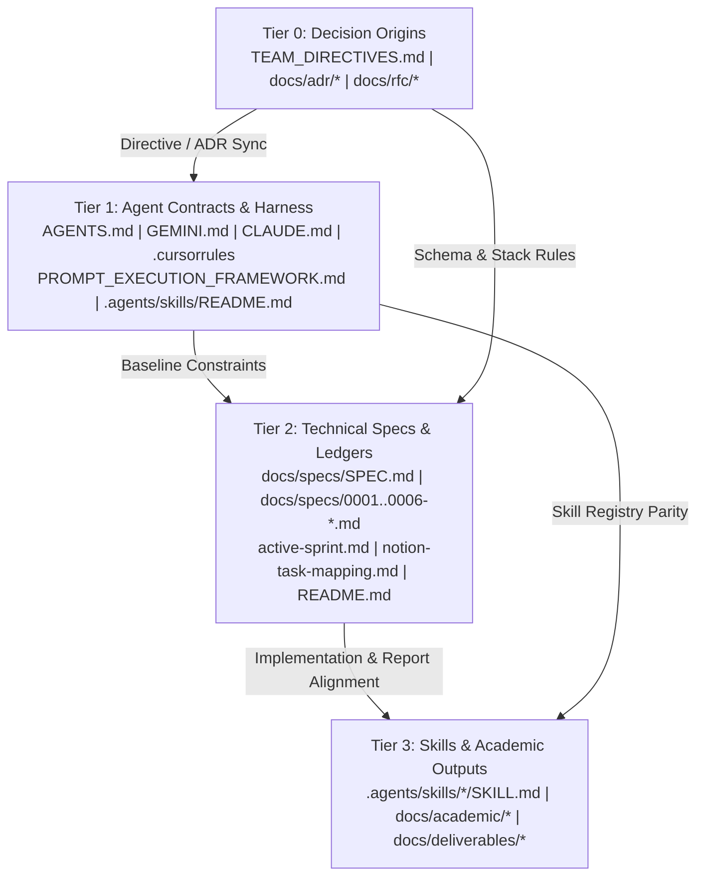

# Decision Dependency Graph & Propagation Tiers

Every architectural decision, team directive, schema update, or technology version lock in `acdp-platform` propagates downward through four tiers. Updating only a leaf specification or only `TEAM_DIRECTIVES.md` creates context rot across agent contracts and documentation portals.

---

## 1. 4-Tier Propagation Topology

---

## 2. Blast-Radius Propagation Matrix

Use this matrix alongside `audit_doc_drift.py --impact <keyword>` to identify every document requiring synchronization after a decision.

| Decision Category | Primary Origin (Tier 0) | Required Downstream Targets (Tiers 1–3) | Deterministic Check |
| :--- | :--- | :--- | :--- |
| New or modified Team Directive (`DIR-XXX`) | `docs/frameworks/TEAM_DIRECTIVES.md` | `AGENTS.md`, `GEMINI.md`, `.agents/skills/doc-decision-sync/references/decision_rules.json`, and any matching spec | `DIRECTIVE-SYNC` |
| Tech stack version or component change | `docs/frameworks/TEAM_DIRECTIVES.md` or `docs/adr/*` or `docs/rfc/*` | `AGENTS.md`, `GEMINI.md`, `README.md`, `docs/specs/SPEC.md`, affected `docs/specs/000X-*.md`, `docs/tasks/active-sprint.md`, affected `SKILL.md` | `CANONICAL-FACT-DRIFT` |
| Python module or schema path refactor | `docs/specs/0001-*.md`, `0002-*.md`, `0003-*.md` | `README.md`, `docs/specs/SPEC.md`, `docs/tasks/active-sprint.md`, `docs/tasks/notion-task-mapping.md`, `SKILL.md` files | `INTERNAL-LINK-INTEGRITY` + `CANONICAL-FACT-DRIFT` |
| Adding, renaming, or retiring a Skill | `.agents/skills/<name>/SKILL.md` | `AGENTS.md`, `GEMINI.md`, `CLAUDE.md`, `.cursorrules`, `.agents/skills/README.md` (including total skill count) | `SKILL-REGISTRY-PARITY` + `DRIFT-004` |
| Web API DTO or Frontend route change | `docs/specs/0004-*.md`, `0005-*.md` | `docs/specs/SPEC.md`, `docs/tasks/active-sprint.md`, `.agents/skills/frontend-designer/SKILL.md` | `--impact` + `INTERNAL-LINK-INTEGRITY` |
| Notion task completion or deliverable creation | `docs/deliverables/NT-XXX-*.md` | `docs/tasks/notion-task-mapping.md`, `docs/tasks/active-sprint.md`, `docs/rd-tasks/README.md` | `INTERNAL-LINK-INTEGRITY` |

---

## 3. Canonical Rules Manifest Schema (`decision_rules.json`)

The file `references/decision_rules.json` acts as the machine-readable Single Source of Truth for `scripts/audit_doc_drift.py`:

1. `required_directives_in_agent_contracts`. Lists universal directives (`DIR-007`, `DIR-008`, `DIR-011` through `DIR-017`) that must appear explicitly in both `AGENTS.md` and `GEMINI.md`.
2. `scoped_directives`. Lists directives defined in `TEAM_DIRECTIVES.md` that apply to specific domains (`DIR-001` through `DIR-006`, `DIR-009`, `DIR-010`) so new uncategorized directives added to `TEAM_DIRECTIVES.md` cannot slip past review.
3. `skill_registry_targets`. Lists contract files (`AGENTS.md`, `GEMINI.md`, `CLAUDE.md`, `.agents/skills/README.md`) where every `.agents/skills/<name>/` directory must be registered.
4. `drift_rules`. Defines regex patterns for retired file paths, superseded framework versions, contradicted exclusions, and entity naming violations along with exact target globs and exclusion markers.
