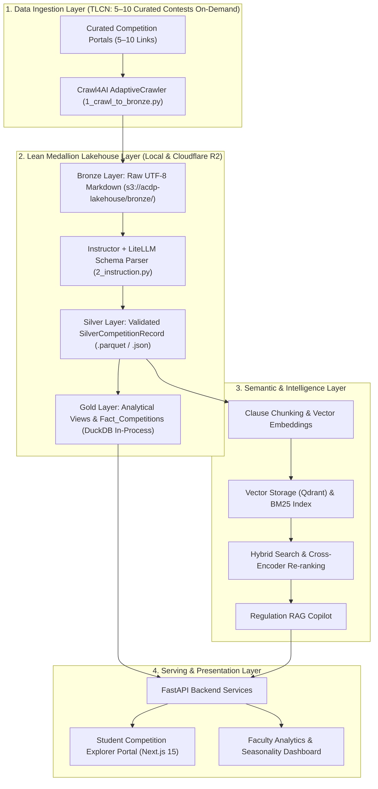

# ACDP: Academic Competition Discovery Platform
> **Building a Data Pipeline and Platform for Academic Competition Discovery, Knowledge Management, and Teammate Recommendation**

[](LICENSE)
[](https://www.python.org/)
[](https://docs.astral.sh/uv/)
[-success.svg)](docs/tasks/roadmap.md)

An end-to-end data platform developed at **Ho Chi Minh City University of Technology and Engineering (HCM-UTE)** that automates academic competition ingestion, provides RAG-powered regulation query assistants, enables intelligent teammate matchmaking, and delivers faculty-level analytical dashboards.

---

[Overview](#overview) • [Key Features](#key-features) • [Architecture](#system-architecture) • [Data Storage](data/README.md) • [Tech Stack](#technology-governance--lean-mvp-architecture) • [Documentation](docs/README.md) • [User & AI Guide](docs/HOW_TO_USE.md) • [Getting Started](#getting-started) • [Contributors & Advisor](#contributors--advisor)

---

## Overview

Academic competitions, hackathons, and talent programs (such as ICPC, National Student Olympiad in Informatics, Euréka, AI Challenge TP.HCM, and Code Tour) are vital for students to gain hands-on engineering experience. However, students and academic institutions face four core bottlenecks:

- **Scattered Information**: Announcements are fragmented across external portals and social media fanpages, causing missed registration deadlines.
- **Rule Navigation & Knowledge Gap**: Complex rulebooks and the absence of centralized historical repositories hinder student preparation.
- **Team Formation & Mentorship Friction**: Difficulties in identifying cross-functional peers and connecting with faculty advisors whose research matches the competition theme.
- **Lack of Institutional Visibility**: Faculty leadership lacks consolidated analytics on student engagement, domain trends, and seasonal distribution.

**ACDP** addresses these bottlenecks through a two-phase academic roadmap:
1. **Phase 1 — Special Topic Project (Tiểu luận chuyên ngành - TLCN, 15-Week Lean MVP)**: Simulates the end-to-end data platform and validates technical feasibility over a curated dataset of **5–10 representative competition links** crawled on-demand (`Crawl4AI` $\rightarrow$ `Cloudflare R2 / Local` raw Markdown $\rightarrow$ `Instructor + Pydantic v2` structured extraction $\rightarrow$ `DuckDB` analytics & `Hybrid RAG`).
2. **Phase 2 — Graduation Thesis (Khóa luận tốt nghiệp - KLTN, 15-Week Full System)**: Scales to automated periodic batch and realtime ingestion across nationwide sources, multi-channel entity deduplication, teammate recommendation, and faculty advisor alignment.

---

## Key Features

- **On-Demand & Adaptive Web Ingestion**: Headless browser crawlers (`Crawl4AI` & `Playwright`) extract clean UTF-8 Markdown from dynamic competition websites (`src/acdp/1_crawl_to_bronze.py`), while `Instructor` and `LiteLLM` enforce structured JSON/Parquet schemas via `Pydantic v2` (`src/acdp/2_instruction.py`).
- **Lean Medallion Lakehouse Architecture**: Tiered data processing ([`data/`](data/README.md) & **Cloudflare R2**: `Bronze` raw UTF-8 Markdown $\rightarrow$ `Silver` validated `SilverCompetitionRecord` entities $\rightarrow$ `Gold` analytical views queried in-process via `DuckDB`).
- **AI-Powered Regulation Copilot**: Hybrid Search (lexical BM25 + Qdrant dense vector retrieval) with Cross-Encoder re-ranking grounded in official contest regulations.
- **Teammate & Advisor Matchmaking (Phase 2 KLTN)**: Vector skill complementarity and heuristic filters matching students with peers and faculty research domains.
- **Interactive Student Portal & BI Dashboard**: Responsive Next.js 15 web application and administrative dashboards tracking competition seasonality and prize distributions.

---

## System Architecture



> 📖 **Data Architecture Reference**: For physical layout, the 7 reproducible sample competitions (`data/raw/`), and Cloudflare R2 synchronization instructions, see [`data/README.md`](data/README.md) and [`docs/deliverables/HUONG_DAN_MIGRATE_R2_LAKEHOUSE.md`](docs/deliverables/HUONG_DAN_MIGRATE_R2_LAKEHOUSE.md).

---

## Technology Governance & Lean MVP Architecture

> [!NOTE]
> **Lean TLCN Scope & Minimalist Stack (DIR-015)**:  
> Following comprehensive first-principles R&D under [`docs/rd-tasks/`](docs/rd-tasks/), the team enforces a strict separation between **Phase 1 (TLCN Feasibility MVP: 5–10 competitions)** and **Phase 2 (KLTN High-Volume Scale)**. To eliminate over-engineering on a 5–10 competition dataset ($\sim 1\text{ MB}$), unnecessary intermediate binary compression (`zstandard`) and heavy container daemons (`SeaweedFS`, `PostgreSQL`, `dbt-core`) are excluded from the Phase 1 execution path.

| Architecture Layer | Phase 1 (TLCN: 5–10 Competitions On-Demand) | Phase 2 (KLTN: Large-Scale & Automated) | Active Spec / Deliverable |
| :--- | :--- | :--- | :--- |
| **Ingestion & Crawling** | `Crawl4AI` (`AdaptiveCrawler`) executed on-demand over 5–10 curated URLs | Automated batch scheduler (HTTP `ETag`), search discovery & webhooks | [`SPEC-0002`](docs/specs/0002-data-ingestion-and-schema-spec.md) / [`1_crawl_to_bronze.py`](src/acdp/1_crawl_to_bronze.py) |
| **Bronze Layer Storage** | Raw UTF-8 Markdown (`.md`) on **Local Files** & **Cloudflare R2** (`boto3`) | High-volume compaction, `SeaweedFS` Haystack object store | [`NT-018`](docs/deliverables/NT-018-bronze-storage-and-table-format-evaluation.md) / [`HUONG_DAN_MIGRATE_R2_LAKEHOUSE.md`](docs/deliverables/HUONG_DAN_MIGRATE_R2_LAKEHOUSE.md) |
| **Silver Extraction & Schema** | `Instructor` + `LiteLLM` + `Pydantic v2` (`SilverCompetitionRecord` $\rightarrow$ Parquet/JSON) | Multi-channel fuzzy Levenshtein entity resolution | [`schema.py`](src/acdp/lakehouse/schema.py) / [`2_instruction.py`](src/acdp/2_instruction.py) |
| **Gold Analytics & OLAP** | **DuckDB** in-process SQL directly over R2 / Local Parquet | Hybrid OLAP (DuckDB) + Transactional OLTP (PostgreSQL) | [`SPEC-0001`](docs/specs/0001-system-foundation-spec.md) / [`NT-013`](docs/deliverables/NT-013-business-technical-feasibility-review.md) |
| **Semantic RAG Copilot** | Clause chunking + Hybrid Search (`BM25` + `Qdrant`) + Ragas evaluation | Multi-modal PDF/Poster OCR & Historical Knowledge Vault | Phase 1 Weeks 11–12 (`NT-012`) |

---

## Roadmap & Project Scope

The project is conducted within the **Major in Data Engineering**, Faculty of Information Technology at **Trường Đại học Công nghệ Kỹ thuật TP.HCM (HCM-UTE)**, structured across two consecutive 15-week phases:

### Phase 1: Special Topic Project (Tiểu luận chuyên ngành - 15-Week Lean MVP)
- [x] Problem formulation, business feasibility (`T01`), competition survey (`T02`), and thesis introduction (`T08_v2`).
- [x] On-demand ingestion pipeline covering 7 representative competition sources (`data/raw/` & `src/acdp/1_crawl_to_bronze.py`) synced to Cloudflare R2.
- [x] Silver layer Pydantic v2 data contract (`SilverCompetitionRecord`) and deterministic deduplication fingerprinting (`src/acdp/lakehouse/schema.py`).
- [ ] Automated Bronze-to-Silver LLM structured extraction (`src/acdp/2_instruction.py`) and DuckDB Gold analytical queries (In Progress - Week 9–10).
- [ ] Core RAG copilot for contest rules and guideline Q&A over the 5–10 competition dataset.
- [ ] MVP web portal for contest exploration and faculty analytics dashboard.

### Phase 2: Graduation Thesis (Khóa luận tốt nghiệp - 15-Week Full System)
- [ ] Large-scale automated crawling via periodic batch jobs (Seasonality Scheduler) and live webhook feeds.
- [ ] Multi-channel fuzzy deduplication and high-volume Lakehouse compaction.
- [ ] Production teammate recommendation algorithm and faculty research matchmaking.
- [ ] Historical knowledge repository with past winning solutions and automated student activity credit (*điểm rèn luyện*) integration.

---

## Getting Started

### Prerequisites
- [Python 3.11+ / 3.13+](https://www.python.org/downloads/)
- [`uv` Python Package Manager](https://docs.astral.sh/uv/)

### 1. Install Dependencies
```bash
uv sync
```

### 2. Environment Configuration
Create a `.env` file in the project root:
```bash
cp .env.example .env
```
Configure your Cloudflare R2 and LLM credentials in `.env`:
```env
BUCKET_NAME=acdp-lakehouse
BRONZE_STORAGE_BACKEND=local
BRONZE_STORAGE_URI=./data/lakehouse/bronze
SILVER_STORAGE_URI=./data/lakehouse/silver
GOLD_STORAGE_URI=./data/lakehouse/gold

# Cloudflare R2 Credentials (for team sync)
AWS_ENDPOINT_URL=https://<account_id>.r2.cloudflarestorage.com
AWS_ACCESS_KEY_ID=your_r2_access_key
AWS_SECRET_ACCESS_KEY=your_r2_secret_key
AWS_REGION=auto

# LLM API Keys
GEMINI_API_KEY=your_gemini_api_key
```

### 3. Run Unit Tests & Sample Pipeline
```bash
# Run Bronze and Silver schema verification suite
uv run pytest -v

# Run on-demand Crawl4AI ingestion to Cloudflare R2
uv run python src/acdp/1_crawl_to_bronze.py
```

---

## Contributors & Advisor

### Core Authors
- **Do Kien Hung (Đỗ Kiến Hưng)**  
  Student ID: `23133030`  
  Major in Data Engineering, Faculty of Information Technology  
  Trường Đại học Công nghệ Kỹ thuật TP.HCM (HCM-UTE)  
  GitHub: [@darktheDE](https://github.com/darktheDE)

- **Nguyen Van Quang Duy (Nguyễn Văn Quang Duy)**  
  Student ID: `23110086`  
  Major in Data Engineering, Faculty of Information Technology  
  Trường Đại học Công nghệ Kỹ thuật TP.HCM (HCM-UTE)  
  GitHub: [@QuangDuyReal](https://github.com/QuangDuyReal)

### Scientific Advisor
- **M.Sc. Tran Quang Khai (ThS. Trần Quang Khải)**  
  Lecturer, Faculty of Information Technology  
  Trường Đại học Công nghệ Kỹ thuật TP.HCM (HCM-UTE)

---

## License

This project is licensed under the [MIT License](LICENSE).
