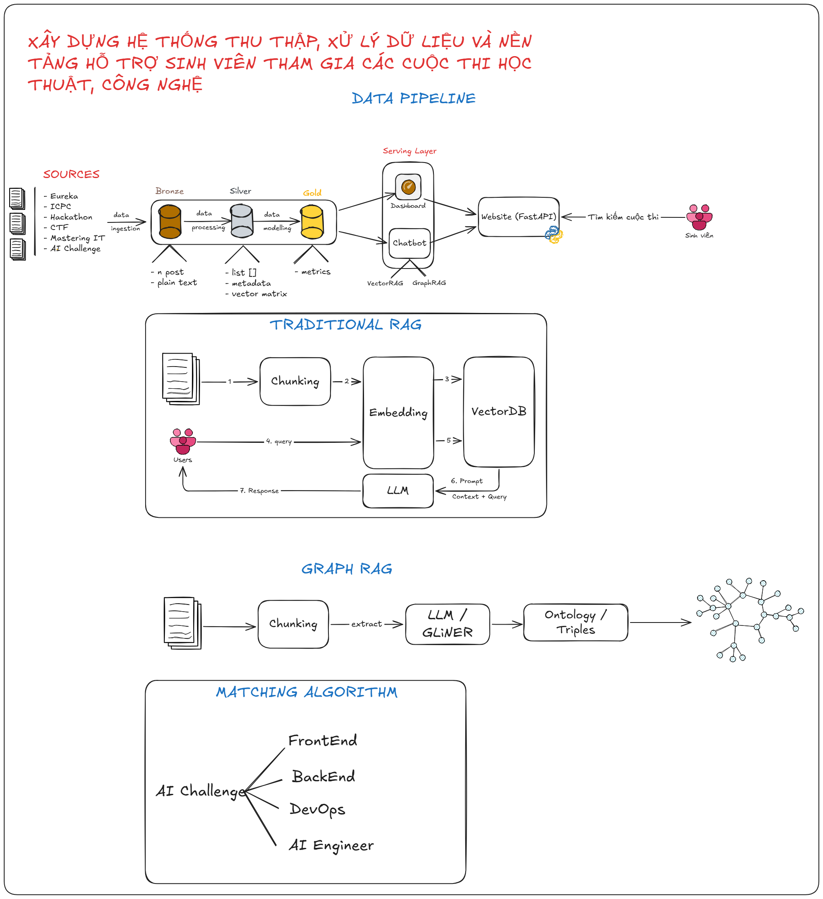

# ACDP: Academic Competition Discovery Platform

An end-to-end data engineering platform that automates student tech competition discovery, delivers DuckDB Gold OLAP analytics, and provides a grounded rulebook Q&A copilot.

---

## 1. Overview and problem statement

Academic hackathons, AI/Data challenges, cybersecurity CTFs, and coding contests are fragmented across organizer websites, university portals, and social media. Each source formats deadlines, prize currencies, and team eligibility differently, forcing students to manually read scattered pages while faculty advisors lack quantitative trends across academic terms.

ACDP consolidates competition data through a Cloudflare R2 Medallion Lakehouse (`v2`), serves dimensional marts via DuckDB `httpfs` and FastAPI, pairs transactional user features with PostgreSQL 18 (Supabase), and grounds rulebook answers in Qdrant with direct official-source citations.

---

## 2. System architecture



**Cloud-Native Full-Stack Topology (`ADR-0002`):**

| Layer | Role & Implementation | Reference |
| :--- | :--- | :--- |
| Lakehouse Storage (`DIR-021`) | Cloudflare R2 (`bronze/`, `silver/`, `gold/`, `backups/oltp/`) with zero local disk persistence | [`src/acdp/config.py`](src/acdp/config.py) |
| Serving & Auth (`SPEC-0004`) | FastAPI OpenAPI 3.1 gateway reading Gold Parquet via DuckDB `httpfs` (TTL cached) + Supabase / PostgreSQL 18 OLTP | [`src/acdp/api/main.py`](src/acdp/api/main.py) |
| Dual-Layer RAG (`TASK-CLD-06`) | Qdrant Cloud (`@cf/baai/bge-m3` 1024-dim + Gold OBT pre-filtering) and Gemini 3.5 Flash Lite -> Groq -> OpenRouter `:free` fallback | [`src/acdp/api/services/rag_service.py`](src/acdp/api/services/rag_service.py) |
| Web Portal (`SPEC-0005`) | Next.js 16 (`apps/web/`, Vercel Hobby) with Tailwind CSS v4, Recharts analytics, explorer, bookmarks, AI assistant, and `/admin` | [`apps/web/`](apps/web/) |
| Cloud Ops & Backups | Daily GitHub Actions health/DQ check + weekly `pg_dump` backup to Cloudflare R2 | [`keep-alive.yml`](.github/workflows/keep-alive.yml) |

---

## 3. Medallion pipeline (`v2`) and tech stack

| Lakehouse Tier | Processing Scope & Target | Core Technology | Source Module |
| :--- | :--- | :--- | :--- |
| **3-Tier Discovery** | Sitemap/RSS/GDELT + Tavily/Exa/Serper Free Tier + ETag gatekeeper | `httpx` + `defusedxml` + `Pydantic v2` | [`src/acdp/v2/discovery.py`](src/acdp/v2/discovery.py) |
| **Bronze Layer** | Raw Rendered HTML capture (`*.html` + `ACDP_PAGE_BOUNDARY`) on R2 | `Crawl4AI` (`AdaptiveCrawler`) + `Cloudflare R2` | [`src/acdp/v2/bronze_crawl.py`](src/acdp/v2/bronze_crawl.py) |
| **Silver Layer** | Hybrid Deterministic Sandwich, Clean Markdown & `v2` Pydantic/Arrow schema | `Crawl4AI` + `Instructor` + `PyArrow` | [`src/acdp/v2/silver_transform.py`](src/acdp/v2/silver_transform.py), [`v2/schemas.py`](src/acdp/v2/schemas.py) |
| **Gold Layer (OLAP)** | Two-Tier Kimball Star Schema (`9` core + `6` mart Parquet) & MotherDuck SQL | **DuckDB** (`httpfs` over R2 Parquet) | [`src/acdp/v2/gold_star_schema.py`](src/acdp/v2/gold_star_schema.py), [`SPEC-0003`](docs/specs/0003-gold-dimensional-modeling-spec.md) |
| **Dual-Layer RAG & Eval** | Clean Markdown + Gold OBT metadata indexing & Ragas benchmark suite | `Qdrant` + `@cf/baai/bge-m3` + `Ragas` | [`src/acdp/v2/rag_ingest.py`](src/acdp/v2/rag_ingest.py), [`src/acdp/v2/rag_eval.py`](src/acdp/v2/rag_eval.py) |
| **Serving & Web (OLTP + UI)** | Transactional App DB, RBAC Admin, OWASP hardening, Student Portal | `FastAPI` + `PostgreSQL 18` + `Next.js 16` | [`SPEC.md`](docs/specs/SPEC.md), [`SPEC-0004`](docs/specs/0004-serving-api-and-oltp-spec.md), [`SPEC-0005`](docs/specs/0005-frontend-design-system-and-ux-spec.md) |
| **Cloud Ops** | Keep-alive pings, Gold/Vector/OLTP DQ checks & weekly `pg_dump` backup | `httpx` + `pg_dump` + GitHub Actions | [`src/acdp/v2/cloud_ops.py`](src/acdp/v2/cloud_ops.py), [`keep-alive.yml`](.github/workflows/keep-alive.yml) |

*(Legacy `v1` modules [`src/acdp/1_crawl_to_bronze.py`](src/acdp/1_crawl_to_bronze.py), [`2_instruction.py`](src/acdp/2_instruction.py), [`3_ingest_to_qdrant.py`](src/acdp/3_ingest_to_qdrant.py), and [`4_analytics_gold.py`](src/acdp/4_analytics_gold.py) remain preserved per `DIR-022`.)*

---

## 4. Repository layout

```text
acdp-platform/
├── .github/workflows/        # GitHub Actions (keep-alive.yml: daily DQ ping & weekly pg_dump)
├── apps/web/                 # Next.js 16 + Tailwind CSS v4 + Recharts portal (Student UI + Admin Console)
├── scripts/                  # Local dev helpers (seed_local_users.py)
├── src/acdp/
│   ├── api/                  # FastAPI gateway (PG18 OLTP, DuckDB R2 httpfs, Qdrant RAG, RBAC /admin)
│   ├── flows/                # Prefect 3.x Medallion orchestration flows
│   ├── v2/                   # Cycle 06+ production pipeline (discovery, bronze, silver, gold, rag, cloud_ops)
│   ├── 1..4_*.py             # Legacy v1 pipeline scripts (preserved)
│   ├── config.py             # Unified Pydantic v2 AppConfig (R2, PG18, Qdrant, LLM fallback, Rate Limits)
│   └── schemas.py            # v1 Pydantic v2 data contracts
├── tests/                    # Unit, pipeline v2, infra (SPEC-0006) & FastAPI integration tests
├── docs/                     # Specs (SPEC-0001..0006), ADRs (0001..0002), experiments, deliverables, tasks
├── docker-compose.yml        # Profiles: core (Web+API+PG18), local-backup (Qdrant), bi (Metabase), pipeline (Prefect)
├── Dockerfile.api            # Slim FastAPI production image (Python 3.13, pre-installed DuckDB httpfs)
├── openapi.json              # Exported OpenAPI 3.1 contract for Frontend TypeScript codegen
├── pyproject.toml            # Python dependencies & optional extras (uv)
├── .env.example / .env.dev   # Environment templates (Cloud vs Local Dev)
└── README.md
```

---

## 5. Quickstart

### Step 1: Install dependencies
```bash
# Core API + Runtime + Dev test tools
uv sync

# Full host environment (adds Crawl4AI, Instructor, Vector Ingestion, Prefect, Ragas)
uv sync --all-extras
```

### Step 2: Configure environment (local dev vs production)
Copy `.env.dev` to `.env` for local development (sets `POSTGRES_MODE=local` for `acdp-postgres`, `ENVIRONMENT=development`, and `http://localhost:3000` CORS):
```bash
cp .env.dev .env
```
For production, never store secrets locally. Configure `SUPABASE_DATABASE_URL`, `SUPABASE_DIRECT_URL`, `QDRANT_CLUSTER_ENDPOINT`, `QDRANT_API_KEY`, `JWT_SECRET_KEY`, `ADMIN_EMAILS`, and `ENVIRONMENT=production` in **Hugging Face Spaces Secrets** (Backend) and **Vercel Environment Variables** (Frontend).

*(Required in `.env` for Cloudflare R2 & Workers AI: `BUCKET_NAME`, `AWS_ENDPOINT_URL`, `AWS_ACCESS_KEY_ID`, `AWS_SECRET_ACCESS_KEY`, `CLOUDFLARE_API_TOKEN`, `CLOUDFLARE_ACCOUNT_ID`; primary LLM: `GEMINI_API_KEY`, optional fallback: `GROQ_API_KEY`, `OPENROUTER_API_KEY`; optional Tier-2 Discovery: `TAVILY_API_KEY`, `EXA_API_KEY`, `SERPER_API_KEY`.)*

### Step 3: Run local stack (Docker or native)

#### Option A: Full-stack via Docker (recommended)
```powershell
# Launch Web (:3000), FastAPI (:8000), and PostgreSQL 18 (:5432)
docker compose --profile core up -d --build --pull always --remove-orphans

# Optional: include local Qdrant (:6333) when not using Qdrant Cloud
docker compose --profile core --profile local-backup up -d --build
```

#### Option B: Native local dev (hot-reload)
```powershell
# 1. Start PostgreSQL 18 container
docker compose --profile core up -d postgres

# 2. Optional: seed local admin@acdp.dev and user@acdp.dev accounts
uv run python scripts/seed_local_users.py

# 3. Run FastAPI backend (port 8000)
uv run uvicorn acdp.api.main:app --reload --host 0.0.0.0 --port 8000

# 4. Run Next.js 16 frontend (port 3000)
npm --prefix apps/web run dev
```

### Step 4: Run verification, `v2` pipeline, and OpenAPI codegen
```powershell
# 1. Run backend test suite & linter
uv run pytest -v
uv run ruff check src tests scripts

# 2. Export OpenAPI 3.1 contract & verify Frontend TypeScript + build
uv run python -m acdp.api.export_openapi --output openapi.json
npm --prefix apps/web run gen:api
npm --prefix apps/web run typecheck
npm --prefix apps/web run build

# 3. Run ACDP v2 Medallion pipeline (Cloudflare R2 Exclusive)
uv run python -m acdp.v2.discovery --include-seeds --check-http
uv run python -m acdp.v2.bronze_crawl --all-sources
uv run python -m acdp.v2.silver_transform --extract
uv run python -m acdp.v2.gold_star_schema --export-silver-r2 --build-gold-r2 --verify
uv run python -m acdp.v2.rag_ingest

# 4. (Optional) Run Dual-Layer RAG Ragas evaluation or Metabase BI (:3001)
uv run python -m acdp.v2.rag_eval --limit 5
uv run python -m acdp.v2.gold_star_schema --metabase-sql
docker compose --profile bi up -d metabase
```

---

## 6. Contributors and scientific advisor

### Core authors
- Đỗ Kiến Hưng (MSSV: `23133030`), Data Engineering, FIT, HCM-UTE ([@darktheDE](https://github.com/darktheDE))
- Nguyễn Văn Quang Duy (MSSV: `23110086`), Data Engineering, FIT, HCM-UTE ([@QuangDuyReal](https://github.com/QuangDuyReal))

### Scientific advisor
- ThS. Trần Quang Khải, Giảng viên Khoa Công nghệ Thông tin, Trường Đại học Công nghệ Kỹ thuật TP.HCM (HCM-UTE)

---

## 7. License

This repository is licensed under the [MIT License](LICENSE).
