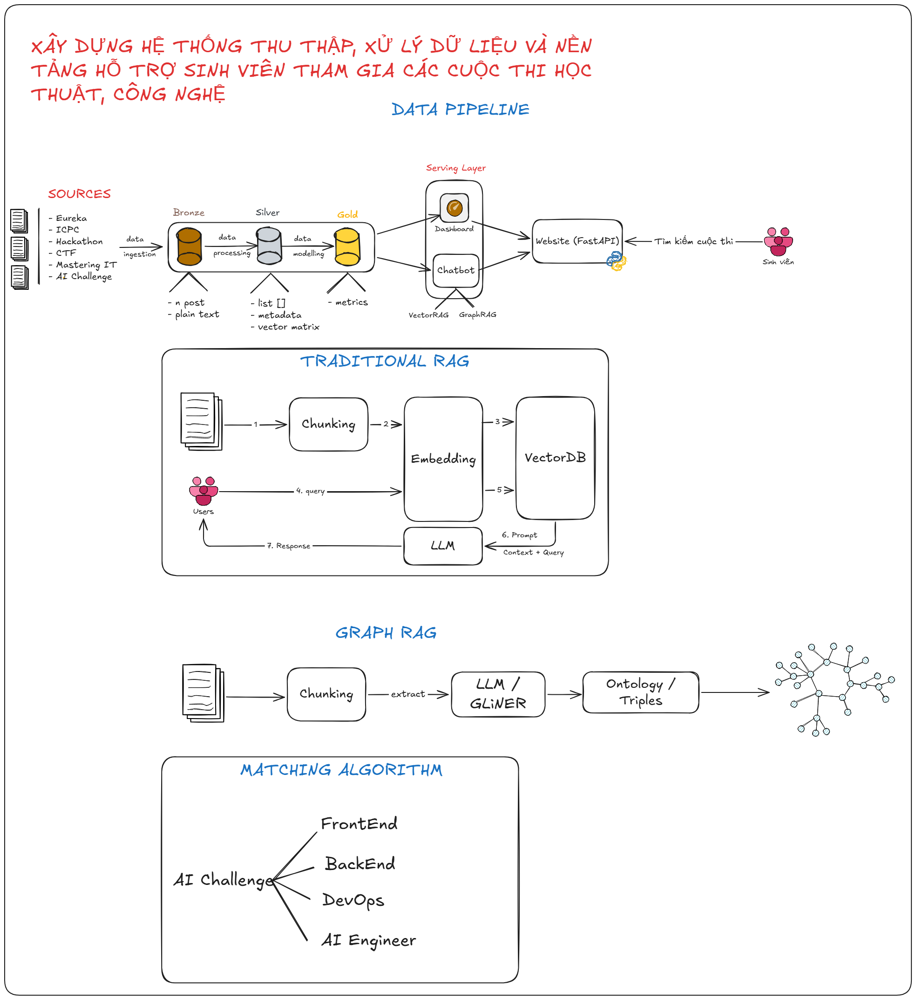

# ACDP: Academic Competition Discovery Platform

An end-to-end data engineering platform that automates competition discovery, provides a RAG-powered regulation query copilot, and delivers analytical OLAP marts.

---

## 1. Overview & Problem Statement

Academic hackathons, coding contests, and research challenges are crucial for student development. However, notices and rulebooks are fragmented across dynamic websites and social media, leading to missed deadlines and information asymmetry.

---

## 2. System Architecture



---

## 3. Medallion Pipeline & Tech Stack

| Lakehouse Tier | Processing Scope & Target | Core Technology | Source Module |
| :--- | :--- | :--- | :--- |
| **Bronze Layer** | Raw, lossless Markdown capture from dynamic web pages | `Crawl4AI` (`AdaptiveCrawler`) + `Cloudflare R2` (S3) | [`src/acdp/1_crawl_to_bronze.py`](src/acdp/1_crawl_to_bronze.py) |
| **Silver Layer** | Pydantic v2 structured extraction with few-shot prompting | `Instructor` + `LiteLLM` + `Pydantic v2` | [`src/acdp/2_instruction.py`](src/acdp/2_instruction.py), [`schemas.py`](src/acdp/schemas.py) |
| **Gold Layer** | In-process SQL OLAP analytics over Silver Parquet | **DuckDB** (`httpfs` extension) | [`src/acdp/config.py`](src/acdp/config.py), [`data/README.md`](data/README.md) |
| **Semantic RAG** | Regulation clause chunking, vector retrieval & chat UI | `Qdrant` + `Ollama` + `Google GenAI` + `Gradio` | [`src/acdp/3_chatbot_mvp.py`](src/acdp/3_chatbot_mvp.py) |

---

## 4. Repository Layout

```text
acdp-platform/
├── src/acdp/               # Core data pipeline and application modules
│   ├── 1_crawl_to_bronze.py    # Crawl4AI ingestion to Cloudflare R2 Bronze
│   ├── 2_instruction.py        # Instructor few-shot extraction to Silver JSON
│   ├── 3_chatbot_mvp.py        # RAG Regulation Chatbot with Qdrant & Gradio
│   ├── config.py               # Application & storage configuration (AppConfig)
│   └── schemas.py              # Pydantic v2 data contracts (Competition, PrizeTier)
├── data/
│   ├── raw/markdown/       # Curated fixtures for 7 reproducible sample competitions
│   └── lakehouse/          # Local Medallion tiers (Bronze, Silver, Gold, DuckDB)
├── tests/                  # Unit and integration test suites (100% Passed)
├── docs/                   # Academic manuscripts, architecture specs, ADRs, roadmap
│   ├── assets/             # Architecture diagrams, figures, and static media
│   ├── academic/           # TLCN report draft, registration & NCKH proposal
│   ├── specs/              # Technical specifications (SPEC-0001, SPEC-0002)
│   └── tasks/              # Active sprint context, Notion mapping & 15-week roadmap
├── pyproject.toml          # Python dependencies & build specification (uv)
└── README.md
```

---

## 5. Quickstart

### Step 1: Install Dependencies
```bash
uv sync
```

### Step 2: Configure Environment
Copy the template and provide your API keys:
```bash
cp .env.example .env
```
*(Required for Cloudflare R2 sync: `AWS_ENDPOINT_URL`, `AWS_ACCESS_KEY_ID`, `AWS_SECRET_ACCESS_KEY`; for RAG: `GEMINI_API_KEY`).*

### Step 3: Run Verification & Pipeline
```bash
# 1. Run unit tests
uv run pytest -v

# 2. Ingest competition pages to Bronze (R2 / Local)
uv run python src/acdp/1_crawl_to_bronze.py

# 3. Extract structured Silver schema using Instructor
uv run python src/acdp/2_instruction.py --extract

# 4. Launch RAG Regulation Chatbot (Gradio UI)
uv run python src/acdp/3_chatbot_mvp.py --chat
```

---

## 6. Contributors & Scientific Advisor

### Core Authors
- **Đỗ Kiến Hưng** (MSSV: `23133030`) — Data Engineering, FIT, HCM-UTE — [@darktheDE](https://github.com/darktheDE)
- **Nguyễn Văn Quang Duy** (MSSV: `23110086`) — Data Engineering, FIT, HCM-UTE — [@QuangDuyReal](https://github.com/QuangDuyReal)

### Scientific Advisor
- **ThS. Trần Quang Khải** — Giảng viên Khoa Công nghệ Thông tin, Trường Đại học Công nghệ Kỹ thuật TP.HCM (HCM-UTE)

---

## 7. License

This repository is licensed under the [MIT License](LICENSE).
