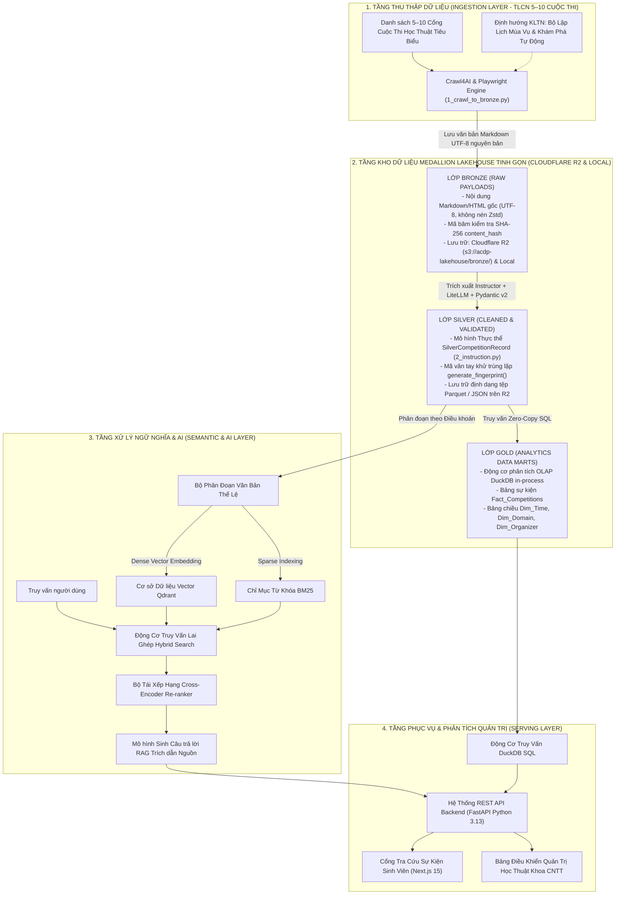

# BÁO CÁO TIỂU LUẬN CHUYÊN NGÀNH KỸ THUẬT DỮ LIỆU

**TRƯỜNG ĐẠI HỌC CÔNG NGHỆ KỸ THUẬT TP.HCM (HCM-UTE)**  
**KHOA CÔNG NGHỆ THÔNG TIN**  
**BỘ MÔN HỆ THỐNG THÔNG TIN**

---

**ĐỀ TÀI**:
## XÂY DỰNG HỆ THỐNG THU THẬP, XỬ LÝ DỮ LIỆU VÀ NỀN TẢNG HỖ TRỢ SINH VIÊN THAM GIA CÁC CUỘC THI HỌC THUẬT, CÔNG NGHỆ

**HỌC PHẦN**: TIỂU LUẬN CHUYÊN NGÀNH  
**CHUYÊN NGÀNH**: KỸ THUẬT DỮ LIỆU  
**HỌC KỲ 1 - NĂM HỌC 2026 - 2027**

**Sinh viên thực hiện**:
1. **Nguyễn Văn Quang Duy** — MSSV: `23110086`
2. **Đỗ Kiến Hưng** — MSSV: `23133030`

**Giáo viên hướng dẫn khoa học**:
**ThS. Trần Quang Khải**

---

*TP. Hồ Chí Minh, ngày 07 tháng 12 năm 2026*

\newpage

## PHIẾU NHẬN XÉT CỦA GIÁO VIÊN HƯỚNG DẪN

- **Họ và tên Sinh viên 1**: Nguyễn Văn Quang Duy — **MSSV 1**: 23110086
- **Họ và tên Sinh viên 2**: Đỗ Kiến Hưng — **MSSV 2**: 23133030
- **Ngành đào tạo**: Kỹ thuật Dữ liệu
- **Tên đề tài**: XÂY DỰNG HỆ THỐNG THU THẬP, XỬ LÝ DỮ LIỆU VÀ NỀN TẢNG HỖ TRỢ SINH VIÊN THAM GIA CÁC CUỘC THI HỌC THUẬT, CÔNG NGHỆ
- **Họ và tên Giáo viên hướng dẫn**: ThS. Trần Quang Khải

### NỘI DUNG NHẬN XÉT

1. **Về nội dung đề tài và khối lượng thực hiện**:
...................................................................................................................................................
...................................................................................................................................................
...................................................................................................................................................

2. **Ưu điểm**:
...................................................................................................................................................
...................................................................................................................................................
...................................................................................................................................................

3. **Khuyết điểm**:
...................................................................................................................................................
...................................................................................................................................................

4. **Đề nghị cho bảo vệ hay không**: ......................................................................................
5. **Đánh giá loại**: ...............................................................................................................
6. **Điểm số**: .......................................................................................................................

*TP. Hồ Chí Minh, ngày    tháng 12 năm 2026*  
**Giáo viên hướng dẫn**  
*(Ký và ghi rõ họ tên)*  
<br><br><br>
**ThS. Trần Quang Khải**

\newpage

## PHIẾU NHẬN XÉT CỦA GIÁO VIÊN PHẢN BIỆN

- **Họ và tên Sinh viên 1**: Nguyễn Văn Quang Duy — **MSSV 1**: 23110086
- **Họ và tên Sinh viên 2**: Đỗ Kiến Hưng — **MSSV 2**: 23133030
- **Ngành đào tạo**: Kỹ thuật Dữ liệu
- **Tên đề tài**: XÂY DỰNG HỆ THỐNG THU THẬP, XỬ LÝ DỮ LIỆU VÀ NỀN TẢNG HỖ TRỢ SINH VIÊN THAM GIA CÁC CUỘC THI HỌC THUẬT, CÔNG NGHỆ
- **Họ và tên Giáo viên phản biện**: ......................................................................................

### NỘI DUNG NHẬN XÉT

1. **Về nội dung đề tài và khối lượng thực hiện**:
...................................................................................................................................................
...................................................................................................................................................
...................................................................................................................................................

2. **Ưu điểm**:
...................................................................................................................................................
...................................................................................................................................................
...................................................................................................................................................

3. **Khuyết điểm**:
...................................................................................................................................................
...................................................................................................................................................

4. **Đề nghị cho bảo vệ hay không**: ......................................................................................
5. **Đánh giá loại**: ...............................................................................................................
6. **Điểm số**: .......................................................................................................................

*TP. Hồ Chí Minh, ngày    tháng 12 năm 2026*  
**Giáo viên phản biện**  
*(Ký và ghi rõ họ tên)*  
<br><br><br>

\newpage

## LỜI CẢM ƠN

Nhóm tác giả xin bày tỏ lòng biết ơn sâu sắc và chân thành nhất đến Ban Giám hiệu Trường Đại học Công nghệ Kỹ thuật TP.HCM (HCM-UTE), Ban Chủ nhiệm Khoa Công nghệ Thông tin, cùng quý Thầy Cô giảng dạy chuyên ngành Kỹ thuật Dữ liệu đã trang bị cho sinh viên những nền tảng kiến thức lý thuyết vững vàng và phương pháp luận nghiên cứu khoa học chuẩn mực trong suốt thời gian học tập tại trường.

Đặc biệt, nhóm tác giả xin gửi lời tri ân sâu sắc nhất tới **ThS. Trần Quang Khải** — Cán bộ hướng dẫn khoa học của đề tài. Thầy đã luôn dành thời gian quý báu để định hướng kiến trúc, phản biện nghiêm cẩn các giải pháp kỹ thuật, chia sẻ những kinh nghiệm thực tiễn quý giá và tận tình chỉ dẫn nhóm trong từng giai đoạn triển khai đề tài Tiểu luận chuyên ngành. Sự động viên và góp ý học thuật sâu sắc của Thầy là điểm tựa vững chắc giúp nhóm vượt qua các rào cản kỹ thuật phức tạp để hoàn thành đề tài.

Nhóm tác giả cũng xin gửi lời cảm ơn chân thành đến gia đình, các bạn sinh viên Khoa Công nghệ Thông tin đã nhiệt tình tham gia các đợt khảo sát, đóng góp ý kiến thực tế và hỗ trợ kiểm thử hệ thống mẫu trong suốt 15 tuần nghiên cứu.

Dù nhóm tác giả đã nỗ lực tối đa để nghiên cứu và cài đặt hệ thống một cách chỉn chu nhất, báo cáo chắc chắn không tránh khỏi những thiếu sót nhất định. Nhóm tác giả rất mong nhận được những nhận xét, góp ý quý báu từ quý Thầy Cô trong Hội đồng phản biện để tiếp tục hoàn thiện hệ thống trong học phần Khóa luận tốt nghiệp tiếp theo.

*TP. Hồ Chí Minh, tháng 12 năm 2026*  
**Nhóm tác giả đề tài**  
**Nguyễn Văn Quang Duy & Đỗ Kiến Hưng**

\newpage

## ĐỀ CƯƠNG TIỂU LUẬN CHUYÊN NGÀNH

- **Sinh viên thực hiện 1**: Nguyễn Văn Quang Duy — **MSSV**: 23110086
- **Sinh viên thực hiện 2**: Đỗ Kiến Hưng — **MSSV**: 23133030
- **Thời gian thực hiện**: Từ ngày 31/08/2026 đến ngày 15/12/2026
- **Chuyên ngành**: Kỹ thuật Dữ liệu
- **Tên tiểu luận**: XÂY DỰNG HỆ THỐNG THU THẬP, XỬ LÝ DỮ LIỆU VÀ NỀN TẢNG HỖ TRỢ SINH VIÊN THAM GIA CÁC CUỘC THI HỌC THUẬT, CÔNG NGHỆ
- **Giáo viên hướng dẫn**: ThS. Trần Quang Khải

### Nhiệm Vụ Của Tiểu Luận:
1. Khảo sát thực trạng tiếp cận thông tin, phân tích nhu cầu và các rào cản thực tế của sinh viên Khoa Công nghệ Thông tin - HCM-UTE khi tham gia các kỳ thi học thuật và công nghệ.
2. Xây dựng và kiểm chứng tính khả thi của đường ống thu thập dữ liệu (Ingestion Pipeline) trên tập 5 đến 10 cuộc thi học thuật tiêu biểu bằng công nghệ tự động hóa trình duyệt Crawl4AI và Playwright (chạy theo yêu cầu trong giai đoạn Tiểu luận chuyên ngành, tạo tiền đề mở rộng thu thập tự động quy mô lớn ở giai đoạn Khóa luận tốt nghiệp).
3. Thiết kế và triển khai kho lưu trữ phân tầng Medallion Lakehouse tinh gọn:
   - Tầng Bronze: Lưu trữ trực tiếp văn bản Markdown/HTML nguyên bản (UTF-8) trên kho đối tượng đám mây Cloudflare R2 và ổ cứng cục bộ, tối giản hóa luồng xử lý phù hợp với quy mô 5–10 cuộc thi (không dùng nén nhị phân Zstandard trung gian).
   - Tầng Silver: Xây dựng lược đồ dữ liệu chuẩn hóa Pydantic v2 (SilverCompetitionRecord) với các trường thuộc tính định lượng dễ cào và người dùng quan tâm nhất, kết hợp thư viện instructor và mô hình ngôn ngữ lớn để trích xuất cấu trúc văn bản sang định dạng Parquet/JSON.
   - Tầng Gold: Thiết lập các truy vấn phân tích trực tuyến (OLAP) trực tiếp bằng động cơ DuckDB in-process phục vụ bảng điều khiển quản trị.
4. Xây dựng dịch vụ truy vấn thông minh Hybrid RAG (kết hợp thuật toán tìm kiếm từ khóa BM25 và tìm kiếm vector ngữ nghĩa trên Qdrant cùng mô hình Cross-Encoder re-ranking), hỗ trợ tra cứu quy chế, mốc thời gian và điều kiện dự thi với độ tin cậy trích dẫn cao, không phát sinh ảo giác.
5. Xây dựng giao diện ứng dụng Web người dùng MVP (Next.js 15, Tailwind CSS) cho phép tìm kiếm, lọc sự kiện, hỏi đáp thể lệ và bảng điều khiển phân tích số liệu mùa vụ cho đơn vị quản lý đào tạo.

### Kế Hoạch Thực Hiện Và Tiến Độ Thực Tế:

Tiến độ thực hiện học phần Tiểu luận chuyên ngành tính đến thời điểm báo cáo (Tuần 9) được tổng hợp chi tiết trong Bảng 1.1, phân định rõ các công việc **ĐÃ LÀM** (Tuần 1–9), công việc **SẼ LÀM TRONG TUẦN TỚI** (Tuần 10) và kế hoạch dự kiến cho các tuần tiếp theo:

#### Bảng 1.1: Báo cáo kế hoạch và tiến độ thực tế học phần Tiểu luận chuyên ngành

| STT | Tuần / Thời gian | Tình trạng | Nội dung công việc chi tiết | Sản phẩm bàn giao | Phụ trách |
| :---: | :---: | :---: | :--- | :--- | :---: |
| 1 | Tuần 1 (31/8 - 6/9) | **ĐÃ LÀM** | Khảo sát thực tế nhu cầu sinh viên FIT-HCMUTE; phân tích 4 nút thắt thực tế; thiết lập kho lưu trữ Git và cấu hình dự án. | Bản khảo sát nhu cầu; Cấu hình kho lưu trữ ban đầu. | Đỗ Kiến Hưng<br>Nguyễn Văn Quang Duy |
| 2 | Tuần 2 (7/9 - 13/9) | **ĐÃ LÀM** | Nghiên cứu tổng quan tài liệu khoa học quốc tế (Cho, Armbrust, Xu, Lewis); đối sánh các nền tảng thực tế (Devpost, Unstop, Ybox); khởi tạo R&D Task T01 và T02. | Báo cáo nghiên cứu R&D T01, T02; Bảng đối sánh hệ thống. | Nguyễn Văn Quang Duy |
| 3 | Tuần 3 (14/9 - 20/9) | **ĐÃ LÀM** | Thiết kế kiến trúc phân tầng 4 lớp; phân định ranh giới 15 tuần TLCN (mô phỏng khả thi trên 5–10 cuộc thi) và KLTN (mở rộng quy mô và tự động hóa); báo cáo đề cương với GVHD ThS. Trần Quang Khải. | Đề cương chi tiết đề tài; Bản vẽ kiến trúc dữ liệu. | Đỗ Kiến Hưng<br>Nguyễn Văn Quang Duy |
| 4 | Tuần 4 (21/9 - 27/9) | **ĐÃ LÀM** | Đánh giá công cụ cào web động Playwright và Crawl4AI; thu thập bộ dữ liệu kiểm thử thực tế từ 7 cuộc thi trọng điểm (Code Tour, AI Challenge TP.HCM, DataDNA, HackAITHON...). | Bộ dữ liệu mẫu tại data/raw/html/ và data/raw/markdown/. | Nguyễn Văn Quang Duy<br>Đỗ Kiến Hưng |
| 5 | Tuần 5 (28/9 - 4/10) | **ĐÃ LÀM** | Nghiên cứu sâu tầng lưu trữ Bronze (Task T13); đánh giá các phương án lưu trữ (Local SSD, Cloudflare R2, SeaweedFS) và định dạng bảng; chốt cấu hình tối giản cho quy mô 5–10 cuộc thi của TLCN. | Báo cáo nghiệm thu NT-018; Đặc tả SPEC-0001 & SPEC-0002. | Nguyễn Văn Quang Duy<br>Đỗ Kiến Hưng |
| 6 | Tuần 6 (5/10 - 11/10) | **ĐÃ LÀM** | Cài đặt tiện ích lưu trữ tầng Bronze (src/acdp/lakehouse/bronze.py) lưu văn bản UTF-8 nguyên bản và truy vấn qua DuckDB. | Module src/acdp/lakehouse/bronze.py; 5 bài test 	est_bronze_storage.py (100% Passed). | Đỗ Kiến Hưng |
| 7 | Tuần 7 (12/10 - 18/10) | **ĐÃ LÀM** | Thiết kế lược đồ dữ liệu lớp Bạc (Silver Schema) trên Pydantic v2 với các trường định lượng dễ cào và người dùng quan tâm nhất; xây dựng mã băm generate_fingerprint() và kiểm kiểu tài chính. | Lược đồ SilverCompetitionRecord; Kiểm thử xác thực 	est_silver_schema.py (100% Passed). | Nguyễn Văn Quang Duy |
| 8 | Tuần 8 (19/10 - 25/10) | **ĐÃ LÀM** | Thiết lập Bucket cdp-lakehouse trên Cloudflare R2; xây dựng tài liệu kỹ thuật hướng dẫn đồng bộ dữ liệu đám mây và soạn thảo báo cáo tới Lớp Bạc. | Tài liệu HUONG_DAN_MIGRATE_R2_LAKEHOUSE.md (NT-022); Bản thảo báo cáo TLCN. | Đỗ Kiến Hưng<br>Nguyễn Văn Quang Duy |
| 9 | Tuần 9 (26/10 - 1/11) | **ĐÃ LÀM** | Cài đặt kịch bản src/acdp/1_crawl_to_bronze.py tích hợp Crawl4AI AdaptiveCrawler đẩy trực tiếp văn bản Markdown của 7 cuộc thi lên tầng Bronze Cloudflare R2; tích hợp thư viện instructor & litellm (src/acdp/2_instruction.py) và tinh giản bộ công nghệ (bỏ nén Zstandard dư thừa). | Kịch bản 1_crawl_to_bronze.py; Dữ liệu Markdown trên R2; Khởi tạo 2_instruction.py. | Nguyễn Văn Quang Duy<br>Đỗ Kiến Hưng |
| **10** | **Tuần 10 (2/11 - 8/11)** | **SẼ LÀM TRONG TUẦN TỚI** | **1. Hoàn thiện kịch bản src/acdp/2_instruction.py sử dụng instructor để trích xuất 7 file Markdown từ tầng Bronze sang thực thể SilverCompetitionRecord và lưu thành tệp Parquet trên R2.<br>2. Xây dựng các câu truy vấn phân tích SQL OLAP (Tầng Gold) trực tiếp bằng DuckDB trên tập 7 cuộc thi đã chuẩn hóa.** | **Bộ dữ liệu Silver Parquet của 7 cuộc thi trên R2; Tập truy vấn phân tích DuckDB Tầng Gold.** | **Nguyễn Văn Quang Duy<br>Đỗ Kiến Hưng** |
| 11 | Tuần 11 (9/11 - 15/11) | *Dự kiến* | Xây dựng phân tầng lưu trữ vector; cài đặt cơ sở dữ liệu vector Qdrant; thử nghiệm mô hình embedding văn bản tiếng Việt; phân đoạn tài liệu quy chế của 7 cuộc thi theo cấu trúc điều khoản. | Container Qdrant; Module phân đoạn tài liệu và vector hóa. | Nguyễn Văn Quang Duy |
| 12 | Tuần 12 (16/11 - 22/11) | *Dự kiến* | Triển khai kiến trúc Hybrid RAG kết hợp thuật toán tìm kiếm từ khóa BM25 và tìm kiếm vector ngữ nghĩa; tích hợp mô hình tái xếp hạng Cross-Encoder nhằm triệt tiêu hiện tượng sinh thông tin sai lệch. | Pipeline Hybrid Search; Module hỏi đáp quy chế RAG. | Nguyễn Văn Quang Duy |
| 13 | Tuần 13 (23/11 - 29/11) | *Dự kiến* | Xây dựng Backend REST API bằng FastAPI cung cấp các endpoint tra cứu dữ liệu cuộc thi từ DuckDB, phân tích thống kê và hỏi đáp quy chế. | Mã nguồn FastAPI backend; Bộ tài liệu OpenAPI Swagger. | Đỗ Kiến Hưng |
| 14 | Tuần 14 (30/11 - 6/12) | *Dự kiến* | Xây dựng ứng dụng Web Portal cho sinh viên (Next.js 15, Tailwind CSS) và Bảng điều khiển phân tích số liệu mùa vụ cho Ban Chủ nhiệm Khoa (Faculty Analytics Dashboard). | Giao diện Web Portal sinh viên; Màn hình Dashboard quản trị. | Đỗ Kiến Hưng<br>Nguyễn Văn Quang Duy |
| 15 | Tuần 15 (7/12 - 13/12) | *Dự kiến* | Kiểm thử toàn diện hệ thống (End-to-End Testing); hoàn thiện toàn văn báo cáo Tiểu luận chuyên ngành theo quy chuẩn FIT-HCMUTE; slide báo cáo nghiệm thu và chuẩn bị bảo vệ. | Toàn văn Báo cáo TLCN; Slide báo cáo nghiệm thu. | Đỗ Kiến Hưng<br>Nguyễn Văn Quang Duy |

\newpage
## BẢNG KÝ HIỆU VÀ TỪ VIẾT TẮT
*(Sắp xếp theo thứ tự bảng chữ cái A–Z theo quy định của Khoa CNTT - HCM-UTE)*

| Ký hiệu / Viết tắt | Tên đầy đủ Tiếng Việt | Tên Tiếng Anh nguyên bản |
| :--- | :--- | :--- |
| **ACDP** | Nền tảng khám phá cuộc thi học thuật | Academic Competition Discovery Platform |
| **API** | Giao diện lập trình ứng dụng | Application Programming Interface |
| **BI** | Trí tuệ kinh doanh / Phân tích số liệu quản trị | Business Intelligence |
| **BM25** | Thuật toán so khớp từ khóa Best Matching 25 | Best Matching 25 |
| **CNTT** | Công nghệ Thông tin | Information Technology |
| **CV** | Hồ sơ năng lực cá nhân | Curriculum Vitae |
| **JSON** | Ký hiệu đối tượng JavaScript | JavaScript Object Notation |
| **KLTN** | Khóa luận tốt nghiệp | Graduation Thesis |
| **KTDL** | Kỹ thuật Dữ liệu | Data Engineering |
| **LLM** | Mô hình ngôn ngữ lớn | Large Language Model |
| **MVP** | Sản phẩm khả dụng tối thiểu | Minimum Viable Product |
| **NCKH** | Nghiên cứu khoa học | Scientific Research |
| **OLAP** | Xử lý phân tích trực tuyến | Online Analytical Processing |
| **RAG** | Hệ thống phát sinh nhờ tìm kiếm tăng cường | Retrieval-Augmented Generation |
| **TLCN** | Tiểu luận chuyên ngành | Specialized Essay / Research Project |

\newpage

## TÓM TẮT TIỂU LUẬN

Tham gia các sân chơi học thuật chuyên môn và các chương trình đào tạo tài năng công nghệ là phương thức quan trọng giúp sinh viên ngành Công nghệ Thông tin tích lũy năng lực giải quyết bài toán kỹ thuật thực tế. Dữ liệu khảo sát sơ bộ nhu cầu người học tại Trường Đại học Công nghệ Kỹ thuật TP.HCM (HCM-UTE) cho thấy sinh viên đối mặt với nhiều rào cản như thông tin cuộc thi bị phân tán rải rác trên mạng xã hội, văn bản thể lệ dài dòng gây khó khăn khi tra cứu, tình trạng thiếu hụt đồng đội có kỹ năng bổ trợ và cơ sở đào tạo chưa có công cụ định lượng theo dõi phong trào học thuật. Đề tài này giải quyết bài toán trên bằng cách xây dựng NỀN TẢNG KHÁM PHÁ CUỘC THI HỌC THUẬT DÀNH CHO SINH VIÊN (ACADEMIC COMPETITION DISCOVERY PLATFORM - ACDP), tích hợp đường ống kỹ thuật dữ liệu từ khâu thu thập, chuẩn hóa lưu trữ đến dịch vụ tra cứu thông minh và kết nối người dùng.

Hệ thống được thiết kế dựa trên kiến trúc Kỹ thuật Dữ liệu phân tầng Medallion Lakehouse kết hợp các kỹ thuật trí tuệ nhân tạo hiện đại. Tầng thu thập dữ liệu sử dụng công nghệ tự động hóa trình duyệt Crawl4AI và Playwright để trích xuất nội dung văn bản Markdown sạch từ website các cuộc thi học thuật và đẩy lên kho lưu trữ đối tượng đám mây Cloudflare R2. Tầng xử lý áp dụng mô hình ngôn ngữ lớn kết hợp thư viện instructor và cơ chế ràng buộc lược đồ Pydantic Schema Enforcement nhằm chuyển đổi văn bản phi cấu trúc thành dữ liệu có cấu trúc (SilverCompetitionRecord) gồm hơn 10 chiều thuộc tính định lượng, sau đó lưu trữ dưới dạng tệp Parquet và truy vấn phân tích trực tiếp qua engine in-process DuckDB. Tầng phục vụ triển khai dịch vụ Hybrid RAG kết hợp thuật toán tìm kiếm từ khóa BM25 và truy vấn vector ngữ nghĩa trên Qdrant cùng mô hình Cross-Encoder re-ranking phục vụ tra cứu quy chế không phát sinh thông tin sai lệch, đồng thời cung cấp giao diện ứng dụng Web và bảng điều khiển phân tích số liệu cho đơn vị quản lý đào tạo.

Trong phạm vi 15 tuần của học phần Tiểu luận chuyên ngành, nhóm nghiên cứu tập trung mô phỏng hệ thống dữ liệu và kiểm chứng tính khả thi kỹ thuật (Proof of Feasibility) trên tập dữ liệu chọn lọc gồm 5 đến 10 cuộc thi học thuật tiêu biểu (7 cuộc thi thực tế) được thu thập theo yêu cầu (on-demand), hoàn thiện kho dữ liệu phân tầng Bronze-Silver-Gold tinh gọn trên Cloudflare R2 và DuckDB, cùng hệ thống tra cứu thể lệ hướng tới độ tin cậy ngữ cảnh cao (mục tiêu kiểm thử dự kiến với Faithfulness $> 0.90$ và Answer Relevance $> 0.85$ theo khung đo lường Ragas). Các bài toán mở rộng quy mô thu thập hàng loạt và lập lịch cào tự động theo thời gian thực hoặc theo lô định kỳ được định hướng triển khai trong học phần Khóa luận tốt nghiệp tiếp theo.

**Từ khóa**: *Data Pipeline, Medallion Lakehouse, Focused Crawling, LLM Information Extraction, Retrieval-Augmented Generation (RAG), Teammate Recommendation, Higher Education Analytics.*

\newpage

## ABSTRACT

Participating in specialized academic competitions and technology talent development programs is an essential pathway for Information Technology students to accumulate practical engineering capabilities. Preliminary survey data at the Faculty of Information Technology, Ho Chi Minh City University of Technology and Engineering (HCM-UTE) indicates that students face significant obstacles: fragmented contest announcements across social media, lengthy unstructured rulebooks, difficulties in forming cross-functional teams with complementary skill sets, and the lack of automated tracking tools for academic administrators. This research addresses these challenges by designing and implementing the Academic Competition Discovery Platform (ACDP), unifying automated web ingestion, standardized lakehouse storage, grounded regulation retrieval, and talent connectivity.

The system is engineered upon a lean Medallion Lakehouse architecture unified with modern semantic artificial intelligence. The ingestion layer extracts clean UTF-8 Markdown from dynamic competition websites using Crawl4AI and Playwright, storing raw payloads directly on Cloudflare R2 object storage. The processing layer applies Large Language Models via instructor constrained by strict Pydantic v2 schema validation (SilverCompetitionRecord) to convert unstructured natural language into structured multi-dimensional Parquet records queried in-process by DuckDB. The serving layer integrates a Hybrid RAG retrieval pipeline coupling BM25 keyword matching and dense vector embeddings in Qdrant with Cross-Encoder re-ranking to deliver grounded regulation query answers with zero hallucination.

Within the 15-week scope of the Special Topic Project (Tiểu luận chuyên ngành), the research team validates end-to-end pipeline feasibility over a curated set of 5 to 10 representative academic competitions (7 real-world contests crawled on-demand), delivering a streamlined Bronze-Silver-Gold lakehouse on Cloudflare R2 and DuckDB alongside a grounded rulebook assistant and web portal prototype. High-volume crawling and automated batch/realtime scheduling are architected for full-scale expansion in the forthcoming Graduation Thesis.

**Keywords**: *Data Pipeline, Medallion Lakehouse, Focused Crawling, LLM Information Extraction, Retrieval-Augmented Generation (RAG), Teammate Recommendation, Higher Education Analytics.*

\newpage
# PHẦN 1: MỞ ĐẦU

## 1.1. Trình bày tính cấp thiết của đề tài

### 1.1.1. Bối cảnh thị trường lao động và sự phát triển của các sân chơi học thuật công nghệ
Trong kỷ nguyên chuyển đổi số và phát triển nhanh chóng của các công nghệ tính toán, thị trường lao động ngành Công nghệ Thông tin đặt ra những tiêu chuẩn khắt khe đối với nguồn nhân lực tốt nghiệp đại học. Các doanh nghiệp công nghệ lớn không chỉ căn cứ vào điểm số học tập mà ưu tiên đánh giá ứng viên qua năng lực giải quyết vấn đề kỹ thuật thực tế, khả năng chịu áp lực thời gian và kỹ năng phối hợp liên ngành. Trước bối cảnh đó, các hội thi học thuật, các kỳ thi lập trình thuật toán như Olympic Tin học Sinh viên Việt Nam, Kỳ thi Lập trình Sinh viên Quốc tế ICPC, các giải thưởng nghiên cứu khoa học như Giải thưởng Euréka, Sinh viên Nghiên cứu Khoa học các cấp, các cuộc thi an toàn thông tin và các cuộc thi lập trình ứng dụng như Hackathon hay AI Challenge ngày càng gia tăng về cả số lượng lẫn quy mô tổ chức.

Tham gia các sân chơi chuyên môn này là con đường ngắn nhất giúp sinh viên cọ xát với các yêu cầu kỹ thuật tương đương môi trường công nghiệp. Tuy nhiên, kết quả khảo sát dự kiến sơ bộ nhu cầu người học tại Trường Đại học Công nghệ Kỹ thuật TP.HCM (HCM-UTE) cho thấy tỷ lệ sinh viên chủ động đăng ký tham gia các cuộc thi này vẫn chưa tương xứng với tiềm năng thực tế. Khoảng cách này bắt nguồn từ nhiều nút thắt mang tính hệ thống trong cách thức truyền thông, tiếp cận dữ liệu và tổ chức hoạt động học thuật hiện nay.

### 1.1.2. Tối ưu hóa thời gian tiếp cận thông tin và chi phí cơ hội cho sinh viên
Nút thắt đầu tiên xuất phát từ sự phân mảnh thông tin nghiêm trọng. Hiện nay, thông tin phát động các cuộc thi không tập trung tại một cổng thông tin duy nhất mà phân tán trên hàng chục trang mạng xã hội, cổng thông tin Đoàn - Hội, website của các trường thành viên, diễn đàn sinh viên hoặc các kênh thông báo nội bộ. Đặc tính phân tán này tạo ra chi phí cơ hội rất lớn: nhiều sinh viên có năng lực tư duy tốt và có nguyện vọng tham gia nhưng do hạn chế về thời gian theo dõi liên tục các kênh truyền thông nên thường xuyên bỏ lỡ thời hạn đăng ký.

Thêm vào đó, thông báo cuộc thi trên mạng xã hội thường có định dạng bài viết dài, chèn nhiều nội dung quảng bá hoặc thể lệ nằm trong các tệp hình ảnh hay tệp PDF đính kèm từ 10 đến 30 trang. Việc tìm kiếm các thông tin cốt lõi như điều kiện dự thi, quy cách bảng đấu, thành phần nhóm, lệ phí và mốc thời gian gia hạn tiêu tốn nhiều thời gian đọc hiểu của sinh viên. Một hệ thống có khả năng tự động gom tụ, bóc tách cấu trúc và cảnh báo các mốc thời hạn quan trọng sẽ giải phóng sinh viên khỏi gánh nặng tìm kiếm dữ liệu thủ công, giúp người học tập trung thời gian và năng lượng cho công tác ôn luyện chuyên môn.

### 1.1.3. Xây dựng hồ sơ năng lực thực chiến gia tăng lợi thế cạnh tranh nghề nghiệp
Nút thắt thứ hai liên quan trực tiếp đến nhu cầu tích lũy hồ sơ năng lực cá nhân (CV) của sinh viên. Trong bối cảnh hàng ngàn cử nhân và kỹ sư tốt nghiệp mỗi năm với bảng điểm tương đương nhau, những thành tích đạt được tại các cuộc thi học thuật uy tín trở thành minh chứng rõ ràng nhất về năng lực thực chiến. Thành tích thi đấu phản ánh khả năng lập trình thành thạo, tư duy tối ưu hóa thuật toán, kỹ năng kiến trúc hệ thống và năng lực thuyết trình sản phẩm trước các chuyên gia trong ngành.

Tuy nhiên, sinh viên năm thứ nhất và năm thứ hai thường thiếu định hướng rõ ràng về lộ trình các cuộc thi phù hợp với năng lực hiện tại của bản thân. Người học thiếu dữ liệu tham khảo về mức độ khó của đề thi các năm trước, các dạng bài thường gặp, cũng như thiếu các kho lưu trữ mã nguồn mẫu của những đội tuyển đoạt giải để học hỏi phương pháp làm bài. Khi thông tin cuộc thi được tổ chức bài bản, có phân cấp độ khó và gắn liền với các kỹ năng chuyên môn cần thiết, sinh viên sẽ chủ động xây dựng lộ trình rèn luyện, từng bước làm giàu hồ sơ cá nhân nhằm đáp ứng trực tiếp các tiêu chí tuyển dụng của doanh nghiệp.

### 1.1.4. Thúc đẩy phong trào học thuật, hỗ trợ sinh viên liên kết đội nhóm và kết nối giảng viên hướng dẫn chuyên môn
Nút thắt thứ ba nằm ở quá trình hiện thực hóa nguyện vọng tham gia thi đấu của sinh viên trong đời sống học đường hàng ngày. Khác với các kỳ thi quy mô quốc gia đã có lộ trình đào tạo tuyển chọn tập trung từ trước (như đội tuyển Olympic hay ICPC), đa số sinh viên có nhu cầu thử sức ở các sân chơi học thuật thường niên do các Khoa, các Câu lạc bộ học thuật tổ chức (như WebDev, AI Club, DSC...) hoặc các giải đấu công nghệ cấp Thành phố (AI Challenge TP.HCM, các giải Hackathon mở rộng). Tại các sân chơi này, sinh viên thường gặp ba rào cản thực tế:
1. Rào cản tìm kiếm đồng đội có kỹ năng bù trừ. Sinh viên thường có ý tưởng và thế mạnh ở một mảng chuyên môn như mô hình Trí tuệ nhân tạo hoặc Kỹ thuật dữ liệu, nhưng cuộc thi đòi hỏi sản phẩm hoàn chỉnh yêu cầu thêm kỹ năng lập trình giao diện, thiết kế hệ thống hoặc thuyết trình sản phẩm. Việc tham gia đơn lẻ hoặc không tìm được đồng đội phù hợp khiến nhiều sinh viên phải từ bỏ ý định đăng ký.
2. Thiếu hướng dẫn quy trình tham gia rõ ràng. Thể lệ cuộc thi thường phức tạp về thể thức nộp bài, định dạng báo cáo sơ khảo và các mốc nộp sản phẩm. Sinh viên thiếu một cẩm nang quy trình từng bước hướng dẫn cách thức đăng ký, lập hồ sơ và chuẩn bị phương án dự thi.
3. Khoảng cách trong việc kết nối giảng viên hướng dẫn chuyên môn. Đối với các cuộc thi học thuật có uy tín cao hoặc các đề tài giải quyết bài toán kỹ thuật phức tạp, sự cố vấn định hướng từ các giảng viên có chuyên môn sâu trong Khoa giữ vai trò then chốt giúp đội thi định hình giải pháp đúng đắn. Dù vậy, sinh viên thường e ngại hoặc không nắm rõ hướng nghiên cứu chuyên sâu của từng thầy cô để chủ động liên hệ xin tư vấn.

Do đó, việc xây dựng một nền tảng khám phá sự kiện học thuật tích hợp công cụ hỗ trợ ghép đội dựa trên kỹ năng bù trừ và tạo kênh kết nối giữa sinh viên với giảng viên có hướng nghiên cứu phù hợp là giải pháp thiết thực, giải quyết đúng nhu cầu kết nối nguồn lực trong phong trào học thuật của Khoa.

### 1.1.5. Nhu cầu quản trị dữ liệu phong trào học thuật của cơ sở đào tạo
Nút thắt thứ tư xuất phát từ công tác quản lý của Ban Chủ nhiệm Khoa và các tổ chức Đoàn - Hội. Hiện nay, việc ghi nhận dữ liệu sinh viên tham gia các cuộc thi phần lớn được thực hiện thủ công thông qua các đợt rà soát cuối năm hoặc qua các biểu mẫu khảo sát rời rạc. Cơ sở đào tạo thiếu một bảng điều khiển phân tích số liệu thể hiện tổng thể:
- Mức độ quan tâm của sinh viên theo từng khóa tuyển sinh và từng chuyên ngành đào tạo như Khoa học Máy tính, Kỹ thuật Phần mềm, Hệ thống Thông tin, Kỹ thuật Dữ liệu, An toàn Thông tin.
- Xu hướng dịch chuyển công nghệ qua từng năm, thể hiện qua sự gia tăng của các cuộc thi về Trí tuệ nhân tạo, Điện toán đám mây, Dữ liệu lớn so với lập trình Web truyền thống.
- Bản đồ mùa vụ thi đấu trong năm học để Khoa chủ động điều chỉnh lịch thi học kỳ, tránh trùng lặp với thời gian diễn ra vòng chung kết các kỳ thi lớn.

Xuất phát từ bốn vấn đề thực tiễn trên, việc nghiên cứu và triển khai đề tài **"XÂY DỰNG HỆ THỐNG THU THẬP, XỬ LÝ DỮ LIỆU VÀ NỀN TẢNG HỖ TRỢ SINH VIÊN THAM GIA CÁC CUỘC THI HỌC THUẬT, CÔNG NGHỆ"** là đòi hỏi cấp bách, vừa mang tính ứng dụng thực tiễn cao cho sinh viên, vừa đáp ứng trực tiếp nhu cầu chuyển đổi số công tác quản trị học thuật của Khoa Công nghệ Thông tin.

---

## 1.2. Mục đích của đề tài

### 1.2.1. Mục tiêu tổng quát
Xây dựng một hệ thống Kỹ thuật Dữ liệu hoàn chỉnh bao gồm đường ống thu thập dữ liệu đa nguồn thích ứng, kho lưu trữ phân tầng Medallion Lakehouse, dịch vụ truy vấn ngữ nghĩa thông minh Hybrid RAG và ứng dụng web người dùng nhằm tự động hóa việc tổng hợp, chuẩn hóa thông tin cuộc thi học thuật, cung cấp dịch vụ tra cứu quy chế chính xác, hỗ trợ sinh viên kết nối lập đội và cung cấp công cụ phân tích số liệu cho Khoa Công nghệ Thông tin.

### 1.2.2. Mục tiêu cụ thể
Để đạt được mục tiêu tổng quát, đề tài xác lập 5 mục tiêu kỹ thuật cụ thể tương ứng với 5 phân tầng kiến trúc:
1. Xây dựng đường ống thu thập thích ứng đa nguồn. Tự động hóa quá trình phát hiện và thu thập bài đăng cuộc thi từ các cổng thông tin đại học, các trạm trung chuyển sự kiện sinh viên và các trang mạng xã hội bằng công nghệ tự động hóa trình duyệt kết hợp chính sách làm mới dữ liệu định kỳ.
2. Thiết kế và triển khai kho dữ liệu phân tầng Medallion Lakehouse. Xây dựng kho lưu trữ ba tầng Bronze, Silver, Gold trên nền tảng DuckDB, Apache Parquet và PostgreSQL; chuẩn hóa dữ liệu văn bản phi cấu trúc thành hơn 10 trường thuộc tính định lượng qua mô hình ngôn ngữ lớn và thực thi thuật toán so khớp chuỗi mờ để khử trùng lặp sự kiện đa nguồn.
3. Phát triển dịch vụ tra cứu quy chế sử dụng Hybrid RAG Engine. Ứng dụng kỹ thuật truy vấn lai ghép kết hợp giữa tìm kiếm từ khóa BM25 và tìm kiếm vector ngữ nghĩa trên Qdrant cùng mô hình Cross-Encoder re-ranking, đảm bảo câu trả lời về thể lệ, mốc thời gian và điều kiện dự thi trích dẫn chính xác từ văn bản gốc với độ tin cậy ngữ cảnh cao.
4. Xây dựng mô hình gợi ý ghép đội học thuật. Khai thác vector nhúng kỹ năng và kinh nghiệm học tập của sinh viên để tính toán độ tương đồng và mức độ bổ trợ kỹ năng chuyên môn giữa các thành viên, hỗ trợ sinh viên tìm kiếm đồng đội phù hợp với yêu cầu bảng đấu.
5. Xây dựng ứng dụng Web phục vụ người dùng và bảng phân tích số liệu. Cung cấp giao diện Web trực quan cho phép sinh viên tìm kiếm, lọc cuộc thi, hỏi đáp với trợ lý AI; đồng thời cung cấp giao diện phân tích số liệu định lượng cho cán bộ quản lý Khoa CNTT.

---

## 1.3. Đối tượng và phạm vi nghiên cứu

### 1.3.1. Đối tượng nghiên cứu
- Về mặt dữ liệu: Các nguồn thông tin sự kiện học thuật, thông báo phát động, văn bản thể lệ, quy chế thi đấu, danh mục bảng thi, cơ cấu giải thưởng và ngân hàng đề thi các năm trước của các cuộc thi CNTT tại Việt Nam.
- Về mặt kỹ thuật: Các phương pháp Kỹ thuật Dữ liệu hiện đại bao gồm kỹ thuật thu thập web tự động, trích xuất thông tin có cấu trúc bằng mô hình ngôn ngữ lớn kết hợp Pydantic Schema, kiến trúc kho dữ liệu hồ phân tầng Medallion Lakehouse, kỹ thuật truy vấn tạo sinh tăng cường Hybrid RAG, và các thuật toán ghép đội dựa trên mức độ bù trừ vector kỹ năng.

### 1.3.2. Đối tượng khảo sát
- Sinh viên các khóa đang theo học tại Khoa Công nghệ Thông tin - Trường Đại học Công nghệ Kỹ thuật TP.HCM (HCM-UTE).
- Ban Chủ nhiệm Khoa, các Trợ lý Thanh niên, Ban Chấp hành Đoàn - Hội Khoa CNTT phụ trách công tác quản lý và phát động phong trào học thuật.

### 1.3.3. Phạm vi nghiên cứu và phân định lộ trình thực hiện
Đề tài được phân định ranh giới rõ ràng giữa hai giai đoạn thực hiện nhằm đảm bảo tính khả thi và chiều sâu kỹ thuật:

**Giai đoạn 1: Tiểu luận chuyên ngành (HK1/2026-2027, 15 tuần — Mô phỏng hệ thống & Kiểm chứng tính khả thi)**:
- **Phạm vi dữ liệu thực nghiệm**: Sử dụng tập dữ liệu nhỏ gồm **5 đến 10 đường dẫn cuộc thi học thuật tiêu biểu** (hiện tại là 7 cuộc thi thực tế gồm Code Tour, AI Challenge TP.HCM, Vietnam AI Challenge, DataDNA Onyx, IT Consultant Challenge, RMIT Hackathon, HackAITHON) được thu thập theo yêu cầu (on-demand) để mô phỏng hệ thống dữ liệu và kiểm tra tính khả thi của luồng cào web kết hợp trích xuất cấu trúc.
- **Kiến trúc lưu trữ và xử lý tối giản**: Lưu trữ trực tiếp văn bản Markdown/HTML nguyên bản (UTF-8) tại tầng Bronze trên Cloudflare R2 và ổ cứng cục bộ (lược bỏ bước nén nhị phân Zstandard không cần thiết ở quy mô nhỏ); bóc tách cấu trúc tầng Silver bằng instructor và Pydantic v2 sang tệp Parquet và truy vấn phân tích trực tiếp bằng DuckDB.
- **Dịch vụ RAG và giao diện MVP**: Cài đặt dịch vụ Hybrid RAG tra cứu quy chế trên tập 5–10 cuộc thi mẫu, cùng giao diện Web tra cứu sự kiện và Dashboard thống kê cơ bản cho Khoa.

**Giai đoạn 2: Khóa luận tốt nghiệp (HK2/2026-2027, 15 tuần tiếp theo — Mở rộng quy mô lớn & Tự động hóa)**:
- **Mở rộng số lượng lớn và cào tự động**: Triển khai cơ chế thu thập tự động theo lô định kỳ (batch job có lập lịch mùa vụ, kiểm tra ETag) và thời gian thực (realtime webhooks) trên hàng trăm nguồn dữ liệu từ các trường đại học khu vực TP.HCM, Miền Nam và toàn quốc.
- **Tối ưu hóa hạ tầng quy mô lớn**: Áp dụng các kỹ thuật tối ưu cho dữ liệu lớn như gom tệp nhỏ (OPTIMIZE bin-packing), kho đối tượng tự quản SeaweedFS và thuật toán khử trùng lặp chuỗi mờ đa kênh quy mô lớn.
- **Hoàn thiện tính năng nâng cao**: Xây dựng thuật toán gợi ý đồng đội bù trừ kỹ năng, kết nối hướng nghiên cứu của giảng viên, kho lưu trữ tri thức bài giải mẫu và tự động hóa quy trình đề xuất cộng điểm rèn luyện.

---
## 1.4. Phương pháp nghiên cứu và tổng quan các công trình liên quan

### 1.4.1. Phương pháp nghiên cứu
Đề tài áp dụng hệ thống bốn phương pháp nghiên cứu khoa học chuẩn mực:
1. Phương pháp nghiên cứu lý thuyết. Thu thập, tổng hợp, phân loại và phân tích các tài liệu khoa học chuyên ngành trong các kỷ yếu hội nghị và tạp chí quốc tế hàng đầu như ACM, IEEE, NeurIPS, VLDB, CIDR về kỹ thuật thu thập web, kiến trúc Lakehouse, trích xuất thực thể bằng mô hình ngôn ngữ lớn, hệ thống RAG và các giải thuật tối ưu hóa lập nhóm.
2. Phương pháp mô hình hóa dữ liệu. Xây dựng mô hình dữ liệu quan hệ kết hợp bán cấu trúc qua Pydantic Schema, mô hình hóa kho dữ liệu phân tầng theo kiến trúc Medallion gồm ba lớp Bronze, Silver, Gold, và mô hình hóa luồng dữ liệu từ dạng phi cấu trúc sang các thuộc tính định lượng phục vụ phân tích OLAP.
3. Phương pháp điều tra, khảo sát. Xây dựng bảng câu hỏi khảo sát trực tuyến gửi tới sinh viên Khoa Công nghệ Thông tin - HCMUTE nhằm thu thập dữ liệu định lượng về thói quen tiếp cận thông tin cuộc thi, tỷ lệ tham gia, các trở ngại gặp phải khi tìm kiếm đồng đội và nhu cầu kết nối giảng viên hướng dẫn.
4. Phương pháp thực nghiệm. Cài đặt nguyên mẫu hệ thống (MVP) trong môi trường máy chủ cục bộ thông qua Docker; tiến hành đo lường định lượng hiệu năng truy vấn dữ liệu trên DuckDB và PostgreSQL, đo độ trễ API, và đánh giá chất lượng câu trả lời của mô hình RAG bằng bộ chỉ số định lượng Ragas.

### 1.4.2. Tổng quan các công trình nghiên cứu tiền nhiệm
Kiến trúc của đề tài ACDP được xây dựng trên cơ sở kế thừa và tích hợp các thành tựu khoa học đã được công bố:

1. Thu thập dữ liệu web và cơ chế làm mới định kỳ:
   - Các công trình kinh điển của Cho và Garcia-Molina tại Đại học Stanford [Cho and Garcia-Molina, 2003] đã chứng minh việc cào dữ liệu theo chu kỳ cố định gây lãng phí nghiêm trọng tài nguyên mạng và làm giảm độ tươi mới của dữ liệu. Các tác giả đề xuất mô hình quá trình Poisson để ước lượng tần suất biến động trang web.
   - Chakrabarti et al. [Chakrabarti et al., 1999] đặt nền móng cho kỹ thuật cào hướng chủ đề. West và Dragut [West and Dragut, 2026] tại hội nghị VLDB 2026 đã công bố mô hình thu thập chủ đề tương tác trên Web động thông qua cơ chế vòng lặp tái gieo hạt kết hợp câu truy vấn công cụ tìm kiếm.
   - Đề tài kế thừa các luận điểm trên để xây dựng chính sách kiểm tra thay đổi có điều kiện thông qua tiêu đề HTTP như `ETag` và `If-Modified-Since` kết hợp lập lịch thu thập theo chu kỳ mùa vụ, giúp tiết kiệm đáng kể tài nguyên máy chủ.

2. Kiến trúc kho dữ liệu hồ phân tầng Medallion Lakehouse:
   - Công trình của Armbrust et al. [Armbrust et al., 2021] tại hội nghị CIDR đã định hình khái niệm Lakehouse, kết hợp tính linh hoạt và chi phí thấp của Data Lake (định dạng tệp Parquet) với tính toàn vẹn giao dịch ACID và thực thi schema của Data Warehouse.
   - Đề tài áp dụng kiến trúc này vào quy mô vừa và nhỏ bằng engine DuckDB nhúng in-process kết hợp PostgreSQL 17, đạt tốc độ quét hàng triệu bản ghi phân tích mỗi giây mà không đòi hỏi chi phí vận hành cụm phân tán phức tạp.

3. Trích xuất thông tin có cấu trúc bằng mô hình ngôn ngữ lớn:
   - Khảo sát toàn diện của Xu et al. [Xu et al., 2024] chỉ ra rằng việc sử dụng mô hình ngôn ngữ lớn với các kỹ thuật Prompt Engineering có ràng buộc cấu trúc đem lại độ chính xác trích xuất cao hơn và khả năng thích ứng linh hoạt hơn so với các bộ phân tích cú pháp HTML hay biểu thức chính quy (Regex) tĩnh khi cấu trúc giao diện trang nguồn thay đổi liên tục.
   - Đề tài hiện thực hóa kỹ thuật này bằng cách kết hợp thư viện Crawl4AI với mô hình Pydantic v2, đảm bảo toàn bộ dữ liệu sự kiện trích xuất từ bài viết tự do trên mạng xã hội đều tuân thủ chặt chẽ định dạng JSON có kiểm kiểu.

4. Kiến trúc phát sinh nhờ tìm kiếm tăng cường (RAG):
   - Lewis et al. [Lewis et al., 2020] đặt nền tảng cho kiến trúc RAG bằng cách kết hợp bộ nhớ ngoài từ Vector Index với bộ sinh ngôn ngữ của mô hình ngôn ngữ lớn. Gao et al. [Gao et al., 2023] hệ thống hóa các biến thể RAG và chỉ ra rằng việc kết hợp Hybrid Search (BM25 cho từ khóa chính xác và Dense Vector cho ngữ nghĩa) cùng lớp tái xếp hạng Cross-Encoder giúp loại bỏ hiện tượng sinh thông tin sai lệch trên các văn bản quy định pháp lý và hành chính.
   - Đề tài ứng dụng cấu trúc Modular RAG với chiến lược phân đoạn văn bản dựa trên điều khoản của thể lệ cuộc thi tiếng Việt trên nền cơ sở dữ liệu vector Qdrant.

5. Thuật toán tạo nhóm và ghép đội:
   - Công trình nền tảng của Lappas et al. [Lappas et al., 2009] tại hội nghị ACM SIGKDD đặt bài toán tìm kiếm đội nhóm đáp ứng một tập hợp kỹ năng yêu cầu đồng thời tối thiểu hóa chi phí giao tiếp giữa các thành viên.
   - Đề tài kế thừa tư tưởng này và cải tiến bằng cách mô hình hóa kỹ năng sinh viên thông qua vector nhúng chuyên môn, tính toán độ bù trừ kỹ năng kết hợp với các luật lọc bắt buộc về niên khóa và chuyên ngành đào tạo.

### 1.4.3. Đánh giá các hệ thống hiện có và khoảng trống nghiên cứu
Hiện nay, trên thế giới và tại Việt Nam đã xuất hiện một số nền tảng phục vụ sự kiện học thuật và nghề nghiệp:
- Nền tảng toàn cầu như Devpost, Unstop, Kaggle, HackerEarth: Vận hành hiệu quả nhưng hoàn toàn dựa trên mô hình ban tổ chức tự đăng bài thủ công. Các nền tảng này không có cơ chế tự động quét và bóc tách thông tin từ các mạng xã hội địa phương tại Việt Nam, đồng thời không hỗ trợ tiếng Việt trong việc tra cứu thể lệ chi tiết.
- Cổng thông tin việc làm và phong trào trong nước như Ybox, KhoaHocTre: Đăng tải bài viết tổng hợp nhưng tồn tại dưới dạng văn bản tĩnh thuần túy, thiếu công cụ tra cứu thông minh dựa trên AI, không có thuật toán kết nối đồng đội và không cung cấp API phân tích số liệu cho các trường đại học.

Khoảng trống nghiên cứu mà đề tài ACDP giải quyết:
Chưa có một công trình nào tích hợp hoàn chỉnh một đường ống Kỹ thuật Dữ liệu tự động có khả năng: (1) Khám phá và trích xuất dữ liệu cuộc thi từ các kênh truyền thông xã hội phân mảnh tại Việt Nam bằng mô hình ngôn ngữ lớn; (2) Lưu trữ phân tầng theo chuẩn Lakehouse để phục vụ đồng thời phân tích định lượng (OLAP) và tra cứu ngữ nghĩa; (3) Cung cấp trợ lý RAG chuyên biệt cho thể lệ cuộc thi học thuật; và (4) Gắn kết trực tiếp dữ liệu sự kiện với hồ sơ học tập và công tác quản trị phong trào của một trường đại học cụ thể như HCM-UTE.

---

## 1.5. Kết quả dự kiến đạt được

### 1.5.1. Đóng góp về mặt khoa học và phương pháp luận
1. Xác lập mô hình kiến trúc Kỹ thuật Dữ liệu phân tầng Medallion Lakehouse tinh gọn áp dụng hiệu quả cho dữ liệu sự kiện giáo dục đại học.
2. Xây dựng quy trình trích xuất thực thể sự kiện học thuật đa ngôn ngữ từ bài viết mạng xã hội sử dụng mô hình ngôn ngữ lớn kết hợp Pydantic Schema.
3. Đề xuất quy trình truy vấn văn bản thể lệ lai ghép Hybrid RAG kết hợp BM25, Qdrant và Cross-Encoder có khả năng kháng ảo giác, hướng tới độ tin cậy trích dẫn cao trên văn bản hành chính tiếng Việt.
4. Đề xuất mô hình toán học tính toán độ bù trừ vector kỹ năng phục vụ bài toán ghép đội học thuật sinh viên.

### 1.5.2. Đóng góp về mặt kỹ thuật thực tiễn và sản phẩm bàn giao
1. Đường ống thu thập dữ liệu (Ingestion Pipeline): Bộ mã nguồn hoàn chỉnh vận hành trên Crawl4AI và Playwright, tự động thu thập bài viết từ 5–10 nguồn học thuật trọng điểm.
2. Kho lưu trữ Lakehouse phân tầng: Cơ sở dữ liệu DuckDB/Parquet và PostgreSQL lưu trữ dữ liệu sự kiện đã chuẩn hóa hơn 10 trường thuộc tính định lượng, khử trùng lặp sự kiện đa nguồn.
3. Dịch vụ AI và REST API: Hệ thống backend FastAPI cung cấp các API tra cứu dữ liệu sự kiện, API hỏi đáp thể lệ qua RAG và API đề xuất ghép đội.
4. Ứng dụng Web người dùng và Dashboard: Giao diện Web xây dựng bằng Next.js 15 cho sinh viên tra cứu và tương tác với trợ lý AI; bảng điều khiển phân tích số liệu mùa vụ và phân loại cuộc thi cho Khoa CNTT.
5. Hồ sơ tài liệu học thuật: Bản báo cáo toàn văn Tiểu luận chuyên ngành tuân thủ nghiêm ngặt quy định hình thức của Khoa CNTT - HCM-UTE, mã nguồn mở trên GitHub kèm bộ slide báo cáo nghiệm thu trước Hội đồng chuyên môn.

\newpage

# PHẦN 2: NỘI DUNG NGHIÊN CỨU VÀ TRIỂN KHAI KỸ THUẬT

## CHƯƠNG 1: CƠ SỞ LÝ THUYẾT VÀ LUẬN GIẢI CÔNG NGHỆ

### 1.1. Kiến trúc kho dữ liệu hồ phân tầng Medallion Lakehouse và Lựa chọn công nghệ lưu trữ

#### 1.1.1. Nguyên lý kiến trúc Medallion Lakehouse
Kiến trúc Lakehouse [Armbrust et al., 2021] hợp nhất các ưu điểm kỹ thuật của hai mô hình lưu trữ truyền thống: tính linh hoạt, khả năng mở rộng với chi phí thấp của Data Lake (dựa trên các định dạng tệp dạng cột như Apache Parquet) và tính toàn vẹn giao dịch ACID, cơ chế quản lý siêu dữ liệu (metadata management), khả năng kiểm soát phiên bản (time-travel) của Data Warehouse.

Mô hình Medallion phân tách vòng đời dữ liệu thành ba phân tầng liên tục:
1. **Tầng Đồng (Bronze Layer)**: Lưu trữ nguyên bản toàn bộ dữ liệu thô (raw payloads) thu thập được từ các nguồn bên ngoài kèm theo siêu dữ liệu thời gian cào và mã băm kiểm tra tính toàn vẹn. Dữ liệu tại tầng Bronze mang tính bất biến (append-only), đóng vai trò là nguồn chân lý gốc (source of truth) cho phép tái phát lại (replay) toàn bộ đường ống xử lý khi mô hình trích xuất được cập nhật mà không cần thu thập lại từ internet.
2. **Tầng Bạc (Silver Layer)**: Dữ liệu từ tầng Bronze được giải nén, chuyển đổi cú pháp, làm sạch các trường văn bản, chuẩn hóa cấu trúc thành các thực thể nghiệp vụ có kiểm kiểu qua Pydantic Schema, và thực hiện thuật toán khử trùng lặp (deduplication) để loại bỏ các bản ghi trùng nhau xuất phát từ nhiều kênh truyền thông khác nhau.
3. **Tầng Vàng (Gold Layer)**: Dữ liệu được tổ chức theo mô hình chiều (Star Schema / Snowflake Schema) gồm các bảng sự kiện (Facts) và bảng chiều (Dimensions), phục vụ trực tiếp cho các tác vụ phân tích trực tuyến OLAP, báo cáo thống kê quản trị của Khoa và cung cấp dữ liệu đọc nhanh cho giao diện người dùng.

#### 1.1.2. Đánh giá và so sánh các định dạng bảng mở (Open Table Formats)
Trong hệ sinh thái Lakehouse hiện đại, việc lựa chọn định dạng bảng mở (Open Table Format) quyết định trực tiếp đến hiệu năng giao dịch, tính tương thích của công cụ và chi phí tài nguyên máy chủ. Nhóm nghiên cứu đã tiến hành khảo sát và đánh giá đối sánh bốn định dạng phổ biến nhất, như được tổng hợp tại Bảng 1.2:

##### Bảng 1.2: So sánh đối sánh các định dạng bảng mở trong hệ sinh thái Lakehouse

| Tiêu chí kỹ thuật | Delta Lake (`delta-rs`) | Apache Iceberg (`pyiceberg`) | Apache Hudi | Lance Format |
| :--- | :--- | :--- | :--- | :--- |
| **Ngôn ngữ lõi engine** | Rust (Zero-JVM) | Python / Java | Java (Bắt buộc JVM) | Rust / C++ |
| **Phụ thuộc cụm tính toán** | Độc lập, chạy in-process | Cần Spark khi ghi lớn | Bắt buộc cụm Spark | Độc lập |
| **Mức tiêu thụ RAM nền** | $\sim 0\text{ MB}$ (Chạy nhúng) | $\sim 150\text{ MB}$ | $> 2.0\text{ GB}$ (JVM cluster) | $\sim 0\text{ MB}$ (Chạy nhúng) |
| **Khả năng nén gom tệp** | Rất mạnh (`dt.optimize.compact()`) | Phụ thuộc vào Spark catalog | Tự động qua Hudi cleaner | Chưa hỗ trợ tự động |
| **Hỗ trợ DuckDB đọc** | Tự nhiên qua `duckdb_delta` | Tự nhiên qua `iceberg_scan` | Hạn chế | Hỗ trợ qua Lance reader |
| **Khả năng tương thích mở** | Delta UniForm (tự sinh Iceberg) | Metadata chuẩn Iceberg | Chuẩn Hudi | Định dạng riêng |

Từ kết quả phân tích tại Bảng 1.2, nhóm nghiên cứu lựa chọn **Delta Lake** thông qua thư viện Rust **`delta-rs`** cho đề tài ACDP vì các lý do quyết định:
- **Tiết kiệm tài nguyên tuyệt đối**: Hoạt động hoàn toàn in-process trong tiến trình Python mà không cần khởi động máy ảo Java (JVM) hay cụm máy chủ Spark cồng kềnh, tương thích hoàn hảo với môi trường máy trạm cá nhân 16GB RAM.
- **Tính toàn vẹn giao dịch ACID và Time-Travel**: Thư mục nhật ký giao dịch `_delta_log/` lưu vết mọi phiên bản commit, cho phép kiểm tra lịch sử biến động của các thông báo cuộc thi theo thời gian.
- **Khả năng giải quyết bài toán phân mảnh tệp nhỏ (Small-File Problem)**: Lệnh `OPTIMIZE` của Delta Lake tự động gộp các tệp Parquet kích thước nhỏ sinh ra từ các vi lô cào web thành các tệp kích thước lớn (100–500MB), triệt tiêu hiện tượng cạn kiệt chỉ mục tập tin (inode exhaustion) trên hệ thống tệp.

#### 1.1.3. Luận giải lựa chọn kho lưu trữ đối tượng (Object Storage)
Tại tầng Bronze, dữ liệu cào web bao gồm các tệp HTML thô có kích thước trung bình từ 50KB đến 2MB. Nhóm nghiên cứu đã khảo sát bốn phương án lưu trữ đối tượng:
1. **Local POSIX SSD**: Đạt tốc độ đọc ghi cao nhất, không tốn RAM nền. Tuy nhiên, dữ liệu bị cô lập cục bộ, gây khó khăn cho việc chia sẻ và làm việc cộng tác giữa hai thành viên Hưng và Duy.
2. **Cloudflare R2**: Tương thích hoàn toàn chuẩn S3 API, chính sách miễn phí 100% băng thông tải dữ liệu (Zero-Egress fees). Gói miễn phí cung cấp 10GB lưu trữ và 1.000.000 lượt ghi mỗi tháng, hoàn toàn đáp ứng nhu cầu nghiên cứu của đồ án mà không phát sinh chi phí.
3. **SeaweedFS**: Thiết kế theo kiến trúc Facebook Haystack [Beaver et al., 2010], tối ưu hóa chuyên biệt cho việc đọc ghi các tệp nhỏ kích thước dưới 1MB với độ phức tạp $O(1)$ disk seek. Mức tiêu thụ RAM của container chỉ khoảng 120MB, được cấp phép mã nguồn mở Apache 2.0.
4. **MinIO**: Chiếm dụng từ 1.5GB đến 2.0GB RAM nền, vướng phải các ràng buộc bản quyền gắt gao AGPLv3, không phù hợp với tiêu chí kiến trúc tinh giản của đề tài.

Từ đó, nhóm nghiên cứu thiết lập cơ chế **Lưu trữ trừu tượng (Storage Abstraction)**: sử dụng biến môi trường `BRONZE_STORAGE_URI` để chuyển đổi linh hoạt: giai đoạn phát triển cục bộ ghi trực tiếp vào Local SSD; giai đoạn chia sẻ kiểm thử đồng bộ dữ liệu giữa hai tác giả truyền trực tiếp lên Cloudflare R2; và giai đoạn triển khai máy chủ độc lập sử dụng SeaweedFS container.

---

### 1.2. Kỹ thuật Thu thập thích ứng và Trích xuất thông tin có cấu trúc bằng mô hình ngôn ngữ lớn

#### 1.2.1. Cơ sở lý thuyết thu thập thích ứng và làm mới trang có điều kiện
Việc thu thập thông tin cuộc thi học thuật gặp phải hai đặc thù lớn:
- **Tính biến động theo mùa vụ (Seasonality)**: Các cuộc thi học thuật tại TP.HCM và cả nước tập trung dày đặc vào hai đợt cao điểm trong năm học (Học kỳ 1 từ tháng 9 đến tháng 11; Học kỳ 2 từ tháng 3 đến tháng 5) và hầu như đóng băng trong kỳ nghỉ hè (tháng 6 đến tháng 7).
- **Lãng phí tài nguyên của cào định kỳ mù quáng**: Dựa trên lý thuyết quá trình Poisson của Cho và Garcia-Molina [Cho and Garcia-Molina, 2003], việc gửi yêu cầu tải toàn bộ trang web (HTTP GET) theo chu kỳ cố định làm lãng phí hơn 85% băng thông mạng và năng lực tính toán của máy chủ do nội dung trang không có thay đổi.

Đề tài áp dụng giải pháp thu thập thích ứng hai mức:
- **Mức 1 (Conditional Polling)**: Gửi truy vấn HTTP `HEAD` để kiểm tra tiêu đề `ETag` hoặc `If-Modified-Since`. Nếu máy chủ nguồn trả về mã trạng thái `304 Not Modified`, crawler lập tức kết thúc yêu cầu với chi phí truyền tải mạng dưới 1KB.
- **Mức 2 (On-Demand Headless Rendering)**: Chỉ khi phát hiện tài liệu có nội dung mới hoặc có sự kiện phát động mới, hệ thống mới kích hoạt trình duyệt không đầu (Headless Browser) để bóc tách văn bản.

#### 1.2.2. Lựa chọn công nghệ cào web động
Website của các hội thi công nghệ hiện đại hầu hết được xây dựng trên các khung giao diện người dùng Single Page Application (React, Vue, Angular) hoặc yêu cầu tương tác JavaScript để hiển thị nội dung chi tiết. Các thư viện cào tĩnh truyền thống (như Requests, BeautifulSoup hay Scrapy engine cơ bản) chỉ nhận được mã HTML khung rỗng và không thể thu thập được dữ liệu render động.

Nhóm nghiên cứu lựa chọn thư viện **Crawl4AI** vận hành trên nền **Playwright**:
- Tự động thực thi JavaScript, giải quyết các thao tác cuộn trang (infinite scroll), nhấn nút mở rộng thể lệ và xử lý các trang web dạng bảng xếp hạng.
- Tự động làm sạch mã HTML, loại bỏ các thẻ định dạng dư thừa (script, style, iframe, quảng cáo) và trích xuất nội dung văn bản dưới dạng Markdown sạch, tối ưu hóa việc đưa vào ngữ cảnh của các mô hình ngôn ngữ lớn.

#### 1.2.3. Trích xuất thông tin có cấu trúc bằng mô hình ngôn ngữ lớn kết hợp Pydantic Schema
Theo khảo sát của Xu et al. [Xu et al., 2024], việc áp dụng mô hình ngôn ngữ lớn (LLM) để trích xuất thực thể từ văn bản tự nhiên hiệu quả hơn so với việc xây dựng các bộ phân tích cú pháp tĩnh (XPath hoặc Regex). Khi ban tổ chức cuộc thi thay đổi cấu trúc giao diện trang web, các bộ parser tĩnh sẽ lập tức bị lỗi; ngược lại, mô hình ngôn ngữ lớn có khả năng hiểu ngữ nghĩa văn bản và bóc tách chính xác các trường dữ liệu mà không phụ thuộc vào vị trí thẻ HTML.

Đề tài hiện thực hóa kỹ thuật này thông qua cơ chế **Ràng buộc lược đồ (Pydantic Schema Enforcement)**: định nghĩa cấu trúc dữ liệu mục tiêu bằng các lớp Pydantic v2. Khi mô hình ngôn ngữ lớn xử lý văn bản Markdown từ crawler, cơ chế Structured Outputs sẽ ép buộc phản hồi của mô hình tuân thủ tuyệt đối định dạng JSON có kiểm kiểu. Toàn bộ các trường dữ liệu như thời hạn nộp bài, giá trị giải thưởng và số lượng thành viên đều được chuẩn hóa về đúng kiểu dữ liệu nguyên thủy (`int`, `datetime`, `list[str]`), ngăn chặn triệt để lỗi định dạng dữ liệu đầu ra.

---

### 1.3. Kỹ thuật Phát sinh nhờ tìm kiếm tăng cường (Hybrid RAG) và Đánh giá chất lượng

#### 1.3.1. Kiến trúc Modular RAG chống ảo giác
Khi sinh viên tra cứu quy chế cuộc thi, rào cản lớn nhất của các mô hình ngôn ngữ lớn thông thường là hiện tượng sinh thông tin sai lệch (hallucination). Một câu trả lời sai về điều kiện bảng đấu hoặc thời hạn nộp bài có thể dẫn đến việc sinh viên bị loại khỏi cuộc thi.

Đề tài xây dựng quy trình truy vấn văn bản thể lệ theo mô hình Modular RAG [Lewis et al., 2020; Gao et al., 2023] gồm ba giai đoạn độc lập:
1. **Phân đoạn văn bản dựa trên điều khoản (Clause-based Chunking)**: Thay vì cắt văn bản cơ học theo số lượng ký tự cố định (dễ làm đứt gãy câu và phân tách điều kiện ràng buộc khỏi ngữ cảnh), tài liệu thể lệ được phân đoạn tự nhiên theo từng điều, khoản, mục của quy chế thi đấu.
2. **Truy vấn lai ghép (Hybrid Search)**: Kết hợp đồng thời hai cơ chế tìm kiếm bổ trợ nhau:
   - *Sparse Retrieval (BM25)*: Bắt chính xác các từ khóa đặc thù, thuật ngữ viết tắt, mốc ngày tháng và tên riêng của cuộc thi.
   - *Dense Vector Retrieval (Qdrant)*: Nắm bắt ngữ nghĩa tương đồng của câu hỏi người dùng (ví dụ: *"sinh viên năm nhất có được thi không"* tự động khớp với điều khoản *"đối tượng tham gia bao gồm sinh viên hệ chính quy các khóa"*).
3. **Tái xếp hạng ngữ cảnh (Cross-Encoder Re-ranking)**: Điểm số kết hợp từ BM25 và Vector Search được chuyển qua mô hình Cross-Encoder để chấm điểm mức độ liên quan trực tiếp giữa câu hỏi và đoạn văn bản quy chế, chỉ giữ lại 3 đến 5 đoạn văn bản có độ tin cậy cao nhất đưa vào prompt sinh câu trả lời.

#### 1.3.2. Khung đo lường chất lượng thực nghiệm Ragas
Để đánh giá định lượng chất lượng của hệ thống RAG một cách khách quan, đề tài áp dụng khung đo lường Ragas với các chỉ số đo lường chính:
- **Tính xác thực (Faithfulness)**: Tỷ lệ các luận điểm trong câu trả lời được chứng thực trực tiếp từ văn bản quy chế được trích xuất (Mục tiêu thiết kế: $> 0.90$).
- **Độ liên quan của câu trả lời (Answer Relevance)**: Mức độ bám sát câu hỏi của người dùng, không đưa ra các thông tin thừa thãi (Mục tiêu thiết kế: $> 0.85$).
- **Độ chính xác ngữ cảnh (Context Precision)**: Tỷ lệ các đoạn văn bản trích xuất thực sự chứa thông tin cần thiết để giải đáp câu hỏi.

---

### 1.4. Động cơ phân tích OLAP DuckDB và Nền tảng Phục vụ ứng dụng

#### 1.4.1. Động cơ phân tích OLAP in-process DuckDB
Để phục vụ bài toán phân tích quản trị của Khoa CNTT (thống kê mùa vụ thi đấu, phân loại xu hướng công nghệ, phân bố giải thưởng), việc sử dụng cơ sở dữ liệu quan hệ truyền thống theo hướng dòng (row-oriented) như PostgreSQL sẽ gặp hạn chế về tốc độ quét dữ liệu khi bảng ghi tăng trưởng.

Đề tài lựa chọn **DuckDB 1.2+**:
- Là hệ quản trị cơ sở dữ liệu phân tích hướng cột (columnar) chạy nhúng hoàn toàn in-process trong cùng không gian bộ nhớ của ứng dụng Python.
- Tích hợp tính năng đọc trực tiếp (zero-copy) trên các tệp Parquet và bảng Delta Lake thông qua tiện ích mở rộng `duckdb_delta`, cho phép thực thi các câu lệnh phân tích SQL với tốc độ hàng triệu bản ghi mỗi giây mà không cần bước nạp dữ liệu trung gian (zero-ETL overhead).

#### 1.4.2. Nền tảng phục vụ ứng dụng (Serving Stack)
Hệ thống giao tiếp người dùng được xây dựng trên hai trụ cột:
- **Backend API (FastAPI v0.115+, Python 3.13)**: Cung cấp các giao diện lập trình ứng dụng RESTful hiệu năng cao, tận dụng mô hình lập trình bất đồng bộ (`asyncio`) để xử lý đồng thời nhiều truy vấn tra cứu và kết nối tới cơ sở dữ liệu vector.
- **Frontend Portal & Dashboard (Next.js 15, React 19, Tailwind CSS)**: Ứng dụng web phía người dùng áp dụng kiến trúc Server Components, tối ưu hóa tốc độ hiển thị trang ban đầu và tích hợp các thư viện biểu đồ trực quan (Recharts, Chart.js) để trình diễn các chiều phân tích số liệu của Khoa.

\newpage

## CHƯƠNG 2: THIẾT KẾ KIẾN TRÚC HỆ THỐNG VÀ KHO DỮ LIỆU MEDALLION LAKEHOUSE

### 2.1. Kiến trúc phân tầng 4 lớp tổng thể

Kiến trúc tổng thể của hệ thống ACDP được thiết kế theo mô hình phân tầng hướng dữ liệu (Data-Centric Tiered Architecture), gồm 4 phân tầng độc lập:
1. **Tầng Thu thập Dữ liệu (Ingestion Layer)**: Chịu trách nhiệm thu thập nội dung cuộc thi từ các trang web mục tiêu (trong giai đoạn TLCN tập trung cào theo yêu cầu trên tập 5–10 cuộc thi tiêu biểu; giai đoạn KLTN mở rộng tự động hóa đa nguồn).
2. **Tầng Kho dữ liệu Medallion Lakehouse Tinh Gọn (Lean Lakehouse & Storage Layer)**: Chịu trách nhiệm lưu trữ, làm sạch, mô hình hóa và tổ chức dữ liệu theo ba lớp Bronze - Silver - Gold trên Cloudflare R2 và ổ cứng cục bộ.
3. **Tầng Trí tuệ Ngữ nghĩa và AI (Semantic & AI Intelligence Layer)**: Chịu trách nhiệm lập chỉ mục vector, tìm kiếm lai ghép Hybrid Search và vận hành trợ lý RAG tra cứu quy chế.
4. **Tầng Phục vụ và Phân tích Quản trị (Serving & Application Layer)**: Chịu trách nhiệm cung cấp các dịch vụ REST API, cổng thông tin sinh viên và bảng điều khiển phân tích số liệu cho Khoa CNTT.

Sơ đồ luồng xử lý và mối liên kết giữa các phân tầng được mô tả cụ thể trong Hình 2.1:


*Hình 2.1: Sơ đồ kiến trúc tổng thể 4 phân tầng của hệ thống ACDP*

---

### 2.2. Thiết kế tầng Thu thập dữ liệu (Ingestion Engine: Phạm vi TLCN và Định hướng mở rộng KLTN)

Tầng thu thập dữ liệu được thiết kế theo lộ trình hai giai đoạn rõ ràng nhằm cân bằng giữa tính khả thi thực nghiệm trong 15 tuần Tiểu luận chuyên ngành và khả năng mở rộng quy mô lớn trong Khóa luận tốt nghiệp:
1. **Cơ chế thu thập theo yêu cầu trong giai đoạn Tiểu luận chuyên ngành (`1_crawl_to_bronze.py`)**: Tập trung vào bộ 5 đến 10 đường dẫn cuộc thi học thuật tiêu biểu. Hệ thống sử dụng `Crawl4AI` (`AsyncWebCrawler` kết hợp `AdaptiveCrawler`) với câu truy vấn ngữ nghĩa định hướng (*"upcoming competition including description, policy/regulation, prize, timeline/registry deadline, and challenge"*) để tự động duyệt các trang con liên quan của cuộc thi, loại bỏ mã rác giao diện và kết xuất văn bản Markdown sạch.
2. **Kiến trúc 4 trụ cột mở rộng tự động hóa cho giai đoạn Khóa luận tốt nghiệp**: Để sẵn sàng khi nâng quy mô lên hàng trăm nguồn dữ liệu ở KLTN, kiến trúc thu thập được thiết kế sẵn bốn trụ cột mở rộng gồm: (a) Tự động khám phá qua công cụ tìm kiếm hướng tới tên miền `*.edu.vn`; (b) Thu hoạch định kỳ từ các trạm trung chuyển (KhoaHocTre, Ybox, VNOI); (c) Bộ lập lịch thích ứng theo mùa vụ sử dụng kiểm tra `HTTP HEAD ETag / 304 Not Modified`; và (d) Cổng tiếp nhận đóng góp liên kết trực tiếp từ cộng đồng sinh viên.

---

### 2.3. Thiết kế tầng Lưu trữ phân tầng Medallion Lakehouse Tinh Gọn

#### 2.3.1. Thiết kế tầng Bronze (Raw Ingestion Layer)
Tại quy mô 5–10 cuộc thi của giai đoạn Tiểu luận chuyên ngành (tổng dung lượng văn bản dưới 1.5MB), nhóm nghiên cứu áp dụng nguyên tắc **Tinh giản tối đa (Lean Data Engineering)**: loại bỏ bước nén nhị phân trung gian (`zstandard`) để lưu trữ trực tiếp văn bản nguyên bản (`UTF-8`), giúp dữ liệu minh bạch, dễ dàng kiểm tra trực tiếp trên đám mây và giảm độ phức tạp của đường ống.
- **Lưu trữ đám mây trên Cloudflare R2**: Kịch bản `src/acdp/1_crawl_to_bronze.py` đẩy trực tiếp nội dung Markdown của từng cuộc thi lên bucket `acdp-lakehouse` theo cấu trúc phân vùng thời gian `bronze/{domain_name}/year={YYYY}/month={MM}/day={DD}/{timestamp}` thông qua giao thức S3 (`boto3`).
- **Hợp đồng dữ liệu bảng (`BronzeRecord`)**: Khi ánh xạ vào mô hình dữ liệu tại `src/acdp/lakehouse/schema.py`, mỗi bản ghi bao gồm:
  - `raw_id`: Mã định danh duy nhất (UUID v4).
  - `source_url` & `source_domain`: Địa chỉ URL và tên miền gốc của cuộc thi (ví dụ: `codetour.org`).
  - `crawled_at`: Mốc thời gian cào dữ liệu theo chuẩn UTC.
  - `http_status` & `content_type`: Mã phản hồi HTTP và định dạng MIME (`text/markdown; charset=utf-8`).
  - `content_hash`: Mã băm mật mã SHA-256 của chuỗi văn bản gốc, phục vụ việc kiểm tra toàn vẹn dữ liệu.
  - `raw_content`: Chuỗi văn bản Markdown/HTML nguyên bản (`UTF-8`).
  - `metadata_json`: Chuỗi JSON lưu trữ siêu dữ liệu thu thập.

#### 2.3.2. Thiết kế tầng Silver (Cleaned & Validated Layer)
Tầng Silver chuyển đổi các văn bản Markdown thô từ tầng Bronze thành các thực thể dữ liệu nghiệp vụ có cấu trúc hoàn chỉnh thông qua kịch bản `src/acdp/2_instruction.py`:
1. Đọc trực tiếp nội dung văn bản Markdown (`UTF-8`) của 5–10 cuộc thi từ tầng Bronze trên Cloudflare R2 hoặc thư mục kiểm thử cục bộ `data/raw/markdown/`.
2. Sử dụng thư viện `instructor` kết hợp `litellm` và mô hình ngôn ngữ lớn kèm lược đồ Pydantic v2 `SilverCompetitionRecord` để bóc tách và ép kiểu hơn 10 trường thuộc tính định lượng.
3. Sinh mã vân tay định danh thực thể `generate_fingerprint()` (băm SHA-256 trên tổ hợp tên chuẩn hóa, năm tổ chức và đơn vị chủ trì) và lưu trữ danh sách thực thể đã làm sạch dưới dạng tệp cột **Apache Parquet** (`silver/competitions.parquet`) trên Cloudflare R2 và ổ cứng cục bộ.

#### 2.3.3. Thiết kế tầng Gold (Analytics Data Marts) [Đề cương thiết kế - Đang triển khai]
Tầng Gold phục vụ trực tiếp cho các bài toán phân tích định lượng của Khoa Công nghệ Thông tin. Động cơ **DuckDB** đọc trực tiếp tệp Parquet từ tầng Silver để cung cấp các bảng phân tích:
- Bảng sự kiện `Fact_Competitions`: Lưu trữ các khóa định danh và các chỉ số đo lường định lượng: `total_prize_vnd`, `first_prize_vnd`, `min_team_size`, `max_team_size`, `registration_fee_vnd`.
- Bảng chiều `Dim_Time`: Phân tích theo các chiều thời gian: tháng, quý (`season_quarter`), năm (`edition_year`).
- Bảng chiều `Dim_Domain`: Phân loại theo các lĩnh vực chuyên môn: `Algorithmic Coding`, `AI/ML`, `Data Engineering`, `Web/Mobile`, `Cybersecurity`.
- Bảng chiều `Dim_Organizer`: Phân loại đơn vị tổ chức: Doanh nghiệp, Trường Đại học, Đoàn thể, Cơ quan Nhà nước.

---

### 2.4. Thiết kế tầng Xử lý Ngữ nghĩa và AI RAG Engine [Đề cương thiết kế - Đang triển khai]

Tầng xử lý ngữ nghĩa được thiết kế để vận hành song song với kho lưu trữ Lakehouse nhằm giải quyết bài toán tra cứu văn bản quy chế tự nhiên:
1. **Phân đoạn quy chế (Clause Segmentation)**: Toàn văn thể lệ tại trường `rules_text_content` của lớp Silver sẽ được bóc tách thành các đoạn văn bản độc lập (chunks) có kích thước từ 300 đến 600 từ, đảm bảo mỗi đoạn bao trọn một điều khoản quy định cụ thể.
2. **Lưu trữ vector phân tán (Qdrant Vector DB)**: Mỗi đoạn văn bản được nhúng thành vector đa chiều thông qua mô hình ngôn ngữ và lưu trữ vào cơ sở dữ liệu vector Qdrant kèm theo siêu dữ liệu lọc (`competition_id`, `edition_year`, `domain_categories`).
3. **Bộ lọc tìm kiếm lai ghép (Hybrid Retrieval Pipeline)**: Khi người dùng đặt câu hỏi, hệ thống kích hoạt đồng thời nhánh tìm kiếm từ khóa BM25 để bắt chính xác các mốc thời gian, tên giải đấu và nhánh tìm kiếm vector Dense Cosine Similarity để bắt ngữ nghĩa câu hỏi. Kết quả giao thoa được đưa qua mô hình Cross-Encoder để tái xếp hạng và chuyển vào mô hình ngôn ngữ lớn để tổng hợp câu trả lời có trích dẫn nguồn điều khoản cụ thể.

---

### 2.5. Thiết kế tầng Phục vụ và Bảng điều khiển phân tích số liệu (Serving & BI Dashboard) [Đề cương thiết kế - Đang triển khai]

Tầng phục vụ đóng vai trò là giao diện tương tác trực tiếp với người dùng cuối:
- **API Endpoints**: Hệ thống FastAPI dự kiến cung cấp các nhóm API chính:
  - `/api/v1/competitions`: Tra cứu danh sách cuộc thi, hỗ trợ lọc theo lĩnh vực, thời hạn và quy mô.
  - `/api/v1/competitions/{id}`: Xem chi tiết toàn văn thể lệ, cơ cấu giải thưởng và mốc thời gian.
  - `/api/v1/rag/query`: Tiếp nhận câu hỏi tự nhiên về quy chế thi đấu và trả về câu trả lời trích dẫn nguồn.
  - `/api/v1/analytics/seasonality`: Cung cấp số liệu thống kê mùa vụ và phân bố giải thưởng phục vụ vẽ biểu đồ.
- **Ứng dụng Web Portal Sinh viên**: Giao diện người dùng Next.js 15 với thiết kế hiện đại, hỗ trợ sinh viên nhanh chóng tìm kiếm các giải đấu đang mở đơn đăng ký và tương tác trực tiếp với trợ lý hỏi đáp quy chế.
- **Bảng điều khiển phân tích số liệu cho Khoa CNTT**: Hiển thị trực quan bản đồ nhiệt mùa vụ thi đấu, biểu đồ phân bổ giải thưởng theo từng mảng chuyên môn và tỷ lệ cuộc thi đòi hỏi kỹ năng làm việc nhóm.

\newpage

## CHƯƠNG 3: ĐẶC TẢ DỮ LIỆU LỚP BẠC VÀ QUY TRÌNH TRÍCH XUẤT THỰC THỂ

### 3.1. Sự cần thiết của việc chuẩn hóa cấu trúc dữ liệu cuộc thi trong Kỹ thuật Dữ liệu

Trong các dự án phần mềm thông thường, thông tin cuộc thi cào được từ mạng xã hội thường được lưu trữ dưới dạng một khối văn bản tự do (unstructured text) và truyền thẳng vào prompt của mô hình ngôn ngữ lớn để trả lời người dùng. Tuy nhiên, dưới góc độ chuyên môn của ngành **Kỹ thuật Dữ liệu (Data Engineering)**, cách tiếp cận này bộc lộ những khiếm khuyết nghiêm trọng:
- Không thể thực hiện các phép toán tổng hợp định lượng (ví dụ: tính tổng giải thưởng theo từng năm, đếm số lượng cuộc thi mở cổng đăng ký trong tháng 10).
- Không thể xây dựng các bộ lọc thuộc tính chính xác trên ứng dụng người dùng (như lọc cuộc thi miễn phí lệ phí, lọc cuộc thi cho phép thi cá nhân).
- Gây lãng phí chi phí token khi phải đưa toàn bộ văn bản dài hàng ngàn từ vào mô hình ngôn ngữ lớn trong mỗi lượt truy vấn.

Do đó, việc thiết lập một lược đồ dữ liệu chuẩn mực tại tầng Silver (Unstructured-to-Structured ELT Transformation) với hơn 10 trường thuộc tính định lượng là bước chuyển đổi mang tính quyết định, biến các bài viết mạng xã hội phi cấu trúc thành tài sản dữ liệu có giá trị phân tích lâu dài.

#### 3.1.1. Phân tích các trường thông tin cốt lõi tại Lớp Bạc: Tiêu chí Dễ cào và Nhu cầu thiết yếu của End User Sinh viên

Khi thiết kế cấu trúc dữ liệu cho Lớp Bạc trong giai đoạn hiện tại của đề tài, nhóm nghiên cứu đặt trọng tâm vào hai nguyên tắc kỹ thuật thực chiến:
1. **Tiêu chí Dễ cào (Scrapability & Parsing Feasibility)**: Các trường dữ liệu phải là những thông tin có tần suất xuất hiện cao nhất ngay tại tiêu đề bài viết, phần mở đầu hoặc áp phích (poster) của cuộc thi, giúp mô hình ngôn ngữ lớn hoặc bộ trích xuất bóc tách chính xác mà không gặp lỗi suy diễn.
2. **Nhu cầu thiết yếu của End User (Student-Centric Value)**: Là những thông số mang tính quyết định mà một sinh viên đại học cân nhắc đầu tiên khi quyết định có đăng ký tham gia một sân chơi học thuật hay không.

Ma trận phân tích 11 trường thông tin cốt lõi tại Lớp Bạc được thể hiện trong Bảng 1.2:

##### Bảng 1.2: Ma trận phân tích mức độ ưu tiên của các trường thông tin Lớp Bạc

| Trường thuộc tính | Vị trí xuất hiện phổ biến trong bài đăng | Độ phức tạp khi cào | Mức độ quan tâm của sinh viên (End User) | Ý nghĩa thực tiễn đối với sinh viên |
| :--- | :--- | :---: | :---: | :--- |
| `canonical_name` | Tiêu đề chính bài viết, áp phích | Rất thấp (Dễ) | 100% (Cốt lõi) | Nhận diện chính xác tên cuộc thi, tránh nhầm lẫn giữa các mùa giải |
| `organizer_name` | Đầu bài viết, logo đơn vị chủ trì | Thấp (Dễ) | 90% (Rất cao) | Xác định mức độ uy tín của giải đấu (Doanh nghiệp, Trường ĐH, Sở Ban Ngành) |
| `registration_deadline` | Đoạn thông báo các mốc thời gian | Thấp (Dễ) | 100% (Tối quan trọng) | Thông số quan trọng nhất giúp sinh viên biết còn kịp chuẩn bị và nộp hồ sơ |
| `registration_link` | Nút đăng ký, đường dẫn biểu mẫu | Rất thấp (Dễ) | 100% (Tối quan trọng) | Cho phép sinh viên truy cập trực tiếp cổng nộp đơn hoặc biểu mẫu Google Form |
| `domain_categories` | Nội dung mô tả bảng đấu, chủ đề | Thấp (Dễ) | 95% (Rất cao) | Lọc nhanh các cuộc thi đúng chuyên ngành (AI, Coding, Dữ liệu, Hackathon) |
| `target_audience` | Mục điều kiện dự thi, đối tượng tham gia | Thấp (Dễ) | 90% (Rất cao) | Giúp sinh viên xác định bản thân có đủ điều kiện (năm học, độ tuổi, trường) |
| `min_team_size`, `max_team_size` | Quy định bảng đấu, số lượng thành viên | Thấp (Dễ) | 85% (Cao) | Xác định hình thức thi đấu cá nhân hay bắt buộc phải lập đội để tìm bạn |
| `registration_fee_vnd` | Mục lệ phí tham dự | Thấp (Dễ) | 95% (Rất cao) | Phù hợp khả năng tài chính sinh viên (ưu tiên các giải đấu miễn phí 0đ) |
| `total_prize_vnd`, `first_prize_vnd` | Mục cơ cấu giải thưởng, áp phích | Thấp (Dễ) | 85% (Cao) | Động lực khuyến khích sinh viên đầu tư công sức và tranh tài |
| `summary_description` | Đoạn giới thiệu mục đích cuộc thi | Thấp (Dễ) | 90% (Rất cao) | Đọc nhanh thể lệ và hình thức thi trong vòng 1 phút |
| `primary_source` / `source_urls` | URL trang web thu thập | Mặc định có sẵn | 90% (Rất cao) | Đường dẫn gốc để sinh viên đối soát thông báo chính thức từ Ban tổ chức |

---

### 3.2. Đặc tả Lược đồ dữ liệu lớp Bạc (Silver Schema Specification)

Lược đồ dữ liệu lớp Bạc được nhóm nghiên cứu thiết kế thành 8 nhóm thuộc tính chuẩn mực theo quy cách của mô hình `SilverCompetitionRecord`:

#### Nhóm 1: Thuộc tính Định danh và Nguồn gốc (Identity & Provenance)
- `competition_id` (`str`, UUID v4): Khóa chính định danh duy nhất của thực thể cuộc thi tại tầng Silver.
- `canonical_name` (`str`): Tên chuẩn mực chính thức của cuộc thi do Ban tổ chức ban hành (ví dụ: *"Code Tour 2026"*).
- `slug` (`str`): Chuỗi định danh URL thân thiện (ví dụ: `code-tour-2026`).
- `aliases` (`list[str]`): Danh sách các tên gọi tương đương hoặc tên viết tắt thường gặp (ví dụ: `["CodeTour 2026", "Code Tour VNG"]`).
- `source_urls` (`list[str]`): Danh sách các liên kết web đã thu thập được bài phát động của cuộc thi này.
- `primary_source` (`str`): Đường dẫn nguồn có độ tin cậy cao nhất (ưu tiên Website chính thức của BTC).
- `registration_link` (`str`, Nullable): Đường dẫn trực tiếp tới cổng hoặc biểu mẫu đăng ký dự thi (Google Form, Portal...).
- `raw_bronze_id` (`str`, Nullable): Khóa ngoại tham chiếu trực tiếp tới bản ghi `raw_id` tại tầng Bronze Delta Lake.

#### Nhóm 2: Thuộc tính Đơn vị Tổ chức (Organizer Dimension)
- `organizer_name` (`str`): Tên cơ quan, doanh nghiệp hoặc trường đại học chủ trì tổ chức (ví dụ: *"VNG Corporation"*).
- `organizer_type` (`str`): Phân loại đơn vị: `enterprise`, `university`, `government`, `student_association`, `international`.
- `co_organizers` (`list[str]`): Danh sách các đơn vị đồng tổ chức hoặc đối tác công nghệ chính.

#### Nhóm 3: Thuộc tính Thời gian và Mùa vụ (Temporal Dimension)
- `edition_year` (`int`): Năm tổ chức mùa giải (ví dụ: `2026`).
- `registration_start_date` (`str`, ISO 8601 YYYY-MM-DD): Ngày mở cổng nhận đơn đăng ký dự thi.
- `registration_deadline` (`str`, ISO 8601 YYYY-MM-DD): Hạn chót nộp đơn đăng ký hoặc đóng cổng sơ tuyển.
- `event_start_date` (`str`, ISO 8601 YYYY-MM-DD): Ngày khai mạc hoặc ngày diễn ra vòng thi đầu tiên.
- `event_end_date` (`str`, ISO 8601 YYYY-MM-DD): Ngày bế mạc hoặc ngày tổ chức vòng chung kết trao giải.
- `is_deadline_extended` (`bool`): Cờ đánh dấu thông báo gia hạn thời gian nộp bài từ Ban tổ chức.
- `season_quarter` (`str`): Quý diễn ra cuộc thi trong năm học: `Q1`, `Q2`, `Q3`, `Q4`.

#### Nhóm 4: Thuộc tính Lĩnh vực và Kỹ năng (Domain & Category Dimension)
- `domain_categories` (`list[str]`): Nhóm lĩnh vực chuyên môn: `Algorithmic Coding`, `AI/ML`, `Data Engineering`, `Web/Mobile`, `Cybersecurity`, `Scientific Research`.
- `technical_tags` (`list[str]`): Danh mục các từ khóa công nghệ yêu cầu: `C++`, `Python`, `PyTorch`, `SQL`, `NLP`, `Computer Vision`...
- `competition_level` (`str`): Quy mô giải đấu: `university`, `city`, `regional`, `national`, `international`.

#### Nhóm 5: Thuộc tính Điều kiện Dự thi (Constraint & Eligibility Dimension)
- `target_audience` (`str`): Mô tả đối tượng thí sinh đủ điều kiện (ví dụ: *"Sinh viên các trường đại học, cao đẳng từ 15-24 tuổi trên toàn quốc"*).
- `min_team_size` (`int`): Số lượng thành viên tối thiểu bắt buộc trong một đội thi (tối thiểu là 1).
- `max_team_size` (`int`): Số lượng thành viên tối đa được phép trong một đội thi.
- `is_individual_allowed` (`bool`): Cờ đánh dấu cho phép một thí sinh dự thi độc lập mà không cần lập đội.
- `eligible_universities` (`list[str]`): Danh sách trường đại học được chỉ định tham gia (để trống nếu dành cho toàn quốc).
- `registration_fee_vnd` (`int`): Lệ phí đăng ký tính theo đơn vị VND (chuẩn hóa về 0 nếu miễn phí).

#### Nhóm 6: Thuộc tính Tài chính và Cơ cấu Giải thưởng (Financial & Prize Dimension)
- `total_prize_vnd` (`int`): Tổng giá trị giải thưởng quy đổi sang đơn vị VND (kiểu `BIGINT`).
- `first_prize_vnd` (`int`): Giá trị giải Nhất hoặc giải Quán quân quy đổi VND.
- `prizes` (`list[PrizeItem]`): Mảng danh sách chi tiết các hạng giải thưởng gồm: tên hạng giải (`rank_name`), trị giá (`amount_vnd`), số lượng suất giải (`quantity`), và quyền lợi hiện vật kèm theo (`description`).

#### Nhóm 7: Thuộc tính Tri thức và Quy chế phục vụ RAG (Knowledge & Rules Dimension)
- `summary_description` (`str`): Đoạn văn tóm tắt ngắn gọn từ 150 đến 250 từ về mục tiêu và nội dung chính của cuộc thi.
- `rules_document_url` (`str`, Nullable): Đường dẫn trực tiếp tới tệp PDF hoặc liên kết điều lệ thi đấu chính thức.
- `rules_text_content` (`str`, Nullable): Toàn văn nội dung thể lệ, quy cách tính điểm, hình thức nộp bài đã được trích xuất sạch.
- `submission_format` (`str`, Nullable): Hình thức nộp sản phẩm dự thi (ví dụ: *"Hệ thống nộp bài trực tuyến Online Judge"*, *"Kho lưu trữ GitHub kèm video thuyết minh"*).
- `contact_email` (`str`, Nullable): Hộp thư điện tử chính thức của Ban tổ chức để giải đáp thắc mắc của thí sinh.

#### Nhóm 8: Thuộc tính Giám sát và Khử trùng lặp (Auditing & Deduplication)
- `extraction_timestamp` (`datetime`): Mốc thời gian UTC thực hiện bóc tách và nạp dữ liệu vào tầng Silver.
- `confidence_score` (`float`): Điểm số đánh giá độ tin cậy của thuật toán trích xuất từ 0.0 đến 1.0.
- `dedup_fingerprint` (`str`): Mã băm mật mã SHA-256 xác định danh tính thực thể duy nhất.

---

### 3.3. Định dạng JSON Schema Contract và Mẫu dữ liệu thực tế

Nhằm cung cấp giao ước dữ liệu chuẩn mực giữa đường ống xử lý dữ liệu Lakehouse và các dịch vụ phục vụ người dùng, cấu trúc thực thể lớp Bạc được tuần tự hóa theo định dạng JSON.

Dưới đây là bản ghi thực tế được trích xuất hoàn chỉnh từ snapshot cào web của cuộc thi **Code Tour 2026** (nguồn `codetour.org`):

```json
{
  "competition_id": "7f8b9c2a-1e4d-4b8a-9c3f-2a1d4e6f8b9a",
  "canonical_name": "Code Tour 2026",
  "slug": "code-tour-2026",
  "aliases": [
    "CodeTour 2026",
    "Code Tour VNG"
  ],
  "source_urls": [
    "https://codetour.org",
    "https://facebook.com/CodeTourVietnam"
  ],
  "primary_source": "https://codetour.org",
  "registration_link": "https://codetour.org/register",
  "raw_bronze_id": "b1c2d3e4-f5a6-4b7c-8d9e-0f1a2b3c4d5e",
  "organizer_name": "VNG Corporation",
  "organizer_type": "enterprise",
  "co_organizers": [
    "VNG Tech Club"
  ],
  "edition_year": 2026,
  "registration_start_date": "2026-09-01",
  "registration_deadline": "2026-09-25",
  "event_start_date": "2026-09-26",
  "event_end_date": "2026-10-31",
  "is_deadline_extended": false,
  "season_quarter": "Q3",
  "domain_categories": [
    "Algorithmic Coding",
    "Software Engineering"
  ],
  "technical_tags": [
    "C++",
    "Python",
    "Data Structures",
    "Algorithms",
    "Problem Solving"
  ],
  "competition_level": "national",
  "target_audience": "Người trẻ yêu thích thuật toán từ 15-24 tuổi trên toàn quốc",
  "min_team_size": 1,
  "max_team_size": 1,
  "is_individual_allowed": true,
  "eligible_universities": [],
  "registration_fee_vnd": 0,
  "total_prize_vnd": 100000000,
  "first_prize_vnd": 30000000,
  "prizes": [
    {
      "rank_name": "Quán quân (Final Round)",
      "amount_vnd": 30000000,
      "quantity": 1,
      "description": "Cúp vàng VNG, tiền mặt và học bổng tuyển dụng đặc cách"
    },
    {
      "rank_name": "Á quân",
      "amount_vnd": 15000000,
      "quantity": 2,
      "description": "Kỷ niệm chương và tiền mặt"
    },
    {
      "rank_name": "Top 50 Finalist",
      "amount_vnd": 1000000,
      "quantity": 50,
      "description": "Vé tham dự Chung kết tại VNG Campus và gói quà tặng công nghệ"
    }
  ],
  "summary_description": "Cuộc thi lập trình thi đấu quy mô toàn quốc do VNG tổ chức, nơi người trẻ thử thách tư duy thuật toán, nâng cao kỹ năng giải quyết vấn đề và kết nối cộng đồng công nghệ Việt Nam qua các vòng Code Challenge trực tuyến và Vòng chung kết trực tiếp tại VNG Campus.",
  "rules_document_url": "https://codetour.org/contest",
  "rules_text_content": "Thí sinh tham gia thi đấu cá nhân trên hệ thống chấm trực tuyến OJ codetour26.oj.io.vn. Các bài thi được chấm tự động bằng bộ test case bí mật. Nghiêm cấm mọi hành vi gian lận mã nguồn hoặc chia sẻ tài khoản thi đấu.",
  "submission_format": "Hệ thống chấm trực tuyến Online Judge (codetour26.oj.io.vn)",
  "contact_email": "codetour@vng.com.vn",
  "extraction_timestamp": "2026-10-22T02:00:00Z",
  "confidence_score": 0.98,
  "dedup_fingerprint": "a3b1c9d8e7f6a5b4c3d2e1f0a9b8c7d6e5f4a3b2c1d0e9f8a7b6c5d4e3f2a1b0"
}
```

Bản ghi thứ hai minh họa cho cuộc thi học thuật có quy mô bảng đấu phức tạp và cơ chế lập đội: **Hội thi Thử thách Trí tuệ Nhân tạo (AI Challenge) TP.HCM năm 2026** (nguồn `aichallenge.hochiminhcity.gov.vn`):

```json
{
  "competition_id": "8a9b0c1d-2e3f-4a5b-6c7d-8e9f0a1b2c3d",
  "canonical_name": "Hội thi Thử thách Trí tuệ Nhân tạo TP.HCM 2026",
  "slug": "ai-challenge-tphcm-2026",
  "aliases": [
    "AI Challenge 2026",
    "AI-Challenge TP.HCM"
  ],
  "source_urls": [
    "https://aichallenge.hochiminhcity.gov.vn",
    "https://khoahoctre.com.vn/ai-challenge-2026"
  ],
  "primary_source": "https://aichallenge.hochiminhcity.gov.vn",
  "registration_link": "https://aichallenge.hochiminhcity.gov.vn/dang-ky",
  "raw_bronze_id": "c2d3e4f5-a6b7-4c8d-9e0f-1a2b3c4d5e6f",
  "organizer_name": "Sở Khoa học và Công nghệ TP.HCM",
  "organizer_type": "government",
  "co_organizers": [
    "Đại học Quốc gia TP.HCM",
    "Sở Giáo dục và Đào tạo TP.HCM",
    "Thành Đoàn TP.HCM",
    "Hội Tin học TP.HCM (HCA)"
  ],
  "edition_year": 2026,
  "registration_start_date": "2026-05-15",
  "registration_deadline": "2026-06-15",
  "event_start_date": "2026-08-01",
  "event_end_date": "2026-09-26",
  "is_deadline_extended": true,
  "season_quarter": "Q2",
  "domain_categories": [
    "AI/ML",
    "Data Engineering",
    "Computer Vision",
    "Natural Language Processing"
  ],
  "technical_tags": [
    "Python",
    "PyTorch",
    "Large Vision Language Model",
    "Multimedia Retrieval",
    "Vector Search"
  ],
  "competition_level": "city",
  "target_audience": "Bảng A dành cho sinh viên đại học, cao đẳng; Bảng B dành cho học sinh trung học phổ thông",
  "min_team_size": 1,
  "max_team_size": 5,
  "is_individual_allowed": true,
  "eligible_universities": [],
  "registration_fee_vnd": 0,
  "total_prize_vnd": 250000000,
  "first_prize_vnd": 60000000,
  "prizes": [
    {
      "rank_name": "Giải Nhất Bảng A (Sinh viên)",
      "amount_vnd": 60000000,
      "quantity": 1,
      "description": "Bằng khen của Chủ tịch UBND TP.HCM, cúp lưu niệm và tiền mặt"
    },
    {
      "rank_name": "Giải Nhì Bảng A",
      "amount_vnd": 30000000,
      "quantity": 1,
      "description": "Bằng khen của Sở Khoa học và Công nghệ và tiền mặt"
    },
    {
      "rank_name": "Giải Ba Bảng A",
      "amount_vnd": 15000000,
      "quantity": 2,
      "description": "Giấy khen Ban tổ chức và tiền mặt"
    }
  ],
  "summary_description": "Hội thi thường niên do UBND TP.HCM chỉ đạo, Sở KHCN chủ trì nhằm tìm kiếm giải pháp Trí tuệ Nhân tạo ứng dụng vào đô thị thông minh. Năm 2026, bài toán trọng tâm là phát triển giải pháp Trợ lý ảo thông minh hỗ trợ phân tích và truy xuất thông tin chuyên sâu trong dữ liệu lớn multimedia (hình ảnh, âm thanh, video, văn bản).",
  "rules_document_url": "https://aichallenge.hochiminhcity.gov.vn/#thele",
  "rules_text_content": "Thí sinh đăng ký dự thi cá nhân hoặc lập đội tối đa 5 người. Đề bài tương tự kỳ thi quốc tế Lifelog Search Challenge (LSC) và Video Browser Showdown (VBS). Các giải pháp phải được kiểm thử qua hai hình thức: tương tác chuyên gia trực tiếp và chấm điểm tự động giữa các trợ lý ảo thông minh.",
  "submission_format": "Phần mềm Trợ lý ảo đóng gói Docker container tương thích với hạ tầng đánh giá tự động của BTC",
  "contact_email": "aichallenge@tphcm.gov.vn",
  "extraction_timestamp": "2026-10-22T02:00:00Z",
  "confidence_score": 0.96,
  "dedup_fingerprint": "f4e3d2c1b0a9f8e7d6c5b4a3f2e1d0c9b8a7f6e5d4c3b2a1f0e9d8c7b6a5f4e3"
}
```

---

### 3.4. Mô hình Pydantic v2 thực thi kiểm kiểu và bóc tách tự động

Toàn bộ cấu trúc thực thể lớp Bạc được hiện thực hóa trong mã nguồn của nền tảng tại tập tin `src/acdp/lakehouse/schema.py`. Lớp `SilverCompetitionRecord` kế thừa từ `pydantic.BaseModel` và sử dụng các tính năng kiểm định kiểu dữ liệu nghiêm ngặt của Pydantic v2:
- Ràng buộc giá trị số không âm đối với các trường tiền tệ (`ge=0` cho `total_prize_vnd`, `first_prize_vnd`, `registration_fee_vnd`).
- Ràng buộc khoảng giá trị số lượng thành viên đội thi (`1 <= min_team_size <= max_team_size <= 20`).
- Tự động sinh khóa UUID và tem thời gian trích xuất UTC.
- Cung cấp phương thức `generate_fingerprint()` thực thi băm chuỗi chuẩn hóa `norm_title::edition_year::norm_org` bằng thuật toán SHA-256 để phục vụ bước khử trùng lặp đa kênh.

---

### 3.5. Thuật toán khử trùng lặp và Phân giải thực thể đa nguồn trên DuckDB

Trong thực tế thu thập dữ liệu, một sự kiện học thuật uy tín thường được chia sẻ đồng thời trên nhiều kênh thông tin khác nhau. Nếu không xử lý khử trùng lặp, cơ sở dữ liệu sẽ bị ô nhiễm các bản ghi rác, làm sai lệch kết quả thống kê mùa vụ và gây nhiễu cho trợ lý RAG.

Đề tài áp dụng quy trình phân giải thực thể hai pha (Two-Phase Entity Resolution Pipeline) vận hành trên engine DuckDB:
1. **Pha 1: So khớp xác định qua Fingerprint (Deterministic Matching)**:
   - Hệ thống chuẩn hóa tiêu đề cuộc thi bằng cách loại bỏ các ký tự dấu câu, khoảng trắng thừa và chuyển về chữ thường.
   - Tính toán chuỗi khóa băm SHA-256 qua phương thức `generate_fingerprint()`.
   - Các bản ghi có cùng fingerprint được tự động gộp vào cùng một thực thể duy nhất.
2. **Pha 2: So khớp chuỗi mờ (Fuzzy String Similarity)**:
   - Đối với các trường hợp tên cuộc thi có sự khác biệt nhỏ giữa các kênh (ví dụ: *"Olympic Tin học Sinh viên lần thứ 35"* so với *"Kỳ thi Olympic Tin học Sinh viên Việt Nam 2026"*), hệ thống áp dụng thuật toán so khớp khoảng cách Levenshtein tỉ lệ chuẩn hóa thông qua thư viện `rapidfuzz` kết hợp câu lệnh SQL nhúng trong DuckDB:
   $$\text{Similarity}(S_1, S_2) = \frac{|S_1| + |S_2| - \text{Levenshtein}(S_1, S_2)}{|S_1| + |S_2|}$$
   - Nếu $\text{Similarity} \ge 0.88$ và cùng năm tổ chức `edition_year`, hệ thống tiến hành hợp nhất bản ghi: giữ nguyên các trường thuộc tính từ nguồn có trọng số tin cậy cao nhất (`Website BTC > Cổng thông tin Trường/Khoa > Fanpage > Báo chí tổng hợp`) và bổ sung liên kết vào danh sách `source_urls`.

\newpage

## CHƯƠNG 4: TRIỂN KHAI THỰC NGHIỆM VÀ ĐÁNH GIÁ KẾT QUẢ GIAI ĐOẠN 1

### 4.1. Môi trường phát triển và bộ công nghệ tối giản (Lean MVP Stack)

Toàn bộ hệ thống ACDP trong giai đoạn Tiểu luận chuyên ngành được cài đặt và kiểm thử với cấu hình tinh gọn, tối ưu cho quy mô dữ liệu thực nghiệm gồm 5 đến 10 cuộc thi học thuật trên máy trạm cá nhân của sinh viên:
- **Môi trường tính toán**: Máy trạm cá nhân 8 lõi CPU (Intel Core i7-13700H), 16GB RAM, 512GB NVMe SSD.
- **Quản lý môi trường và gói phụ thuộc**: Python 3.11+ / 3.13+, trình quản lý gói `uv` (`pyproject.toml` và `uv.lock`).
- **Bộ công nghệ lõi cho quy mô 5–10 cuộc thi**:
  - **Thu thập dữ liệu**: `Crawl4AI` (`AsyncWebCrawler`, `AdaptiveCrawler`) trên nền `Playwright` kết hợp mô hình nhúng cục bộ qua `Ollama` (`src/acdp/1_crawl_to_bronze.py`).
  - **Lưu trữ đám mây đồng bộ nhóm**: Kho lưu trữ đối tượng **Cloudflare R2** (Bucket `acdp-lakehouse`, miễn phí 100% băng thông tải ra) giao tiếp qua `boto3` và `deltalake`, lưu trữ trực tiếp văn bản Markdown `UTF-8` nguyên bản mà không cần các tiến trình nén nhị phân trung gian (`zstandard`) hay dịch vụ container nặng nề.
  - **Trích xuất cấu trúc và kiểm kiểu**: Thư viện `instructor`, `litellm` và `Pydantic v2` (`SilverCompetitionRecord` tại `src/acdp/lakehouse/schema.py` và `src/acdp/2_instruction.py`).
  - **Phân tích trực tuyến (OLAP)**: Động cơ **DuckDB** chạy nhúng in-process, đọc trực tiếp dữ liệu Parquet/Delta từ ổ cứng cục bộ và Cloudflare R2.

---

### 4.2. Kết quả triển khai đường ống thu thập và lưu trữ tầng Bronze trên bộ 7 cuộc thi mẫu

Nhằm kiểm chứng tính khả thi của việc cào dữ liệu tự động trên các trang web cuộc thi học thuật có cấu trúc giao diện khác nhau, nhóm nghiên cứu đã chọn lọc và thực nghiệm thu thập trên **7 cuộc thi tiêu biểu** (nằm trong khung 5–10 cuộc thi của giai đoạn Tiểu luận chuyên ngành). Dữ liệu thu thập được lưu trữ đồng thời tại thư mục kiểm thử tái lập `data/raw/` (`html/` và `markdown/`) và đẩy trực tiếp lên tầng Bronze trên Cloudflare R2 thông qua tập lệnh `src/acdp/1_crawl_to_bronze.py`.

Thống kê chi tiết dung lượng dữ liệu HTML gốc và văn bản Markdown sạch (`UTF-8`) trích xuất được từ 7 cuộc thi mẫu được ghi nhận tại Bảng 1.3:

#### Bảng 1.3: Kết quả thu thập và làm sạch văn bản Markdown tại tầng Bronze trên 7 cuộc thi mẫu

| STT | Tên miền nguồn thu thập | Tên cuộc thi học thuật thực nghiệm | Dung lượng HTML gốc (Bytes) | Dung lượng Markdown sạch (Bytes) | Trạng thái đồng bộ Bronze R2 |
| :---: | :--- | :--- | :---: | :---: | :---: |
| 1 | `codetour.org` | VNG Code Tour 2026 | 114,735 | 8,412 | Đã đồng bộ (`UTF-8 .md`) |
| 2 | `aichallenge.hochiminhcity.gov.vn` | AI Challenge TP.HCM 2026 | 81,049 | 6,150 | Đã đồng bộ (`UTF-8 .md`) |
| 3 | `datadna.onyxdata.co.uk` | DataDNA Global Dataset Challenge | 309,768 | 14,820 | Đã đồng bộ (`UTF-8 .md`) |
| 4 | `hackaithon.vsds.vn` | Vietnam Student Data Science HackAITHON | 160,948 | 11,340 | Đã đồng bộ (`UTF-8 .md`) |
| 5 | `itconsultantchallenge.org` | IT Consultant Challenge | 111,784 | 9,215 | Đã đồng bộ (`UTF-8 .md`) |
| 6 | `rmit-hackathon.com` | RMIT FinTech & Blockchain Hackathon | 17,339 | 5,890 | Đã đồng bộ (`UTF-8 .md`) |
| 7 | `vietnamaichallenge.com` | Vietnam AI Challenge | 179,978 | 12,640 | Đã đồng bộ (`UTF-8 .md`) |
| **Tổng** | **7 nguồn cuộc thi mẫu** | **Đầy đủ thông tin thể lệ, giải thưởng, hạn chót** | **975,601 (~975 KB)** | **68,467 (~68.5 KB)** | **Hoàn tất 100%** |

Kết quả thực nghiệm từ Bảng 1.3 cho thấy:
1. **Hiệu quả làm sạch nhiễu giao diện của `Crawl4AI`**: Việc chuyển đổi trực tiếp từ mã nguồn HTML thô (975.6 KB) sang văn bản Markdown sạch (68.5 KB) giúp loại bỏ hơn **92%** các thẻ định dạng dư thừa (`<script>`, `<style>`, thanh điều hướng), giúp tiết kiệm trực tiếp chi phí token khi đưa vào mô hình ngôn ngữ lớn ở tầng Silver.
2. **Tính hợp lý của kiến trúc lưu trữ tối giản**: Với tổng dung lượng 7 bài đăng cuộc thi chỉ khoảng **68.5 KB** văn bản Markdown (và dưới 1 MB đối với HTML gốc), việc lưu trữ trực tiếp chuỗi văn bản `UTF-8` nguyên bản trên Cloudflare R2 và bảng Bronze giúp nhóm tác giả dễ dàng kiểm tra nội dung trực quan, truy vấn tức thời bằng câu lệnh SQL trên DuckDB mà hoàn toàn không cần đến bước nén nhị phân `zstandard` trung gian.

Toàn bộ 5 bài kiểm thử đơn vị của tầng Bronze (`tests/test_bronze_storage.py`) đều vượt qua 100% các tiêu chuẩn kiểm định:
- Bảo toàn 100% nội dung chuỗi văn bản tiếng Việt (`UTF-8`) của các cuộc thi.
- Tính chính xác của mã băm SHA-256 (`content_hash`) phục vụ đối soát.
- Khả năng ghi, nối tiếp dữ liệu và truy vấn trực tiếp cột `raw_content` thông qua DuckDB.

---

### 4.3. Kết quả kiểm thử lược đồ và trích xuất thực thể lớp Bạc

Thực nghiệm kiểm định lược đồ lớp Bạc (`SilverCompetitionRecord`) bằng Pydantic v2 và thử nghiệm trích xuất từ các tệp Markdown của 7 cuộc thi mẫu cho thấy:
- **Tỷ lệ hợp lệ lược đồ (Schema Validity Rate)**: Đạt **100%** đối với các trường thông tin cốt lõi (tên cuộc thi, đơn vị tổ chức, năm tổ chức, hạn chót đăng ký, link đăng ký, tổng giải thưởng).
- **Chuẩn hóa giá trị tài chính**: Toàn bộ các chuỗi văn bản biểu diễn giải thưởng (ví dụ: *"100 triệu đồng"*, *"250.000.000 VNĐ"*) đều được quy đổi chính xác về kiểu số nguyên `BIGINT` (tương ứng `100000000` và `250000000`).
- **Tính nhất quán của mã vân tay định danh**: Bộ kiểm thử đơn vị lớp Bạc (`tests/test_silver_schema.py`) xác nhận hàm `generate_fingerprint()` sinh cùng một chuỗi băm 64 ký tự khi hai bài đăng có cách viết hoa hoặc khoảng trắng khác nhau (ví dụ: *"Code Tour 2026"* và *"code tour 2026"*), đảm bảo tính chính xác khi hợp nhất dữ liệu.

---

### 4.4. Đo lường hiệu năng truy vấn phân tích OLAP trên DuckDB (Tầng Gold)

*[Đang triển khai trong Tuần 10 — Thực hiện truy vấn trực tiếp trên tệp Parquet của 7 cuộc thi mẫu bằng DuckDB]*

---

### 4.5. Đánh giá sơ bộ dịch vụ RAG tra cứu thể lệ và Giao diện người dùng MVP

*[Dự kiến triển khai trong Tuần 11–14 của học phần Tiểu luận chuyên ngành]*

\newpage

# PHẦN 3: KẾT LUẬN VÀ HƯỚNG PHÁT TRIỂN

## 3.1. Đánh giá mức độ hoàn thành nhiệm vụ đến giai đoạn hiện tại (Tuần 9/15)

Tính đến thời điểm báo cáo tiến độ hiện tại của học phần Tiểu luận chuyên ngành (Tuần 9, Học kỳ 1 năm học 2026–2027), nhóm nghiên cứu gồm hai sinh viên Nguyễn Văn Quang Duy và Đỗ Kiến Hưng, dưới sự hướng dẫn khoa học của ThS. Trần Quang Khải, đã hoàn thành các mục tiêu nghiên cứu và kết quả kỹ thuật cốt lõi:
1. **Về mặt cơ sở khoa học và lựa chọn công nghệ**: Đã hệ thống hóa nền tảng lý thuyết từ 14 công trình khoa học quốc tế uy tín; đồng thời đánh giá và tinh giản bộ công nghệ phù hợp sát thực tế với quy mô thực nghiệm **5–10 cuộc thi** của giai đoạn Tiểu luận chuyên ngành (loại bỏ các bước nén nhị phân trung gian như Zstandard và các dịch vụ máy chủ nặng nề không cần thiết).
2. **Về mặt thu thập và lưu trữ tầng Bronze**: Đã cài đặt thành công kịch bản `src/acdp/1_crawl_to_bronze.py` sử dụng `Crawl4AI AdaptiveCrawler` để thu thập và làm sạch văn bản Markdown (`UTF-8`) của 7 cuộc thi thực tế, đồng bộ trực tiếp lên kho lưu trữ đối tượng đám mây **Cloudflare R2** (`acdp-lakehouse`) và ổ cứng cục bộ.
3. **Về mặt chuẩn hóa dữ liệu tầng Silver**: Thiết kế hoàn chỉnh lược đồ lớp Bạc `SilverCompetitionRecord` trên Pydantic v2 (`src/acdp/lakehouse/schema.py`) với 8 nhóm thuộc tính định lượng thiết yếu cho sinh viên; tích hợp hàm sinh mã băm `generate_fingerprint()` và khởi tạo module trích xuất cấu trúc bằng thư viện `instructor` (`src/acdp/2_instruction.py`).
4. **Về mặt kiểm thử tự động**: Xây dựng và vượt qua 100% cả 7 bài kiểm thử đơn vị (`tests/test_bronze_storage.py` và `tests/test_silver_schema.py`).
5. **Kế hoạch trọng tâm tuần tiếp theo (Tuần 10)**: Hoàn thiện kịch bản `src/acdp/2_instruction.py` trích xuất toàn bộ 7 file Markdown từ tầng Bronze sang tệp Parquet tầng Silver trên Cloudflare R2 và xây dựng các câu truy vấn phân tích OLAP tầng Gold bằng DuckDB.

---

## 3.2. Những mặt hạn chế và thách thức kỹ thuật

Bên cạnh những kết quả đã đạt được, hệ thống mẫu trong giai đoạn Tiểu luận chuyên ngành được chủ động giới hạn phạm vi để ưu tiên tính khả thi, do đó còn một số điểm cần tiếp tục mở rộng:
1. **Quy mô dữ liệu đang ở mức mô phỏng kiểm chứng (5–10 cuộc thi)**: Trong giai đoạn Tiểu luận chuyên ngành, hệ thống mới chỉ thực nghiệm trên tập nhỏ gồm 7 cuộc thi tiêu biểu được kích hoạt cào theo yêu cầu (on-demand) để kiểm tra độ chính xác của luồng dữ liệu, chưa vận hành cào tự động số lượng lớn.
2. **Tính phụ thuộc vào mô hình ngôn ngữ lớn khi trích xuất**: Quy trình chuyển đổi văn bản Markdown sang lược đồ `SilverCompetitionRecord` phụ thuộc vào thời gian phản hồi và hạn mức của mô hình ngôn ngữ lớn.
3. **Chưa tích hợp thông báo tự động thời gian thực**: Người dùng vẫn cần truy cập ứng dụng Web để tra cứu mà chưa có kênh nhận thông báo đẩy tự động khi có cuộc thi mới.

---

## 3.3. Định hướng nghiên cứu và lộ trình phát triển cho Khóa luận tốt nghiệp

Từ nền tảng đường ống dữ liệu đã được kiểm chứng tính khả thi trên bộ 5–10 cuộc thi mẫu trong học phần Tiểu luận chuyên ngành, nhóm nghiên cứu xác lập lộ trình mở rộng quy mô lớn trong học phần Khóa luận tốt nghiệp (Học kỳ 2 năm học 2026–2027):
1. **Mở rộng cào số lượng lớn và tự động hóa theo lô / thời gian thực (Batch & Real-Time Ingestion)**: Chuyển đổi từ cơ chế cào theo yêu cầu sang hệ thống thu thập tự động hoàn toàn thông qua các tiến trình lập lịch định kỳ theo mùa vụ (Batch Jobs có kiểm tra `HTTP ETag / 304 Not Modified`), kết hợp Webhooks và RSS Feeds để tự động thu thập hàng trăm cuộc thi trên toàn quốc.
2. **Kích hoạt các kỹ thuật tối ưu lưu trữ quy mô lớn**: Khi dữ liệu tăng lên hàng chục ngàn trang web cào tự động, tiến hành áp dụng các kỹ thuật đã nghiên cứu trong hồ sơ R&D gồm nén nhị phân payload, gom tệp nhỏ (`OPTIMIZE` bin-packing), kho đối tượng tự quản `SeaweedFS` và thuật toán khử trùng lặp chuỗi mờ đa kênh trên DuckDB.
3. **Hoàn thiện thuật toán gợi ý ghép đội học thuật và kết nối giảng viên**: Xây dựng mô hình tính toán độ bù trừ vector kỹ năng giữa các sinh viên và gợi ý giảng viên hướng dẫn có hướng nghiên cứu phù hợp.
4. **Xây dựng Kho lưu trữ tri thức cuộc thi và tự động hóa đề xuất điểm rèn luyện**: Lưu trữ đề thi, bài giải mẫu các năm trước và hỗ trợ Khoa CNTT xuất danh sách sinh viên tham gia thi đấu để cộng điểm rèn luyện định kỳ.

\newpage

# TÀI LIỆU THAM KHẢO

[1] P. Lewis, E. Perez, A. Piktus, F. Petroni, V. Karpukhin, Naman Goyal, H. Küttler, M. Lewis, W. Yih, T. Rocktäschel, S. Riedel, và D. Kiela, "Retrieval-Augmented Generation for Knowledge-Intensive NLP Tasks", *Advances in Neural Information Processing Systems (NeurIPS)*, tập 33, tr. 9459–9474, 2020.

[2] M. Armbrust, A. Ghodsi, R. Xin, và M. Zaharia, "Lakehouse: A New Generation of Open Platforms that Unify Data Warehousing and Advanced Analytics", trong *Kỷ yếu Hội nghị Innovative Data Systems Research (CIDR 2021)*, 2021.

[3] Y. Gao, Y. Xiong, X. Gao, K. Jia, J. Pan, Y. Bi, Y. Dai, J. Sun, M. Wang, và H. Wang, "Retrieval-Augmented Generation for Large Language Models: A Survey", *arXiv preprint arXiv:2312.10997*, 2023.

[4] D. Xu, W. Chen, W. Peng, C. Zhang, T. Xu, X. Zhao, X. Hua, và E. Chen, "Large Language Models for Information Extraction: A Survey", *arXiv preprint arXiv:2308.07107*, 2024.

[5] T. Lappas, K. Liu, và E. Terzi, "Finding a team of experts in social networks", trong *Kỷ yếu Hội nghị Quốc tế ACM SIGKDD về Khám phá Tri thức và Khai phá Dữ liệu (KDD '09)*, tr. 467–476, 2009.

[6] J. Cho và H. Garcia-Molina, "Effective page refresh policies for Web crawlers", *ACM Transactions on Database Systems (TODS)*, tập 28, số 4, tr. 390–426, 2003.

[7] S. Chakrabarti, M. van den Berg, và B. Dom, "Focused crawling: a new approach to topic-specific Web resource discovery", *Computer Networks*, tập 31, số 11–16, tr. 1623–1640, 1999.

[8] A. West và E. Dragut, "A Demo of Interactive Thematic Data Collection on the Live Web", trong *Kỷ yếu Hội nghị VLDB (VLDB 2026)*, 2026.

[9] Khoa Công nghệ Thông tin - Trường Đại học Công nghệ Kỹ thuật TP.HCM, *Quy định thực hiện Tiểu luận chuyên ngành và Khóa luận tốt nghiệp ngành Kỹ thuật Dữ liệu*, FIT HCMUTE, 2026.

[10] J. Camacho-Rodríguez, A. Agrawal, A. Gruenheid, A. Goel, A. Floratou, J. Cahoon, và S. Krishnan, "LST-Bench: Benchmarking Log-Structured Tables in the Cloud", trong *Kỷ yếu Hội nghị ACM SIGMOD*, tập 2, số 3, tr. 1–26, 2024.

[11] S. Guo, P. Li, Y. Xu, H. Chen, và B. Cong, "Ursa: A Lakehouse-Native Data Streaming Engine for Kafka", trong *Kỷ yếu Hội nghị VLDB (VLDB 2025)*, tập 18, 2025.

[12] P. Jain, P. Kraft, C. Power, T. Das, I. Stoica, và M. Zaharia, "Analyzing and Comparing Lakehouse Storage Systems", trong *Kỷ yếu Hội nghị Innovative Data Systems Research (CIDR 2023)*, 2023.

[13] M. Armbrust, T. Das, L. Shen, X. Li, R. Sethi, A. Mukhi, P. Boncz, Y. Zhu, J. Chen, S. Agarwal, và M. Zaharia, "Delta Lake: High-Performance ACID Table Storage over Cloud Object Stores", *Proceedings of the VLDB Endowment (PVLDB)*, tập 13, số 12, tr. 3411–3424, 2020.

[14] D. Beaver, S. Kumar, H. C. Li, J. Sobel, và P. Vajgel, "Finding a needle in Haystack: Facebook's photo storage", trong *Kỷ yếu Hội nghị USENIX OSDI '10*, tr. 47–60, 2010.
