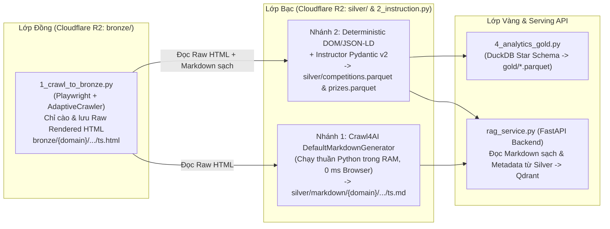

# Deliverable: Kiểm định lý thuyết lớp Đồng (Bronze Purity: Raw HTML vs Pre-processed Markdown)

- **Task ID**: `TASK-BRZ-01`
- **Related Cycle**: Cycle 06 (TLCN Phase 1)
- **Primary Owner**: Do Kien Hung (`@darktheDE`) & Nguyen Van Quang Duy (`@QuangDuyReal`)
- **Institution**: Khoa Công nghệ Thông tin, Trường Đại học Công nghệ Kỹ thuật TP.HCM (HCM-UTE)
- **Date Completed**: 2026-11-23
- **Deliverable Type**: Medallion Architecture Theory Audit & Cloud Storage Re-alignment
- **Status**: Complete

---

## 1. Tóm tắt điều hành và quyết định kiến trúc

Kiểm toán thực tế trên bucket **Cloudflare R2 (`acdp-lakehouse`)** và mã nguồn pipeline hiện tại cho thấy hai sai lệch ranh giới trong kiến trúc Medallion:
1. **Tiền xử lý sớm gây mất mát dữ liệu tại lớp Đồng**: [`src/acdp/1_crawl_to_bronze.py`](../../src/acdp/1_crawl_to_bronze.py) đang dùng `Crawl4AI` chuyển đổi HTML sang `raw_markdown` rồi mới đẩy lên `bronze/` trên Cloudflare R2. Quá trình này xóa bỏ toàn bộ thẻ `<head>`, `<meta property="og:*">`, `<script type="application/ld+json">` (`Schema.org/Event`), và payload trạng thái Next.js.
2. **Đọc tắt từ lớp Đồng ở tầng phục vụ RAG**: Tầng `silver/` trên R2 hiện chỉ lưu 2 bảng Parquet (`competitions.parquet` và `prizes.parquet`), không lưu văn bản Markdown đã làm sạch. Hệ quả là kịch bản kiểm thử [`src/acdp/3_chatbot_mvp.py`](../../src/acdp/3_chatbot_mvp.py) phải đọc trực tiếp từ `bronze/`. Vì `3_chatbot_mvp.py` chỉ phục vụ thử nghiệm và sẽ được thay thế bằng [`src/acdp/api/services/rag_service.py`](../../src/acdp/api/services/rag_service.py) trong FastAPI Backend, luồng RAG chính thức không được phép đọc trực tiếp từ lớp Đồng.

**Quyết định kiến trúc chuẩn hóa**:
- **Lớp Đồng (`s3://acdp-lakehouse/bronze/`)**: Chỉ làm nhiệm vụ cào và lưu **Raw Rendered HTML (`result.html`)** nguyên bản sau khi trình duyệt kết xuất JavaScript SPA, bảo đảm 100% tính bất biến (*Immutable Raw Landing*) và khả năng chạy lại (*Replayability*).
- **Lớp Bạc (`s3://acdp-lakehouse/silver/`)**: Tiếp nhận toàn bộ khâu tiền xử lý từ lớp Đồng. Tận dụng hàm thuần Python `DefaultMarkdownGenerator().generate_markdown(raw_html)` của `Crawl4AI` (chạy trong RAM với **0 ms mở lại trình duyệt**) song song với bộ trích xuất tất định DOM/JSON-LD và `Instructor` + `Pydantic v2` để xuất ra cả **Clean Markdown (`silver/markdown/...`)** phục vụ `rag_service.py` lẫn **Bảng Parquet chuẩn hóa (`silver/competitions.parquet`, `silver/prizes.parquet`)**.

---

## 2. Cơ sở lý thuyết về tính nguyên bản của lớp Đồng trong Medallion

Theo đặc tả kiến trúc Lakehouse của Databricks (*Armbrust et al., CIDR 2021*; *Jain et al., CIDR 2023*) và chuẩn lưu trữ web quốc tế **ISO 28500:2017 (WARC)**, tầng Bronze đóng vai trò là vùng hạ cánh bất biến (*Immutable Raw Landing Zone*), lưu trữ bản sao số trung thực tuyệt đối của hệ thống nguồn (*Source Fidelity*). Mọi phép biến đổi có suy hao (*lossy transformation*), làm sạch văn bản, hoặc áp đặt lược đồ phải được đẩy xuống tầng Silver.

Trong bài toán thu thập dữ liệu web hiện đại (SPA/CSR bằng React, Next.js, Vue), cần phân biệt rõ 3 trạng thái dữ liệu:

| Trạng thái dữ liệu | Cơ chế tạo sinh | Đặc tính kỹ thuật | Vị trí chuẩn trong Medallion |
| :--- | :--- | :--- | :--- |
| **Initial Wire HTML** | HTTP `GET` tĩnh (`curl` / `httpx`) | Thiếu nội dung động trên các trang SPA (ví dụ `codetour.org` chỉ trả về khung `<div id="root"></div>`) | Không đủ dữ liệu cho SPA |
| **Rendered DOM HTML (`result.html`)** | Playwright thực thi JS hoàn chỉnh | Giữ nguyên 100% nội dung hiển thị, thẻ `<meta>`, `JSON-LD`, bảng DOM và link ẩn | **Lớp Đồng (Bronze)** |
| **Derived Markdown (`raw_markdown`)** | `Crawl4AI` `DefaultMarkdownGenerator` | Giảm 88,39% dung lượng bằng cách cắt bỏ DOM wrapper, `<head>`, `<script>`, `<style>` | **Lớp Bạc (Silver)** |

---

## 3. Điều tra thực trạng Cloudflare R2 và lỗ hổng kiến trúc khi tiền xử lý sớm

### 3.1. Hiện trạng bucket `s3://acdp-lakehouse` trên Cloudflare R2

Kiểm tra trực tiếp toàn bộ đối tượng trên Cloudflare R2 tại thời điểm 23/11/2026 ghi nhận tổng cộng **83 objects** với tổng dung lượng **2,26 MB**:

| Prefix trên R2 | Số lượng Object | Tổng dung lượng | Định dạng & Nội dung thực tế |
| :--- | :---: | :---: | :--- |
| **`bronze/`** | `60` | `2.224.170 B` (~2,12 MB) | Lưu 18 domain cuộc thi theo cấu trúc `bronze/{domain}/year={YYYY}/month={MM}/day={DD}/{ts}` dưới dạng `text/markdown; charset=utf-8`. |
| **`silver/`** | `2` | `29.654 B` (~29,0 KB) | Chỉ lưu `silver/competitions.parquet` (`15 dòng × 25 cột`, `22.928 B`) và `silver/prizes.parquet` (`50 dòng × 7 cột`, `6.726 B`). |
| **`gold/`** | `21` | `109.551 B` (~107,0 KB) | Lưu 4 bảng `dim_*`, 3 bảng `fact_*`, 2 bảng `bridge_*`, 6 bảng `mart_*`, và 6 bảng `gold_*` (Parquet). |

### 3.2. Hai lỗ hổng của thiết kế cũ

1. **Lỗ hổng 1 — Suy hao thông tin cấu trúc tại lớp Đồng**: Khi `Crawl4AI` chuyển `result.html` sang `raw_markdown`, toàn bộ khối siêu dữ liệu có cấu trúc trong `<head>` và `<script>` bị loại bỏ. Đối chiếu trên 7 bộ mẫu HTML và Markdown tương ứng cho thấy tổng dung lượng giảm từ `975.601 B` xuống `113.297 B` (-88,39%), nhưng làm mất các trường dữ liệu chuẩn sau:

| Domain cuộc thi | Raw HTML | Raw Markdown | Mức giảm | Siêu dữ liệu bị mất trong Markdown |
| :--- | :---: | :---: | :---: | :--- |
| `datadna.onyxdata.co.uk` | `309.768 B` | `29.470 B` | -90,49% | `1` khối `application/ld+json` (`Schema.org`), `8` thẻ `og:*`, `276` thuộc tính `href` |
| `vietnamaichallenge.com` | `179.978 B` | `22.155 B` | -87,69% | `12` khối payload trạng thái Next.js (`self.__next_f.push`) |
| `hackaithon.vsds.vn` | `160.948 B` | `13.595 B` | -91,55% | `12` thẻ `<meta property="og:*">` (`og:title`, `og:locale`, `og:image`) |
| `codetour.org` | `114.735 B` | `16.878 B` | -85,29% | `8` thẻ `<meta property="og:*">` (`og:description`, `og:url`, `og:image`) |
| `itconsultantchallenge.org` | `111.784 B` | `10.198 B` | -90,88% | `12` thẻ `og:*`, `11` khối payload Next.js |
| `aichallenge.hochiminhcity.gov.vn` | `81.049 B` | `12.843 B` | -84,15% | Cấu trúc DOM bảng và thuộc tính thẻ gốc |
| `rmit-hackathon.com` | `17.339 B` | `8.158 B` | -52,95% | Cấu trúc DOM thẻ gốc |
| **Tổng cộng (7 cuộc thi)** | **`975.601 B`** | **`113.297 B`** | **-88,39%** | **Mất khả năng trích xuất tất định (Deterministic Parsing) ở lớp Bạc** |

2. **Lỗ hổng 2 — Vi phạm ranh giới tầng phục vụ (RAG đọc từ Bronze)**: Vì `bronze/` giữ Markdown còn `silver/` chỉ giữ 2 file Parquet, `3_chatbot_mvp.py` đã đọc trực tiếp từ `bronze/` để chia chunk và nhúng vector. Thiết kế này phá vỡ tính phân tầng: dữ liệu chưa qua khử trùng lặp và kiểm định chất lượng ở lớp Bạc đã bị đẩy thẳng vào cơ sở dữ liệu vector Qdrant.

---

## 4. Kiến trúc chuẩn hóa: Lưu raw HTML ở lớp Đồng và hợp nhất xử lý ở lớp Bạc

Để tuân thủ tuyệt đối lý thuyết Medallion mà không làm chậm pipeline, hệ thống tách bạch ranh giới xử lý trên Cloudflare R2 như sau:



### Cơ chế thực thi không cần mở lại trình duyệt ở lớp Bạc
Thư viện `Crawl4AI` tách rời hoàn toàn bộ tải trang Playwright (`AsyncWebCrawler`) và bộ chuyển đổi Markdown (`DefaultMarkdownGenerator`). Ở lớp Bạc (`2_instruction.py`), khi đọc chuỗi `raw_html` từ R2 `bronze/`, hệ thống gọi trực tiếp trong RAM với độ trễ dưới 5 ms:

```python
from crawl4ai.markdown_generation_strategy import DefaultMarkdownGenerator

md_generator = DefaultMarkdownGenerator()
md_result = md_generator.generate_markdown(raw_html_from_bronze)
clean_markdown = md_result.raw_markdown
```

Đối với các phiên `AdaptiveCrawler` duyệt nhiều trang con (`result.knowledge_base`), lớp Đồng đóng gói các bản chụp HTML kèm thẻ phân cách `<!-- ACDP_PAGE_BOUNDARY url="..." -->` để lớp Bạc tách từng trang, chuyển sang Markdown sạch và hợp nhất thành tệp `silver/markdown/.../*.md`. Đồng thời, lớp Bạc hỗ trợ tương thích ngược với 60 object `.md` lịch sử đang có sẵn trên `bronze/` bằng cách tự động nhận diện tiền tố `<html` / `<!DOCTYPE` trước khi quyết định chạy `DefaultMarkdownGenerator`.

---

## 5. Phân tích chi phí và hạn mức trên Cloudflare R2 Free Tier

Việc lưu Raw HTML ở lớp Đồng (`~140 KB/cuộc thi`) và Clean Markdown ở lớp Bạc (`~16 KB/cuộc thi`) hoàn toàn nằm gọn trong gói miễn phí của Cloudflare R2 (10 GB lưu trữ, 1.000.000 lệnh ghi Class A/tháng, 10.000.000 lệnh đọc Class B/tháng, 0 VNĐ phí băng thông tải ra):

- **Quy mô TLCN (10 cuộc thi × 5 đợt cào)**: Tổng dung lượng cả `bronze/` (.html), `silver/` (.md + .parquet) và `gold/` (.parquet) đạt khoảng **8,0 MB** (chiếm **0,08%** hạn mức 10 GB).
- **Quy mô KLTN (100 cuộc thi × 10 đợt cào/năm)**: Tổng dung lượng ước tính đạt khoảng **156 MB** (chiếm **1,56%** hạn mức 10 GB), chi phí vận hành vẫn duy trì ở mức **0 VNĐ**.

---

## 6. Luận cứ bảo vệ và phản biện trước Hội đồng FIT-HCMUTE

1. **Câu hỏi 1**: *Tại sao không giữ nguyên file `.md` ở lớp Đồng như ban đầu cho gọn mà phải đẩy bước chuyển đổi của `Crawl4AI` lên lớp Bạc?*
   - **Trả lời**: Theo chuẩn Medallion, lớp Đồng phải bảo toàn dữ liệu nguyên bản (*Source Fidelity*). Việc chuyển sang Markdown ngay ở lớp Đồng làm mất vĩnh viễn thẻ `application/ld+json` và `<meta property="og:*">`, triệt tiêu khả năng chạy bộ bóc tách tất định (Deterministic Parsing) ở lớp Bạc và không thể chạy lại parser khi website cuộc thi đóng cửa.
2. **Câu hỏi 2**: *Chuyển `Crawl4AI` lên lớp Bạc có bắt buộc phải mở lại trình duyệt Playwright gây tốn RAM và chậm pipeline không?*
   - **Trả lời**: Không. Trình duyệt Playwright chỉ chạy duy nhất một lần ở lớp Đồng để kết xuất JavaScript SPA thành `result.html`. Ở lớp Bạc, `DefaultMarkdownGenerator().generate_markdown()` xử lý trực tiếp chuỗi HTML trong RAM với chi phí trình duyệt bằng **0 ms** và **0 MB RAM Playwright**.
3. **Câu hỏi 3**: *Việc tách `3_chatbot_mvp.py` sang `rag_service.py` đọc từ lớp Bạc giải quyết được vấn đề gì?*
   - **Trả lời**: Chấm dứt hoàn toàn lỗi kiến trúc đọc tắt từ lớp Đồng (*Layer-Skipping Anti-Pattern*). Mọi văn bản đưa vào Qdrant Vector DB đều đã được lớp Bạc làm sạch, khử trùng lặp và gắn định danh `competition_key` chuẩn xác từ `silver/competitions.parquet`, đảm bảo tính nhất quán giữa câu trả lời RAG và dữ liệu hiển thị trên Web Portal.

---

## 7. Tài liệu và mã nguồn liên quan

- Mã nguồn crawler lớp Đồng: [`src/acdp/1_crawl_to_bronze.py`](../../src/acdp/1_crawl_to_bronze.py)
- Mã nguồn xử lý lớp Bạc: [`src/acdp/2_instruction.py`](../../src/acdp/2_instruction.py)
- Dịch vụ RAG Production (FastAPI): [`src/acdp/api/services/rag_service.py`](../../src/acdp/api/services/rag_service.py)
- Báo cáo trực quan HTML: [`TASK-BRZ-01-bronze-raw-vs-markdown-justification-visual-dossier.html`](./TASK-BRZ-01-bronze-raw-vs-markdown-justification-visual-dossier.html)
- Sổ cái quản lý task: [`docs/tasks/task-registry.md`](../tasks/task-registry.md)

---

## 8. Nhật ký truy vấn và nguồn tham khảo đối chiếu (`DIR-020`)

### 8.1. Nhật ký câu truy vấn (`search_web`)
1. `Databricks Medallion Architecture Bronze layer raw data immutability unprocessed HTML vs markdown`
2. `"Landing Zone" vs "Bronze Layer" Databricks Medallion architecture unstructured web scraping HTML JSON-LD`
3. `Crawl4AI CrawlResult raw html cleaned_html fit_markdown raw_markdown properties 2025 2026`
4. `Crawl4AI process local raw HTML string "raw://" OR "raw:" DefaultMarkdownGenerator without browser fetch`

### 8.2. Nguồn tài liệu tham khảo chính thức
- **Databricks Medallion Architecture**: [https://www.databricks.com/glossary/medallion-architecture](https://www.databricks.com/glossary/medallion-architecture)
- **Lakehouse Foundational Paper (Armbrust et al., CIDR 2021)**: [https://www.cidrdb.org/cidr2021/papers/cidr2021_paper17.pdf](https://www.cidrdb.org/cidr2021/papers/cidr2021_paper17.pdf)
- **Analyzing and Comparing Lakehouse Storage Systems (Jain et al., CIDR 2023)**: [https://www.cidrdb.org/cidr2023/papers/p92-jain.pdf](https://www.cidrdb.org/cidr2023/papers/p92-jain.pdf)
- **ISO 28500:2017 WARC Specification (IIPC)**: [https://iipc.github.io/warc-specifications/specifications/warc-format/warc-1.1/](https://iipc.github.io/warc-specifications/specifications/warc-format/warc-1.1/)
- **Crawl4AI Documentation (`CrawlResult` & `DefaultMarkdownGenerator`)**: [https://docs.crawl4ai.com/](https://docs.crawl4ai.com/)
- **Cloudflare R2 Pricing & Free Tier**: [https://developers.cloudflare.com/r2/pricing/](https://developers.cloudflare.com/r2/pricing/)
