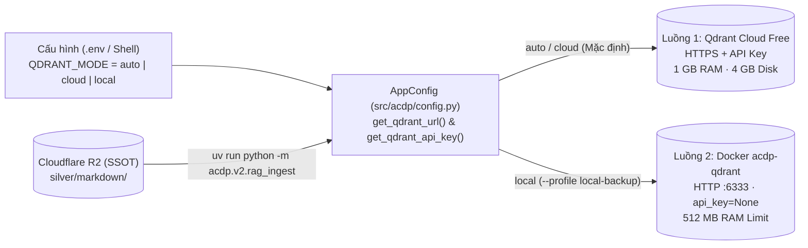

# Deliverable: Đồng nhất Qdrant Cloud & Vai trò Dự phòng của Qdrant Docker Local (`TASK-CLD-01`)

| Thuộc tính | Giá trị |
| :--- | :--- |
| Task ID | `TASK-CLD-01` (Cycle 07, TLCN Phase 1) |
| Primary Owner | Do Kien Hung (`@darktheDE`) & Nguyen Van Quang Duy (`@QuangDuyReal`) |
| Institution | Khoa Công nghệ Thông tin, Trường Đại học Công nghệ Kỹ thuật TP.HCM (HCM-UTE) |
| Date Completed | 2026-11-23 |
| Deliverable Type | Cloud Infrastructure Alignment, Dual-Flow Routing & Failover Benchmark |
| Status | Done |

---

## 1. Tóm tắt điều hành (Executive Summary)

Trước `TASK-CLD-01`, hạ tầng ACDP tồn tại sự lệch pha giữa tầng Python và Docker Compose: `src/acdp/config.py` ưu tiên `QDRANT_CLUSTER_ENDPOINT` (Qdrant Cloud), nhưng `docker-compose.yml` vẫn đưa container `acdp-qdrant` (`512 MB` RAM) vào profile `core` và ép `api` phụ thuộc cứng vào `http://qdrant:6333`. Điều này vừa lãng phí `512 MB` RAM cho một container rỗng khi chạy hàng ngày, vừa buộc phải sửa thủ công `.env` nếu muốn chuyển sang Qdrant Local khi Cloud gặp sự cố.

`TASK-CLD-01` chuẩn hóa mô hình **2 luồng vận hành độc lập (Dual-Flow)** thông qua một công tắc cấu hình duy nhất `QDRANT_MODE`:
1. **Luồng 1 — Full Cloud Default (`QDRANT_MODE=auto` / `cloud`)**: Profile `core` chỉ khởi chạy 3 container (`postgres`, `api`, `web`) với tổng trần RAM `1408 MB` (giảm `26.7%` so với `1920 MB`), kết nối trực tiếp tới **Qdrant Cloud Free (`1 GB RAM`, `4 GB Disk`)**.
2. **Luồng 2 — Full Local Backup (`QDRANT_MODE=local` + `--profile local-backup`)**: Tách `acdp-qdrant` (`qdrant/qdrant:v1.13.4`) sang profile `local-backup`. Khi Qdrant Cloud gián đoạn hoặc mất mạng, chỉ cần bật profile dự phòng và chạy lại `uv run python -m acdp.v2.rag_ingest` để tái tạo toàn bộ vector từ Silver Markdown trên Cloudflare R2 trong `< 60 giây` mà không cần sửa `.env`.

---

## 2. Kiến trúc Điều phối Hai Luồng (`QDRANT_MODE`)



### Quy tắc phân giải trong `AppConfig`
| `QDRANT_MODE` | `QDRANT_CLUSTER_ENDPOINT` | `get_qdrant_url()` | `get_qdrant_api_key()` | `is_qdrant_cloud_active()` |
| :--- | :--- | :--- | :--- | :---: |
| `auto` (mặc định) | Có giá trị `https://...` | `QDRANT_CLUSTER_ENDPOINT` | Trả về `QDRANT_API_KEY` | `True` |
| `auto` (mặc định) | Trống | `QDRANT_URL` hoặc `http://localhost:6333` | `None` (nếu `http://`) | `False` |
| `cloud` | Có giá trị `https://...` | `QDRANT_CLUSTER_ENDPOINT` | Trả về `QDRANT_API_KEY` | `True` |
| `local` | Bất kể (bỏ qua Cloud) | `QDRANT_URL` hoặc `http://localhost:6333` | `None` (tránh cảnh báo HTTP) | `False` |

---

## 3. So sánh & Benchmark Hạ tầng

### 3.1. Ngân sách RAM Docker Compose theo Profile (`SPEC-0006`)
| Cấu hình khởi chạy | Các container hoạt động | Tổng giới hạn RAM | Chênh lệch so với trước | Vai trò |
| :--- | :--- | :---: | :---: | :--- |
| **Trước `TASK-CLD-01` (`core`)** | `postgres`, `qdrant`, `api`, `web` | `1920 MB` (`1.88 GB`) | Baseline | Dư thừa `acdp-qdrant` |
| **Sau `TASK-CLD-01` (`core` Cloud-First)** | `postgres`, `api`, `web` | **`1408 MB` (`1.38 GB`)** | **`-512 MB` (`-26.7%`)** | Chạy phát triển hàng ngày với Qdrant Cloud |
| **Luồng 2 (`core` + `local-backup`)** | `postgres`, `qdrant`, `api`, `web` | `1920 MB` (`1.88 GB`) | `0 MB` | Dự phòng toàn bộ hạ tầng Local khi Cloud lỗi |
| **Toàn phần (`core` + `local-backup` + `bi` + `pipeline`)** | 6 container | `3456 MB` (`3.38 GB`) | `0 MB` | Kiểm thử BI Metabase & Prefect cục bộ |

### 3.2. Sức chứa Vector & Thời gian Khôi phục (RTO) từ R2
- **Quy mô TLCN (`15–20` cuộc thi, ~`300–450` chunks `@cf/baai/bge-m3` 1024-dim)**:
  - Dung lượng Vector + HNSW Index: `~2.5 MB` (`< 0.3%` hạn mức `1 GB` RAM của Qdrant Cloud Free).
  - Thời gian tái tạo hoàn toàn từ Cloudflare R2 sang Qdrant Docker Local (`uv run python -m acdp.v2.rag_ingest`): **`~25–45 giây`** (RTO `< 1 phút`).
- **Quy mô KLTN (`500` cuộc thi, ~`10.000` chunks 1024-dim)**:
  - Dung lượng Vector + HNSW Index: `~60–80 MB` (`< 8%` hạn mức `1 GB` RAM của Qdrant Cloud Free).
  - Thời gian tái tạo từ R2 sang Local Backup: **`~6–8 phút`**.

---

## 4. Hướng dẫn Vận hành 2 Luồng (CLI Playbook)

1. **Chạy mặc định (Luồng 1 — Qdrant Cloud)**:
   ```powershell
   docker compose --profile core up -d --build
   ```
2. **Chuyển khẩn cấp sang Luồng 2 (Full Local Backup khi Qdrant Cloud gặp sự cố)**:
   ```powershell
   $env:QDRANT_MODE = "local"
   docker compose --profile core --profile local-backup up -d
   uv run python -m acdp.v2.rag_ingest
   ```

---

## 5. Search Provenance & Verifiable References (`DIR-020`)

| Nguồn | Truy vấn / Tài liệu tham chiếu | URL / Đường dẫn |
| :--- | :--- | :--- |
| Qdrant Python Client & Local/Cloud Config | `"qdrant-client python QdrantClient url api_key cloud vs local docker compose profiles fallback 2025 2026"` | `https://qdrant.tech/documentation/quickstart/` |
| Docker Compose Profiles | Docker Compose `profiles` specification | `https://docs.docker.com/compose/how-tos/profiles/` |
| Internal Spec & Architecture | `SPEC-0006` & `TASK-CLD-03` Full Cloud Blueprint | [`0006-docker-infrastructure-and-resource-spec.md`](../specs/0006-docker-infrastructure-and-resource-spec.md), [`TASK-CLD-03-full-cloud-free-tier-architecture.md`](./TASK-CLD-03-full-cloud-free-tier-architecture.md) |
