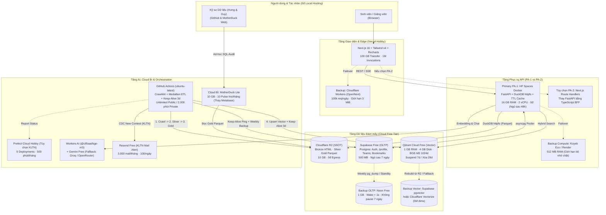

# Deliverable: Kiến trúc đồng bộ Full Cloud Free-Tier (TLCN đến KLTN)

| Thuộc tính | Giá trị |
| :--- | :--- |
| Task ID | `TASK-CLD-03` (Cycle 07, TLCN $\rightarrow$ KLTN) |
| Primary Owner | Do Kien Hung (`@darktheDE`) & Nguyen Van Quang Duy (`@QuangDuyReal`) |
| Institution | Khoa Công nghệ Thông tin, Trường Đại học Công nghệ Kỹ thuật TP.HCM (HCM-UTE) |
| Date Completed | 2026-11-23 |
| Deliverable Type | Cloud Architecture Blueprint, Tech Stack Audit & Risk Continuity Plan |
| Status | Complete (Hồ sơ kiến trúc & phản biện nội bộ theo `DIR-011`, chờ Hưng & Duy duyệt trước khi chốt ADR và sửa code tại `TASK-CLD-01`, `TASK-CLD-04`) |

---

## 1. Tóm tắt điều hành và bối cảnh vấn đề

Theo hiện trạng [`docker-compose.yml`](../../docker-compose.yml) và đặc tả [`SPEC-0006`](../specs/0006-docker-infrastructure-and-resource-spec.md), nền tảng ACDP đang vận hành theo mô hình lai (Hybrid Local–Cloud). Cụ thể, ba tầng lưu trữ Lakehouse đã được đồng bộ lên Cloudflare R2 theo chỉ thị `DIR-021`, nhưng 6 thành phần tính toán và cơ sở dữ liệu gồm PostgreSQL 18 (`256 MB`), Qdrant (`512 MB`), FastAPI + DuckDB (`640 MB`), Next.js 16 (`512 MB`), Metabase (`1024 MB`) và Prefect Server (`512 MB`) vẫn chạy cục bộ trên Docker Desktop.

Tiếp thu góp ý của Giảng viên hướng dẫn, dữ liệu cuộc thi học thuật mang tính công khai, không chịu ràng buộc bảo mật nội bộ như hệ thống doanh nghiệp. Việc giữ các dịch vụ phục vụ ở máy trạm cá nhân làm phát sinh ba hệ quả: sai lệch trạng thái đồng bộ dữ liệu OLTP và Vector giữa hai thành viên, phụ thuộc cấu hình máy cá nhân (`16 GB RAM`) khi trình diễn, và không có địa chỉ truy cập công khai thường trực cho sinh viên dùng thử.

Báo cáo này thiết kế kiến trúc đồng bộ **100% Cloud Free-Tier** ở mức chi phí **0 USD/tháng**, đồng thời thẩm định lại bốn câu hỏi kiến trúc cốt lõi cho giai đoạn **Tiểu luận chuyên ngành (TLCN: 5–20 cuộc thi)** tiến tới **Khóa luận tốt nghiệp (KLTN: 100–500 cuộc thi, 500–1.000 sinh viên)**:

1. Giữ **DuckDB (`httpfs` trên R2)** làm bộ máy truy vấn OLAP lõi (tối ưu thêm lớp đệm TTL Cache và Next.js ISR) và dùng **MotherDuck Lite Free** (`10 GB`, `10 giờ/tháng`) thay thế Metabase cục bộ vì Metabase Cloud không có gói miễn phí.
2. Đề xuất hai lộ trình cho tầng Serving API để nhóm phản biện: **Phương án 1 (PA-1, khuyến nghị cho TLCN)** giữ FastAPI + DuckDB chạy Docker trên **Hugging Face Spaces (`16 GB RAM` miễn phí)** để bảo toàn toàn bộ mã nguồn Sprint 02; **Phương án 2 (PA-2, tối giản hóa)** gộp bỏ FastAPI vào **Next.js Route Handlers + Supabase Auth** trên **Vercel Hobby** nếu nhóm ưu tiên triển khai một nền tảng duy nhất bằng TypeScript. Bác bỏ phương án viết lại toàn bộ sang Rust vì làm chậm tốc độ phát triển tính năng KLTN.
3. Thiết lập nguyên tắc **An toàn thẻ quốc tế 0 đồng**: dù nhóm có thẻ quốc tế để xác minh danh tính, hệ thống chỉ sử dụng các dịch vụ miễn phí không yêu cầu thẻ hoặc có trần ngắt cứng (hard cap), loại bỏ các dịch vụ tính phí vượt ngưỡng không tự ngắt như Google Cloud Run PAYG hoặc Oracle Cloud PAYG (giữ cọc tạm `100 USD`).
4. Thiết lập cơ chế **Keep-Alive tự động mỗi 3 ngày** bằng GitHub Actions và kế hoạch dự phòng hai lớp cho mọi thành phần có chính sách ngủ đông hoặc xóa dữ liệu do không hoạt động (Supabase tạm dừng sau 7 ngày, Qdrant Cloud tạm dừng sau 7 ngày và xóa sau 28 ngày).

---

## 2. Đánh giá tối ưu tech stack và câu hỏi chuyển đổi công nghệ

Trước khi đưa toàn bộ hệ thống lên đám mây, các thành phần cốt lõi trong [`ADR-0001`](../adr/0001-medallion-lakehouse-and-rag-stack.md) và [`T14`](../rd-tasks/T14_web_and_gold_stack_evaluation.md) được kiểm định lại từ góc độ lý thuyết Kỹ thuật Dữ liệu, chi phí vận hành Free Tier năm 2026 và khả năng mở rộng từ TLCN sang KLTN.

### 2.1. Đánh giá bộ máy truy vấn: Có nhất thiết phải dùng DuckDB không?

Từ góc độ kiến trúc phân tách **OLTP / OLAP** (Stonebraker & Cetintemel, 2005) và mô hình **Lakehouse** (Armbrust et al., CIDR 2021), DuckDB giải quyết bài toán đọc trực tiếp định dạng cột Apache Parquet trên Object Storage bằng cơ chế thực thi vector hóa (*vectorized execution*) mà không cần dựng cụm máy chủ kho dữ liệu riêng. Thực nghiệm tại [`TASK-GLD-01`](./TASK-GLD-01-kimball-star-schema-audit-and-alternatives.md) cho thấy DuckDB `httpfs` truy vấn bảng OBT `mart_competition_explorer` trên Cloudflare R2 đạt độ trễ `182,9 ms` (cold) và `208,0 ms` (warm).

Bảng dưới đây đối sánh DuckDB với 6 lựa chọn bộ máy truy vấn khả dụng trên Cloud Free Tier năm 2026:

| Bộ máy truy vấn | Cơ chế vận hành trên Cloud | Hạn mức Free Tier (2026) | Phù hợp với mô hình ACDP | Phán quyết kiến trúc |
| :--- | :--- | :--- | :--- | :--- |
| **DuckDB (`httpfs` in-process)** | Nhúng trong tiến trình API, đọc R2 Parquet qua HTTP Range Requests | Miễn phí 100% (MIT) | Hỗ trợ đầy đủ Star Join (`4 dim`, `3 fact`, `2 bridge`) và OBT `mart_*`, chứng minh năng lực DE | **Giữ làm lõi OLAP** (kèm TTL Cache 5–15 phút) |
| **MotherDuck (Lite)** | Serverless Cloud DuckDB + Web SQL IDE | `10 GB` lưu trữ, `10 giờ` Pulse/tháng, tối đa 3 người dùng | Thay thế hoàn hảo Metabase để kỹ sư dữ liệu chạy SQL ad-hoc; dễ hết 10 giờ nếu mở trực tiếp cho lưu lượng công khai | **Dùng làm Cloud BI Workbench thay Metabase** |
| **Supabase `pg_duckdb` & `wrappers`** | Phần mở rộng nhúng vào PostgreSQL quản trị | Nằm trong gói Free `500 MB` của Supabase | Kiểm chứng 2026: `pg_duckdb` **chưa được bật** trên Supabase Cloud (chỉ có ở bản tự host); `s3_wrapper` tải toàn bộ file nén vào RAM | **Không thay thế được DuckDB `httpfs`** |
| **`hyparquet` (Pure JS)** | Thư viện JavaScript thuần (`~10 KB`) đọc Parquet qua HTTP Range | Miễn phí 100% (MIT) | Rất nhẹ cho Vercel Serverless khi đọc bảng phẳng `mart_competition_explorer`, nhưng **không có bộ máy SQL JOIN** cho các bảng Fact/Dim | **Chỉ dùng ở PA-2** cho bảng phẳng |
| **DuckDB-Wasm (Browser)** | Chạy nhân DuckDB ngay trên trình duyệt người dùng | Miễn phí (`0 MB` RAM máy chủ) | Phải tải gói WebAssembly `~30 MB` trong lần mở trang đầu tiên, ảnh hưởng xấu tới tốc độ tải trên điện thoại sinh viên | **Loại bỏ cho cổng sinh viên** |
| **Apache DataFusion (Rust)** | Bộ máy SQL/DataFrame trên bộ nhớ Apache Arrow | Miễn phí (Apache 2.0) | Tiêu thụ RAM cực thấp (`~30–50 MB`), nhưng buộc viết lại toàn bộ mã Python xử lý Gold và API sang Rust | **Chưa dùng ở TLCN/KLTN** (tránh quá tải nhân lực) |
| **ClickHouse Cloud / R2 SQL** | Kho dữ liệu MPP / truy vấn Iceberg ở Edge | ClickHouse chỉ cho dùng thử 30 ngày (`300 USD` credit); R2 SQL cần đóng gói Iceberg | ClickHouse không có gói miễn phí vĩnh viễn; R2 SQL dư thừa phức tạp cho dữ liệu Gold `< 20 MB` | **Loại bỏ** |

Kết luận về Query Engine: **Nên giữ DuckDB làm bộ máy truy vấn lõi** cho cả TLCN và KLTN. Thay vì loại bỏ DuckDB, điểm cần tối ưu là bổ sung bộ nhớ đệm ngắn hạn (**TTL Cache 5–15 phút** trên tầng API hoặc **Next.js ISR**) cho 6 bảng `mart_*`, giúp trên `95%` lượt truy cập không cần gọi lại `httpfs` sang R2 và giữ mức độ trễ phản hồi `< 20 ms`.

### 2.2. Đánh giá tầng Backend API: Có nhất thiết phải dùng FastAPI không?

Hiện trạng mã nguồn `src/acdp/api/` đã hoàn thiện toàn bộ cụm endpoint (`auth`, `bookmarks`, `competitions`, `analytics`, `rag`) theo hợp đồng OpenAPI 3.1 (`SPEC-0004`). Tuy nhiên, đối chiếu với định hướng tối giản *"Next.js + Supabase + TailwindCSS"* trong [`.scratchpad/22112026.md`](../../.scratchpad/22112026.md), nhóm có ba phương án cấu trúc tầng Backend:

| Phương án | Kiến trúc triển khai | Tận dụng mã nguồn hiện tại | Rủi ro vận hành & Cold Start | Phán quyết đề xuất |
| :--- | :--- | :--- | :--- | :--- |
| **PA-1: Giữ FastAPI + DuckDB (Docker)** | `Next.js 16 (Vercel)` $\rightarrow$ `FastAPI (HF Spaces 16 GB RAM)` $\rightarrow$ `Supabase + R2 + Qdrant` | Tái sử dụng 100% `src/acdp/api/` và chia sẻ trực tiếp `Pydantic v2` (`src/acdp/schemas.py`) | HF Spaces ngủ đông sau `48 giờ` không có truy cập; cần ping giữ ấm định kỳ | **Khuyến nghị số 1 cho TLCN $\rightarrow$ KLTN** |
| **PA-2: Gộp FastAPI vào Next.js BFF + Supabase** | `Next.js 16 + Route Handlers (Vercel)` $\rightarrow$ `Supabase (Auth/DB)` + `R2` + `Qdrant JS` | Loại bỏ máy chủ Python phục vụ; phải viết lại các route từ Python sang TypeScript | Phải chuyển đổi xác thực JWT sang Supabase Auth và cấu hình `VERCEL_SUPPORT_LARGE_FUNCTIONS=1` nếu nhúng `@duckdb/node-api` | **Phương án tối giản thay thế** nếu muốn 1 deploy duy nhất |
| **PA-3: Viết lại sang Rust (`Axum` + `DataFusion`)** | `Next.js` (hoặc Leptos) $\rightarrow$ `Rust Axum (Koyeb 512 MB)` | Bỏ toàn bộ code `src/acdp/api/` | Tốn công sức phát triển gấp 3–5 lần cho các tính năng KLTN (`TASK-SRV-01..05`), thiếu hệ sinh thái RAG/LLM trưởng thành | **Bác bỏ chuyển đổi toàn phần** |

Phân tích câu hỏi chuyển sang **Rust** (từ [`.scratchpad/22112026.md`](../../.scratchpad/22112026.md)): Rust (`Axum` + `Apache DataFusion`) tiết kiệm bộ nhớ đáng kể (`~40 MB` RAM so với `~220–300 MB` RAM của Python), rất hợp với PaaS giới hạn `512 MB` RAM. Tuy nhiên, tại quy mô TLCN (`15–20` cuộc thi) và KLTN (`100–500` cuộc thi), nút thắt của dự án nằm ở độ chính xác bóc tách thể lệ, nghiệp vụ Ghép đội (`TASK-SRV-02`), RAG cá nhân hóa (`TASK-SRV-04`) và dịch vụ thông báo (`TASK-SRV-05`), không nằm ở thông lượng CPU của API. Do đó, giữ hệ sinh thái Python/TypeScript (PA-1 hoặc PA-2) bảo đảm tiến độ bảo vệ đề tài, trong khi vẫn mở ngỏ khả năng thực nghiệm Rust ở mức nghiên cứu so sánh hiệu năng nếu nhóm muốn làm điểm nhấn phụ tại KLTN.

### 2.3. Phán quyết lộ trình TLCN đến KLTN: Giữ nguyên hay phải chuyển đổi?

| Thành phần hệ thống | Hiện trạng (Hybrid Local) | Đích Full Cloud Free-Tier (TLCN) | Tiến hóa lên KLTN (100–500 cuộc thi) | Ghi chú chuyển đổi |
| :--- | :--- | :--- | :--- | :--- |
| **Frontend Portal** | Docker `acdp-web` (`:3000`) | **Vercel Hobby** (`Next.js 16 + Tailwind v4`) | Giữ nguyên Vercel Hobby | Không cần viết lại code UI |
| **Serving API** | Docker `acdp-api` (`:8000`) | **HF Spaces Docker (`16 GB` Free)** *(PA-1)* hoặc **Next.js BFF** *(PA-2)* | Giữ nguyên PA-1 hoặc chuyển sang PA-2 nếu bỏ hoàn toàn container Python | Sửa cấu hình `NEXT_PUBLIC_API_URL` & `CORS_ORIGINS` |
| **OLTP App Database** | Docker `postgres:18` (`:5432`) | **Supabase Free (`500 MB`)** | Giữ Supabase Free; tách bảng log chat cũ nếu chạm ngưỡng `400 MB` | Chỉ đổi `DATABASE_URL` sang Supabase Session/Transaction Pooler |
| **Medallion Lakehouse** | **Cloudflare R2** (`DIR-021`) | **Cloudflare R2 Free (`10 GB`)** | Giữ nguyên Cloudflare R2 (`10 GB` chứa được >50.000 cuộc thi HTML + Parquet) | Không cần chuyển đổi |
| **Vector Search** | Docker `qdrant` (`:6333`) | **Qdrant Cloud Free (`1 GB RAM`)** | Giữ nguyên Qdrant Cloud (`1 GB` chứa ~1 triệu vector 768d / ~750k vector 1024d) | Đổi `QDRANT_CLUSTER_ENDPOINT` & `QDRANT_API_KEY` (`TASK-CLD-01`) |
| **Embeddings & LLM** | Cloudflare `@cf/baai/bge-m3` + Gemini | Giữ nguyên + thêm `LiteLLM` fallback sang **Groq / OpenRouter** | Giữ nguyên; dùng batch cache tránh lặp embedding | Đạt 100% Cloud |
| **BI & Ad-hoc SQL** | Docker `metabase-duckdb` (`1024 MB`) | **Next.js `/dashboard` + MotherDuck Lite (`10 GB`)** | Giữ nguyên; dùng MotherDuck cho DataOps audit | **Gỡ bỏ** `metabase` khỏi luồng chạy mặc định (`TASK-CLD-02`) |
| **Pipeline & Crawl** | Máy trạm + Docker `prefect-server` | **GitHub Actions (`workflow_dispatch` + `cron`)** | **GitHub Actions Scheduled** + **Prefect Cloud Hobby** (tùy chọn) | Triển khai tự động ở `TASK-ING-02` |
| **Mail Service (KLTN)** | Chưa có | Chưa kích hoạt ở TLCN | **Resend Free (`3.000 mail/tháng`, `100/ngày`)** | Phục vụ `TASK-SRV-05` |

---

## 3. Kiến trúc tổng thể Full Cloud Free-Tier

Sơ đồ dưới đây mô tả luồng dữ liệu khép kín trên Cloud Free Tier theo **PA-1 (Khuyến nghị chuyển tiếp mượt mà)** kèm các nhánh dự phòng nóng (**Backup / Failover**) và cơ chế **Keep-Alive**:

Điểm mấu chốt của kiến trúc trên là nguyên lý **Tài sản Dữ liệu Bất biến trên Cloudflare R2 (Immutable SSOT)**: toàn bộ HTML gốc (Bronze), văn bản sạch và bản ghi chuẩn hóa (Silver), mô hình sao (Gold) và bảng mảnh văn bản RAG (`chunks`) đều nằm tập trung trên R2. Nhờ vậy, nếu bất kỳ cụm tính toán miễn phí nào (Qdrant Cloud, Hugging Face Spaces, hoặc Supabase) gặp sự cố hoặc bị tạm dừng, hệ thống có thể tái dựng lại hoàn toàn từ R2 trong vòng vài phút.

---

## 4. Ma trận hạn mức Free Tier (2026) và quy tắc an toàn thẻ quốc tế 0đ

### 4.1. Bảng kiểm chứng hạn mức miễn phí toàn bộ ngăn xếp (Cập nhật 2026)

| Dịch vụ | Vai trò | Hạn mức Free Tier (2026) | Quy tắc Ngủ đông / Giới hạn cứng | Tải dự kiến TLCN | Tải dự kiến KLTN |
| :--- | :--- | :--- | :--- | :---: | :---: |
| **Vercel Hobby** | Frontend `Next.js 16` | `100 GB` transfer/tháng, `1M` function calls, `300s` max timeout, `8 GB` build RAM | Tự tạm dừng đến hết chu kỳ 30 ngày nếu vượt quota; chỉ dùng phi thương mại | `< 2%` | `< 15%` |
| **HF Spaces (Docker)** | Backend `FastAPI + DuckDB` | `16 GB RAM`, `2 vCPU`, `50 GB` ephemeral disk, không cần thẻ | Ngủ sau **48 giờ** không có request; khởi động lại `~15–30s` | `< 5%` RAM | `< 10%` RAM |
| **Koyeb Eco / Render** | Backup Backend Docker | `512 MB RAM`, `0.1 vCPU` (Koyeb) hoặc `750h/tháng` (Render) | Koyeb ngủ sau `1h`; Render ngủ sau `15 phút` (cold start `~50s`) | Sát trần RAM | Rủi ro OOM |
| **Supabase Free** | OLTP App DB & Auth | `500 MB` DB, `5 GB` egress + `5 GB` cached, `50.000 MAU`, tối đa `2` project | **Tự pause sau 7 ngày** không hoạt động; lưu trữ dữ liệu tối đa 1 năm | `< 5%` (`< 25 MB`) | `< 25%` (`~120 MB`) |
| **Neon Free** | Backup OLTP Postgres | `1 GB` storage/project, `100 CU-hours/tháng`, `5 GB` egress | Scale-to-zero sau `5 phút`, **không bị pause vĩnh viễn sau 7 ngày** | Dự phòng | Dự phòng nóng |
| **Cloudflare R2** | Bronze / Silver / Gold | `10 GB` lưu trữ, `1M` Class A writes, `10M` Class B reads, **`0đ` egress** | Không khóa xóa dữ liệu ở gói Free | `< 0.1%` (`~5 MB`) | `< 5%` (`~300 MB`) |
| **Cloudflare Workers AI** | Embedding `@cf/baai/bge-m3` | **`10.000 Neurons/ngày`** (reset `00:00 UTC`); `bge-m3` tốn `1.075 Neurons / 1M tokens` | Tương đương **~9 triệu input tokens/ngày**; quá hạn mức trả lỗi tới ngày sau | `< 1%` | `< 5%` |
| **Qdrant Cloud Free** | Vector Database | `1 GB RAM`, `0.5 vCPU`, `4 GB Disk` (~1 triệu vector 768d) | **Suspend sau 1 tuần** không hoạt động; **XÓA VĨNH VIỄN sau 4 tuần** | `< 1%` | `< 3%` |
| **Cloudflare Vectorize** | Backup Vector DB | `5M` stored dims (~4.880 vector 1024d), `30M` queried dims/tháng | Gắn với hệ sinh thái Workers, không tự xóa theo tuần | Đủ cho 100% TLCN | Dùng `pgvector` |
| **Google Gemini API** | LLM Extraction & RAG | `10–15 RPM`, `500–1.500 RPD` tùy model Flash/Flash-Lite | Reset nửa đêm giờ Thái Bình Dương (PT); prompt Free Tier có thể được Google review | `< 5%` | `< 20%` |
| **Groq / OpenRouter** | Backup LLM Fallback | Groq: `30 RPM`, `1.000 RPD`, `200k TPD`; OpenRouter `:free`: `20 RPM`, `50 RPD` (`1.000` nếu từng nạp `$10`) | Chặn request HTTP `429` khi vượt RPM/RPD | Dự phòng | Dự phòng |
| **MotherDuck Lite** | Cloud BI SQL Workbench | `10 GB` lưu trữ, `10 giờ` Pulse compute/tháng, tối đa `3` người dùng | Khóa chạy truy vấn khi hết 10 giờ Pulse trong tháng | `< 10%` | `< 40%` |
| **GitHub Actions** | Crawl, ETL & Keep-Alive | **Không giới hạn phút** (Public repo) hoặc `2.000 phút/tháng` (Private repo), `500 MB` artifacts | Tối đa `6 giờ/job`; Linux runner có `7–16 GB RAM` đủ chạy Crawl4AI Playwright | `< 5%` | `< 25%` |
| **Prefect Cloud Hobby** | Control Plane (KLTN) | `5` deployments, `500 phút` serverless/tháng, lưu lịch sử `7 ngày` | Không hỗ trợ tính năng doanh nghiệp (RBAC/SSO) | Tùy chọn | Đủ dùng |
| **Resend Free** | Email Alert (KLTN) | `3.000 emails/tháng`, giới hạn cứng **`100 emails/ngày`** | Trả lỗi `429` khi vượt `100/ngày`, **không trừ phí phát sinh** | Chưa dùng | Đủ dùng theo batch |

### 4.2. Chính sách bảo vệ thẻ quốc tế không có số dư (0-Balance Card Guardrail)

Nhóm tác giả có thẻ thanh toán quốc tế với số dư 0 đồng để phục vụ xác minh danh tính. Kiểm chứng thực tế các chính sách thanh toán năm 2026 cho thấy hai cái bẫy nghiêm trọng cần né tránh:

1. **Google Cloud Run Always Free:** Dù cung cấp `2 triệu request/tháng` và `360.000 vCPU-giây` miễn phí, Cloud Run bắt buộc liên kết Google Cloud Billing Account và **không có công tắc tự ngắt cứng khi vượt ngưỡng miễn phí**. Cảnh báo ngân sách (Budget Alert) chỉ gửi email thông báo chứ không chặn lưu lượng tự động. Nếu ứng dụng bị tấn công vét cạn API hoặc lặp vô hạn vượt Free Tier, hóa đơn phát sinh sẽ khiến thẻ 0 đồng bị từ chối thanh toán, dẫn đến khóa toàn bộ Billing Account và các dự án liên quan trên tài khoản Google của nhóm.
2. **Oracle Cloud Always Free vs PAYG:** Đăng ký Always Free chỉ giữ cọc tạm `~1 USD` (sau đó hoàn lại), nhưng khu vực châu Á (Singapore, Tokyo) thường xuyên báo hết tài nguyên ARM (*Out of Capacity*). Nhiều hướng dẫn khuyên nâng cấp lên Pay-As-You-Go (PAYG) để được cấp máy ảo ARM `4 OCPU / 24 GB RAM`; tuy nhiên, khi nâng cấp PAYG, Oracle thực hiện kiểm tra giữ cọc **`~100 USD`** và chạy kiểm tra số dư định kỳ. Với thẻ 0 đồng, thao tác này chắc chắn thất bại hoặc dẫn đến khóa tài khoản.

Do đó, toàn bộ kiến trúc chính thức của ACDP **chỉ chọn các nền tảng không yêu cầu thẻ hoặc có cơ chế Hard-Cap tự dừng ở mức 0 USD** (Vercel Hobby, Hugging Face Spaces, Supabase Free, Neon Free, Cloudflare Free Plan, Qdrant Cloud Free, GitHub Actions, MotherDuck Lite, Resend Free).

---

## 5. Quản trị rủi ro và kế hoạch dự phòng (Risk & Backup Matrix)

| Mã rủi ro | Tình huống & Mức độ | Dấu hiệu nhận biết & Nguyên nhân | Biện pháp phòng ngừa chủ động | Phương án Backup / Khôi phục (Failover) |
| :--- | :--- | :--- | :--- | :--- |
| **R1: Ngủ đông & Xóa dữ liệu do Inactivity** | **Nghiêm trọng** (Gây mất Vector DB hoặc lỗi 503 khi Demo) | Qdrant Cloud tự suspend sau 7 ngày và **xóa vĩnh viễn sau 28 ngày**; Supabase pause sau 7 ngày; HF Spaces ngủ sau 48h; Render ngủ sau 15 phút | Tạo workflow `.github/workflows/keep-alive.yml` chạy định kỳ **mỗi 3 ngày** thực hiện: `GET /api/v1/health`, 1 query `SELECT 1` vào Supabase và 1 `scroll(limit=1)` vào Qdrant Cloud | Lưu toàn bộ văn bản chunk & metadata Gold lên R2 (`silver/chunks/`). Nếu Qdrant mất cluster, chạy `3_ingest_to_qdrant.py` nạp lại 100% trong `< 60 giây`. Chuyển OLTP sang **Neon** và Vector sang **Supabase `pgvector`** nếu dịch vụ chính bảo trì |
| **R2: Cạn kiệt Quota AI / Rate Limit (`429`)** | **Cao** (Đứt quãng RAG Chatbot hoặc ETL batch) | Vượt `10–15 RPM` trên Google Gemini Free hoặc `10.000 Neurons/ngày` trên Cloudflare Workers AI | Thiết lập **TTL Cache** câu hỏi RAG lặp lại; giới hạn kích thước batch extract (`5–10` cuộc thi/lần ở TLCN); dùng Deterministic Sandwich (`TASK-SLV-01`) giảm gọi LLM | Cấu hình chuỗi fallback trong `LiteLLM` (`Gemini 3.5 Flash-Lite` $\rightarrow$ `Groq` $\rightarrow$ `OpenRouter :free`). Nếu Workers AI hết Neurons, chạy model `BAAI/bge-m3` bằng CPU qua `fastembed` ngay trên GitHub Actions runner |
| **R3: Tràn RAM (`OOM 137`) hoặc Vượt trần Bundle Size** | **Cao** (Nếu chạy DuckDB trên PaaS `512 MB` hoặc Next.js trên CF Worker `3 MiB`) | Container API sập khi nhiều sinh viên lọc `/explorer` cùng lúc; `OpenNext` báo lỗi `Worker exceeded 3 MiB` | Đặt API trên **HF Spaces (`16 GB RAM`)** thay vì Render `512 MB`; ép `DUCKDB_MEMORY_LIMIT=256MB`, `threads=2`; phục vụ qua OBT `mart_*` (`1` file Parquet thay vì join 4 file) | Bổ sung In-Memory TTL Cache (5–15 phút) trong FastAPI để chỉ giữ JSON kết quả nhẹ trên RAM. Với Frontend, ưu tiên Vercel Hobby (`8 GB` build RAM) thay cho CF Workers Free |
| **R4: Mất dữ liệu người dùng OLTP** | **Trung bình – Cao** (Supabase Free không có Auto-Backup) | Lỗi migration schema, thao tác nhầm `DELETE`, hoặc lỗi phần cứng phía nhà cung cấp | Kiểm thử migration trên nhánh SQL riêng trước khi đẩy lên Supabase Production | Chạy GitHub Actions weekly job `pg_dump --format=custom` lưu snapshot OLTP (không chứa secret thô công khai) lên prefix riêng tư trên R2 hoặc Private GitHub Artifacts |
| **R5: Khóa tài khoản vì thẻ quốc tế 0đ** | **Cao** (Nguy cơ mất toàn bộ Google/Cloud account) | Gắn thẻ vào Cloud Run / Oracle PAYG bị vượt ngưỡng dẫn tới giao dịch từ chối | **Tuyệt đối không bật PAYG** trên GCP, AWS, Cloudflare Workers Paid (`$5/tháng`) hay Oracle | Chỉ sử dụng gói **Free Tier Hard-Cap** tự ngắt/throttle khi chạm trần (`0 USD` bất biến) |
| **R6: Cold Start hoặc Mất mạng tại phòng Bảo vệ Hội đồng** | **Cao** (Rủi ro trực tiếp trong ngày chấm TLCN/KLTN) | Không mở kịp web trong 30 giây đầu nếu HF Spaces/Supabase vừa ngủ, hoặc Wi-Fi phòng bảo vệ chập chờn | Thực hiện quy trình **Pre-warm `T-15 phút`** trước giờ báo cáo (mở sẵn `/explorer`, `/dashboard`, `/copilot` để đánh thức HF Spaces, Supabase và Qdrant) | Giữ nguyên `docker-compose.yml` với profile `local-offline` (kèm bản snapshot dữ liệu mẫu đóng gói sẵn) trên laptop làm **phao cứu sinh dự phòng offline** khi giảng đường mất Internet |

---

## 6. Tác động tới các task tiếp theo và lộ trình chuyển đổi

Theo nguyên tắc phản biện trước khi ban hành ADR (`DIR-011`), bản thiết kế này chưa tự ý sửa mã nguồn hay viết đè `ADR-0001`. Sau khi hai đồng tác giả Hưng và Duy thống nhất chọn **PA-1 (Khuyến nghị)** hoặc **PA-2**, các tác vụ kế tiếp trong Cycle 07–09 sẽ thực thi theo đúng thứ tự phụ thuộc:

1. **`TASK-CLD-01` (Đồng nhất Qdrant Cloud):** Cập nhật `docker-compose.yml` đưa container `qdrant` cục bộ vào `--profile local-offline` và đặt mặc định `QDRANT_CLUSTER_ENDPOINT` hướng về Qdrant Cloud.
2. **`TASK-CLD-02` (Phân định Web Dashboard vs Metabase):** Cập nhật [`T15`](../rd-tasks/T15_metabase_and_prefect_lightweight_architecture.md), chốt chuyển vai trò BI ad-hoc sang **MotherDuck Lite Free** + Web Portal Recharts, loại bỏ phụ thuộc Metabase local trong vận hành thường nhật.
3. **`TASK-CLD-04` (Triển khai Supabase OLTP & DuckDB Direct-on-R2):** Đưa `FastAPI + DuckDB httpfs` lên **Hugging Face Spaces Docker** (hoặc chuyển đổi sang Next.js BFF nếu chọn PA-2), kết nối Supabase PostgreSQL qua Transaction/Session Pooler (`asyncpg`, tắt prepared statement cache nếu dùng port `6543`), thêm lớp TTL Cache cho 6 bảng `mart_*`, và gắn URL lên Vercel Hobby.
4. **`TASK-ING-02` & `TASK-SRV-05` (Giai đoạn KLTN):** Tạo `.github/workflows/keep-alive.yml`, `.github/workflows/medallion-crawl.yml` (chạy `Crawl4AI` + `2_instruction.py` + `4_analytics_gold.py` + `3_ingest_to_qdrant.py`), kết hợp **Resend Free** gửi email thông báo khi bảng `gold_change_events` (từ `TASK-GLD-03`) phát hiện cuộc thi mới.

---

## 7. Nhật ký truy vấn và nguồn tham khảo (`DIR-020`)

Toàn bộ hạn mức Free Tier, chính sách ngủ đông và tính năng mở rộng năm 2026 trong báo cáo đều được kiểm chứng qua các lượt tìm kiếm thực tế dưới đây:

### 7.1. Nhật ký câu lệnh `search_web` đã thực thi

| STT | Câu lệnh truy vấn (`search_web`) | Mục đích kiểm chứng |
| :---: | :--- | :--- |
| 1 | `Supabase free tier limits 2026 pause inactivity database size egress` | Kiểm chứng giới hạn 500 MB DB, 5 GB egress, 50k MAU và chính sách pause sau 7 ngày |
| 2 | `Qdrant Cloud free tier limits 2026 suspension inactivity RAM storage` | Kiểm chứng 1 GB RAM, 4 GB disk và chính sách suspend 1 tuần / xóa vĩnh viễn 4 tuần |
| 3 | `Cloudflare R2 Workers AI free tier limits 2026 neurons bge-m3` | Kiểm chứng 10 GB R2 (0đ egress), 10.000 Neurons/ngày và định mức 1.075 Neurons/1M token của `@cf/baai/bge-m3` |
| 4 | `Vercel Hobby free tier limits 2026 Next.js Render free tier Hugging Face Spaces Docker free RAM` | Đối sánh Vercel Hobby (`100 GB`, `300s`), Render Free (`512 MB`, 15m sleep) và HF Spaces Docker (`16 GB RAM`, 48h sleep) |
| 5 | `Prefect Cloud free tier limits 2026 GitHub Actions free minutes 2026 MotherDuck free tier` | Kiểm chứng Prefect Hobby (`5 deployments`, `500 phút`), GitHub Actions (Unlimited public / `2.000 phút` private) và MotherDuck Lite (`10 GB`, `10h`) |
| 6 | `Neon Postgres free tier limits 2026 vs Supabase Metabase Cloud pricing free tier 2026` | Kiểm chứng Neon Free (`1 GB`, không pause vĩnh viễn) và xác nhận Metabase Cloud **không có Free Tier** (tối thiểu `$100/tháng`) |
| 7 | `Vercel Python serverless function size limit 250MB DuckDB FastAPI Koyeb free tier 2026` | Kiểm chứng trần bundle `250 MB` / `5 GB` Large Functions trên Vercel và gói Koyeb Eco (`512 MB RAM`, ngủ sau 1h) |
| 8 | `Cloudflare Vectorize free tier limits 2026 Supabase pgvector free tier` | Đối sánh giới hạn Vectorize (`5M` stored dims) và Supabase `pgvector` (`500 MB`) cho phương án backup |
| 9 | `Google Gemini API free tier rate limits RPM RPD 2026 Groq OpenRouter free tier` | Kiểm chứng hạn mức RPM/RPD của Gemini (`10–15 RPM`), Groq (`30 RPM`, `1k RPD`) và OpenRouter `:free` (`20 RPM`, `50–1k RPD`) |
| 10 | `Cloudflare Workers OpenNext Next.js free tier limits 2026 Resend free tier email limits 2026` | Kiểm chứng trần `3 MiB` uncompressed script của OpenNext trên CF Workers Free và giới hạn `100 mail/ngày` (`3.000/tháng`) của Resend |
| 11 | `DuckDB vs MotherDuck vs ClickHouse Cloud free tier vs Cloudflare R2 SQL 2026` | Đối sánh các Query Engine cho Parquet trên Cloud Free Tier |
| 12 | `DuckDB Node.js Vercel serverless function @duckdb/node-api hyparquet Parquet Next.js 2026` | Đánh giá khả năng chạy `@duckdb/node-api` và `hyparquet` trong Next.js Route Handlers cho PA-2 |
| 13 | `Supabase S3 Foreign Data Wrapper pg_duckdb DuckDB Wasm Next.js client side Parquet 2026` | Kiểm chứng tính khả dụng của `pg_duckdb`, `wrappers` và trade-off của DuckDB-Wasm |
| 14 | `"pg_duckdb" Supabase hosted cloud platform supported extensions 2026` | Xác nhận `pg_duckdb` chưa mở trên Supabase Hosted Cloud; chỉ có `duckdb_wrapper` / `s3_wrapper` |
| 15 | `Oracle Cloud Free Tier temporary authorization hold $100 PAYG vs Always Free card balance 2026` | Kiểm chứng rủi ro giữ cọc `~$100` khi nâng PAYG ở Oracle với thẻ 0đ |
| 16 | `Google Cloud Run Always Free tier overage charge failed payment account suspension 2026` | Kiểm chứng rủi ro khóa tài khoản dây chuyền khi vượt Free Tier trên Cloud Run với thẻ 0đ |
| 17 | `FastAPI vs Next.js API Routes BFF vs Rust Axum DataFusion Data Engineering thesis 2026` | Đối chiếu lý thuyết học thuật giữa FastAPI, Next.js BFF và Rust `Axum + DataFusion` |

### 7.2. Liên kết tài liệu chính thức (Đã kiểm chứng)

1. Vercel: [Vercel Limits](https://vercel.com/docs/limits) và [Vercel Functions Limitations](https://vercel.com/docs/functions/limitations)
2. Supabase: [Supabase Pricing](https://supabase.com/pricing), [Going into Production](https://supabase.com/docs/guides/platform/going-into-prod), [Supabase Wrappers Overview](https://supabase.com/docs/guides/database/extensions/wrappers/overview) và [Hydra Joins Supabase](https://supabase.com/blog/hydra-joins-supabase)
3. Neon Postgres: [Neon Pricing](https://neon.com/pricing) và [Neon Plans](https://neon.com/docs/introduction/plans)
4. Cloudflare: [Cloudflare R2 Pricing](https://developers.cloudflare.com/r2/pricing/), [Workers AI Pricing](https://developers.cloudflare.com/workers-ai/platform/pricing/), [Workers AI BGE-M3](https://developers.cloudflare.com/workers-ai/models/bge-m3/), [Vectorize Limits](https://developers.cloudflare.com/vectorize/platform/limits/), [Basin SQL Docs (R2 SQL)](https://developers.cloudflare.com/basin-sql/) và [Next.js on Cloudflare Workers](https://developers.cloudflare.com/workers/framework-guides/web-apps/nextjs/)
5. Qdrant Cloud: [Qdrant Pricing](https://qdrant.tech/pricing/) và [Qdrant Cloud Documentation](https://qdrant.tech/documentation/cloud/)
6. Hugging Face Spaces: [Spaces Overview](https://huggingface.co/docs/hub/spaces-overview) và [Spaces Docker SDK](https://huggingface.co/docs/hub/spaces-sdks-docker)
7. Render & Koyeb: [Render Free Tier](https://render.com/docs/free) và [Koyeb Pricing](https://www.koyeb.com/pricing)
8. MotherDuck & Metabase: [MotherDuck Pricing](https://motherduck.com/pricing/) và [Metabase Pricing](https://www.metabase.com/pricing/)
9. GitHub Actions & Prefect: [GitHub Actions Billing](https://docs.github.com/en/billing/managing-billing-for-github-actions/about-billing-for-github-actions) và [Prefect Pricing](https://www.prefect.io/pricing)
10. LLM APIs & Email: [Gemini API Rate Limits](https://ai.google.dev/gemini-api/docs/rate-limits), [Groq Rate Limits](https://console.groq.com/docs/rate-limits), [OpenRouter Limits](https://openrouter.ai/docs/api/reference/limits) và [Resend Pricing](https://resend.com/pricing)
11. Oracle Cloud & Google Cloud: [Oracle Cloud Free Tier](https://www.oracle.com/cloud/free/) và [Google Cloud Free Features](https://cloud.google.com/free/docs/free-cloud-features)
12. Query Engines: [DuckDB Node Neo Client](https://duckdb.org/docs/stable/clients/node_neo/overview), [Apache DataFusion](https://datafusion.apache.org/) và [hyparquet GitHub](https://github.com/hyparam/hyparquet)

---

## 8. Tài liệu và mã nguồn liên quan

- Sổ cái quản lý task: [`docs/tasks/task-registry.md`](../tasks/task-registry.md)
- Tài liệu trực quan tương tác: [`TASK-CLD-03-full-cloud-free-tier-architecture-visual-dossier.html`](./TASK-CLD-03-full-cloud-free-tier-architecture-visual-dossier.html)
- Hồ sơ đối chiếu cấu trúc Gold & Serving: [`TASK-GLD-01-kimball-star-schema-audit-and-alternatives.md`](./TASK-GLD-01-kimball-star-schema-audit-and-alternatives.md)
- Đặc tả hạ tầng Docker gốc (cần cập nhật profile `local-offline` ở `TASK-CLD-01`): [`SPEC-0006`](../specs/0006-docker-infrastructure-and-resource-spec.md)
- Tài liệu đánh giá Metabase & Prefect: [`T15_metabase_and_prefect_lightweight_architecture.md`](../rd-tasks/T15_metabase_and_prefect_lightweight_architecture.md)
