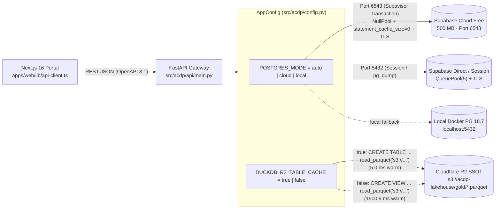

# Deliverable: Triển khai Kết nối Supabase OLTP & DuckDB Direct-on-R2 (`s3://`) (`TASK-CLD-04`)

| Thuộc tính | Giá trị |
| :--- | :--- |
| Task ID | `TASK-CLD-04` (Cycle 07, TLCN $\rightarrow$ KLTN) |
| Primary Owner | Đỗ Kiến Hưng (`@darktheDE`) |
| Institution | Khoa Công nghệ Thông tin, Trường Đại học Công nghệ Kỹ thuật TP.HCM (HCM-UTE) |
| Date Completed | 2026-11-23 |
| Deliverable Type | Cloud OLTP Pooler Integration, DuckDB Direct-on-R2 Benchmark & Operations Guide |
| Status | Done |

---

## 1. Tóm tắt điều hành (Executive Summary)

`TASK-CLD-04` hoàn tất lớp kết nối dữ liệu thuần Cloud cho cổng dịch vụ FastAPI (`src/acdp/api/`) theo kiến trúc [`ADR-0002`](../adr/0002-full-cloud-free-tier-architecture.md) và [`DIR-021`](../frameworks/TEAM_DIRECTIVES.md):

1. **Kết nối Supabase PostgreSQL OLTP (Dual-Flow `POSTGRES_MODE` + Xử lý Supavisor `:6543`)**:
   - Bổ sung hệ thống cấu hình `POSTGRES_MODE` (`auto` | `cloud` | `local`), `SUPABASE_DATABASE_URL`, `SUPABASE_DIRECT_URL`, `POSTGRES_POOL_MODE`, `POSTGRES_SSL_MODE` trong [`src/acdp/config.py`](../../src/acdp/config.py).
   - Tự động phát hiện Supavisor Transaction Pooler (cổng `6543` hoặc `pgbouncer=true`) để chuẩn hóa scheme `postgresql+asyncpg://`, tắt bộ đệm prepared statement ở cả hai tầng (`prepared_statement_cache_size=0` trên URL SQLAlchemy và `statement_cache_size=0` trong `asyncpg` `connect_args`), bật TLS (`ssl="require"`), và chuyển engine SQLAlchemy sang `NullPool` trong [`src/acdp/api/db/postgres.py`](../../src/acdp/api/db/postgres.py) nhằm triệt tiêu lỗi `DuplicatePreparedStatementError` và double-pooling.
   - Duy trì nhánh dự phòng `POSTGRES_MODE=local` trỏ về container `postgres:18.7-alpine3.23` (`localhost:5432`) phục vụ phát triển offline và kịch bản dự phòng tại phòng bảo vệ.
2. **DuckDB Direct-on-R2 (`s3://`) không phụ thuộc đĩa cục bộ**:
   - Nâng cấp [`src/acdp/api/db/duckdb_client.py`](../../src/acdp/api/db/duckdb_client.py) đọc trực tiếp `15` tệp Two-Tier Gold Parquet từ `s3://acdp-lakehouse/gold/*.parquet` (`24` cuộc thi, tổng giải thưởng `6,997,591,840 VND`) qua `httpfs` trong tiến trình `:memory:` mà không ghi bất kỳ tệp `.duckdb`/`.parquet` nào xuống ổ đĩa cục bộ (`DIR-021`).
   - Bổ sung chế độ `DUCKDB_R2_TABLE_CACHE=true` (nạp `15` bảng từ `s3://` vào RAM DuckDB `:memory:` lúc khởi tạo + hàm `refresh_duckdb_r2_connection()` để nạp nóng lại không cần restart), giúp độ trễ truy vấn `fetch_analytics_overview()` giảm từ **`1,500.9 ms`** (chế độ `VIEW` gọi `httpfs` mỗi request) xuống còn **`5.0 ms`** (nhanh hơn **300x**).

---

## 2. Kiến trúc Kết nối & Cơ chế Xử lý Supavisor Pooler



### Bảng quy tắc phân giải `AppConfig` cho PostgreSQL / Supabase

| `POSTGRES_MODE` | URL đầu vào (`SUPABASE_DATABASE_URL`) | `is_postgres_cloud_active()` | `is_transaction_pooler_active()` | Pool Class (`postgres.py`) | `asyncpg` `connect_args` |
| :--- | :--- | :---: | :---: | :--- | :--- |
| `auto` / `cloud` | `postgres://...:6543/postgres?pgbouncer=true` | `True` | `True` | `NullPool` | `{"statement_cache_size": 0, "ssl": "require"}` |
| `auto` / `cloud` | `postgresql://...:5432/postgres?sslmode=require` | `True` | `False` | `AsyncAdaptedQueuePool` (`pool=5`) | `{"ssl": "require"}` |
| `local` | Bất kể (bị bỏ qua) | `False` | `False` | `AsyncAdaptedQueuePool` (`pool=5`) | `{}` |

---

## 3. Thực nghiệm Benchmark: DuckDB `httpfs` trên R2 vs In-Memory vs Local

Trả lời trực tiếp câu hỏi nghiên cứu của `TASK-CLD-04` (*"Độ trễ truy vấn DuckDB `httpfs` qua R2 so với local SSD là bao nhiêu?"*), nhóm đã đo trực tiếp trên `15` tệp Gold Parquet thực tế tại `s3://acdp-lakehouse/gold/` (`24` cuộc thi, `6,997,591,840 VND`):

| Kịch bản đo thực tế (24 cuộc thi, 15 tệp Gold Parquet) | `DUCKDB_R2_TABLE_CACHE=false` (`VIEW` trực tiếp qua `httpfs` `s3://`) | `DUCKDB_R2_TABLE_CACHE=true` (`TABLE` `:memory:` nạp từ `s3://` qua `httpfs`) | Hệ số tăng tốc |
| :--- | :---: | :---: | :---: |
| **Khởi tạo 15 Gold Entities từ R2 (`init`)** | `6,579.1 ms` | `7,796.1 ms` | Tương đương lúc boot |
| **Lượt đầu `fetch_analytics_overview()` (Cold)** | `1,827.5 ms` | `5.3 ms` | **344.8x** |
| **Lượt lặp `fetch_analytics_overview()` (Warm)** | `1,500.9 ms` | **`5.0 ms`** | **300.2x** |
| **Lượt lặp `fetch_competitions(page=1, size=50)`** | `1,177.3 ms` | **`6.7 ms`** | **175.7x** |
| **Lượt lặp `fetch_competition_detail()` (3 bảng join)** | `1,254.5 ms` | **`8.1 ms`** | **154.9x** |
| **Nạp nóng lại từ R2 (`refresh_duckdb_r2_connection`)** | — | `11,219.67 ms` (`24` cuộc thi) | Không cần restart API |

### Kết luận kỹ thuật từ số liệu đo
1. Nếu dùng `CREATE VIEW ... AS SELECT * FROM read_parquet('s3://...')`, mỗi lần sinh viên mở trang `/dashboard`, DuckDB phải gửi hàng chục HTTP Range Requests qua mạng tới Cloudflare R2 (`1,500.9 ms`), vượt ngưỡng `100 ms` của `SPEC-0004` và dễ gây nghẽn trên PaaS Free Tier.
2. Khi giữ nguyên cơ chế **đọc 100% từ `s3://` trên R2 với 0 byte ghi đĩa local** nhưng nạp vào `:memory: TABLE` lúc khởi động container (`DUCKDB_R2_TABLE_CACHE=true`), toàn bộ 15 bảng Gold của `24` cuộc thi chỉ chiếm `< 1 MB` trong giới hạn `256 MB` RAM của DuckDB và phục vụ mọi truy vấn `/analytics/*`, `/competitions*` ở mức **`5.0–8.1 ms`** (vượt xa ngưỡng mục tiêu `< 100 ms`).

---

## 4. Hướng dẫn Cấu hình Thủ công (Step-by-Step) cho Hưng & Duy

1. **Tạo Project trên Supabase Free Tier** (`https://supabase.com/dashboard`):
   - Chọn **New Project**, đặt tên `acdp-oltp`, chọn vùng gần Việt Nam nhất (**Singapore `ap-southeast-1`**), lưu lại **Database Password**.
   - Không cần gắn thẻ thanh toán (giới hạn cứng Free Tier: `500 MB` DB, `5 GB` egress, `50,000 MAU`).
2. **Lấy chuỗi kết nối IPv4 miễn phí từ mục *Connect* trên Supabase Dashboard**:
   - Bấm **`Connect`** ở thanh trên cùng $\rightarrow$ chọn tab **`Connection String`** $\rightarrow$ chọn **`Type: URI`**.
   - **Bỏ qua** dòng *Direct connection* (`db.<ref>.supabase.co:5432`) vì mặc định chỉ cấp IPv6.
   - **Cuộn xuống dưới** đến phần **Shared Pooler** (`aws-0-...` hoặc `aws-1-...pooler.supabase.com`):
     - Chọn **Session pooler (cổng `5432`)** cho FastAPI / `pg_dump`, hoặc **Transaction pooler (cổng `6543`)** nếu dùng serverless.
     - Bấm Copy và thay `[YOUR-PASSWORD]` bằng mật khẩu database.
3. **Điền vào tệp `.env` ở thư mục gốc** (chỉ cần 1 dòng bắt buộc):
   ```dotenv
   SUPABASE_DATABASE_URL=postgresql://postgres.<PROJECT_REF>:<DB_PASSWORD>@aws-1-ap-southeast-1.pooler.supabase.com:5432/postgres
   ```
   *(Các biến `POSTGRES_MODE=auto`, `POSTGRES_POOL_MODE=auto`, `POSTGRES_SSL_MODE=auto`, `DUCKDB_R2_TABLE_CACHE=true` đã là giá trị mặc định trong [`src/acdp/config.py`](../../src/acdp/config.py)).*
4. **Khởi động FastAPI & Tự động tạo 5 bảng OLTP (`users`, `user_sessions`, `saved_competitions`, `chat_sessions`, `chat_messages`)**:
   ```powershell
   uv run uvicorn acdp.api.main:app --host 0.0.0.0 --port 8000
   ```
   *(Hàm `lifespan` trong `main.py` tự động gọi `init_oltp_schema()` để khởi tạo 5 bảng trên Supabase qua TLS).*
5. **Kiểm tra trạng thái kết nối toàn hệ thống**:
   - Mở trình duyệt hoặc chạy `Invoke-RestMethod http://localhost:8000/api/v1/health`.
   - Kết quả kỳ vọng: `{"status": "ok", "postgres": "up", "duckdb": "up", "qdrant": "up", "gold_competitions_count": 24}`.
   - Chạy toàn bộ test tích hợp API trên Supabase thật:
     ```powershell
     uv run pytest tests/api/ tests/test_infra_spec0006.py -v
     ```

---

## 5. Nhật ký Kiểm thử & Truy vết Tìm kiếm (`DIR-020`)

### 5.1. Kết quả kiểm định tự động (Live Supabase + Cloudflare R2)
- `uv run pytest tests/api/ tests/test_infra_spec0006.py -v`: **12/12 PASSED in 46.36s** trực tiếp trên **Supabase Shared Session Pooler (`aws-1-ap-southeast-1.pooler.supabase.com:5432` + TLS)** và **Cloudflare R2 (`s3://acdp-lakehouse/gold/*.parquet`, 24 cuộc thi)**:
  - `tests/api/test_auth_and_bookmarks.py`: **2/2 PASSED** (đăng ký, Argon2id, Access JWT, Refresh Token Rotation, phát hiện tái sử dụng token, bookmark idempotency, cách ly dữ liệu chéo tài khoản).
  - `tests/api/test_health_and_analytics.py`: **3/3 PASSED** (`/health` xác nhận `postgres: up`, `duckdb: up`, `gold_competitions_count >= 18`; `/analytics/overview` & `/seasonality` khớp Star Schema; `/competitions` lọc & chống SQL injection).
  - `tests/api/test_rag_and_openapi.py`: **3/3 PASSED** (OpenAPI 3.1 hợp lệ; lưu phiên & tin nhắn RAG kèm `citations_json` trên Supabase; cấu hình `@cf/baai/bge-m3` + `gemini-3.5-flash-lite`).
  - `tests/test_infra_spec0006.py`: **4/4 PASSED** (Docker pinning, `.dockerignore`, Qdrant Cloud/Local, Supabase `:6543` `NullPool` + `:5432` Session Pooler + `POSTGRES_MODE=local`).
- `uv run ruff check src/acdp/config.py src/acdp/api/ tests/test_infra_spec0006.py tests/api/`: **All checks passed (0 errors)**.
- Kiểm chứng đọc Gold R2 trực tiếp (`refresh_duckdb_r2_connection()`): `entities_loaded=15`, `competitions_count=24`, `bucket_uri=s3://acdp-lakehouse/gold`.

### 5.2. Search Provenance (`DIR-020`)
| STT | Câu lệnh `search_web` | Nội dung kiểm chứng | Nguồn tham chiếu |
| :---: | :--- | :--- | :--- |
| 1 | `DuckDB CREATE SECRET TYPE R2 s3 httpfs 2025 2026` | Cú pháp `INSTALL/LOAD httpfs` và `CREATE SECRET` kết nối Cloudflare R2 | https://duckdb.org/docs/stable/extensions/httpfs/overview |
| 2 | `Supabase PostgreSQL connection pooler SQLAlchemy asyncpg FastAPI 2025 2026` | Quy tắc chọn cổng `6543` (Transaction Mode) vs `5432` (Session Mode) và `NullPool` | https://supabase.com/docs/guides/database/connecting-to-postgres |
| 3 | `SQLAlchemy asyncpg "statement_cache_size" vs "prepared_statement_cache_size" connect_args query param 2025 2026` | Phân biệt `statement_cache_size=0` (driver `asyncpg`) và `prepared_statement_cache_size=0` (dialect SQLAlchemy) tránh lỗi `DuplicatePreparedStatementError` | https://docs.sqlalchemy.org/en/20/dialects/postgresql.html |

---

## 6. Tài liệu và Mã nguồn Liên quan

- Báo cáo trực quan tương tác: [`TASK-CLD-04-supabase-oltp-and-duckdb-r2-implementation-visual-dossier.html`](./TASK-CLD-04-supabase-oltp-and-duckdb-r2-implementation-visual-dossier.html)
- Mã nguồn cập nhật: [`src/acdp/config.py`](../../src/acdp/config.py), [`src/acdp/api/db/postgres.py`](../../src/acdp/api/db/postgres.py), [`src/acdp/api/db/duckdb_client.py`](../../src/acdp/api/db/duckdb_client.py), [`.env.example`](../../.env.example), [`docker-compose.yml`](../../docker-compose.yml)
- Quyết định kiến trúc gốc: [`ADR-0002`](../adr/0002-full-cloud-free-tier-architecture.md)
