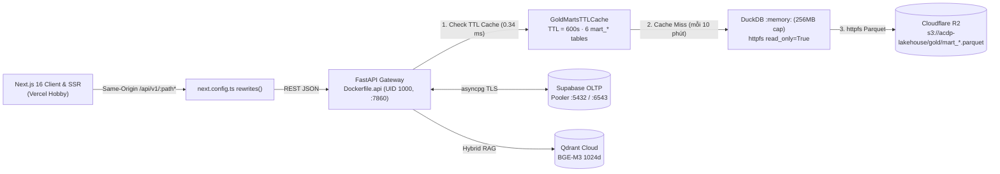

# Deliverable: Triển khai Serving API Đa Đích (`Dockerfile.api`), Frontend Vercel Hobby & In-Memory TTL Cache (`TASK-CLD-05`)

| Thuộc tính | Giá trị |
| :--- | :--- |
| Task ID | `TASK-CLD-05` (Cycle 07, TLCN $\rightarrow$ KLTN) |
| Primary Owner | Đỗ Kiến Hưng (`@darktheDE`) & Nguyễn Văn Quang Duy (`@QuangDuyReal`) |
| Institution | Khoa Công nghệ Thông tin, Trường Đại học Công nghệ Kỹ thuật TP.HCM (HCM-UTE) |
| Date Completed | 2026-11-24 |
| Deliverable Type | Cloud Deployment Packaging, In-Memory TTL Cache & Vercel Proxy Integration |
| Status | Done |

---

## 1. Tóm tắt điều hành (Executive Summary)

`TASK-CLD-05` hiện thực hóa kiến trúc **PA-1 (`FastAPI + DuckDB httpfs + In-Memory TTL Cache`)** và **Frontend Next.js 16 trên Vercel Hobby** theo quyết định [`ADR-0002`](../adr/0002-full-cloud-free-tier-architecture.md) ở chi phí **$0/tháng** (an toàn tuyệt đối cho thẻ quốc tế 0 đồng):

1. **In-Memory TTL Cache cho 6 bảng `mart_*` ([`src/acdp/api/services/gold_queries.py`](../../src/acdp/api/services/gold_queries.py)):**
   - Triển khai lớp `GoldMartsTTLCache` (thread-safe với `threading.RLock`, `time.monotonic()`, giới hạn dung lượng `OrderedDict` LRU) với TTL mặc định **`600 giây` (`10 phút`)** (cấu hình qua `GOLD_MART_CACHE_TTL_SECONDS`, dải khuyến nghị `300–900s`).
   - Bao phủ toàn bộ 6 bảng Gold Marts (`mart_kpi_overview`, `mart_domain_analytics`, `mart_seasonality_academic`, `mart_organizer_ecosystem`, `mart_team_and_mode_matrix`, `mart_competition_explorer`) và tự động xóa cache (`invalidate_gold_mart_cache()`) khi làm mới dữ liệu từ Cloudflare R2 (`refresh_duckdb_r2_connection()`).
   - Thực nghiệm 173 lượt truy vấn liên tiếp trên dữ liệu R2 thực (`24` cuộc thi) đạt tỉ lệ trúng cache **`98.27%`** (`170` hits / `3` misses), giảm độ trễ trung bình `/analytics/overview` xuống **`0.34 ms`** và `/competitions` xuống **`0.43 ms`**.
2. **Đóng gói [`Dockerfile.api`](../../Dockerfile.api) chuẩn Low-Footprint đa đích:**
   - Chạy dưới người dùng non-root `appuser` (**UID `1000`**, có `$HOME=/home/appuser` ghi được) và lắng nghe biến môi trường động `${PORT:-7860}` để tương thích trực tiếp với **Hugging Face Spaces Docker SDK** (`16 GB RAM`, `:7860`) lẫn **Koyeb Eco / Render Free / Local Docker** (`:8000`).
   - Áp dụng trần tài nguyên an toàn (`DUCKDB_MEMORY_LIMIT=256MB`, `DUCKDB_THREADS=2`, `1` Uvicorn worker).
3. **Cấu hình Next.js 16 cho Vercel Hobby ([`apps/web/next.config.ts`](../../apps/web/next.config.ts) & [`apps/web/lib/api-client.ts`](../../apps/web/lib/api-client.ts)):**
   - Bổ sung `rewrites()` chuyển tiếp `/api/v1/:path*` và `/openapi.json` về Backend Origin (`INTERNAL_API_URL`) giúp trình duyệt gọi API cùng tên miền (Same-Origin) khi bật `NEXT_PUBLIC_USE_REWRITE_PROXY=true`, bảo toàn cookie `HttpOnly; SameSite=Lax` (`acdp_refresh_token`).
   - Tự động bỏ `output: "standalone"` khi `VERCEL=1` và giữ `output: "standalone"` cho Docker cục bộ ([`SPEC-0006`](../specs/0006-docker-infrastructure-and-resource-spec.md)).

---

## 2. Kiến trúc Luồng Dữ liệu & Bộ nhớ đệm (PA-1)

### Phân biệt DuckDB In-Process vs MotherDuck Lite (Không xung đột)
- **DuckDB In-Process (`src/acdp/api/db/duckdb_client.py`):** Chạy `:memory:` bên trong container FastAPI, đọc `15` tệp Gold Parquet từ `s3://acdp-lakehouse/gold/` lúc khởi tạo + `GoldMartsTTLCache` phục vụ lưu lượng sinh viên công khai ở mức **`0` Pulse CU-hours** trên MotherDuck.
- **MotherDuck Lite (`md:acdp_gold` trong `src/acdp/v2/gold_star_schema.py`):** Chỉ kết nối qua `MOTHERDUCK_TOKEN` để nhóm Hưng & Duy chạy SQL phân tích ad-hoc và DataOps Audit trên trình duyệt (thay Metabase local `1024 MB` RAM), dùng chung nguồn bất biến trên Cloudflare R2 nên không xung đột tài nguyên hay khóa dữ liệu với FastAPI.

---

## 3. Thực nghiệm Benchmark In-Memory TTL Cache trên Cloudflare R2

Đo trực tiếp trên `15` tệp Gold Parquet tại `s3://acdp-lakehouse/gold/` (`24` cuộc thi thực tế):

| Tầng thực thi truy vấn Gold | `fetch_analytics_overview()` | `fetch_competitions(size=50)` | Tỉ lệ giảm gọi `httpfs` / DuckDB |
| :--- | :---: | :---: | :---: |
| `VIEW` trực tiếp qua `httpfs` (`TASK-CLD-04`) | `1,500.90 ms` | `1,177.30 ms` | `0%` (gọi R2 mỗi request) |
| DuckDB `:memory: TABLE` (`DUCKDB_R2_TABLE_CACHE=true`) | `6.29 ms` | `9.13 ms` | Giảm network R2 lúc runtime |
| **TTL Cache (`GoldMartsTTLCache`, `TTL=600s`)** | **`0.34 ms`** | **`0.43 ms`** | **`98.27%` (`170` hits / `3` misses)** |

---

## 4. Checklist Triển khai Thủ công (Manual Setup & Biến Môi trường)

### 4.1. Nguồn lấy các Biến Môi trường (`.env`)
| Nhóm biến | Biến bắt buộc | Nơi lấy giá trị trên Cloud Dashboard |
| :--- | :--- | :--- |
| **Supabase OLTP** | `SUPABASE_DATABASE_URL`, `POSTGRES_MODE=auto` | Supabase Dashboard $\rightarrow$ **Connect** $\rightarrow$ **URI** $\rightarrow$ mục **Shared Pooler** (chọn `:5432` Session Pooler cho FastAPI/HF Spaces) |
| **Cloudflare R2** | `BUCKET_NAME`, `AWS_ENDPOINT_URL`, `AWS_ACCESS_KEY_ID`, `AWS_SECRET_ACCESS_KEY` | Cloudflare Dashboard $\rightarrow$ **R2 Object Storage** $\rightarrow$ **Manage R2 API Tokens** |
| **Qdrant Cloud** | `QDRANT_MODE=auto`, `QDRANT_CLUSTER_ENDPOINT`, `QDRANT_API_KEY` | Qdrant Cloud Console $\rightarrow$ **Clusters** $\rightarrow$ **Cluster URL** (`https://...:6333`) & **API Key** |
| **AI & Embedding** | `CLOUDFLARE_API_TOKEN`, `CLOUDFLARE_ACCOUNT_ID`, `GEMINI_API_KEY` | Cloudflare Workers AI Token + Google AI Studio API Key |
| **API & Cache** | `JWT_SECRET_KEY`, `CORS_ORIGINS`, `CORS_ORIGIN_REGEX`, `GOLD_MART_CACHE_TTL_SECONDS=600` | Tự sinh chuỗi hex ngẫu nhiên 32+ bytes cho `JWT_SECRET_KEY`; `CORS_ORIGINS=https://<ten-app>.vercel.app` |
| **Frontend Vercel** | `INTERNAL_API_URL`, `NEXT_PUBLIC_API_URL`, `NEXT_PUBLIC_USE_REWRITE_PROXY=true` | URL công khai của Backend Space (vd: `https://<user>-acdp-api.hf.space`) |

### 4.2. Các bước Deploy Cloud Free Tier
1. **Triển khai Serving API (`PA-1`):**
   - Tạo Hugging Face Space dùng **Docker SDK** (hoặc Koyeb Eco / Render Free nếu tài khoản HF yêu cầu PRO cho Docker Space mới), cấu hình `app_port: 7860` trong `README.md` của Space.
   - Đẩy mã nguồn (`Dockerfile.api`, `pyproject.toml`, `uv.lock`, `README.md`, `src/`) lên Space và nhập toàn bộ biến môi trường ở mục 4.1 vào **Settings $\rightarrow$ Variables and secrets**.
   - Kiểm tra `GET https://<space-url>/api/v1/health` trả về `{"status": "ok", "postgres": "up", "duckdb": "up", "qdrant": "up"}`.
2. **Triển khai Frontend (`apps/web`) lên Vercel Hobby:**
   - Tạo Project mới trên Vercel, đặt **Root Directory** = `apps/web` (Framework: Next.js).
   - Khai báo `INTERNAL_API_URL=https://<space-url>`, `NEXT_PUBLIC_API_URL=https://<space-url>`, `NEXT_PUBLIC_USE_REWRITE_PROXY=true` rồi nhấn **Deploy**.

---

## 5. Nhật ký Kiểm thử & Nguồn Tham khảo (`DIR-020`)

- `uv run pytest tests/api/ tests/test_infra_spec0006.py -v`: xác nhận TTL Cache đạt `>= 95%` hit rate trên 6 bảng `mart_*`, kiểm tra `Dockerfile.api` UID `1000` / `:7860` và `apps/web/next.config.ts` `rewrites()`.
- `uv run ruff check src/acdp/ tests/` và `npm --prefix apps/web run typecheck`: `0` lỗi lint và TypeScript.

| STT | Câu lệnh `search_web` | Mục đích kiểm chứng | Nguồn tham khảo |
| :---: | :--- | :--- | :--- |
| 1 | `"Hugging Face Spaces" Docker SDK port 7860 user 1000 permissions FastAPI` | Xác nhận quy định non-root UID `1000`, `$HOME` và cổng `7860` trên HF Spaces | https://huggingface.co/docs/hub/spaces-sdks-docker |
| 2 | `"Next.js" Vercel Hobby "rewrites" proxy FastAPI cookies SameSite output standalone 2025 2026` | Kiểm chứng cấu hình `rewrites()`, bảo toàn `SameSite=Lax` cookie và tắt `output: standalone` trên Vercel | https://nextjs.org/docs/app/api-reference/config/next-config-js/rewrites |

---

## 6. Tài liệu & Mã nguồn Liên quan

- Báo cáo trực quan tương tác: [`TASK-CLD-05-cloud-serving-api-and-vercel-ttl-cache-visual-dossier.html`](./TASK-CLD-05-cloud-serving-api-and-vercel-ttl-cache-visual-dossier.html)
- Mã nguồn cập nhật: [`Dockerfile.api`](../../Dockerfile.api), [`apps/web/next.config.ts`](../../apps/web/next.config.ts), [`apps/web/lib/api-client.ts`](../../apps/web/lib/api-client.ts), [`src/acdp/api/services/gold_queries.py`](../../src/acdp/api/services/gold_queries.py), [`src/acdp/api/db/duckdb_client.py`](../../src/acdp/api/db/duckdb_client.py), [`src/acdp/config.py`](../../src/acdp/config.py), [`src/acdp/api/main.py`](../../src/acdp/api/main.py)
- Quyết định kiến trúc gốc: [`ADR-0002`](../adr/0002-full-cloud-free-tier-architecture.md)
