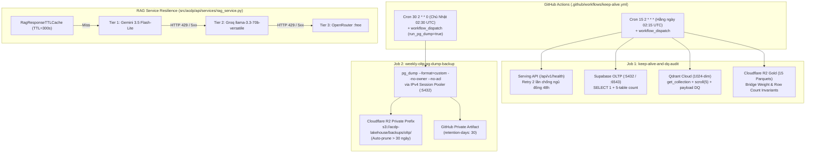

# Deliverable: GitHub Actions Keep-Alive, Backup `pg_dump` & Chuỗi Fallback LLM/Vector (`TASK-CLD-06`)

| Thuộc tính | Giá trị |
| :--- | :--- |
| Task ID | `TASK-CLD-06` (Cycle 07, TLCN $\rightarrow$ KLTN) |
| Primary Owner | Đỗ Kiến Hưng (`@darktheDE`) & Nguyễn Văn Quang Duy (`@QuangDuyReal`) |
| Institution | Khoa Công nghệ Thông tin, Trường Đại học Công nghệ Kỹ thuật TP.HCM (HCM-UTE) |
| Date Completed | 2026-11-24 |
| Deliverable Type | CI/CD Keep-Alive Automation, OLTP Disaster Recovery (`pg_dump`) & Multi-Provider AI/Vector Fallback |
| Status | Done |

---

## 1. Tóm tắt điều hành (Executive Summary)

`TASK-CLD-06` hoàn thiện lớp phòng thủ vận hành và phục hồi thảm họa (**0 USD/tháng**) cho kiến trúc Full Cloud Free-Tier theo [`TASK-CLD-03`](./TASK-CLD-03-full-cloud-free-tier-architecture.md) và [`ADR-0002`](../adr/0002-full-cloud-free-tier-architecture.md), xử lý trực tiếp ba nhóm rủi ro trọng yếu (`R1`, `R2`, `R4`):

1. **Chống ngủ đông & xóa dữ liệu cụm (`R1`) qua GitHub Actions (`.github/workflows/keep-alive.yml`) + [`cloud_ops.py`](../../src/acdp/v2/cloud_ops.py):**
   - Lịch chạy hằng ngày (`cron: '15 2 * * *'`, 02:15 UTC) đánh thức Serving API (`GET /api/v1/health` kèm retry cho cold start), thực thi `SELECT 1` + kiểm đếm 5 bảng OLTP trên **Supabase Free** (ngăn pause 7 ngày), và gọi `get_collection` + `scroll(limit=5)` trên **Qdrant Cloud Free** (ngăn suspend 7 ngày và xóa vĩnh viễn sau 28 ngày).
   - Tích hợp **Data Quality Audit tự động** trên cả 3 tầng: xác thực `points_count > 0` và vector `1024-dim` trên Qdrant Cloud, đồng thời kiểm định toàn bộ `15` tệp Gold Parquet trên **Cloudflare R2** (`dim_competition = mart_competition_explorer = mart_kpi_overview`, `0` bản ghi thiếu `canonical_url`/`name`, `0` vi phạm `SUM(allocation_weight) = 1.0` trên `bridge_competition_domain`).
2. **Sao lưu OLTP `pg_dump` định kỳ hàng tuần (`R4`) qua IPv4 Session Pooler (`:5432`):**
   - Khắc phục xung đột hạ tầng GitHub Actions (`ubuntu-latest` chỉ hỗ trợ IPv4 trong khi Direct Connection Supabase mặc định IPv6, còn Transaction Pooler `:6543` làm gãy khóa phiên của `pg_dump`): hàm `AppConfig.get_pg_dump_database_url()` tự động chuẩn hóa về **Shared Session Pooler `:5432`** kèm `sslmode=require`.
   - Job `weekly-oltp-pg-dump-backup` (`cron: '30 2 * * 0'` + `workflow_dispatch`) chạy `pg_dump --format=custom --no-owner --no-acl`, tạo tệp `.dump` + `.manifest.json` (kèm `SHA-256`), đẩy lên prefix riêng tư `backups/oltp/` trên Cloudflare R2 (tự động xóa bản cũ `> 30` ngày) và lưu Private GitHub Artifact (`retention-days: 30`).
3. **Chuỗi Fallback Đa nhà cung cấp AI/Vector & RAG TTL Cache (`R2`) tại [`rag_service.py`](../../src/acdp/api/services/rag_service.py):**
   - **LLM Generation Fallback Chain**: Hỗ trợ cả `httpx` OpenAI-compatible gọn nhẹ (mặc định) và `litellm.completion(..., fallbacks=[...])` (`USE_LITELLM_ROUTER=true`) theo thứ tự **Google Gemini (`gemini-3.5-flash-lite`) $\rightarrow$ Groq LPU (`llama-3.3-70b-versatile`) $\rightarrow$ OpenRouter Free (`meta-llama/llama-3.3-70b-instruct:free`)** khi gặp HTTP `429` (`RESOURCE_EXHAUSTED`), `5xx` hoặc timeout.
   - **Embedding & Retrieval Failover**: Thử lại có jitter trên Cloudflare Workers AI (`@cf/baai/bge-m3`) với tùy chọn fallback `fastembed` (`BAAI/bge-m3`); Qdrant Cloud failover sang Qdrant Backup và **DuckDB Gold Lexical Fallback** trên `mart_competition_explorer` (giữ nguyên trích dẫn `canonical_url` chuẩn `DIR-004`).
   - **In-Memory `RagResponseTTLCache` (`TTL = 300s`)**: Lưu cache câu trả lời đã grounded để giảm chi phí quota AI khi sinh viên hoặc Hội đồng hỏi lặp lại.

---

## 2. Kiến trúc CI/CD Keep-Alive, Backup & Chuỗi Fallback

---

## 3. Kết quả Kiểm chứng Thực tế & Data Quality Scorecard (`2026-11-24`)

Kết quả chạy trực tiếp lệnh `uv run python -m acdp.v2.cloud_ops --keep-alive --check-dq` (trong bối cảnh server Serving API đang tắt chủ động để phát triển):

| Thành phần kiểm định | Trạng thái | Chỉ số thực tế ghi nhận | Độ trễ |
| :--- | :---: | :--- | :---: |
| **Supabase OLTP (`supabase_oltp`)** | `ok` | `SELECT 1 = 1`; đủ `5/5` bảng (`users=1`, `user_sessions=4`, `saved_competitions=1`, `chat_sessions=1`, `chat_messages=2`) | `1,344.4 ms` |
| **Qdrant Cloud (`qdrant_cloud`)** | `ok` | Collection `acdp_competitions_bge_m3`: `778` vectors, `1024-dim`, `0` mẫu lỗi payload (`domain`, `source_url`, `page_content`) | `618.5 ms` |
| **Cloudflare R2 Gold (`r2_gold_dq`)** | `ok` | `15/15` tệp Parquet (`102.41 KB`); `dim_competition = mart_competition_explorer = mart_kpi_total = 24`; `0` null URL; `0` lỗi trọng số Bridge | `9,692.0 ms` |
| **Serving API (`serving_api`)** | `degraded` | Endpoint `https://acdp-api.onrender.com/api/v1/health` đang tắt cho development nên trả HTTP `503` sau `2` lần thử | `8,992.7 ms` |

### Kết quả Kiểm thử Tự động (`pytest` & `ruff`)
- `uv run pytest tests/api/ tests/test_infra_spec0006.py -v`: **`16/16 PASSED`** (`33.51s`), bao gồm các kịch bản mới:
  - `test_rag_llm_fallback_chain_and_ttl_cache`: mô phỏng lỗi `429 RESOURCE_EXHAUSTED` trên Gemini $\rightarrow$ failover sang Groq $\rightarrow$ failover sang OpenRouter `:free` $\rightarrow$ cache hit qua `RagResponseTTLCache`.
  - `test_rag_litellm_router_fallback_mode`: xác minh chế độ `USE_LITELLM_ROUTER=true` truyền đúng `fallbacks=[...]` cho `litellm.completion`.
  - `test_keep_alive_workflow_pg_dump_url_and_backup`: xác minh cấu trúc `.github/workflows/keep-alive.yml`, chuyển đổi URI `:6543` sang `:5432` cho `pg_dump`, tạo manifest `SHA-256`, upload R2 và xóa bản sao lưu quá `30` ngày.
- `uv run ruff check src/acdp/ tests/`: **`All checks passed!`** (`0` lỗi lint).

---

## 4. Hướng dẫn Cấu hình GitHub Repository Secrets

Để workflow `.github/workflows/keep-alive.yml` chạy tự động trên GitHub Actions, nhóm cần khai báo các Secrets sau tại **Settings $\rightarrow$ Secrets and variables $\rightarrow$ Actions**:

| Secret Key | Nguồn lấy & Lưu ý kỹ thuật |
| :--- | :--- |
| `SUPABASE_DATABASE_URL` | URI **Shared Session Pooler (`:5432`)** dạng `postgresql://postgres.<ref>:<pass>@aws-0-<region>.pooler.supabase.com:5432/postgres` (bắt buộc IPv4 cho `pg_dump` trên GitHub runner) |
| `SUPABASE_DIRECT_URL` | Tùy chọn: URI Session Pooler `:5432` chuyên biệt cho `pg_dump` (nếu `SUPABASE_DATABASE_URL` dùng Transaction Pooler `:6543`) |
| `QDRANT_CLUSTER_ENDPOINT` & `QDRANT_API_KEY` | URL HTTPS (`:6333`) và API Key từ Qdrant Cloud Console |
| `AWS_ENDPOINT_URL`, `AWS_ACCESS_KEY_ID`, `AWS_SECRET_ACCESS_KEY` | Khóa R2 từ Cloudflare Dashboard (`BUCKET_NAME=acdp-lakehouse`) |
| `PUBLIC_API_URL` | URL công khai của FastAPI trên HF Spaces / Koyeb / Render (vd: `https://<user>-acdp-api.hf.space`) |

---

## 5. Nhật ký Truy vấn & Nguồn Tham khảo Kiểm chứng (`DIR-020`)

| STT | Câu lệnh truy vấn (`search_web`) | Mục đích kiểm chứng | Nguồn tham khảo |
| :---: | :--- | :--- | :--- |
| 1 | `"Supabase" free tier inactivity pause 7 days keep alive GitHub Actions pg_dump backup 2025 2026` | Kiểm chứng chính sách pause 7 ngày và yêu cầu truy vấn cấp độ Postgres | [Supabase Going into Prod](https://supabase.com/docs/guides/platform/going-into-prod) |
| 2 | `"Supabase" pg_dump GitHub Actions IPv4 "pooler.supabase.com" port 5432 session mode 2025 2026` | Xác nhận runner GitHub chỉ có IPv4 và `pg_dump` bắt buộc dùng Session Pooler `:5432` thay vì `:6543` | [Supabase Connecting to Postgres](https://supabase.com/docs/guides/database/connecting-to-postgres) |
| 3 | `"Qdrant Cloud" free tier inactivity pause 7 days delete 4 weeks keep alive health check 2025 2026` | Kiểm chứng mốc suspend 7 ngày và xóa vĩnh viễn sau 4 tuần trên Qdrant Cloud Free | [Qdrant Cloud Documentation](https://qdrant.tech/documentation/cloud/) |
| 4 | `"Hugging Face Spaces" free tier sleep 48 hours keep alive GitHub Actions cron 2025 2026` | Kiểm chứng cơ chế ngủ đông và chu kỳ ping giữ ấm Space | [HF Spaces Overview](https://huggingface.co/docs/hub/spaces-overview) |
| 5 | `"api.groq.com/openai/v1/chat/completions" "openrouter.ai/api/v1/chat/completions" free tier models 2025 2026` | Kiểm chứng endpoint OpenAI-compatible, model `llama-3.3-70b-versatile` (Groq) và `:free` / `openrouter/free` | [OpenRouter Free Models](https://openrouter.ai/docs/api/reference/limits) |
| 6 | `Cloudflare R2 boto3 upload pg_dump custom format retention lifecycle 2025 2026` | Kiểm chứng tải tệp `.dump` bằng `boto3` và quản lý vòng đời 30 ngày trên R2 | [Cloudflare R2 Object Lifecycles](https://developers.cloudflare.com/r2/buckets/object-lifecycles/) |

---

## 6. Tài liệu & Mã nguồn Liên quan

- Báo cáo trực quan tương tác: [`TASK-CLD-06-github-actions-keep-alive-backup-and-fallback-visual-dossier.html`](./TASK-CLD-06-github-actions-keep-alive-backup-and-fallback-visual-dossier.html)
- Mã nguồn & CI/CD: [`.github/workflows/keep-alive.yml`](../../.github/workflows/keep-alive.yml), [`src/acdp/v2/cloud_ops.py`](../../src/acdp/v2/cloud_ops.py), [`src/acdp/api/services/rag_service.py`](../../src/acdp/api/services/rag_service.py), [`src/acdp/config.py`](../../src/acdp/config.py), [`.env.example`](../../.env.example)
- Kiểm thử liên quan: [`tests/api/test_rag_and_openapi.py`](../../tests/api/test_rag_and_openapi.py), [`tests/test_infra_spec0006.py`](../../tests/test_infra_spec0006.py)
- Quyết định kiến trúc gốc: [`ADR-0002`](../adr/0002-full-cloud-free-tier-architecture.md)
