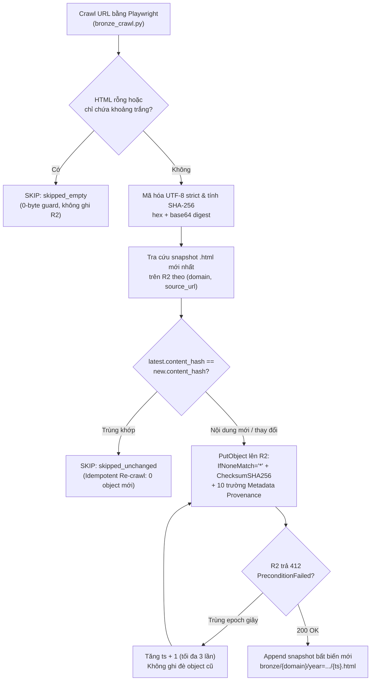

# Deliverable: Validate Lớp Đồng (Bronze) — Tính đầy đủ, Bất biến, Truy vết Nguồn gốc & Idempotent Re-crawl

| Thuộc tính | Giá trị |
| :--- | :--- |
| **Task ID** | `TASK-DQ-01` |
| **Chu kỳ / Phạm vi** | Cycle 07 / TLCN (Phase 1) — Tầng Bronze |
| **Nhóm thực hiện** | Đỗ Kiến Hưng (`@darktheDE`) & Nguyễn Văn Quang Duy (`@QuangDuyReal`) |
| **Giảng viên hướng dẫn** | ThS. Trần Quang Khải (Khoa CNTT, Trường ĐH Công nghệ Kỹ thuật TP.HCM — HCM-UTE) |
| **Ngày hoàn thành** | `2026-11-28` |
| **Trạng thái** | `Complete` (Đã áp dụng Phương án A trên Cloudflare R2 và đạt 7 trụ cột `DIR-024`) |

---

## 1. Tóm tắt điều hành & Ma trận Kiểm chứng 3 Trục

Sau khi hoàn thành [`TASK-BRZ-02`](./TASK-BRZ-02-raw-html-bronze-implementation.md), mã nguồn [`src/acdp/v2/bronze_crawl.py`](../../src/acdp/v2/bronze_crawl.py) đã lưu Raw Rendered HTML (`.html`) lên Cloudflare R2, nhưng kiểm toán thực tế lúc ban đầu trên `s3://acdp-lakehouse/bronze/` cho thấy 3 khoảng trống: (1) `0/34` object `.html` có đủ trường `content_hash`, `source_url`, `crawled_at` và `http_status`; (2) hàm `upload_to_bronze()` dùng `put_object()` trần nên re-crawl cùng nội dung sẽ sinh bản ghi trùng lặp; và (3) chưa có CLI kiểm định tự động đối soát toàn vẹn byte lẫn truy vết từ Silver/Gold về Bronze.

Công việc trong `TASK-DQ-01` giải quyết dứt điểm cả 3 khoảng trống trên thông qua nâng cấp [`src/acdp/v2/bronze_crawl.py`](../../src/acdp/v2/bronze_crawl.py), xây mới bộ kiểm định [`src/acdp/v2/bronze_validate.py`](../../src/acdp/v2/bronze_validate.py), thực thi backfill siêu dữ liệu không phá hủy (**Phương án A**) cho toàn bộ `34` object `.html` hiện có trên R2 và xác minh bằng bộ test tự động [`tests/test_bronze_validation_dq01.py`](../../tests/test_bronze_validation_dq01.py).

| Trục kiểm chứng | Chuẩn mực / Thực hành đối chiếu | Hiện trạng áp dụng trong ACDP (`TASK-DQ-01`) |
| :--- | :--- | :--- |
| **Lý thuyết (Medallion & Archiving)** | Chuẩn Bronze *Immutable Raw Landing* (Armbrust et al., CIDR 2021; Databricks Medallion) và ISO 28500:2017 WARC (`WARC-Payload-Digest`, hồ sơ `revisit`). | Lưu nguyên bản Raw Rendered HTML UTF-8; cấm ghi đè lịch sử; bổ sung dấu vân tay `SHA-256`, `source_url`, `crawled_at` và `http_status` theo chuẩn truy xuất nguồn gốc. |
| **Thực tiễn (Cloud Object Store)** | Cơ chế S3 Conditional Writes (`If-None-Match: *` trả HTTP `412 PreconditionFailed`) và `ChecksumSHA256` trên Cloudflare R2 (Jain et al., CIDR 2023; Cloudflare R2 S3 API). | Kiểm tra `content_hash` của snapshot mới nhất để bỏ qua upload khi nội dung không đổi (`skipped_unchanged`); ép `IfNoneMatch="*"` và `ChecksumAlgorithm="SHA256"` trên mọi `put_object`. |
| **Người dùng & Downstream** | Bảo đảm mọi quy định, giải thưởng và trích dẫn ở Gold/RAG truy ngược được về bản gốc HTML tại Bronze. | Tự động đối soát `24/24` dòng trong `silver/competitions.parquet` và `24/24` dòng trong `gold/dim_competition.parquet` trỏ đúng về `bronze_key` tồn tại và nguyên vẹn SHA-256 trên R2. |

---

## 2. Thiết kế Siêu dữ liệu Nguồn gốc, Bất biến & Idempotent Re-crawl



### 2.1. Đặc tả 10 trường Metadata Nguồn gốc trên Cloudflare R2

Mọi object Bronze `v2` (`.html`) giữ nguyên cấu trúc khóa `bronze/{domain}/year={YYYY}/month={MM}/day={DD}/{ts}.html` để tương thích 100% với regex `BRONZE_KEY_PATTERN` trong [`src/acdp/v2/silver_transform.py`](../../src/acdp/v2/silver_transform.py), đồng thời gắn 10 trường S3 User Metadata (`x-amz-meta-*`, tổng kích thước dưới 600 bytes, thấp hơn nhiều so với giới hạn 2 KB):

| Metadata Key | Định dạng / Ràng buộc | Vai trò trong kiểm định Provenance & Bất biến |
| :--- | :--- | :--- |
| `content_hash` | Chuỗi 64 ký tự hex (SHA-256) | Dấu vân tay mật mã của payload UTF-8 (`WARC-Payload-Digest`), dùng để phát hiện bit-rot và bỏ qua re-crawl trùng nội dung. |
| `source_url` | URL HTTP/HTTPS đầy đủ | Địa chỉ trang nguồn được crawl (hoặc trích từ thẻ `ACDP_PAGE_BOUNDARY` đầu tiên khi backfill). |
| `crawled_at` | ISO-8601 UTC (`YYYY-MM-DDTHH:MM:SSZ`) | Dấu thời gian thu thập chuẩn hóa để sắp xếp dòng lịch sử phiên bản. |
| `http_status` | Mã trạng thái HTTP (`"200"`, `"inferred_200"`, `"unknown"`) | Ghi nhận trạng thái phản hồi trực tiếp từ `CrawlResult.status_code`. |
| `source` | Hostname (`codetour.org`) | Khóa phân vùng theo tên miền trên R2. |
| `layer` | `"bronze"` | Đánh dấu tầng Medallion. |
| `format` | `"raw_html"` | Xác nhận định dạng HTML nguyên bản sau kết xuất JS (`TASK-BRZ-01`). |
| `page_count` | Chuỗi số nguyên dương (`>= 1`) | Số lượng trang con đóng gói bằng thẻ `ACDP_PAGE_BOUNDARY`. |
| `content_bytes` | Chuỗi số nguyên dương (`> 0`) | Kích thước byte UTF-8 để đối soát tính đầy đủ khi đọc lại từ R2. |
| `crawl_mode` | `"adaptive"`, `"fallback_single_page"`, `"backfill"`, `"verify_recrawl"` | Phân loại phương thức tạo snapshot. |

### 2.2. Xử lý tương thích với dữ liệu lịch sử (Phương án A)

Bucket `s3://acdp-lakehouse/bronze/` hiện chứa 3 nhóm đối tượng: `34` file `.html` (pipeline `v2`), `59` file không đuôi `.html` (Markdown `v1` trước `TASK-BRZ-01`) và `8` file hệ thống dưới `bronze/_*`. Module [`src/acdp/v2/bronze_validate.py`](../../src/acdp/v2/bronze_validate.py) phân tách rạch ròi 3 nhóm này để không làm sai lệch chỉ số của pipeline `v2`, đồng thời chạy `copy_object(..., MetadataDirective="REPLACE")` cho `34` file `.html` cũ (kèm cờ `metadata_backfilled="true"`) và xác minh `SHA-256 trước == SHA-256 sau` cho từng file.

---

## 3. Benchmark & Kết quả Kiểm chứng Thực nghiệm trên Cloudflare R2

### 3.1. Bảng đo đạc Trước và Sau Backfill (`s3://acdp-lakehouse/bronze/`)

| Chỉ số kiểm định | Trước kiểm định (Baseline) | Sau backfill & nâng cấp (Phương án A) | Nguồn kiểm chứng |
| :--- | :---: | :---: | :--- |
| **Tổng số object `bronze/`** | `101` (`34` v2 `.html`, `59` v1 `.md`, `8` system) | `102` (thêm 1 báo cáo JSON tại `bronze/_validation/`) | `bronze_validate.py --audit` |
| **Tổng dung lượng Active v2 `.html`** | `17,334,177 B` (`16.531 MB`, 32 domain) | `17,334,177 B` (bảo toàn 100% từng byte) | `bronze_validate.py --backfill-metadata` |
| **Tuân thủ Key Taxonomy (`year=/month=/day=`)** | `34 / 34` (`100.0%`) | `34 / 34` (`100.0%`) | `bronze_validate.py --audit` |
| **Non-Empty & Content-Type UTF-8** | `34 / 34` (`100.0%`) | `34 / 34` (`100.0%`) | `bronze_validate.py --audit` |
| **Giải mã UTF-8 Strict & `ACDP_PAGE_BOUNDARY`** | `34 / 34` (`100.0%`) | `34 / 34` (`100.0%`) | `bronze_validate.py --audit` |
| **Đủ 10 trường Metadata Provenance** | `0 / 34` (`0.0%`) | **`34 / 34` (`100.0%`)** | `bronze_validate.py --audit --save-report` |
| **Khớp mật mã SHA-256 (`HeadObject == Body`)** | `0 / 34` (`0.0%`) | **`34 / 34` (`100.0%`)** | `bronze_validate.py --audit --save-report` |
| **Nhóm trùng lặp ngoài kiểm soát** | `0` nhóm | **`0` nhóm** | `bronze_validate.py --audit` |
| **Truy vết Downstream (`Silver` & `Gold`)** | `24 / 24` Silver `->` Bronze; `24 / 24` Gold `->` Silver | **`24 / 24` Silver `->` Bronze; `24 / 24` Gold `->` Silver** | `bronze_validate.py --audit` |

### 3.2. Kết quả kiểm chứng Re-crawl 2 lần liên tiếp & Khóa bất biến R2 (`codetour.org`)

| Bước kiểm tra thực tế trên Cloudflare R2 | Tham số đầu vào / Hành động | Kết quả đo được |
| :--- | :--- | :--- |
| **Pass 1 (`upload_to_bronze_with_result`)** | Payload `https://codetour.org/` (`sha256=8f79cd555a4e...`) | `status="skipped_unchanged"`, giữ nguyên `bronze/codetour.org/year=2026/month=11/day=23/1795416946.html`, `delta_objects=0`. |
| **Pass 2 (`upload_to_bronze_with_result`)** | Lặp lại lần 2 liên tiếp với cùng payload | `status="skipped_unchanged"`, tổng object domain giữ nguyên `2`, `delta_objects_pass2=0`. |
| **Probe ghi đè vật lý (`IfNoneMatch="*"`)** | Gọi `put_object(..., Key=existing_key, Body=b"<!-- overwrite-probe -->", IfNoneMatch="*")` | Cloudflare R2 từ chối với **`PreconditionFailed` (HTTP `412`)**; đọc lại object gốc xác nhận SHA-256 còn nguyên vẹn `100%`. |
| **Bộ kiểm thử tự động (`pytest` + `ruff`)** | `tests/test_bronze_storage.py` + `tests/test_bronze_validation_dq01.py` | **`21/21 passed`** trong `2.68s`, `ruff check` trả về `0` lỗi. |

---

## 4. Luận cứ Phản biện Hội đồng & So sánh Open Table Format (Iceberg / Delta Lake)

1. **Tại sao dùng S3 Metadata + SHA-256 + `IfNoneMatch="*"` ở Bronze thay vì Apache Iceberg hoặc Delta Lake?**
   - Kiểm tra [`pyproject.toml`](../../pyproject.toml) xác nhận dự án chưa cài `deltalake`, `pyiceberg` hay `hudi` (chỉ có 1 file `_delta_log` tàn dư từ giai đoạn thử nghiệm v1 trên R2). Ở tầng Bronze, dữ liệu là các trang HTML phi cấu trúc kích thước 60 KB–2.1 MB, không phát sinh truy vấn SQL `UPDATE`/`MERGE` cấp dòng. Dấu vân tay SHA-256 trong S3 Metadata giải quyết trọn vẹn bài toán bất biến tệp thô theo chuẩn Web Archiving (ISO 28500) mà không tốn chi phí vận hành Catalog. Khi chuyển sang Phase 2 (KLTN, vượt ngưỡng `> 100` cuộc thi hoặc cần `SCD Type 2` tại `TASK-GLD-03`), hệ thống sẽ nâng cấp tầng bảng Parquet Silver/Gold sang **Apache Iceberg** hoặc **DuckLake** theo lộ trình trong [`RFC-0002`](../rfc/RFC-0002-kltn-scale-evolution-triggers.md).
2. **Việc chạy backfill bằng `copy_object` (`MetadataDirective="REPLACE"`) có phá vỡ nguyên lý bất biến không?**
   - Không. Hệ thống thực hiện self-copy chỉ để gắn bổ sung 7 header siêu dữ liệu còn thiếu từ `TASK-BRZ-02`, gắn cờ `metadata_backfilled="true"`, và tự động kiểm tra `SHA-256 trước == SHA-256 sau` trên toàn bộ `34/34` file (kết quả `byte_verified_ok: 34`, `errors: []`). Trong vận hành thường nhật về sau, mọi upload mới đều dùng `IfNoneMatch="*"` nên không thể ghi đè.
3. **Chi phí R2 Class A/B phát sinh khi bật check idempotency trước khi upload có vượt Free Tier không?**
   - Mỗi URL khi re-crawl chỉ phát sinh `1` lệnh `ListObjectsV2` (Class A, hạn mức `1.000.000`/tháng) và `1` lệnh `HeadObject` (Class B, hạn mức `10.000.000`/tháng). Khi nội dung không đổi, hệ thống bỏ qua luôn lệnh `PutObject` (Class A) và tiết kiệm băng thông lẫn dung lượng lưu trữ trùng lặp trên R2.

---

## 5. Hướng dẫn Kiểm thử Thủ công, Triển khai CLI & Kịch bản Demo GVHD

### Kịch bản Demo cho Giảng viên Hướng dẫn
- **Demo nhanh 5 phút**: Mở [`TASK-DQ-01-bronze-validation-report-visual-dossier.html`](./TASK-DQ-01-bronze-validation-report-visual-dossier.html) để xem KPI `34/34` (100%) và sơ đồ luồng `IfNoneMatch="*"`, sau đó chạy Bước 1 (`pytest`) và Bước 2 (`--audit`) trên PowerShell để thấy toàn bộ kiểm định chạy thật trên Cloudflare R2.
- **Demo chuyên sâu 15 phút**: Trình bày thêm Bước 3 (`--verify-recrawl --url https://codetour.org/`) để chứng minh trực tiếp trên R2 hai cơ chế: bỏ qua bản ghi trùng nội dung (`delta_objects_pass2=0`) và Cloudflare R2 trả về HTTP `412 PreconditionFailed` khi thử ghi đè object đã tồn tại.

### Bước 1: Chạy bộ kiểm thử tự động & kiểm tra mã nguồn (`pytest` + `ruff`)

```powershell
uv run pytest tests/test_bronze_storage.py tests/test_bronze_validation_dq01.py -v; if ($LASTEXITCODE -eq 0) { uv run ruff check src/acdp/v2/bronze_crawl.py src/acdp/v2/bronze_validate.py tests/test_bronze_storage.py tests/test_bronze_validation_dq01.py }
```

Captured Output:

```text
============================= test session starts =============================
platform win32 -- Python 3.11.14, pytest-9.2.0, pluggy-1.7.0 -- D:\Code\final-thesis\acdp-platform\.venv\Scripts\python.exe
cachedir: .pytest_cache
rootdir: D:\Code\final-thesis\acdp-platform
configfile: pyproject.toml
plugins: anyio-4.16.0, langsmith-0.14.17
collecting ... collected 21 items

tests/test_bronze_storage.py::test_local_backend_rejected_under_r2_exclusive_policy PASSED [  4%]
tests/test_bronze_storage.py::test_storage_options_cloudflare_r2_backend PASSED [  9%]
tests/test_bronze_storage.py::test_storage_options_custom_s3_backend_http PASSED [ 14%]
tests/test_bronze_storage.py::test_markdown_utf8_storage_and_sha256_integrity PASSED [ 19%]
tests/test_bronze_storage.py::test_bronze_r2_key_generation_logic PASSED [ 23%]
tests/test_bronze_storage.py::test_empty_content_check_logic PASSED      [ 28%]
tests/test_bronze_storage.py::test_upload_to_bronze_r2_and_empty_skip PASSED [ 33%]
tests/test_bronze_storage.py::test_v2_package_bronze_html_with_boundaries PASSED [ 38%]
tests/test_bronze_storage.py::test_v2_upload_to_bronze_raw_html_r2_and_empty_skip PASSED [ 42%]
tests/test_bronze_validation_dq01.py::test_bronze_upload_attaches_full_provenance_metadata_and_sha256 PASSED [ 47%]
tests/test_bronze_validation_dq01.py::test_bronze_utf8_vietnamese_diacritics_and_sha256_parity PASSED [ 52%]
tests/test_bronze_validation_dq01.py::test_bronze_idempotent_recrawl_same_content_creates_no_duplicate PASSED [ 57%]
tests/test_bronze_validation_dq01.py::test_bronze_changed_content_appends_new_immutable_version PASSED [ 61%]
tests/test_bronze_validation_dq01.py::test_bronze_if_none_match_prevents_overwrite_and_retries_next_second PASSED [ 66%]
tests/test_bronze_validation_dq01.py::test_bronze_empty_or_whitespace_payload_skipped PASSED [ 71%]
tests/test_bronze_validation_dq01.py::test_extract_primary_http_status_from_crawl_results PASSED [ 76%]
tests/test_bronze_validation_dq01.py::test_bronze_audit_passes_for_compliant_v2_and_downstream_silver_gold PASSED [ 80%]
tests/test_bronze_validation_dq01.py::test_bronze_audit_detects_missing_metadata_and_hash_tampering PASSED [ 85%]
tests/test_bronze_validation_dq01.py::test_bronze_audit_detects_invalid_utf8_and_missing_boundary PASSED [ 90%]
tests/test_bronze_validation_dq01.py::test_bronze_audit_detects_uncontrolled_duplicate_and_dangling_silver PASSED [ 95%]
tests/test_bronze_validation_dq01.py::test_bronze_backfill_preserves_exact_bytes_and_populates_provenance PASSED [100%]

============================= 21 passed in 2.68s ==============================
All checks passed!
```

### Bước 2: Chạy kiểm định toàn bộ Lớp Đồng trên Cloudflare R2 (`--audit --save-report`)

```powershell
uv run python -m acdp.v2.bronze_validate --audit --save-report --check-qdrant
```

Captured Output:

```text
================ BRONZE LAYER VALIDATION AUDIT ================
Bucket          : s3://acdp-lakehouse/bronze/
Audited At (UTC): 2026-11-28T08:56:00Z
Objects         : 101 total (v2_html=34 across 32 domains, v1_legacy=59, system=8)
v2 Payload Size : 17,334,177 B (16.531 MB)
Key Taxonomy    : 34/34 (100.0%)
Non-Empty       : 34/34 (100.0%)
UTF-8 Strict    : 34/34 (100.0%)
Page Boundary   : 34/34 (100.0%)
Provenance Meta : 34/34 (100.0%)
SHA-256 Match   : 34/34 (100.0%)
Duplicate Groups: 0
Downstream Link : Silver 24/24 -> Bronze | Gold 24/24 -> Silver
Overall Status  : PASS
===============================================================
Saved validation audit report -> s3://acdp-lakehouse/bronze/_validation/audit_1795856160.json
```

### Bước 3: Chạy kiểm chứng Re-crawl 2 lần liên tiếp & Probe bất biến `412 PreconditionFailed`

```powershell
uv run python -m acdp.v2.bronze_validate --verify-recrawl --url https://codetour.org/
```

Captured Output:

```text
[IDEMPOTENT-SKIP] codetour.org: Nội dung không đổi (sha256=8f79cd555a4e...), giữ nguyên snapshot bronze/codetour.org/year=2026/month=11/day=23/1795416946.html.
[IDEMPOTENT-SKIP] codetour.org: Nội dung không đổi (sha256=8f79cd555a4e...), giữ nguyên snapshot bronze/codetour.org/year=2026/month=11/day=23/1795416946.html.
================ LIVE IDEMPOTENT RE-CRAWL & 412 PROBE ================
{
  "url": "https://codetour.org/",
  "domain": "codetour.org",
  "source_mode": "existing_r2_snapshot",
  "expected_sha256": "8f79cd555a4ee3a57eab6e869627d107ab8615e515c158694432d07b995d568c",
  "count_before": 2,
  "count_after_pass1": 2,
  "count_after_pass2": 2,
  "pass1_status": "skipped_unchanged",
  "pass1_key": "bronze/codetour.org/year=2026/month=11/day=23/1795416946.html",
  "pass2_status": "skipped_unchanged",
  "pass2_existing_key": "bronze/codetour.org/year=2026/month=11/day=23/1795416946.html",
  "delta_objects_pass2": 0,
  "if_none_match_probe_key": "bronze/codetour.org/year=2026/month=11/day=23/1795416946.html",
  "if_none_match_blocked": true,
  "if_none_match_error_code": "PreconditionFailed",
  "if_none_match_http_status": 412,
  "target_object_intact_after_probe": true,
  "overall_status": "PASS"
}
```

---

## 6. Tài liệu & Mã nguồn Liên quan

- Báo cáo trực quan HTML: [`TASK-DQ-01-bronze-validation-report-visual-dossier.html`](./TASK-DQ-01-bronze-validation-report-visual-dossier.html)
- Mã nguồn crawler Bronze `v2` (provenance + `IfNoneMatch` + idempotency): [`src/acdp/v2/bronze_crawl.py`](../../src/acdp/v2/bronze_crawl.py)
- Công cụ kiểm định & backfill Lớp Đồng: [`src/acdp/v2/bronze_validate.py`](../../src/acdp/v2/bronze_validate.py)
- Bộ kiểm thử tự động `TASK-DQ-01`: [`tests/test_bronze_validation_dq01.py`](../../tests/test_bronze_validation_dq01.py) và [`tests/test_bronze_storage.py`](../../tests/test_bronze_storage.py)
- Đặc tả kỹ thuật liên kết: [`SPEC-0002`](../specs/0002-data-ingestion-and-schema-spec.md) và [`task-registry.md`](../tasks/task-registry.md)

---

## 7. Search Provenance & Nhật ký Truy vấn (`DIR-020`)

| # | Câu truy vấn (`search_web`) | Mục đích kiểm chứng | Nguồn chính thức đã xác minh HTTP 200 |
| :---: | :--- | :--- | :--- |
| 1 | `Databricks Medallion Architecture bronze layer immutability append-only metadata provenance 2025 2026` | Chuẩn hóa nguyên tắc append-only và metadata nguồn tại Bronze | https://docs.databricks.com/aws/en/lakehouse/medallion |
| 2 | `"Lakehouse: A New Generation of Open Platforms" Armbrust CIDR 2021 bronze raw immutable` | Cơ sở khoa học về tầng dữ liệu thô bất biến trong Lakehouse | https://www.cidrdb.org/cidr2021/papers/cidr2021_paper17.pdf |
| 3 | `Cloudflare R2 S3 conditional write If-None-Match SHA-256 content hash idempotent ingestion 2025 2026` | Cơ chế ghi có điều kiện `If-None-Match: *` trên Cloudflare R2 | https://developers.cloudflare.com/r2/api/s3/extensions/ |
| 4 | `W3C PROV-O data provenance lineage web archiving WARC SHA-256 content addressing idempotent ingestion` | Đối chiếu chuẩn lưu trữ web ISO 28500:2017 và SHA-256 content digest | https://iipc.github.io/warc-specifications/specifications/warc-format/warc-1.1/ |
| 5 | `Cloudflare R2 S3 API compatibility PutObject If-None-Match Metadata ChecksumSHA256` | Kiểm tra khả năng tương thích `Metadata` và `ChecksumSHA256` của R2 | https://developers.cloudflare.com/r2/api/s3/api/ |
| 6 | `"boto3" s3 put_object "IfNoneMatch" "ChecksumSHA256" documentation` | Tham số chuẩn trong `boto3 1.43.126` cho `put_object` | https://docs.aws.amazon.com/boto3/latest/reference/services/s3/client/put_object.html |
| 7 | `"ISO 28500" WARC specification SHA-256 payload digest provenance iipc` | Quy chuẩn `WARC-Payload-Digest` và deduplication hồ sơ `revisit` | https://docs.aws.amazon.com/AmazonS3/latest/userguide/conditional-writes.html |

Tài liệu tham khảo bổ sung đã xác minh HTTP 200: [Databricks Medallion Blog](https://www.databricks.com/blog/what-is-medallion-architecture), [Jain et al., CIDR 2023](https://www.cidrdb.org/cidr2023/papers/p92-jain.pdf), [Cloudflare R2 Consistency](https://developers.cloudflare.com/r2/reference/consistency/), [AWS S3 Checking Object Integrity](https://docs.aws.amazon.com/AmazonS3/latest/userguide/checking-object-integrity.html), [Crawl4AI Docs](https://docs.crawl4ai.com/).
