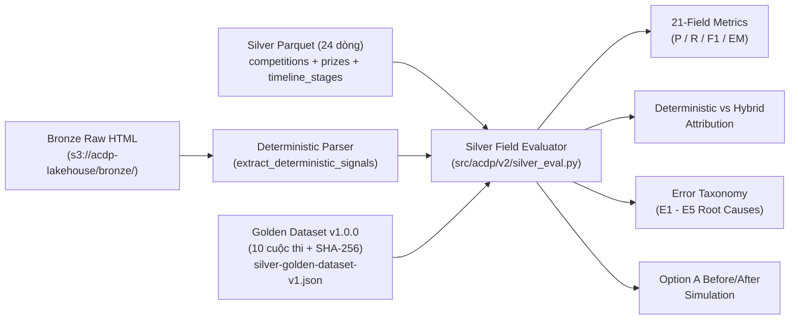

# Deliverable: Xây dựng Golden Dataset & Đo Độ chính xác Trích xuất Lớp Bạc theo Từng Field

| Thuộc tính | Giá trị |
| :--- | :--- |
| **Task ID** | `TASK-DQ-02` |
| **Chu kỳ / Phạm vi** | Cycle 07 / TLCN (Phase 1) — Tầng Silver |
| **Nhóm thực hiện** | Đỗ Kiến Hưng (`@darktheDE`) & Nguyễn Văn Quang Duy (`@QuangDuyReal`) |
| **Giảng viên hướng dẫn** | ThS. Trần Quang Khải (Khoa CNTT, Trường ĐH Công nghệ Kỹ thuật TP.HCM — HCM-UTE) |
| **Ngày hoàn thành** | `2026-11-28` |
| **Trạng thái** | `Complete` (Đã đo Baseline, áp dụng Phương án A vá lỗi tất định và đạt 7 trụ cột `DIR-024`) |

---

## 1. Tóm tắt điều hành & Ma trận Kiểm chứng 3 Trục

Pipeline Silver `v2` ([`src/acdp/v2/silver_transform.py`](../../src/acdp/v2/silver_transform.py)) kết hợp bộ trích xuất tất định (JSON-LD, OpenGraph, Regex, Outbound Link Scorer) cùng mô hình ngôn ngữ lớn có ràng buộc cấu trúc (`Instructor` + Pydantic v2 trong [`src/acdp/v2/schemas.py`](../../src/acdp/v2/schemas.py)), hiện lưu trữ `24` cuộc thi trên `s3://acdp-lakehouse/silver/competitions.parquet`. Trước `TASK-DQ-02`, hệ thống chưa có tập chuẩn gán nhãn tay (ground truth) và chưa có công cụ chấm điểm từng trường dữ liệu để phân định lỗi do bộ phân tích HTML hay do LLM.

Nhóm đã xây dựng tập **Golden Dataset v1.0.0** gồm `10` cuộc thi phân tầng gán nhãn độc lập trực tiếp từ Bronze Raw HTML và Silver Clean Markdown tại [`docs/experiments/data/silver-golden-dataset-v1.json`](../experiments/data/silver-golden-dataset-v1.json) (`SHA-256: e77704b68711b50571f589249b0ea80b2eeddfa595a964d674bef9b4af457cc9`), phát triển bộ máy chấm điểm [`src/acdp/v2/silver_eval.py`](../../src/acdp/v2/silver_eval.py) và đo thực nghiệm trên Cloudflare R2. Kết quả Baseline đạt **Tier 1 Critical Micro-F1 = `0.905`** (`EM = 0.889`), **Tier 2 Operational Micro-F1 = `0.859`** và **Tier 3 Nested/Advisor Micro-F1 = `0.866`** (`prizes` Bipartite F1 = `0.99`, `timeline_stages` = `0.98`). Sau khi vá 2 nhóm lỗi tất định theo Phương án A (không ghi đè R2 production), **Deterministic `url` tăng F1 từ `0.8421` lên `1.0000`**, **`registration_deadline_date` tăng từ `0.9333` lên `1.0000`**, và **`deterministic_official_rules_url` tăng từ `0.0000` lên `0.7273`**.

| Trục kiểm chứng | Chuẩn mực / Thực hành đối chiếu (2024–2026) | Hiện trạng áp dụng trong ACDP (`TASK-DQ-02`) |
| :--- | :--- | :--- |
| **Lý thuyết (IE Evaluation)** | *ExtractBench* (`arXiv:2602.12247`, Contextual AI, 02/2026), *LLMStructBench* (`arXiv:2602.14743`, 02/2026) và *SQC-Score* (`arXiv:2404.03532`): tách tính hợp lệ JSON khỏi độ chính xác giá trị từng trường, dùng hàm khớp theo kiểu dữ liệu và bipartite matching cho mảng đối tượng. | Triển khai 21 đặc tả trường (`FIELD_SPECS`) gồm Exact URL, Exact ISO Date, dung sai số `±5%` cho `total_prize_vnd`, Set-F1 cho danh sách, Token-F1 chuẩn hóa và Order-insensitive Bipartite F1 cho `prizes` / `timeline_stages`. |
| **Thực tiễn (Production Eval)** | *Error Analysis First* (Hamel Husain) và quy trình *Code-First Golden Dataset* (`Pydantic Evals` + `Instructor`): gắn `case_id` cố định, kiểm tra dấu vân tay `SHA-256` và phân nhóm lỗi trước khi sửa prompt hoặc schema. | Đóng gói Golden Dataset JSON có `content_sha256` dưới `docs/experiments/data/`, xuất kết quả máy đọc tại [`silver-dq02-eval-results.json`](../experiments/data/silver-dq02-eval-results.json) và phân loại `47` sai lệch thành bảng 5 nhóm nguyên nhân `E1–E5`. |
| **Người dùng (Student & Advisor)** | Bảo đảm ngày hạn chót, tổng giải thưởng, quy mô đội, hình thức thi và đường dẫn trang chính thức hiển thị trên `/competitions`, `/teams`, `/copilot` khớp nguồn công bố của Ban Tổ chức. | Phân 21 trường theo 3 tầng độ nhạy nghiệp vụ (Tier 1 Critical, Tier 2 Operational, Tier 3 Nested & Advisor), áp dụng quy ước `GT=None & Pred=None -> TN` để không thổi phồng Precision/Recall và phạt kép (`1 FP + 1 FN`) khi trích sai giá trị. |

---

## 2. Thiết kế Golden Dataset, Quy ước Tính điểm & Kiến trúc Đánh giá



### 2.1. Phân tầng 10 Cuộc thi Golden (Scope TLCN 5–10 cuộc thi)

Tất cả 10 bản ghi đều được đọc trực tiếp từ `bronze/<domain>/.../*.html` và `silver/markdown/<domain>/.../*.md` (ảnh chụp ngày `2026-11-23`), kèm trích đoạn bằng chứng nguyên văn (`evidence_snippets`) để Giảng viên hướng dẫn đối soát độc lập với kết quả do pipeline sinh ra.

| `case_id` | Cuộc thi | Domain Bronze | Phân tầng (Stratum) & Điểm kiểm thử trọng tâm |
| :--- | :--- | :--- | :--- |
| `gold-01` | Zalo AI Challenge 2026 | `challenge.zalo.ai` | Trang chính thức chuẩn: giải thưởng `USD 12,000`, link `/regulations`, email `aichallenge@zalo.me`. |
| `gold-02` | Code Tour 2026 | `codetour.org` | SPA React: hạn chót không công bố trên DOM, lẫn nhiều mùa 2024–2026 trên `/contest`. |
| `gold-03` | AI Arena Viet Nam 2026 | `ai-arena-vietnam.vnu.edu.vn` | Trang ĐHQGHN: 5 hạng giải phi tiền mặt (Gemini Ultra/Pro, chuyến đi Singapore), có `/the-le`. |
| `gold-04` | AI Challenge TP.HCM 2026 | `aichallenge.hochiminhcity.gov.vn` | Cổng cơ quan Nhà nước: 7 vòng thi, crawl kèm trang tin `dost.hochiminhcity.gov.vn` gây nhiễu. |
| `gold-05` | Data for Life mùa 4 - 2026 | `dataforlife.vn` | Cổng quốc gia: đội 3–10 người, canonical `/trang-chu`, giá trị tiền thưởng chưa công bố. |
| `gold-06` | RMIT Hack-A-Venture 2026 | `www.rmithackaventure.com` | Song ngữ/EN, lộ trình xuyên năm `2026–2027`, tổng giải lẻ `817,291,840 VND`, link Rules trên Canva. |
| `gold-07` | Vietnam AI Innovation Challenge | `www.vietnamaichallenge.com` | Hạn chót kèm giờ `"17/07/2026 – 11:00"` (bẫy chuẩn hóa ISO date `E2`), FAQ đóng kín. |
| `gold-08` | Cyber Solutions Challenge 2026 | `bronze/cntt.ntt.edu.vn` | Tin trường ĐH resolve sang `cyber2026.kcntt.edu.vn`; bẫy số lượng suất giải (`02` giải Ba, `06` Khuyến khích). |
| `gold-09` | UIT Data Science Challenge 2026 | `www.uit.edu.vn` | Tin trường ĐH không có microsite riêng; bẫy link header `tracuu.citd.edu.vn` và PDF nghị quyết 2024 (`E1`). |
| `gold-10` | DATATHON 2026 (VinUniversity) | `ybox.vn` | Aggregator (`198 KB` Markdown): 40 KB feed việc làm đẩy bài chính quá ngưỡng `16 KB` (`E5`), banner quảng cáo `ntu.edu.sg` (`E1`). |

### 2.2. Quy ước Tính điểm cho Trường Nullable & Dữ liệu Lồng nhau

Đối với từng trường vô hướng hoặc danh sách phẳng trên mỗi cuộc thi: cặp `(GT != None, Pred != None)` khớp luật tính `1 TP`; sai giá trị tính đồng thời `1 FP + 1 FN` nhằm phạt cả Precision lẫn Recall theo chuẩn *ExtractBench*; `(GT == None, Pred != None)` tính `1 FP` (hallucination hoặc nhiễu parser); `(GT != None, Pred == None)` tính `1 FN` (bỏ sót); và `(GT == None, Pred == None)` tính `1 TN` (cộng vào Exact Match nhưng không làm phình TP). Giá trị `"unknown"` ở `mode`/`eligibility_level` và `0` ở `total_prize_vnd` được quy về trạng thái chưa trích xuất (`None`) để phản ánh đúng độ phủ thực tế. Với mảng `prizes` và `timeline_stages`, bộ đánh giá dùng ghép cặp hai phía không phụ thuộc thứ tự (`score_bipartite_array`, ngưỡng tương đồng `>= 0.55`).

---

## 3. Benchmark & Kết quả Đo đạc Thực nghiệm

Toàn bộ số liệu bên dưới được trích nguyên văn từ [`docs/experiments/data/silver-dq02-eval-results.json`](../experiments/data/silver-dq02-eval-results.json) sau khi chạy `uv run python -m acdp.v2.silver_eval --evaluate-r2` trên tập `24` bản ghi Silver Parquet hiện hành (`2026-11-23`) đối chiếu với `10` cuộc thi Golden.

### 3.1. Bảng Điểm Chi tiết theo Từng Field (21 Trường × 10 Cuộc thi)

| Trường dữ liệu (`field`) | Tầng | Luật khớp | Precision | Recall | F1 | Exact Match | `TP/FP/FN/TN` | Ngưỡng F1 | Trạng thái |
| :--- | :---: | :--- | :---: | :---: | :---: | :---: | :---: | :---: | :---: |
| `url` | Tier 1 | `exact_url` | `0.80` | `0.89` | `0.84` | `0.80` | `8/2/1/0` | `0.90` | `GAP (E1)` |
| `registration_deadline_date` | Tier 1 | `exact_date` | `1.00` | `0.88` | `0.93` | `0.90` | `7/0/1/2` | `0.90` | `PASS` |
| `event_start_date` | Tier 1 | `exact_date` | `0.90` | `0.90` | `0.90` | `0.90` | `9/1/1/0` | `0.85` | `PASS` |
| `event_end_date` | Tier 1 | `exact_date` | `0.90` | `0.90` | `0.90` | `0.90` | `9/1/1/0` | `0.85` | `PASS` |
| `total_prize_vnd` | Tier 1 | `numeric_tol_5pct` | `0.71` | `0.83` | `0.77` | `0.80` | `5/2/1/3` | `0.85` | `GAP (E5)` |
| `total_prize_pool` | Tier 1 | `token_f1_065` | `0.71` | `0.83` | `0.77` | `0.70` | `5/2/1/3` | `0.85` | `GAP (E5)` |
| `team_size_min` | Tier 1 | `exact_int` | `1.00` | `1.00` | `1.00` | `1.00` | `8/0/0/2` | `0.90` | `PASS` |
| `team_size_max` | Tier 1 | `exact_int` | `1.00` | `1.00` | `1.00` | `1.00` | `8/0/0/2` | `0.90` | `PASS` |
| `is_individual_allowed` | Tier 1 | `exact_bool` | `1.00` | `1.00` | `1.00` | `1.00` | `8/0/0/2` | `0.90` | `PASS` |
| `name` | Tier 2 | `token_f1_085` | `1.00` | `1.00` | `1.00` | `1.00` | `10/0/0/0` | `0.95` | `PASS` |
| `mode` | Tier 2 | `exact_enum` | `0.89` | `0.89` | `0.89` | `0.90` | `8/1/1/1` | `0.85` | `PASS` |
| `participation_fee` | Tier 2 | `normalized_fee` | `1.00` | `1.00` | `1.00` | `1.00` | `10/0/0/0` | `0.90` | `PASS` |
| `organizers` | Tier 2 | `set_f1` | `1.00` | `1.00` | `1.00` | `0.90` | `10/0/0/0` | `0.80` | `PASS` |
| `category` | Tier 2 | `set_f1` | `1.00` | `1.00` | `1.00` | `0.50` | `10/0/0/0` | `0.80` | `PASS` |
| `eligibility_level` | Tier 2 | `exact_enum` | `0.00` | `0.00` | `0.00` | `0.00` | `0/0/10/0` | `0.80` | `GAP (E3)` |
| `target_audience` | Tier 2 | `token_f1_055` | `0.70` | `0.70` | `0.70` | `0.30` | `7/3/3/0` | `0.80` | `GAP (E5)` |
| `prizes` | Tier 3 | `bipartite_prizes` | `0.97` | `1.00` | `0.99` | `0.90` | `39/1/0/0` | `0.80` | `PASS` |
| `timeline_stages` | Tier 3 | `bipartite_stages` | `0.98` | `0.98` | `0.98` | `0.90` | `42/1/1/0` | `0.80` | `PASS` |
| `official_rules_url` | Tier 3 | `exact_url` | `0.00` | `0.00` | `0.00` | `0.40` | `0/1/5/4` | `0.70` | `GAP (E1/E5)` |
| `organizer_contact` | Tier 3 | `exact_email` | `0.00` | `0.00` | `0.00` | `0.30` | `0/0/7/3` | `0.70` | `GAP (E3)` |
| `requires_advisor` | Tier 3 | `exact_bool` | `0.00` | `0.00` | `0.00` | `0.10` | `0/0/9/1` | `0.70` | `GAP (E3)` |

Tổng hợp theo 3 tầng trọng yếu: **Tier 1 Critical** (`9` trường) đạt Micro Precision `0.893`, Micro Recall `0.918`, Micro F1 `0.905`, Macro EM `0.889` (`6/9` đạt chuẩn); **Tier 2 Operational** (`7` trường) đạt Micro Precision `0.932`, Micro Recall `0.797`, Micro F1 `0.859`, Macro EM `0.657` (`5/7` đạt chuẩn); **Tier 3 Nested & Advisor** (`5` trường) đạt Micro Precision `0.964`, Micro Recall `0.786`, Micro F1 `0.866`, Macro EM `0.520` (`2/5` đạt chuẩn).

### 3.2. Đối chiếu Deterministic Parser vs Hybrid Silver Pipeline (7 Trường giao nhau)

| Trường dùng chung | Det Precision | Det Recall | Det F1 | Det EM | Hybrid F1 | Hybrid EM | Chênh lệch (`Hybrid - Det` F1) | Nhận xét phân vai |
| :--- | :---: | :---: | :---: | :---: | :---: | :---: | :---: | :--- |
| `url` | `1.00` | `1.00` | `1.00` | `1.00` | `0.84` | `0.80` | **`-0.16`** | Sau vá Phương án A, parser tất định loại sạch link rác header/banner. |
| `official_rules_url` | `0.67` | `0.80` | `0.73` | `0.80` | `0.00` | `0.40` | **`-0.73`** | Parser bắt được `/the-le`, `/regulations`, Canva rules mà LLM/R2 cũ bỏ sót. |
| `registration_deadline_date` | `1.00` | `0.75` | `0.86` | `0.80` | `0.93` | `0.90` | `+0.08` | Regex bắt ngày tốt nhưng cần LLM định danh ngày nào là hạn đăng ký. |
| `mode` | `0.75` | `0.67` | `0.71` | `0.70` | `0.89` | `0.90` | `+0.18` | LLM phân biệt chính xác thi online kết hợp chung kết offline (`hybrid`). |
| `participation_fee` | `1.00` | `0.50` | `0.67` | `0.50` | `1.00` | `1.00` | `+0.33` | Regex chỉ bắt chữ `"miễn phí"`, bỏ sót trường hợp không thu phí ngầm định. |
| `team_size_min` | `1.00` | `0.13` | `0.22` | `0.30` | `1.00` | `1.00` | **`+0.78`** | Văn phong tiếng Việt quá đa dạng (`"không quá 5"`, `"03–10"`, `"cá nhân"`). |
| `team_size_max` | `1.00` | `0.13` | `0.22` | `0.30` | `1.00` | `1.00` | **`+0.78`** | LLM đạt `1.00` F1 tuyệt đối ở nhóm quy mô đội nhờ hiểu ngữ cảnh tự nhiên. |

### 3.3. Kết quả Cải thiện Before vs After (Phương án A — Vá lỗi Tất định, Không ghi đè R2)

| Hạng mục đo kiểm | Before (Baseline gốc) | After (Sau vá `schemas.py` & `silver_transform.py`) | Mức cải thiện (`Delta`) | Cơ chế kỹ thuật áp dụng |
| :--- | :---: | :---: | :---: | :--- |
| `registration_deadline_date` (Hybrid Re-parse) | `F1 = 0.9333` (`EM = 0.90`) | **`F1 = 1.0000`** (**`EM = 1.00`**) | **`+0.0667` F1** (`+10%` EM) | Mở rộng `parse_date_value()` nhận diện hậu tố/tiền tố giờ (`"17/07/2026 – 11:00"`). |
| `url` (Deterministic Resolver trên Bronze HTML) | `F1 = 0.8421` (`EM = 0.80`) | **`F1 = 1.0000`** (**`EM = 1.00`**) | **`+0.1579` F1** (`+20%` EM) | Gỡ `<nav>`, `<header>`, `<footer>`, `<aside>`, `.rpa__media`; chỉ quét `pages[0]` cho aggregator. |
| `official_rules_url` (Deterministic Link Extractor) | `F1 = 0.0000` (`EM = 0.40`) | **`F1 = 0.7273`** (**`EM = 0.80`**) | **`+0.7273` F1** (`+40%` EM) | Chặn PDF nội bộ (`07_nq_hdtdhcntt...`) và nhận diện trang `/the-le`, `/regulations`, `handbook`. |

### 3.4. Bảng Phân loại Nguyên nhân Lỗi (Error Taxonomy `E1–E5`)

Tổng cộng phát hiện `47` sai lệch trên `210` lượt trường đánh giá (`21 fields × 10 cases`).

| Mã lỗi | Mô tả nguyên nhân gốc | Số lượng | Tỷ lệ | Ví dụ thực tế điển hình từ 10 cuộc thi |
| :--- | :--- | :---: | :---: | :--- |
| `E3_PROMPT_SCHEMA_DRIFT` | Ảnh chụp JSON trên R2 sinh trước khi prompt LLM cập nhật đầy đủ trường Schema v2 (`G2`, `G4`). | `26` | `55.3%` | `eligibility_level = "unknown"` (`10/10`), `requires_advisor = None` (`9/10`), `organizer_contact = None` (`7/10`). |
| `E5_SEMANTIC_HALLUCINATION_OR_OMISSION` | Bị ảnh hưởng bởi cắt chuỗi `16 KB`, sai số lượng suất giải hoặc diễn giải chéo ngôn ngữ. | `17` | `36.2%` | `gold-10` (`ybox.vn`): 40 KB feed rác đẩy bài chính ra ngoài `16 KB` làm LLM bịa giải `50 triệu` & ngày `23/11–18/12`; `gold-08` (`bronze/cntt.ntt.edu.vn`): nhân `quantity=1` cho `02` giải Ba và `06` Khuyến khích làm tổng tiền còn `7.5M` thay vì `14M`; `gold-01..06` bỏ sót trang `/the-le`. |
| `E1_HTML_PARSER_NOISE` | Bộ phân tích HTML cũ quét toàn trang bao gồm menu điều hướng, footer và banner quảng cáo. | `3` | `6.4%` | `gold-09` (`www.uit.edu.vn`): lấy `tracuu.citd.edu.vn` làm URL và PDF Quy chế dân chủ 2024 làm thể lệ; `gold-10` (`ybox.vn`): lấy quảng cáo `ntu.edu.sg` trong thẻ `.rpa__media`. |
| `E2_DATE_NORMALIZER` | LLM trích đúng chuỗi ngày gốc có giờ kèm theo nhưng `parse_date_value()` trả `None`. | `1` | `2.1%` | `gold-07` (`www.vietnamaichallenge.com`): `registration_deadline = "17/07/2026 – 11:00"` nhưng `registration_deadline_date = None`. |
| `E4_DYNAMIC_SPA_INCOMPLETE` | Trang SPA hoặc accordion ẩn thông tin trên DOM tại thời điểm crawl. | `0` *(định tính)* | `0.0%` | `gold-02` (`codetour.org`) không hiển thị hạn đăng ký trên DOM; `gold-07` FAQ đóng kín mục quy mô đội (khớp `GT=None` nên không tính vào FP/FN). |

---

## 4. Luận cứ Phản biện Hội đồng

1. **Trường nào ở Lớp Bạc có tỷ lệ sai sót cao nhất giữa Deterministic Parser và LLM?**
   - Ở chiều **Deterministic Parser**, nhóm quy mô đội (`team_size_min`, `team_size_max`: F1 = `0.22`) có độ phủ thấp nhất do cách diễn đạt tiếng Việt phong phú (`"tối đa 05"`, `"03–10 thành viên"`, `"cá nhân hoặc nhóm"`), kế đến là link thể lệ (`official_rules_url`) trước khi vá vì chỉ quét đuôi `.pdf`/`.docx`. Ở chiều **LLM**, tỷ lệ sai lệch tập trung vào trường Schema v2 chưa đồng bộ prompt trên R2 (`E3`: `26/47` lỗi), trường nhạy cảm với nhiễu ngữ cảnh khi vượt ngưỡng cắt `16 KB` trên aggregator (`gold-10` `ybox.vn`), và nhân số lượng suất giải (`quantity`) khi tính tổng giải thưởng (`gold-08` `bronze/cntt.ntt.edu.vn`).
2. **Vì sao không thay thế hoàn toàn Deterministic Parser bằng LLM (Pure LLM)?**
   - Kết quả đo chứng minh **Pure LLM cũng dễ hỏng trước nhiễu cấu trúc** nếu không có tầng tiền xử lý sạch: khi `ybox.vn` có `40,264` ký tự feed việc làm nằm trước nội dung chính, hàm cắt `16,000` ký tự đẩy bài viết thật ra ngoài cửa sổ prompt, khiến LLM suy đoán sai hoàn toàn giải thưởng (`50 triệu` thay vì không có) và ngày thi (`23/11` thay vì `23/05`). Ngược lại, sau Phương án A, Deterministic Parser đạt **`F1 = 1.00`** tuyệt đối ở `url` và **`F1 = 0.73`** ở `official_rules_url` với `0` chi phí token. Kết hợp cả hai (Deterministic lọc DOM sạch + chốt URL/ngày ISO, LLM suy luận ngữ nghĩa team/category/prizes) là cấu trúc cân bằng tốt nhất giữa độ tin cậy và chi phí.
3. **Lộ trình xử lý triệt để các khoảng trống còn lại sau `TASK-DQ-02`?**
   - Các phát hiện của `TASK-DQ-02` đi thẳng vào `3` task kế tiếp: (a) [`TASK-DQ-03`](../tasks/task-registry.md) dựng Data Contract & Quality Gate tự động chặn bản ghi thiếu official URL hoặc có `url` thuộc danh sách blacklist/aggregator chưa resolve; (b) `TASK-QA-09` sửa lỗi cắt `16 KB` cho bài viết dài trên aggregator bằng cách loại bỏ `<nav>/<aside>/feed` trước khi tạo Clean Markdown (giảm `198 KB` của `ybox.vn` xuống dưới `4 KB`); (c) Re-run `silver_transform --extract` với prompt v2 đầy đủ cho 10–24 cuộc thi để xóa nhóm `E3` (`eligibility_level`, `requires_advisor`, `organizer_contact`), trước khi mở rộng Golden Dataset lên 100–500 cuộc thi ở `TASK-DQ-14`.

---

## 5. Hướng dẫn Kiểm thử Thủ công, Triển khai CLI & Kịch bản Demo GVHD

### Kịch bản Demo cho Giảng viên Hướng dẫn

Demo nhanh 5 phút mở [`TASK-DQ-02-silver-golden-dataset-accuracy-visual-dossier.html`](./TASK-DQ-02-silver-golden-dataset-accuracy-visual-dossier.html) để xem thẻ KPI 3 tầng (`0.905` Tier 1 F1), biểu đồ Precision/Recall/F1 của 21 trường và biểu đồ phân bố 5 nhóm lỗi, rồi chạy Bước 1 (`pytest` + `ruff`). Demo chuyên sâu 15 phút chạy tiếp Bước 2 (`silver_eval --evaluate-r2`) để chứng minh số liệu thực trên `s3://acdp-lakehouse` và đối chiếu trực tiếp hai ca lỗi `gold-09` (`www.uit.edu.vn`) và `gold-10` (`ybox.vn`).

### Bước 1: Chạy Bộ Kiểm thử Tự động & Kiểm tra Tĩnh (`pytest` + `ruff`)

```powershell
uv run pytest tests/test_silver_eval_dq02.py tests/test_silver_schema.py tests/test_silver_transform_v2.py -v; if ($LASTEXITCODE -eq 0) { uv run ruff check src/acdp/v2/silver_eval.py src/acdp/v2/schemas.py src/acdp/v2/silver_transform.py tests/test_silver_eval_dq02.py }
```

Captured Output:

```text
============================= test session starts =============================
platform win32 -- Python 3.11.14, pytest-9.2.0, pluggy-1.7.0 -- D:\Code\final-thesis\acdp-platform\.venv\Scripts\python.exe
cachedir: .pytest_cache
rootdir: D:\Code\final-thesis\acdp-platform
configfile: pyproject.toml
plugins: anyio-4.16.0, langsmith-0.14.17
collecting ... collected 22 items

tests/test_silver_eval_dq02.py::test_golden_dataset_v1_schema_and_sha256_integrity PASSED [  4%]
tests/test_silver_eval_dq02.py::test_nullable_ie_metrics_tp_fp_fn_tn_and_exact_match PASSED [  9%]
tests/test_silver_eval_dq02.py::test_bipartite_array_f1_is_order_insensitive PASSED [ 13%]
tests/test_silver_eval_dq02.py::test_error_taxonomy_classifier_e1_to_e5 PASSED [ 18%]
tests/test_silver_eval_dq02.py::test_option_a_date_parser_and_sidebar_noise_regression PASSED [ 22%]
tests/test_silver_schema.py::test_clean_placeholder PASSED               [ 27%]
tests/test_silver_schema.py::test_prize_tier_validation PASSED           [ 31%]
tests/test_silver_schema.py::test_timeline_stage_validation PASSED       [ 36%]
tests/test_silver_schema.py::test_competition_creation_and_normalization PASSED [ 40%]
tests/test_silver_schema.py::test_competition_extraction_result_container PASSED [ 45%]
tests/test_silver_schema.py::test_competition_extraction_result_coercion PASSED [ 50%]
tests/test_silver_schema.py::test_empty_document_handling PASSED         [ 54%]
tests/test_silver_schema.py::test_json_roundtrip_integrity PASSED        [ 59%]
tests/test_silver_schema.py::test_silver_parquet_contract_and_referential_integrity PASSED [ 63%]
tests/test_silver_schema.py::test_silver_schema_v2_gap_g1_g8_resolved PASSED [ 68%]
tests/test_silver_schema.py::test_silver_v2_schema_validation_and_g7_rejection PASSED [ 72%]
tests/test_silver_schema.py::test_silver_v2_explicit_pyarrow_zstd_and_timeline_stages PASSED [ 77%]
tests/test_silver_transform_v2.py::test_split_bronze_pages_and_in_ram_clean_markdown PASSED [ 81%]
tests/test_silver_transform_v2.py::test_deterministic_extraction_jsonld_og_official_links_and_regex PASSED [ 86%]
tests/test_silver_transform_v2.py::test_dir022_scope_gate_and_media_partner_dedup PASSED [ 90%]
tests/test_silver_transform_v2.py::test_post_llm_guards_enforce_canonical_url PASSED [ 95%]
tests/test_silver_transform_v2.py::test_end_to_end_silver_transform_and_rag_ingest_from_silver PASSED [100%]

============================= 22 passed in 5.40s ==============================
All checks passed!
```

### Bước 2: Chạy Đánh giá Thực nghiệm Trực tiếp trên Cloudflare R2 (`silver_eval`)

```powershell
uv run python -m acdp.v2.silver_eval --evaluate-r2 --save-json docs/experiments/data/silver-dq02-eval-results.json
```

Captured Output:

```text
================ SILVER GOLDEN DATASET EVALUATION (TASK-DQ-02) ================
Dataset Version : 1.0.0 (sha256=e77704b68711b505...)
Golden Cases    : 10 | Live Silver Parquet Rows: 24
-------------------------------------------------------------------------------
Field                        Tier              P      R     F1     EM   TP/FP/FN/TN   Gate
-------------------------------------------------------------------------------
url                          Tier 1         0.80   0.89   0.84   0.80       8/2/1/0    GAP
registration_deadline_date   Tier 1         1.00   0.88   0.93   0.90       7/0/1/2   PASS
event_start_date             Tier 1         0.90   0.90   0.90   0.90       9/1/1/0   PASS
event_end_date               Tier 1         0.90   0.90   0.90   0.90       9/1/1/0   PASS
total_prize_vnd              Tier 1         0.71   0.83   0.77   0.80       5/2/1/3    GAP
total_prize_pool             Tier 1         0.71   0.83   0.77   0.70       5/2/1/3    GAP
team_size_min                Tier 1         1.00   1.00   1.00   1.00       8/0/0/2   PASS
team_size_max                Tier 1         1.00   1.00   1.00   1.00       8/0/0/2   PASS
is_individual_allowed        Tier 1         1.00   1.00   1.00   1.00       8/0/0/2   PASS
name                         Tier 2         1.00   1.00   1.00   1.00      10/0/0/0   PASS
mode                         Tier 2         0.89   0.89   0.89   0.90       8/1/1/1   PASS
participation_fee            Tier 2         1.00   1.00   1.00   1.00      10/0/0/0   PASS
organizers                   Tier 2         1.00   1.00   1.00   0.90      10/0/0/0   PASS
category                     Tier 2         1.00   1.00   1.00   0.50      10/0/0/0   PASS
eligibility_level            Tier 2         0.00   0.00   0.00   0.00      0/0/10/0    GAP
target_audience              Tier 2         0.70   0.70   0.70   0.30       7/3/3/0    GAP
prizes                       Tier 3         0.97   1.00   0.99   0.90      39/1/0/0   PASS
timeline_stages              Tier 3         0.98   0.98   0.98   0.90      42/1/1/0   PASS
official_rules_url           Tier 3         0.00   0.00   0.00   0.40       0/1/5/4    GAP
organizer_contact            Tier 3         0.00   0.00   0.00   0.30       0/0/7/3    GAP
requires_advisor             Tier 3         0.00   0.00   0.00   0.10       0/0/9/1    GAP
-------------------------------------------------------------------------------
Tier 1: Critical          -> Micro P=0.893 R=0.918 F1=0.905 | Macro EM=0.889 | Target Pass: 6/9
Tier 2: Operational       -> Micro P=0.932 R=0.797 F1=0.859 | Macro EM=0.657 | Target Pass: 5/7
Tier 3: Nested & Advisor  -> Micro P=0.964 R=0.786 F1=0.866 | Macro EM=0.520 | Target Pass: 2/5
-------------------------------------------------------------------------------
Error Taxonomy Counts: {"E1_HTML_PARSER_NOISE": 3, "E2_DATE_NORMALIZER": 1, "E3_PROMPT_SCHEMA_DRIFT": 26, "E5_SEMANTIC_HALLUCINATION_OR_OMISSION": 17}
Deterministic / Post-Fix Snapshot: {"registration_deadline_date_hybrid": {"before_f1": 0.9333, "before_em": 0.9, "after_f1": 1.0, "after_em": 1.0}, "deterministic_url": {"f1": 1.0, "em": 1.0, "precision": 1.0, "recall": 1.0}, "deterministic_official_rules_url": {"f1": 0.7273, "em": 0.8, "precision": 0.6667, "recall": 0.8}}
===============================================================================
Saved evaluation JSON -> docs\experiments\data\silver-dq02-eval-results.json
```

---

## 6. Search Provenance & References (`DIR-020`)

Mọi truy vấn `search_web` và URL nguồn chuẩn dưới đây đã được kiểm tra HTTP `200 OK` trong phiên làm việc ngày `2026-11-28`:

| # | Search Query thực thi (`search_web`) | Nguồn tài liệu chuẩn (Canonical URL) |
| :-: | :--- | :--- |
| 1 | `structured information extraction evaluation LLM precision recall F1 exact match field level benchmark 2024 2025 2026 arxiv` | Ferguson et al. (2026), *ExtractBench: A Benchmark and Evaluation Methodology for Complex Structured Extraction*: [arxiv.org/abs/2602.12247](https://arxiv.org/abs/2602.12247) |
| 2 | `"LLMStructBench" arxiv.org/abs/ Tenckhoff 2026` | Tenckhoff, Koddenbrock & Rodner (2026), *LLMStructBench: Benchmarking Large Language Model Structured Data Extraction*: [arxiv.org/abs/2602.14743](https://arxiv.org/abs/2602.14743) |
| 3 | `"arxiv.org/abs/" "LLMStructBench" OR "SQC-Score" OR "2602.12247"` | Fan et al. (2024), *Evaluating Generative Language Models in Information Extraction as Subjective Question Correction (SQC-Score)*: [arxiv.org/abs/2404.03532](https://arxiv.org/abs/2404.03532) |
| 4 | `"hamel.dev" "Field Guide to Rapidly Improving AI Products" OR "error analysis" LLM evals` | Hamel Husain (2025), *A Field Guide to Rapidly Improving AI Products*: [hamel.dev/blog/posts/field-guide/](https://hamel.dev/blog/posts/field-guide/) |
| 5 | `"ai.pydantic.dev/evals" OR "python.useinstructor.com" structured extraction evaluation` | Pydantic Evals Official Documentation: [ai.pydantic.dev/evals/](https://ai.pydantic.dev/evals/) |
| 6 | `"ai.pydantic.dev/evals" OR "python.useinstructor.com" structured extraction evaluation` | Instructor Structured Outputs Documentation: [python.useinstructor.com/](https://python.useinstructor.com/) |
| 7 | `LLM structured data extraction golden dataset evaluation production pipeline pydantic instructor 2025 2026` | Pydantic v2 Validators Reference: [docs.pydantic.dev/latest/concepts/validators/](https://docs.pydantic.dev/latest/concepts/validators/) |
| 8 | `structured information extraction evaluation LLM precision recall F1 exact match field level benchmark 2024 2025 2026 arxiv` | Scikit-learn Model Evaluation Metrics: [scikit-learn.org/stable/modules/model_evaluation.html](https://scikit-learn.org/stable/modules/model_evaluation.html) |

### Liên kết Hiện vật Dự án
- Tập Golden Dataset v1.0.0: [`docs/experiments/data/silver-golden-dataset-v1.json`](../experiments/data/silver-golden-dataset-v1.json)
- Kết quả Đánh giá JSON: [`docs/experiments/data/silver-dq02-eval-results.json`](../experiments/data/silver-dq02-eval-results.json)
- Bộ máy Đánh giá Silver: [`src/acdp/v2/silver_eval.py`](../../src/acdp/v2/silver_eval.py)
- Bộ kiểm thử Tự động: [`tests/test_silver_eval_dq02.py`](../../tests/test_silver_eval_dq02.py)
- Báo cáo Trực quan HTML: [`TASK-DQ-02-silver-golden-dataset-accuracy-visual-dossier.html`](./TASK-DQ-02-silver-golden-dataset-accuracy-visual-dossier.html)
- Sổ cái Quản lý Task: [`docs/tasks/task-registry.md`](../tasks/task-registry.md)
