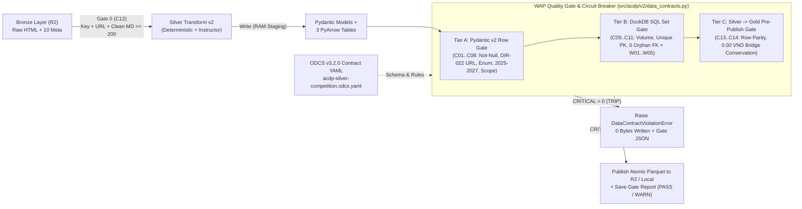

# Deliverable: Data Contract & Quality Gate Tự động giữa Các Layer (`TASK-DQ-03`)

| Thuộc tính | Giá trị |
| :--- | :--- |
| **Task ID** | `TASK-DQ-03` |
| **Chu kỳ / Phạm vi** | Cycle 07 / TLCN (Phase 1) — Tầng Silver (Chốt chặn xuyên tầng `Bronze -> Silver -> Gold`) |
| **Nhóm thực hiện** | Đỗ Kiến Hưng (`@darktheDE`) & Nguyễn Văn Quang Duy (`@QuangDuyReal`) |
| **Giảng viên hướng dẫn** | ThS. Trần Quang Khải (Khoa CNTT, Trường ĐH Công nghệ Kỹ thuật TP.HCM — HCM-UTE) |
| **Ngày hoàn thành** | `2026-11-28` |
| **Trạng thái** | `Complete` (Đã kiểm chứng Phương án A chỉ đọc trên Cloudflare R2 và đạt 7 trụ cột `DIR-024`) |

---

## 1. Tóm tắt điều hành & Ma trận Kiểm chứng 3 Trục

Trước `TASK-DQ-03`, pipeline `v2` ([`silver_transform.py`](../../src/acdp/v2/silver_transform.py) $\rightarrow$ [`gold_star_schema.py`](../../src/acdp/v2/gold_star_schema.py)) chưa có chốt chặn chất lượng tự động dạng **fail-fast circuit breaker** theo mẫu **Write-Audit-Publish (WAP)**. Kiểm toán chỉ đọc trực tiếp trên `s3://acdp-lakehouse/silver/competitions.parquet` (`24` cuộc thi, chụp từ `2026-11-23` trước bản vá `TASK-DQ-02`) phát hiện **5 bản ghi lỗi thực tế theo `DIR-022`** đã lọt sang Gold/Web (`ntu.edu.sg/business/admissions/...`, `tracuu.citd.edu.vn`, `jst-haui.vn`, trang chủ Bộ TT&TT cũ `mic[.]gov.vn`, `marketingarena.vn`).

Nhóm đã chuẩn hóa hợp đồng dữ liệu YAML theo **Open Data Contract Standard (ODCS v3.2.0)** tại [`docs/contracts/acdp-silver-competition.odcs.yaml`](../contracts/acdp-silver-competition.odcs.yaml), xây dựng bộ máy kiểm định 3 tầng [`src/acdp/v2/data_contracts.py`](../../src/acdp/v2/data_contracts.py) với **19 quy tắc** (`14 CRITICAL` ngắt mạch + `5 WARNING` mềm), và gắn chốt chặn WAP trực tiếp trước bước ghi tệp ở `export_silver_parquet()`, `build_gold_star_schema()` và `run_silver_transform(--strict-gate)`. Khi nạp fixture lỗi, circuit breaker ngắt pipeline với mã thoát `1`, ghi **`0` tệp `.parquet`** ra đĩa/R2 và xuất báo cáo JSON chi tiết từng rule.

| Trục kiểm chứng | Chuẩn mực / Thực hành đối chiếu (2024–2026) | Hiện trạng áp dụng trong ACDP (`TASK-DQ-03`) |
| :--- | :--- | :--- |
| **Lý thuyết (Data Contracts & WAP)** | **ODCS v3.2.0** (Bitol / Linux Foundation AI & Data), **Andrew Jones** (*Driving Data Quality with Data Contracts* & *Circuit Breaker Pattern*), **Write-Audit-Publish (WAP)**, *Proof-Gated Publication* (`arXiv:2608.14643`, Khan 2026) và *AI-Driven Data Contracts* (`arXiv:2507.21056`, Bhoite 2025). | Khai báo hợp đồng máy đọc được chuẩn ODCS v3.2.0 làm nguồn chân lý duy nhất; thực thi kiểm định trên vùng đệm RAM trước khi cho phép publish Parquet sang Silver/Gold. |
| **Thực tiễn (Tooling Trade-off)** | Đối chiếu 2025–2026 giữa **Pydantic v2** (biên bản ghi), **DuckDB SQL Assertions** (vectorized push-down trên Parquet), **Soda Core** (Elastic License 2.0) và **Great Expectations** (overhead Data Context). | Dùng **Pydantic v2 (`Tier A`) + DuckDB 1.5.6 Native SQL (`Tier B/C`)**, giữ **0 gói phụ thuộc mới** theo `DIR-015` và tái sử dụng nguyên trạng cho CI offline `TASK-QA-08`. |
| **Người dùng (Sinh viên & GVHD)** | Cổng `/competitions`, `/dashboard`, `/copilot` tuyệt đối không hiển thị cuộc thi hết hạn ngoài `[2025–2027]`, thiếu trang chính thức (`DIR-022`), dính link quảng cáo/tra cứu hoặc sai định dạng đội/giải thưởng. | Chặn cứng mọi vi phạm `CRITICAL` (`C01–C14`); tách 5 chỉ số hay khuyết tự nhiên sang `WARNING` (`W01–W05`) để tránh false-positive ở quy mô `5–10` cuộc thi. |

---

## 2. Kiến trúc Hợp đồng Dữ liệu (ODCS v3.2) & Cơ chế WAP Circuit Breaker



### 2.1. Phân tách 19 Quy tắc Chốt chặn (`14 CRITICAL` vs `5 WARNING`)

Để trả lời câu hỏi nghiên cứu *"Bộ quy tắc Data Contract tối thiểu nào vừa chặn được lỗi nghiêm trọng vừa không gây false-positive ở quy mô 5–10 cuộc thi?"*, hệ thống chia rạch ròi giữa **ràng buộc bất biến (`CRITICAL` — ngắt mạch)** và **chỉ số độ phủ mềm (`WARNING` — theo dõi SLA)**:

| Mã Rule | Tầng / Engine | Mức độ | Đặc tả kiểm tra & Ngưỡng áp dụng | Lý do tách ngưỡng chống False-Positive |
| :---: | :--- | :---: | :--- | :--- |
| `C01` | Silver Row (`hybrid`) | `CRITICAL` | `competition_key` đúng 64 ký tự hex; `name`, `url`, `summary`, `PrizeTier.tier` khác `NULL`/rỗng/placeholder. | Bản ghi khuyết tên hoặc URL sẽ làm hỏng thẻ hiển thị trên `/competitions`. |
| `C02` | Silver Row (`hybrid`) | `CRITICAL` | `url` phải là `http(s)://`, cấm `urn:acdp:*`, cấm `AGGREGATOR_HOSTS` (`ybox.vn`, `vnoi.info`...) và `SOCIAL_OR_FORM_HOSTS`. | Bắt buộc tuân thủ `DIR-022`: mọi cuộc thi phải có trang chính thức. |
| `C03` | Silver Row (`pydantic`) | `CRITICAL` | Chặn subdomain cổng trường (`tracuu.`, `tuyensinh.`, `jst-`, `daotao.`, `ctsv.`), đường dẫn tuyển sinh (`/admissions`, `/msc-programmes`) và root cổng bộ/ngành chung (như `mic[.]gov.vn/`). | Chặn trực tiếp lỗi `E1` đã ghi nhận trong `TASK-DQ-02` (`ntu.edu.sg`, `tracuu.citd.edu.vn`). |
| `C04` | Silver Row (`hybrid`) | `CRITICAL` | Enum chuẩn trên `mode`, `registration_status`, `eligibility_level`, `prizes.currency`, `prizes.prize_type`. | Bảo vệ bộ lọc Frontend và phép ánh xạ Star Schema Gold. |
| `C05` | Silver Row (`hybrid`) | `CRITICAL` | Mọi trường ngày ISO khác `NULL` (cấp cuộc thi & `timeline_stages`) phải nằm trong `[2025, 2027]` (`2026 ± 1`). | Cho phép trường ngày khuyết (`NULL`) nhưng chặn tuyệt đối năm cũ/bịa (`2022`, `2029`). |
| `C06` | Silver Row (`pydantic`) | `CRITICAL` | Thứ tự thời gian: `event_end >= event_start`, `registration_deadline >= registration_start`, `stage.end >= stage.start`. | Ngăn chặn `duration_days` âm ở `fact_competitions`. |
| `C07` | Silver Row (`pydantic`) | `CRITICAL` | `1 <= team_size_min <= team_size_max <= 20`; `total_prize_vnd >= 0`; `estimated_value_vnd >= 0`; `quantity >= 1`; `tier_rank >= 1`. | Đảm bảo bộ lọc quy mô đội và tổng hợp tiền thưởng hợp lệ. |
| `C08` | Silver Row (`pydantic`) | `CRITICAL` | Loại trừ cuộc thi phi công nghệ (`MARKETING ARENA`, ẩm thực, thời trang) và cuộc thi chỉ dành cho học sinh phổ thông (`THPT`/`THCS`). | Thực thi `DIR-022` cho đối tượng sinh viên CNTT/AI/Dữ liệu/Bảo mật/Lập trình. |
| `C09` | Silver Table (`duckdb_sql`) | `CRITICAL` | `COUNT(*) >= 1` trong `competitions` (chống batch rỗng ghi đè production). | Ngăn mất toàn bộ dữ liệu trên R2 khi crawler gặp sự cố mạng. |
| `C10` | Silver Table (`duckdb_sql`) | `CRITICAL` | Duy nhất khóa chính: `0` trùng `competition_key`, `(competition_key, tier_rank)` và `(competition_key, stage_order)`. | Bảo toàn grain `1` dòng/cuộc thi trước khi tạo `dim_competition`. |
| `C11` | Silver Table (`duckdb_sql`) | `CRITICAL` | `0` bản ghi mồ côi trong `prizes` và `timeline_stages` khi `LEFT JOIN competitions`. | Ngăn lỗi khóa ngoại khi nạp `fact_prize_tiers` và `fact_timeline_stages`. |
| `C12` | Bronze $\rightarrow$ Silver (`pydantic`) | `CRITICAL` | `bronze_key` khớp `BRONZE_KEY_PATTERN`, `source_url` HTTP(S), `Clean Markdown >= 200` ký tự, không phải trang lỗi `404/403`. | Chặn đầu vào rác trước khi tốn quota LLM. |
| `C13` | Silver $\rightarrow$ Gold (`duckdb_sql`) | `CRITICAL` | `COUNT(dim_competition) == COUNT(fact_competitions) == COUNT(mart_competition_explorer) == silver_count`; `0` NULL `canonical_url`/`name`. | Bảo chứng WAP 1-1 trước khi ghi 15 tệp Gold Parquet lên R2. |
| `C14` | Silver $\rightarrow$ Gold (`duckdb_sql`) | `CRITICAL` | Tổng `allocation_weight` mỗi cuộc thi bằng `1.0 ± 0.001` và chênh lệch tổng giải thưởng Mart KPI vs Domain `<= 1.0 VND` (`SPEC-0003 EC-G1`). | Bảo toàn sai số `0.00 VND` trên biểu đồ phân tích lĩnh vực. |
| `W01–W05` | Silver Table (`duckdb_sql`) | `WARNING` | Theo dõi độ phủ `registration_deadline_date` (`W01`), `eligibility_level`/`mode = unknown` (`W02`), `official_rules_url`/`contact` (`W03`), `bronze_key` (`W04`), giải `0 VND` (`W05`). | Không ngắt pipeline vì nhiều trang SPA hợp lệ chưa công bố đủ hạn nộp hay file `.pdf` (`DIR-022`). |

---

## 3. Benchmark & Kết quả Kiểm chứng Thực nghiệm

Toàn bộ số liệu bên dưới được đo trực tiếp từ bộ công cụ CLI `acdp.v2.data_contracts` và bộ kiểm thử `pytest` ngày `2026-11-28`, lưu vết tại [`docs/experiments/data/dq03-valid-fixture-report.json`](../experiments/data/dq03-valid-fixture-report.json), [`dq03-invalid-fixture-report.json`](../experiments/data/dq03-invalid-fixture-report.json) và [`dq03-r2-live-audit-report.json`](../experiments/data/dq03-r2-live-audit-report.json).

### 3.1. Đối chứng Fixture Hợp lệ vs Fixture Vi phạm & Kiểm định Live R2 (Phương án A — Chỉ đọc)

| Tập dữ liệu kiểm chứng | Quy mô bản ghi | Thời gian chạy | Quy tắc `CRITICAL` đạt / tổng | Quy tắc `WARNING` kích hoạt | Trạng thái Circuit Breaker | Phát hiện trọng yếu đo được |
| :--- | :--- | :---: | :---: | :---: | :---: | :--- |
| **`valid_silver_batch.json`** | `5` cuộc thi, `4` prizes, `3` stages | `142.09 ms` | **`11 / 11` (`100%`)** | `4` (`W01–W04`) | `CLOSED` (`False`, Exit `0`) | **0% false-positive** dù có các trường tùy chọn `None` / `"unknown"`. |
| **`invalid_silver_batch.json`** | `10` cuộc thi, `2` prizes, `2` stages (+`2` orphan) | `254.69 ms` | **`1 / 11`** (`10` rule tripped) | `5` (`W01–W05`) | **`TRIPPED`** (`True`, Exit `1`) | Bắt đủ `10/10` rule lỗi `C01–C08`, `C10`, `C11`; `C09` đạt do có 10 dòng (`C09` fail ở test batch 0 dòng). |
| **Live Cloudflare R2 (Chỉ đọc)** | `24` Silver, `90` prizes, `89` stages, `24` Gold | `10,103.08 ms` | **`11 / 13`** (`2` rule tripped) | `4` (`W01–W03`, `W05`) | **`TRIPPED`** (`True`, chẩn đoán) | Chặn đúng **5/24** bản ghi lỗi lịch sử (`C03`: `4` URL nhiễu; `C08`: `1` non-tech); `C13–C14` Gold đạt **100%** (`0` lỗi). |

### 3.2. Chi tiết 5 Bản ghi Vi phạm Lịch sử Phát hiện trên Live Cloudflare R2 (`s3://acdp-lakehouse/silver/`)

Theo **Phương án A** (giữ nguyên R2 production, chỉ đọc đối soát trước khi làm sạch ở `TASK-DQ-04`), gate đã tự động cô lập chính xác 5 cuộc thi sai chuẩn `DIR-022`:

| # | Cuộc thi trên R2 (`2026-11-23`) | Giá trị `url` / Ngữ cảnh vi phạm | Quy tắc bị Trip | Nguyên nhân gốc (`TASK-DQ-02` / `DIR-022`) |
| :-: | :--- | :--- | :---: | :--- |
| 1 | `Cuộc Thi Khoa Học Dữ Liệu DATATHON 2026` | `https://www.ntu.edu.sg/business/admissions/graduate-studies/msc-programmes` | `C03` | Banner quảng cáo thạc sĩ trong `.rpa__media` của `ybox.vn` lọt vào `url`. |
| 2 | `UIT Data Science Challenge 2026` | `https://tracuu.citd.edu.vn` | `C03` | Link header tra cứu văn bằng trên `www.uit.edu.vn` lọt vào `url`. |
| 3 | `Cuộc thi Olympic Tin học sinh viên... (HaUI)` | `https://jst-haui.vn` | `C03` | Subdomain tạp chí khoa học `jst-` lọt vào `url`. |
| 4 | `Cuộc thi Sáng tạo trẻ tỉnh Quảng Ngãi... AI 2026` | `mic[.]gov.vn` (root cổng Bộ TT&TT cũ, NXDOMAIN) | `C03` | Trang chủ chung của Bộ TT&TT (`/`), không phải microsite cuộc thi. |
| 5 | `MARKETING ARENA 2026` | `https://marketingarena.vn` (`category: Marketing`) | `C08` | Cuộc thi Marketing kinh tế nằm ngoài phạm vi CNTT/AI/Dữ liệu/Bảo mật/Lập trình. |

### 3.3. Benchmark Tốc độ Thực thi Tier A (Pydantic v2) vs Tier B (DuckDB SQL)

Đo trực tiếp qua `uv run python -m acdp.v2.data_contracts --benchmark`:

| Quy mô lô (`records`) | Tier A — Pydantic v2 (`ms`) | Tier B — DuckDB 1.5.6 SQL (`ms`) | Tổng độ trễ Quality Gate (`ms`) | Nhận xét hiệu năng |
| :---: | :---: | :---: | :---: | :--- |
| `10` cuộc thi (Phạm vi TLCN) | `0.43 ms` | `100.00 ms` | **`100.43 ms`** | Dưới `0.11` giây; phù hợp chạy đồng bộ trước mọi lần publish R2. |
| `24` cuộc thi (Quy mô hiện tại) | `0.67 ms` | `73.54 ms` | **`74.21 ms`** | Chi phí khởi tạo kết nối `:memory:` chi phối (~70 ms), tốc độ lọc dòng Pydantic dưới `1 ms`. |
| `500` cuộc thi (Mục tiêu KLTN) | `15.06 ms` | `71.42 ms` | **`86.48 ms`** | DuckDB SQL gần như giữ nguyên thời gian (`O(1)` overhead), tổng thời gian vẫn dưới `90 ms`. |

---

## 4. Luận cứ Phản biện Hội đồng & Quyết định Kiến trúc

1. **Tại sao chọn Pydantic v2 + DuckDB SQL + ODCS v3.2 YAML thay vì Great Expectations (GX Core) hoặc Soda Core?**
   - Kiểm tra [`pyproject.toml`](../../pyproject.toml) cho thấy toàn bộ ngăn xếp kiểm định (`pydantic 2.14+`, `duckdb 1.5.6`, `pyarrow 26+`, `PyYAML 6.0.3`) đã có sẵn, giúp đạt **0 gói phụ thuộc mới** theo đúng tinh thần `DIR-015`. Great Expectations đòi hỏi boilerplate cấu hình `DataContext`/`Checkpoint` nặng nề, còn Soda Core sử dụng giấy phép Elastic License 2.0 (hạn chế mở rộng) và khó viết các quy tắc phân tích URL/ngữ nghĩa tiếng Việt như `C03` và `C08`. Kiến trúc kết hợp Pydantic v2 + DuckDB chạy hoàn toàn offline trong `< 100 ms`, sẵn sàng tích hợp thẳng vào GitHub Actions ở `TASK-QA-08`.
2. **Tác động lên Đặc tả & Quy trình Vận hành (`SPEC-0002`, `TASK-DQ-04`, `TASK-QA-08`)**:
   - [`SPEC-0002`](../specs/0002-data-ingestion-and-schema-spec.md) đã được cập nhật bổ sung cổng Data Contract ODCS v3.2.0. Với **Phương án A**, `5` bản ghi lỗi lịch sử trên R2 được giữ nguyên làm minh chứng thực nghiệm; khi hoàn tất `TASK-DQ-04` (Entity Resolution/Dedup) và tái chạy `silver_transform` + `gold_star_schema`, circuit breaker mặc định (`enforce_contract=True`) sẽ tự động bảo vệ R2 không bao giờ nhận lại dữ liệu lỗi.

---

## 5. Hướng dẫn Kiểm thử Thủ công, Triển khai CLI & Kịch bản Demo GVHD

### Kịch bản Demo cho Giảng viên Hướng dẫn

- **Demo nhanh 5 phút**: Mở [`TASK-DQ-03-data-contracts-and-quality-gates-visual-dossier.html`](./TASK-DQ-03-data-contracts-and-quality-gates-visual-dossier.html) để xem tổng quan 19 quy tắc, sơ đồ WAP Circuit Breaker và biểu đồ benchmark, sau đó chạy Bước 1 (`pytest` + `ruff`) và Bước 3 (`--audit-local invalid_silver_batch.json`) để thấy pipeline tự động dừng (exit `1`) và chặn ghi Parquet.
- **Demo chuyên sâu 15 phút**: Chạy thêm Bước 2 (`--validate-odcs`), Bước 4 (`--audit-r2 --no-fail-fast`) để chứng minh gate quét trực tiếp `24` cuộc thi Silver + Gold trên Cloudflare R2 và bắt đúng `5` bản ghi vi phạm thực tế (`ntu.edu.sg`, `tracuu.citd.edu.vn`, `jst-haui.vn`, `mic[.]gov.vn`, `MARKETING ARENA 2026`).

### Bước 1: Chạy Bộ Kiểm thử Tự động & Kiểm tra Tĩnh (`pytest` + `ruff`)

```powershell
uv run pytest tests/test_data_contracts_dq03.py tests/test_silver_schema.py tests/test_silver_transform_v2.py tests/test_gold_star_schema.py -v; if ($LASTEXITCODE -eq 0) { uv run ruff check src/acdp/v2/data_contracts.py src/acdp/v2/gold_star_schema.py src/acdp/v2/silver_transform.py tests/test_data_contracts_dq03.py }
```

Captured Output:

```text
============================= test session starts =============================
platform win32 -- Python 3.11.14, pytest-9.2.0, pluggy-1.7.0 -- D:\Code\final-thesis\acdp-platform\.venv\Scripts\python.exe
cachedir: .pytest_cache
rootdir: D:\Code\final-thesis\acdp-platform
configfile: pyproject.toml
plugins: anyio-4.16.0, langsmith-0.14.17
collecting ... collected 37 items

tests/test_data_contracts_dq03.py::test_odcs_v32_contract_yaml_valid_and_synced PASSED [  2%]
tests/test_data_contracts_dq03.py::test_valid_silver_fixture_passes_all_critical_rules_with_zero_false_positives PASSED [  5%]
tests/test_data_contracts_dq03.py::test_invalid_silver_fixture_trips_all_expected_critical_rules_c01_to_c11 PASSED [  8%]
tests/test_data_contracts_dq03.py::test_bronze_to_silver_handoff_gate_c12_pass_and_fail PASSED [ 10%]
tests/test_data_contracts_dq03.py::test_wap_circuit_breaker_blocks_silver_parquet_publish_on_violation PASSED [ 13%]
tests/test_data_contracts_dq03.py::test_wap_circuit_breaker_blocks_gold_star_schema_publish_on_violation PASSED [ 16%]
tests/test_data_contracts_dq03.py::test_gold_pre_publish_gate_c13_c14_catches_row_mismatch_and_bridge_drift PASSED [ 18%]
tests/test_data_contracts_dq03.py::test_silver_parquet_dir_audit_pass_and_fail_via_duckdb PASSED [ 21%]
tests/test_data_contracts_dq03.py::test_warning_rules_w01_to_w05_never_trip_circuit_breaker PASSED [ 24%]
tests/test_data_contracts_dq03.py::test_cli_exit_codes_and_json_report_export PASSED [ 27%]
tests/test_data_contracts_dq03.py::test_silver_transform_strict_gate_blocks_dirty_record PASSED [ 29%]
tests/test_data_contracts_dq03.py::test_benchmark_runner_outputs_valid_timings PASSED [ 32%]
tests/test_silver_schema.py::test_clean_placeholder PASSED               [ 35%]
tests/test_silver_schema.py::test_prize_tier_validation PASSED           [ 37%]
tests/test_silver_schema.py::test_timeline_stage_validation PASSED       [ 40%]
tests/test_silver_schema.py::test_competition_creation_and_normalization PASSED [ 43%]
tests/test_silver_schema.py::test_competition_extraction_result_container PASSED [ 45%]
tests/test_silver_schema.py::test_competition_extraction_result_coercion PASSED [ 48%]
tests/test_silver_schema.py::test_empty_document_handling PASSED         [ 51%]
tests/test_silver_schema.py::test_json_roundtrip_integrity PASSED        [ 54%]
tests/test_silver_schema.py::test_silver_parquet_contract_and_referential_integrity PASSED [ 56%]
tests/test_silver_schema.py::test_silver_schema_v2_gap_g1_g8_resolved PASSED [ 59%]
tests/test_silver_schema.py::test_silver_v2_schema_validation_and_g7_rejection PASSED [ 62%]
tests/test_silver_schema.py::test_silver_v2_explicit_pyarrow_zstd_and_timeline_stages PASSED [ 64%]
tests/test_silver_transform_v2.py::test_split_bronze_pages_and_in_ram_clean_markdown PASSED [ 67%]
tests/test_silver_transform_v2.py::test_deterministic_extraction_jsonld_og_official_links_and_regex PASSED [ 70%]
tests/test_silver_transform_v2.py::test_dir022_scope_gate_and_media_partner_dedup PASSED [ 72%]
tests/test_silver_transform_v2.py::test_post_llm_guards_enforce_canonical_url PASSED [ 75%]
tests/test_silver_transform_v2.py::test_end_to_end_silver_transform_and_rag_ingest_from_silver PASSED [ 78%]
tests/test_gold_star_schema.py::test_currency_normalization_edge_cases PASSED [ 81%]
tests/test_gold_star_schema.py::test_date_resolution_and_academic_terms PASSED [ 83%]
tests/test_gold_star_schema.py::test_fee_and_team_and_domain_classification PASSED [ 86%]
tests/test_gold_star_schema.py::test_load_silver_prefers_newest_batch_and_deduplicates PASSED [ 89%]
tests/test_gold_star_schema.py::test_star_schema_bridge_allocation_and_edge_cases PASSED [ 91%]
tests/test_gold_star_schema.py::test_r2_end_to_end_silver_to_gold_zero_local_disk PASSED [ 94%]
tests/test_gold_star_schema.py::test_motherduck_cli_sql_output PASSED    [ 97%]
tests/test_gold_star_schema.py::test_expired_open_status_normalizes_to_closed PASSED [100%]

============================= 37 passed in 8.87s ==============================
All checks passed!
```

### Bước 2: Kiểm tra Đồng bộ Hợp đồng ODCS v3.2.0 & Chạy Fixture Hợp lệ (Exit Code `0`)

```powershell
uv run python -m acdp.v2.data_contracts --validate-odcs
uv run python -m acdp.v2.data_contracts --audit-local tests/fixtures/dq03/valid_silver_batch.json --save-report docs/experiments/data/dq03-valid-fixture-report.json
```

Captured Output:

```text
{
  "status": "ok",
  "path": "D:\\Code\\final-thesis\\acdp-platform\\docs\\contracts\\acdp-silver-competition.odcs.yaml",
  "apiVersion": "v3.2.0",
  "id": "urn:acdp:datacontract:silver-competitions",
  "version": "2.0.0",
  "tables": [
    "competitions",
    "prizes",
    "timeline_stages"
  ],
  "rules_count": 19,
  "rule_ids": ["C01", "C02", "C03", "C04", "C05", "C06", "C07", "C08", "C09", "C10", "C11", "C12", "C13", "C14", "W01", "W02", "W03", "W04", "W05"]
}
====================================================================================
DATA CONTRACT QUALITY GATE: Local Fixture Data Contract Gate (tests/fixtures/dq03/valid_silver_batch.json)
Contract: urn:acdp:datacontract:silver-competitions v2.0.0 | Ref Year: 2026 (2025-2027)
Records : {'competitions': 5, 'prizes': 4, 'timeline_stages': 3} | Elapsed: 142.09 ms
------------------------------------------------------------------------------------
Summary : 12/16 passed | critical_failed=0 | warnings=4 | circuit_breaker_tripped=False | OVERALL=PASS_WITH_WARNINGS
====================================================================================
Saved quality gate report -> docs\experiments\data\dq03-valid-fixture-report.json
```

### Bước 3: Kiểm chứng Fail-Fast Circuit Breaker trên Fixture Vi phạm (Exit Code `1`)

```powershell
uv run python -m acdp.v2.data_contracts --audit-local tests/fixtures/dq03/invalid_silver_batch.json --save-report docs/experiments/data/dq03-invalid-fixture-report.json; Write-Output "EXIT_CODE=$LASTEXITCODE"
```

Captured Output:

```text
====================================================================================
DATA CONTRACT QUALITY GATE: Local Fixture Data Contract Gate (tests/fixtures/dq03/invalid_silver_batch.json)
Contract: urn:acdp:datacontract:silver-competitions v2.0.0 | Ref Year: 2026 (2025-2027)
Records : {'competitions': 10, 'prizes': 2, 'timeline_stages': 2} | Elapsed: 254.69 ms
------------------------------------------------------------------------------------
Rule   Severity  Layer             Engine      Failed/Chk   Status Name
------------------------------------------------------------------------------------
C01    CRITICAL  silver_row        hybrid      4/10         FAIL   Non-Empty Core Not-Null Contract
C02    CRITICAL  silver_row        hybrid      3/10         FAIL   Official Website URL Required (DIR-022)
C03    CRITICAL  silver_row        pydantic    3/10         FAIL   Anti-Noise Official URL Guard (E1)
C04    CRITICAL  silver_row        hybrid      5/10         FAIL   Strict Enum Domains
C05    CRITICAL  silver_row        hybrid      4/10         FAIL   Temporal Window 2025-2027 (DIR-022)
C06    CRITICAL  silver_row        pydantic    3/10         FAIL   Chronological Date Ordering
C07    CRITICAL  silver_row        pydantic    4/10         FAIL   Numeric and Team Size Bounds
C08    CRITICAL  silver_row        pydantic    2/10         FAIL   Student Tech Scope Guard (DIR-022)
C09    CRITICAL  silver_table      duckdb_sql  0/10         PASS   Non-Empty Batch Volume Guard
C10    CRITICAL  silver_table      duckdb_sql  1/14         FAIL   Primary Key Uniqueness Across Silver Tables
C11    CRITICAL  silver_table      duckdb_sql  2/4          FAIL   Silver Referential Integrity (Zero Orphan Children)
W01    WARNING   silver_table      duckdb_sql  9/10         WARN   Soft SLA - Missing Registration Deadline Date
W02    WARNING   silver_table      duckdb_sql  2/10         WARN   Soft SLA - Unknown Eligibility or Mode
W03    WARNING   silver_table      duckdb_sql  10/10        WARN   Soft SLA - Missing Advisor or Rules Metadata
W04    WARNING   silver_table      duckdb_sql  10/10        WARN   Soft SLA - Missing Bronze Lineage Metadata
W05    WARNING   silver_table      duckdb_sql  2/10         WARN   Soft SLA - Unquantified Prize Pool
------------------------------------------------------------------------------------
Summary : 1/16 passed | critical_failed=10 | warnings=5 | circuit_breaker_tripped=True | OVERALL=FAIL
====================================================================================
Saved quality gate report -> docs\experiments\data\dq03-invalid-fixture-report.json
[CIRCUIT BREAKER TRIPPED] Exiting with code 1 (10 CRITICAL rule(s) failed).
EXIT_CODE=1
```

### Bước 4: Kiểm toán Chỉ đọc Dữ liệu Live trên Cloudflare R2 (`--audit-r2 --no-fail-fast`)

```powershell
uv run python -m acdp.v2.data_contracts --audit-r2 --no-fail-fast --save-report docs/experiments/data/dq03-r2-live-audit-report.json
```

Captured Output:

```text
====================================================================================
DATA CONTRACT QUALITY GATE: Live Cloudflare R2 Silver+Gold Audit (Read-Only) (s3://acdp-lakehouse/silver+gold)
Contract: urn:acdp:datacontract:silver-competitions v2.0.0 | Ref Year: 2026 (2025-2027)
Records : {'silver_competitions': 24, 'silver_prizes': 90, 'silver_timeline_stages': 89, 'gold_dim_competition': 24} | Elapsed: 10103.08 ms
------------------------------------------------------------------------------------
C01..C02 CRITICAL  silver_row        hybrid      0/24         PASS
C03      CRITICAL  silver_row        pydantic    4/24         FAIL   Anti-Noise Official URL Guard (E1) [mic.gov.vn, jst-haui.vn, tracuu.citd.edu.vn, ntu.edu.sg/business/admissions/...]
C04..C07 CRITICAL  silver_row        hybrid      0/24         PASS
C08      CRITICAL  silver_row        pydantic    1/24         FAIL   Student Tech Scope Guard (DIR-022) [MARKETING ARENA 2026]
C09..C11 CRITICAL  silver_table      duckdb_sql  0/203        PASS
C13..C14 CRITICAL  silver_to_gold    duckdb_sql  0/24         PASS   Gold Parity & 0.00 VND Bridge Conservation
------------------------------------------------------------------------------------
Summary : 12/18 passed | critical_failed=2 | warnings=4 | circuit_breaker_tripped=True | OVERALL=FAIL
====================================================================================
Saved quality gate report -> docs\experiments\data\dq03-r2-live-audit-report.json
```

---

## 6. Tài liệu & Mã nguồn Liên quan

- Đặc tả Hợp đồng ODCS v3.2.0: [`docs/contracts/acdp-silver-competition.odcs.yaml`](../contracts/acdp-silver-competition.odcs.yaml)
- Bộ máy Quality Gate & WAP Circuit Breaker: [`src/acdp/v2/data_contracts.py`](../../src/acdp/v2/data_contracts.py)
- Tích hợp chốt chặn tại Silver/Gold & Transform: [`src/acdp/v2/gold_star_schema.py`](../../src/acdp/v2/gold_star_schema.py) và [`src/acdp/v2/silver_transform.py`](../../src/acdp/v2/silver_transform.py)
- Bộ fixture & kiểm thử tự động: [`tests/fixtures/dq03/valid_silver_batch.json`](../../tests/fixtures/dq03/valid_silver_batch.json), [`invalid_silver_batch.json`](../../tests/fixtures/dq03/invalid_silver_batch.json), [`tests/test_data_contracts_dq03.py`](../../tests/test_data_contracts_dq03.py)
- Báo cáo trực quan HTML: [`TASK-DQ-03-data-contracts-and-quality-gates-visual-dossier.html`](./TASK-DQ-03-data-contracts-and-quality-gates-visual-dossier.html)
- Đặc tả kỹ thuật liên kết: [`SPEC-0002`](../specs/0002-data-ingestion-and-schema-spec.md) và [`task-registry.md`](../tasks/task-registry.md)

---

## 7. Search Provenance & Nhật ký Truy vấn (`DIR-020`)

Mọi truy vấn `search_web` và URL nguồn chuẩn dưới đây đã được kiểm tra đạt **HTTP `200 OK`** trong phiên làm việc ngày `2026-11-28`:

| # | Search Query thực thi (`search_web`) | Mục đích kiểm chứng | Nguồn chính thức đã xác minh (`HTTP 200`) |
| :-: | :--- | :--- | :--- |
| 1 | `"Open Data Contract Standard" ODCS v3 Bitol Linux Foundation 2025 2026 data contract specification` | Cấu trúc chuẩn ODCS v3 (`apiVersion`, `schema`, `quality`, `slaProperties`) | https://bitol-io.github.io/open-data-contract-standard/ |
| 2 | `"Open Data Contract Standard" "v3.0" OR "v3.1" OR "v3.2" github.com/bitol-io/open-data-contract-standard releases 2025 2026` | Xác minh phát hành ODCS v3.1 (12/2025) và v3.2.0 (2026) | https://github.com/bitol-io/open-data-contract-standard |
| 3 | `site:bitol-io.github.io/open-data-contract-standard OR site:github.com/bitol-io/open-data-contract-standard ODCS v3 specification` | Đối chiếu hệ sinh thái Data Contract CLI hỗ trợ gốc ODCS v3 | https://datacontract.com/ |
| 4 | `Andrew Jones "Driving Data Quality with Data Contracts" circuit breaker data pipeline fail-fast Write-Audit-Publish WAP` | Nguyên lý Data Contracts và phân tầng ngưỡng Circuit Breaker | https://andrew-jones.com/ |
| 5 | `"data contracts" "circuit breaker" OR "Write-Audit-Publish" academic paper OR IEEE OR ACM OR arXiv 2024 2025 2026` | Mẫu thiết kế Circuit Breaker trong kỹ thuật phần mềm | https://martinfowler.com/bliki/CircuitBreaker.html |
| 6 | `site:lakefs.io "write-audit-publish" OR site:docs.greatexpectations.io OR site:docs.soda.io "duckdb"` | Mẫu kiến trúc Write-Audit-Publish (WAP) cô lập bản ghi trước publish | https://lakefs.io/blog/data-engineering-patterns-write-audit-publish/ |
| 7 | `site:arxiv.org/abs "2507.21056" OR "2608.14643" data contracts OR "Proof-Gated Publication"` | Nghiên cứu sinh Data Contract bằng AI (Bhoite, 2025) | https://arxiv.org/abs/2507.21056 |
| 8 | `site:arxiv.org/abs "2507.21056" OR "2608.14643" data contracts OR "Proof-Gated Publication"` | Giao thức Proof-Gated Publication Verify-Before-Commit (Khan, 2026) | https://arxiv.org/abs/2608.14643 |
| 9 | `site:docs.pydantic.dev OR site:duckdb.org/docs Pydantic v2 TypeAdapter validation DuckDB parquet assertions` | Pydantic v2 Validators & `TypeAdapter` tăng tốc Rust | https://pydantic.dev/docs/validation/latest/concepts/validators/ |
| 10 | `site:docs.pydantic.dev OR site:duckdb.org/docs Pydantic v2 TypeAdapter validation DuckDB parquet assertions` | Tham chiếu Pydantic `TypeAdapter` & DuckDB Parquet SQL | https://pydantic.dev/docs/validation/latest/concepts/type_adapter/ |
| 11 | `Pydantic v2 DuckDB data quality assertions vs Great Expectations Soda Core Python pipeline benchmark 2025 2026` | Tham chiếu DuckDB Parquet native execution vs Great Expectations & Soda | https://duckdb.org/docs/stable/data/parquet/overview |

Tài liệu đối chiếu bổ sung đã xác minh HTTP 200: [Great Expectations GX Core Overview](https://docs.greatexpectations.io/docs/core/introduction/gx_overview/) và [Soda Documentation](https://docs.soda.io/).
