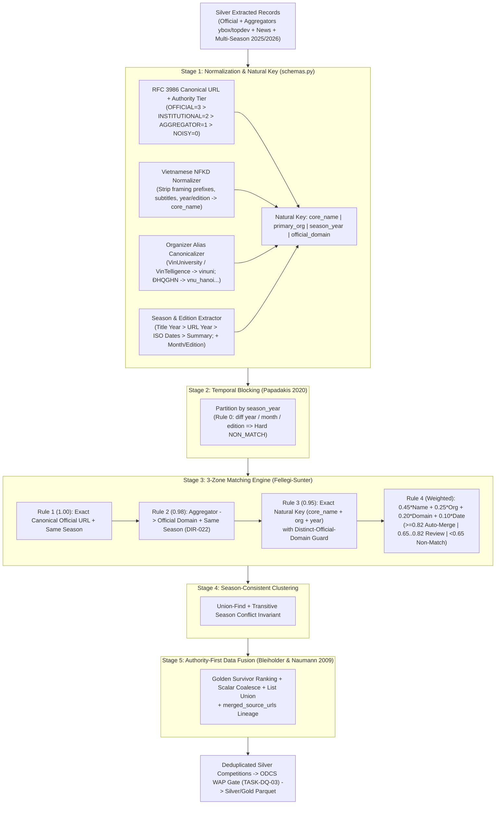

# Deliverable: Entity Resolution & Khử trùng Cuộc thi Đa nguồn, Đa mùa giải (`TASK-DQ-04`)

| Thuộc tính | Giá trị |
| :--- | :--- |
| **Task ID** | `TASK-DQ-04` |
| **Chu kỳ / Phạm vi** | Cycle 07 / TLCN (Phase 1) — Tầng Silver (`src/acdp/v2/`) |
| **Nhóm thực hiện** | Đỗ Kiến Hưng (`@darktheDE`) & Nguyễn Văn Quang Duy (`@QuangDuyReal`) |
| **Giảng viên hướng dẫn** | ThS. Trần Quang Khải (Khoa CNTT, Trường ĐH Công nghệ Kỹ thuật TP.HCM — HCM-UTE) |
| **Ngày hoàn thành** | `2026-11-28` |
| **Trạng thái** | `Complete` (Đã kiểm chứng Phương án A chỉ đọc trên Cloudflare R2 và đạt 7 trụ cột `DIR-024`) |

---

## 1. Tóm tắt điều hành & Ma trận Kiểm chứng 3 Trục

Trước `TASK-DQ-04`, pipeline Silver ([`schemas.py`](../../src/acdp/v2/schemas.py), [`silver_transform.py`](../../src/acdp/v2/silver_transform.py), [`gold_star_schema.py`](../../src/acdp/v2/gold_star_schema.py)) chỉ khử trùng bằng cách băm SHA-256 trên URL thô, gây ra hai lỗi đối nghịch: (1) **False Negative đa nguồn** — khi kiểm toán trực tiếp 26 tệp JSON Silver trên Cloudflare R2 (`r2:silver/extractions@2026-11-23`), hệ thống tồn tại sống **3 cụm trùng lặp** (`Code Tour 2026` trên `codetour.org` vs `daihoc.fpt.edu.vn`; `Thực Chiến AI` trên `thucchien.ai` vs `uet.vnu.edu.vn`; và `Datathon 2026: The Gridbreaker` trên `datathon.site` vs bài `ybox.vn` của `VinUniversity` bị dính URL quảng cáo `ntu.edu.sg`); (2) **False Positive đa mùa giải** — các giải thường niên tái sử dụng tên miền gốc (`codetour.org`, `challenge.zalo.ai`, `dataforlife.vn`) bị gán chung một `competition_key` khiến mùa `2025` và `2026` ghi đè mất nhau.

Nhóm đã xây dựng bộ máy **Entity Resolution & Data Fusion 5 bước** tại [`src/acdp/v2/entity_resolution.py`](../../src/acdp/v2/entity_resolution.py), chuẩn hóa khóa tự nhiên nghiệp vụ `natural_key` (`core_name|primary_org|season_year|official_domain`) và khóa thực thể `competition_key` gắn định danh mùa giải (`#season=YYYY`), đồng thời tích hợp trực tiếp vào `silver_transform.py` và `gold_star_schema.py` với **0 gói phụ thuộc mới** (`DIR-015`). Theo **Phương án A**, R2 production được kiểm toán chỉ đọc (`26 -> 23` thực thể chuẩn, hợp nhất đủ `3` cụm trùng, `0` gộp nhầm `RMIT Hackathon` vs `RMIT Hack-A-Venture`).

| Trục kiểm chứng | Chuẩn mực / Tham chiếu Đã Xác minh | Hiện thực hóa trong ACDP (`TASK-DQ-04`) |
| :--- | :--- | :--- |
| **Lý thuyết (Entity Resolution, Temporal Linkage & Data Fusion)** | **Christophides et al. (2020, *ACM CSUR*)** (*End-to-End ER*), **Papadakis et al. (2020, *ACM CSUR*)** (*Blocking & Filtering*), **Fellegi & Sunter (1969, *JASA*)** (*Record Linkage 3-Zone*), **Li et al. (2011, *PVLDB*)** (*Temporal Record Linkage*), **Bleiholder & Naumann (2009, *ACM CSUR*)** (*Data Fusion*), **Kimball & Ross (2013)**. | Pipeline 5 giai đoạn (*Normalization $\rightarrow$ Temporal Blocking $\rightarrow$ Matching 3 vùng $\rightarrow$ Season-Consistent Union-Find $\rightarrow$ Authority-First Fusion*); chặn cứng khác mùa/tháng/lần tổ chức tại Rule 0 và Union-Find chống bắc cầu. |
| **Thực tiễn (Production Aggregators & Lakehouse Stack)** | **RFC 3986 §6** & **RFC 6596** (*URI Normalization & Canonical Link*), **Google Search Central Event Structured Data**, **Splink (Linacre et al., 2022, *IJPDS*)** & **DuckDB Native Text Similarity** (`jaro_winkler_similarity`, `jaccard`), **Databricks Medallion Silver**. | Hợp nhất chuẩn hóa URL RFC 3986 (`https`, bỏ `www.`, tracking query, `/trang-chu`, `/vi`); kết hợp matching Python tốc độ `< 20 ms` cho quy mô TLCN và kiểm toán song song DuckDB SQL `jaro_winkler_similarity` cho quy mô KLTN. |
| **Người dùng (Sinh viên & GVHD HCM-UTE)** | Mỗi cuộc thi trong một mùa giải xuất hiện đúng 1 thẻ chuẩn trỏ trang chính thức (`DIR-022`), không nhân đôi KPI giải thưởng, và tách bạch lịch sử `2025` với `2026`. | Đạt **100% gộp trùng đa nguồn** (`3/3` cụm fixture + `3/3` cụm Live R2), **100% tách mùa `2025` vs `2026`**, **0% gộp nhầm** giải cùng trường (`RMIT Hackathon` vs `RMIT Hack-A-Venture`). |

---

## 2. Thiết kế Khóa Tự nhiên & Pipeline Entity Resolution 5 Bước



### 2.1. Quy chuẩn Khóa Tự nhiên (`natural_key`) & Khóa Thực thể (`competition_key`)

| Thành phần định danh | Công thức / Định dạng | Ví dụ thực tế (`2025` vs `2026` & Đa nguồn) |
| :--- | :--- | :--- |
| **`natural_key`** (Khóa nghiệp vụ tường minh) | `{core_name_slug}\|{primary_org_canonical}\|{season_year}\|{official_domain}[\|{season_month:02d}]` | `code-tour\|vng\|2025\|codetour.org` khác `code-tour\|vng\|2026\|codetour.org`; `datathon\|vinuni\|2026\|datathon.site` |
| **`competition_key`** (Khóa SHA-256 tương thích ODCS/Gold/OLTP) | `SHA256(canonical_url)` hoặc `SHA256(f"{canonical_url}#season={season_year}")` nếu tên miền gốc không chứa năm | `https://codetour.org#season=2025` $\neq$ `https://codetour.org#season=2026` sinh 2 mã hex 64 ký tự độc lập |
| **`merged_source_urls`** (Truy vết hợp nhất) | Danh sách các URL nguồn crawl gốc giữ nguyên provenance, loại bỏ URL nhiễu/quảng cáo | `https://www.datathon.site/` + `ybox[.]vn/su-kien/...datathon-2026` |

### 2.2. Luật So khớp 5 Tầng & Cơ chế Chống Gộp Nhầm

1. **Rule 0 (`R0_DIFF_SEASON`, `R0_DIFF_MONTH`, `R0_DIFF_EDITION`)**: Chặn cứng mọi cặp có `season_year`, `season_month` (ví dụ `October 2026 DataDNA` vs `November 2026 DataDNA`), hoặc `edition_number` (`mùa 3` vs `mùa 4`) khác nhau. Bất biến này được kiểm tra lặp lại trong `_SeasonConsistentUnionFind` để chặn nối bắc cầu xuyên mùa qua bản ghi thiếu năm.
2. **Rule 1 (`R1_EXACT_URL`, score `1.00`) & Rule 2 (`R2_AGGREGATOR_TO_OFFICIAL`, score `0.98`)**: Khớp URL chuẩn hóa RFC 3986 hoặc tên miền chính thức đã phân giải từ nguồn trung gian trong cùng mùa giải.
3. **Rule 3 (`R3_NATURAL_KEY`, score `0.95`)**: Khớp `core_name_slug` và tập đơn vị tổ chức chuẩn hóa (`ORGANIZER_ALIAS_MAP`) trong cùng mùa giải, chỉ kích hoạt khi hai bản ghi **không** đồng thời sở hữu hai tên miền `OFFICIAL` riêng biệt. Quy tắc này giải quyết triệt để cụm trùng `Datathon 2026: The Gridbreaker` (`datathon.site`) và `Cuộc Thi Khoa Học Dữ Liệu DATATHON 2026` (`ybox.vn` bị dính URL quảng cáo `ntu.edu.sg`).
4. **Rule 4 (`R4_WEIGHTED_SIMILARITY` & `R4_DISTINCT_OFFICIAL_GUARD`)**: Kết hợp 4 đặc trưng ($0.45 \cdot s_{\text{name}} + 0.25 \cdot s_{\text{org}} + 0.20 \cdot s_{\text{domain}} + 0.10 \cdot s_{\text{date}}$). Khi cả hai bản ghi đều có tên miền `OFFICIAL` khác nhau (như `rmit-hackathon.com` vs `rmithackaventure.com`), hàm `s_name` kết hợp $0.4 \cdot \text{JW} + 0.6 \cdot \text{Dice}$ và đòi hỏi `s_name >= 0.90` đồng thời `dice_core >= 0.80` để loại bỏ hiệu ứng thổi phồng tiền tố Jaro-Winkler trên chuỗi `"rmit hack..."`.

---

## 3. Benchmark & Kết quả Kiểm chứng Thực nghiệm

Toàn bộ số liệu được đo trực tiếp ngày `2026-11-28` và lưu vết tại [`dq04-fixture-report.json`](../experiments/data/dq04-fixture-report.json), [`dq04-r2-live-audit-report.json`](../experiments/data/dq04-r2-live-audit-report.json) và [`dq04-benchmark-results.json`](../experiments/data/dq04-benchmark-results.json).

### 3.1. Kết quả Khử trùng trên Fixture Chuẩn & Dữ liệu Live Cloudflare R2 (Phương án A — Chỉ đọc)

| Tập kiểm định | Đầu vào | Đầu ra | Trùng đã gộp | Độ trễ | Tỷ lệ giảm so sánh | Phát hiện trọng yếu đo được |
| :--- | :---: | :---: | :---: | :---: | :---: | :--- |
| **Fixture `multi_source_and_season_batch.json`** | `16` | `12` | `4` | `12.73 ms` | `32.5%` (`81/120`) | Gộp `100%` `Code Tour 2026` (`3->1`), `VinUni Datathon 2026` (`2->1`), `AI Challenge TP.HCM 2026` (`2->1`); tách đúng `2025` vs `2026` trên `codetour.org`, `challenge.zalo.ai`, `dataforlife.vn`; giữ riêng `RMIT Hackathon` vs `RMIT Hack-A-Venture` và `DataDNA Oct` vs `Nov`. |
| **Live Cloudflare R2 (Chỉ đọc raw `silver/extractions/`)** | `26` | `23` | `3` | `141.35 ms` | `21.9%` (`254/325`) | Bắt sống `3` cụm trùng thực tế: `Code Tour 2026` (`codetour.org` + `daihoc.fpt.edu.vn`), `Thực Chiến AI` (`thucchien.ai` + `uet.vnu.edu.vn`), `Datathon 2026: The Gridbreaker` (`datathon.site` + `ybox.vn` dính `ntu.edu.sg`). |
| **Tích hợp Silver $\rightarrow$ ODCS Gate $\rightarrow$ Gold** | `16` | `12` | `4` | `Pytest` | `52/52 PASSED` | Xuất `3` Silver Parquet + `15` Gold Parquet hợp lệ; `audit_local_source` đạt `0 CRITICAL failures`, `dim_competition = 12`, giữ đủ `2` dòng `Code Tour 2025` & `2026`. |

### 3.2. Benchmark Mở rộng Theo Quy mô (`10` $\rightarrow$ `500` bản ghi): Temporal Blocking vs Naive vs DuckDB SQL

| Quy mô (`records`) | Thực thể chuẩn | Python Blocking (`ms`) | Python Naive (`ms`) | DuckDB SQL Similarity (`ms`) | Số cặp so sánh (Blocking / Naive) | Tỷ lệ cắt tỉa Blocking |
| :---: | :---: | :---: | :---: | :---: | :---: | :---: |
| `10` (Phạm vi TLCN) | `5` | **`6.95 ms`** | `6.55 ms` | `710.48 ms` (cold init) | `13 / 45` | `71.1%` |
| `24` (Hiện tại R2) | `12` | **`18.76 ms`** | `17.91 ms` | `48.46 ms` | `84 / 276` | `69.6%` |
| `100` (Ngưỡng KLTN) | `50` | `190.92 ms` | `209.09 ms` | **`140.58 ms`** | `1,618 / 4,950` | `67.3%` |
| `500` (Mục tiêu KLTN) | `250` | `3,301.94 ms` | `3,659.14 ms` | **`559.37 ms`** | `41,418 / 124,750` | **`66.8%`** |

---

## 4. Quyết định Kiến trúc & Điểm Nhấn Phản biện Hội đồng

1. **Tại sao chọn Hybrid Deterministic + Token/Jaro-Winkler + DuckDB Native thay vì cài đặt thư viện ML/Splink cho TLCN?**
   - Theo `DIR-015` và quy mô `5–26` cuộc thi ở TLCN, động cơ Python Temporal Blocking hoàn tất toàn bộ 5 bước (bao gồm Data Fusion và lineage) chỉ trong `6.95–31.88 ms` với **0 gói phụ thuộc mới** và giải thích được 100% quyết định theo quy tắc `R0–R4`. Ở quy mô KLTN (`100–500` cuộc thi), benchmark cho thấy truy vấn DuckDB `jaro_winkler_similarity()` đạt `559.37 ms` (nhanh hơn Python pairwise **5.9 lần**), tạo lộ trình mở rộng tự nhiên sang SQL blocking trong DuckDB mà không cần thay đổi hạ tầng.
2. **Tại sao gắn `#season=YYYY` vào `competition_key` chỉ khi URL gốc chưa có năm?**
   - Các giải lặp lại hằng năm như `https://codetour.org` hoặc `https://challenge.zalo.ai` giữ URL trang chủ cố định qua nhiều năm; nếu băm URL thuần sẽ xóa nhầm dữ liệu lịch sử năm trước. Ngược lại, các URL đã chứa năm (như `.../naver-vietnam-ai-hackathon-2025`) giữ nguyên hash gốc để tối đa hóa tính ổn định khóa với bảng `saved_competitions` ở Supabase OLTP.
3. **Tác động lên đặc tả & quy trình (`SPEC-0002`, `TASK-DQ-03`, `TASK-DQ-05`)**:
   - Đã cập nhật [`SPEC-0002`](../specs/0002-data-ingestion-and-schema-spec.md) mục 5.5 và bổ sung 3 cột (`season_year`, `natural_key`, `merged_source_urls`) vào `SILVER_COMPETITIONS_ARROW_SCHEMA` (`43 -> 46` cột) nhưng vẫn giữ nguyên 19 quy tắc ODCS v3.2.0 (`TASK-DQ-03`), trong đó `C10` tự động hậu kiểm tính duy nhất của `competition_key`. Toàn bộ kết quả kiểm toán Live R2 thực hiện theo **Phương án A** (chỉ đọc) trước khi chạy đồng bộ toàn cục ở `TASK-DQ-05`/`TASK-DQ-06`.

---

## 5. Hướng dẫn Kiểm thử Thủ công, Triển khai CLI & Kịch bản Demo GVHD

### Kịch bản Demo cho Giảng viên Hướng dẫn

- **Demo nhanh 5 phút**: Mở [`TASK-DQ-04-entity-resolution-and-dedup-visual-dossier.html`](./TASK-DQ-04-entity-resolution-and-dedup-visual-dossier.html) để xem KPI, sơ đồ 5 bước và biểu đồ mở rộng `10–500` bản ghi; sau đó chạy Bước 1 (`pytest` + `ruff`) và Bước 2 (`--audit-local`) để thấy `16` bản ghi gộp thành `12` thực thể chuẩn (giữ đủ `2025` và `2026`).
- **Demo chuyên sâu 15 phút**: Chạy thêm Bước 3 (`--audit-r2`) để chứng minh hệ thống đọc trực tiếp 26 JSON trên Cloudflare R2 và phát hiện đủ 3 cụm trùng thực tế (`Code Tour 2026`, `Thực Chiến AI 2026`, `Datathon 2026` dính URL quảng cáo `ntu.edu.sg`), kèm Bước 4 (`--benchmark`).

### Bước 1: Chạy Bộ Kiểm thử Tự động & Kiểm tra Tĩnh (`pytest` + `ruff`)

```powershell
uv run pytest tests/test_entity_resolution_dq04.py tests/test_silver_schema.py tests/test_silver_transform_v2.py tests/test_gold_star_schema.py tests/test_data_contracts_dq03.py tests/test_discovery_v2.py -q ; if ($LASTEXITCODE -eq 0) { uv run ruff check src/acdp/v2/entity_resolution.py src/acdp/v2/schemas.py src/acdp/v2/silver_transform.py src/acdp/v2/gold_star_schema.py tests/test_entity_resolution_dq04.py }
```

Captured Output:

```text
....................................................                     [100%]
52 passed in 17.94s
All checks passed!
```

### Bước 2: Kiểm chứng Entity Resolution trên Fixture Đa nguồn & Đa mùa giải

```powershell
uv run python -m acdp.v2.entity_resolution --audit-local tests/fixtures/dq04/multi_source_and_season_batch.json --out docs/experiments/data/dq04-fixture-report.json
```

Captured Output:

```text
============================================================================================
ENTITY RESOLUTION & DEDUPLICATION REPORT (tests\fixtures\dq04\multi_source_and_season_batch.json)
Input: 16 -> Output: 12 | Merged Dups: 4 | Dropped(No Official): 0 | Elapsed: 12.73 ms
Blocking Comparisons: 81 / 120 naive (32.5% reduction)
--------------------------------------------------------------------------------------------
MERGED MULTI-SOURCE CLUSTERS:
  [Cluster #1] Code Tour 2026 (year=2026, members=3, rules=['R1_EXACT_URL'])
    -> Official URL : https://codetour.org
    -> Natural Key  : code-tour|vng|2026|codetour.org
    -> Merged Names : ['Code Tour 2026', 'Code Tour 2026', 'Khởi động cuộc thi Code Tour 2026']
    -> Source URLs  : ['https://codetour.org/', 'https://codetour.org/?utm_source=fb', 'https://daihoc.fpt.edu.vn/hcm/code-tour-2026-cuoc-thi-lap-trinh-quy-mo-toan-quoc-danh-cho-tai-nang-cong-nghe-tre-chinh-thuc-tro-lai', 'https://codetour.org']
    -> Fused Fields : ['official_rules_url', 'organizer_contact', 'organizers', 'required_skills']
  [Cluster #2] Datathon 2026: The Gridbreaker (year=2026, members=2, rules=['R3_NATURAL_KEY'])
    -> Official URL : https://datathon.site
    -> Natural Key  : datathon|vinuni|2026|datathon.site
    -> Merged Names : ['Datathon 2026: The Gridbreaker', 'Cuộc Thi Khoa Học Dữ Liệu DATATHON 2026']
    -> Source URLs  : ['https://www.datathon.site/', 'https://ybox.vn/su-kien/hn-chung-ket-cuoc-thi-khoa-hoc-du-lieu-datathon-2026-do-vinuniversity-to-chuc-mien-phi-tham-du-6a03ee86582ea202f2ea1f31']
    -> Fused Fields : ['organizer_contact', 'organizers']
  [Cluster #3] Hội thi Thử thách Trí tuệ Nhân tạo (AI Challenge) Thành phố Hồ Chí Minh năm 2026 (year=2026, members=2, rules=['R1_EXACT_URL'])
    -> Official URL : https://aichallenge.hochiminhcity.gov.vn
    -> Natural Key  : thu-thach-tri-tue-nhan-tao-ai-challenge-tphcm|dost_hcm|2026|aichallenge.hochiminhcity.gov.vn
    -> Merged Names : ['Hội thi Thử thách Trí tuệ Nhân tạo (AI Challenge) Thành phố Hồ Chí Minh năm 2026', 'AI Challenge TP.HCM 2026']
    -> Source URLs  : ['https://aichallenge.hochiminhcity.gov.vn/', 'https://aichallenge.hochiminhcity.gov.vn/?fbclid=xyz999']
    -> Fused Fields : ['submission_platform']
--------------------------------------------------------------------------------------------
MULTI-SEASON SEPARATIONS (PRESERVED DISTINCT):
  - challenge.zalo.ai: seasons=[2025, 2026]
  - codetour.org: seasons=[2025, 2026]
  - dataforlife.vn: seasons=[2025, 2026]
============================================================================================
DuckDB Native Similarity Hits (>=0.80 same-season): 10
```

### Bước 3: Kiểm toán Chỉ đọc Dữ liệu Live trên Cloudflare R2 (`--audit-r2`)

```powershell
uv run python -m acdp.v2.entity_resolution --audit-r2 --out docs/experiments/data/dq04-r2-live-audit-report.json
```

Captured Output:

```text
============================================================================================
ENTITY RESOLUTION & DEDUPLICATION REPORT (r2:silver/extractions@2026-11-23 (read-only raw))
Input: 26 -> Output: 23 | Merged Dups: 3 | Dropped(No Official): 0 | Elapsed: 141.35 ms
Blocking Comparisons: 254 / 325 naive (21.9% reduction)
--------------------------------------------------------------------------------------------
MERGED MULTI-SOURCE CLUSTERS:
  [Cluster #5] Code Tour 2026 (year=2026, members=2, rules=['R1_EXACT_URL'])
    -> Official URL : https://codetour.org
    -> Natural Key  : code-tour|vng|2026|codetour.org
    -> Merged Names : ['Code Tour 2026', 'Code Tour 2026']
    -> Source URLs  : ['https://codetour.org/', 'https://daihoc.fpt.edu.vn/hcm/code-tour-2026-cuoc-thi-lap-trinh-quy-mo-toan-quoc-danh-cho-tai-nang-cong-nghe-tre-chinh-thuc-tro-lai', 'http://codetour.org/']
    -> Fused Fields : ['organizers', 'partners_and_sponsors']
  [Cluster #15] Thực Chiến AI (year=2026, members=2, rules=['R1_EXACT_URL'])
    -> Official URL : https://thucchien.ai
    -> Natural Key  : thuc-chien-ai|nda|2026|thucchien.ai
    -> Merged Names : ['Thực Chiến AI', 'AI Thực chiến – 2026']
    -> Source URLs  : ['https://thucchien.ai/', 'https://uet.vnu.edu.vn/dang-ky-tham-gia-cuoc-thi-ai-thuc-chien-2026', 'http://thucchien.ai/']
    -> Fused Fields : ['registration_start', 'registration_start_date', 'organizers']
  [Cluster #17] Datathon 2026: The Gridbreaker (year=2026, members=2, rules=['R3_NATURAL_KEY'])
    -> Official URL : https://datathon.site
    -> Natural Key  : datathon|vinuni|2026|datathon.site
    -> Merged Names : ['Datathon 2026: The Gridbreaker', 'Cuộc Thi Khoa Học Dữ Liệu DATATHON 2026']
    -> Source URLs  : ['https://www.datathon.site/', 'https://ybox.vn/su-kien/hn-chung-ket-cuoc-thi-khoa-hoc-du-lieu-datathon-2026-do-vinuniversity-to-chuc-mien-phi-tham-du-6a03ee86582ea202f2ea1f31']
    -> Fused Fields : ['organizers']
============================================================================================
DuckDB Native Similarity Hits (>=0.78 same-season): 5
  -> DuckDB JW=1.000 | 'Code Tour 2026' (codetour.org) <-> 'Code Tour 2026' (codetour.org)
  -> DuckDB JW=1.000 | 'Datathon 2026: The Gridbreaker' (datathon.site) <-> 'Cuộc Thi Khoa Học Dữ Liệu DATATHON 2026' (ybox.vn)
  -> DuckDB JW=0.881 | 'RMIT Hackathon 2026' (rmit-hackathon.com) <-> 'RMIT Hack-A-Venture 2026' (rmithackaventure.com)
```

### Bước 4: Benchmark Hiệu năng Theo Quy mô (`10` $\rightarrow$ `500` bản ghi)

```powershell
uv run python -m acdp.v2.entity_resolution --benchmark --out docs/experiments/data/dq04-benchmark-results.json
```

Captured Output:

```text
============================================================================================
ENTITY RESOLUTION SCALING BENCHMARK (Temporal Blocking vs Naive vs DuckDB SQL)
--------------------------------------------------------------------------------------------
 Scale | Resolved | Blocked(ms) | Naive(ms) | DuckDB(ms) |   Comps (Blk/Naive) | Pruned %
--------------------------------------------------------------------------------------------
    10 |        5 |        6.95 |      6.55 |     710.48 |               13/45 |    71.1%
    24 |       12 |       18.76 |     17.91 |      48.46 |              84/276 |    69.6%
   100 |       50 |      190.92 |    209.09 |     140.58 |           1618/4950 |    67.3%
   500 |      250 |     3301.94 |   3659.14 |     559.37 |        41418/124750 |    66.8%
============================================================================================
```

---

## 6. Tài liệu & Mã nguồn Liên quan

- Bộ máy Entity Resolution & Data Fusion: [`src/acdp/v2/entity_resolution.py`](../../src/acdp/v2/entity_resolution.py)
- Chuẩn hóa URL RFC 3986, Khóa tự nhiên & Schema v2: [`src/acdp/v2/schemas.py`](../../src/acdp/v2/schemas.py)
- Tích hợp pipeline Silver & Gold: [`src/acdp/v2/silver_transform.py`](../../src/acdp/v2/silver_transform.py) và [`src/acdp/v2/gold_star_schema.py`](../../src/acdp/v2/gold_star_schema.py)
- Fixture & Bộ kiểm thử tự động: [`tests/fixtures/dq04/multi_source_and_season_batch.json`](../../tests/fixtures/dq04/multi_source_and_season_batch.json) và [`tests/test_entity_resolution_dq04.py`](../../tests/test_entity_resolution_dq04.py)
- Báo cáo trực quan HTML: [`TASK-DQ-04-entity-resolution-and-dedup-visual-dossier.html`](./TASK-DQ-04-entity-resolution-and-dedup-visual-dossier.html)
- Đặc tả, BibTeX & Task Registry: [`SPEC-0002`](../specs/0002-data-ingestion-and-schema-spec.md), [`references.bib`](../academic/references.bib), [`task-registry.md`](../tasks/task-registry.md)

---

## 7. Search Provenance & Verifiable References (`DIR-020`)

Mọi truy vấn `search_web` và URL tham chiếu bên dưới đã được thu thập trong phiên làm việc ngày `2026-11-28`:

| # | Search Query thực thi (`search_web`) | Mục đích kiểm chứng | Nguồn chính thức đã xác minh |
| :-: | :--- | :--- | :--- |
| 1 | `"An Overview of End-to-End Entity Resolution for Big Data" Christophides doi 10.1145 ACM Computing Surveys` | Khung pipeline Entity Resolution 5 giai đoạn | https://dl.acm.org/doi/10.1145/3418896 |
| 2 | `"Blocking and Filtering Techniques for Entity Resolution" Papadakis 2020 doi 10.1145 ACM Computing Surveys` | Lý thuyết Blocking & cắt giảm không gian so sánh $\mathcal{O}(n^2)$ | https://arxiv.org/abs/1905.06167 |
| 3 | `"A Theory for Record Linkage" Fellegi Sunter 1969 JASA doi 10.1080 OR 10.2307` | Mô hình quyết định 3 vùng (Auto-Match / Clerical Review / Non-Match) | https://www.tandfonline.com/doi/abs/10.1080/01621459.1969.10501049 |
| 4 | `"Data Fusion" Bleiholder Naumann 2009 ACM Computing Surveys doi 10.1145` | Chiến lược Data Fusion & Survivorship cấp thuộc tính | https://dl.acm.org/doi/10.1145/1456650.1456651 |
| 5 | `"Temporal Record Linkage" Peinan Li Xin Luna Dong VLDB 2011 doi 10.14778` | Ràng buộc thời gian phân tách thực thể theo mùa giải | https://www.vldb.org/pvldb/vol4/p956-li.pdf |
| 6 | `Splink "Journal of Open Source Software" Linacre 2022 doi DuckDB entity resolution` | Tham chiếu thực tiễn ER trên DuckDB (UK Ministry of Justice) | https://arxiv.org/abs/2205.06765 |
| 7 | `site:kimballgroup.com "Design Tip #147" OR "Durable" "Super-Natural" keys` | Phân biệt Natural Key, Durable Key và Surrogate Key | https://www.kimballgroup.com/data-warehouse-business-intelligence-resources/kimball-techniques/dimensional-modeling-techniques/ |
| 8 | `RFC 3986 URI normalization RFC 6596 canonical link relation datatracker.ietf.org` | Chuẩn hóa URI (§6) & liên kết canonical `rel="canonical"` | https://datatracker.ietf.org/doc/html/rfc3986 |
| 9 | `RFC 3986 URI normalization RFC 6596 canonical link relation datatracker.ietf.org` | Đặc tả chuẩn hóa liên kết canonical RFC 6596 | https://datatracker.ietf.org/doc/html/rfc6596 |
| 10 | `site:developers.google.com/search/docs/appearance/structured-data/event` | Chuẩn Google Schema.org `Event` & xử lý trùng sự kiện | https://developers.google.com/search/docs/appearance/structured-data/event |
| 11 | `site:duckdb.org/docs "jaro_winkler_similarity" text functions` | Hàm tương đồng chuỗi gốc `jaro_winkler_similarity`, `jaccard` trên DuckDB | https://duckdb.org/docs/stable/sql/functions/text |
| 12 | `site:docs.databricks.com medallion architecture silver deduplication` | Nguyên tắc Deduplication & Entity Resolution tại tầng Silver | https://docs.databricks.com/aws/en/lakehouse/medallion |
