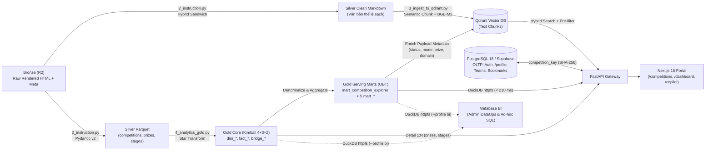

# Deliverable: Phản biện & bảo vệ mô hình Lớp Vàng (Kimball Star Schema vs OBT & phương án thay thế)

| Thuộc tính | Giá trị |
| :--- | :--- |
| Task ID | `TASK-GLD-01` (Cycle 06, TLCN Phase 1) |
| Primary Owner | Do Kien Hung (`@darktheDE`) & Nguyen Van Quang Duy (`@QuangDuyReal`) |
| Institution | Khoa Công nghệ Thông tin, Trường Đại học Công nghệ Kỹ thuật TP.HCM (HCM-UTE) |
| Date Completed | 2026-11-23 |
| Deliverable Type | Architecture Audit, Modeling Evaluation & Serving Blueprint |
| Status | Complete (Hồ sơ phản biện nội bộ theo `DIR-011`, chờ Hưng & Duy duyệt trước khi chốt ADR/sửa code) |

---

## 1. Tóm tắt điều hành (Executive summary)

Kiểm định mã nguồn [`src/acdp/4_analytics_gold.py`](../../src/acdp/4_analytics_gold.py), đặc tả [`SPEC-0003`](../specs/0003-gold-dimensional-modeling-spec.md) và `21` tệp Gold Parquet thực tế trên Cloudflare R2 (`106.98 KB`, `15` cuộc thi) xác nhận năm kết luận trọng tâm:

| Trụ cột đánh giá | Kết luận chính | Căn cứ định lượng & kỹ thuật |
| :--- | :--- | :--- |
| **1. Chuẩn Kimball hiện tại** | Đạt phần lõi, còn `5` lệch chuẩn (`A1–A5`) | Đúng Surrogate Keys, Unknown Member `-1`, Accumulating Snapshot, Factless Fact, Weighted Bridge (`0.0 VND` sai số); cần xử lý trùng `team_size_*`, mảng lồng trong Dim và `6` tệp `gold_*` thừa. |
| **2. Kiến trúc Lớp Vàng** | **Two-Tier Gold** (Kimball Core + OBT Marts) | Đo trên R2 `httpfs`, OBT `mart_competition_explorer` nhanh hơn Star Join `4` bảng tới **4.8x cold** (`182.9 ms` vs `880.5 ms`) và **3.9x warm** (`208.0 ms` vs `813.8 ms`), khớp chuẩn Gold của Databricks. |
| **3. Nguồn đọc RAG Service** | **Dual-Layer RAG** (Silver Text + Gold Metadata) | `3_ingest_to_qdrant.py` hiện đọc Bronze thô. Cần lấy văn bản thể lệ từ **Silver Clean Markdown** (bảo toàn điều khoản theo Guardrail #4) và metadata lọc từ **Gold** cho Qdrant pre-filtering. |
| **4. Giá trị Lakehouse & BI** | Tách rạch ròi **Web** (User) vs **Metabase** (Admin) | Website lấy danh mục chuẩn hóa, mùa vụ học kỳ `HK1`/`HK2`/`Hè` và RAG filter từ Gold; OLTP giữ `/profile`, tạo đội (`TASK-SRV-02`), bookmark. Metabase phục vụ DataOps quality audit và ad-hoc SQL. |
| **5. Kỹ thuật DE (`TLCN -> KLTN`)** | Giữ **SCD Type 1** ở TLCN, lên **SCD Type 2 + CDC** ở KLTN | Phù hợp tập mẫu `15` cuộc thi on-demand ở TLCN; sang KLTN tự động hóa cào cần SCD Type 2 + CDC Diff để nuôi Mail Alert (`TASK-SRV-05`) không gửi trùng. |

---

## 2. Kiểm định chuẩn Kimball trên hiện trạng Lớp Vàng

### 2.1. Hồ sơ thực nghiệm các tệp Gold Parquet trên Cloudflare R2

Kiểm tra chỉ đọc (read-only) ngày `2026-11-23` trên bucket R2 ghi nhận tổng cộng **21 tệp Parquet** (`109,551 bytes` / `106.98 KB`), phản ánh `15` cuộc thi duy nhất (`total_prize_pool_vnd = 4,170,091,840 VND`):

| Nhóm bảng | Tên tệp Parquet trên R2 | Số dòng | Số cột | Dung lượng | Phân loại chuẩn Kimball |
| :--- | :--- | :---: | :---: | :---: | :--- |
| **Dimensions (4)** | `dim_competition.parquet` | `15` | `29` | `20,993 B` | Type-1 Dimension (chứa cả mảng & văn bản dài) |
| | `dim_date.parquet` | `73` | `10` | `3,167 B` | Conformed Date Dimension (kèm bản ghi `-1`) |
| | `dim_domain.parquet` | `6` | `4` | `1,064 B` | Conformed Taxonomy Dimension (`5` nhóm + `-1`) |
| | `dim_organizer.parquet` | `59` | `4` | `3,332 B` | Conformed Entity Dimension (`University`/`Enterprise`/`Community`) |
| **Facts (3)** | `fact_competitions.parquet` | `15` | `15` | `2,928 B` | Accumulating Snapshot Fact (`4` Role-Playing Date FKs) |
| | `fact_prize_tiers.parquet` | `50` | `7` | `4,294 B` | Transaction / Detail Fact (kèm Degenerate Dimensions) |
| | `fact_timeline_stages.parquet` | `54` | `9` | `7,022 B` | Factless Fact Table (tiến độ các vòng thi) |
| **Bridges (2)** | `bridge_competition_domain.parquet` | `26` | `3` | `819 B` | Weighted Bridge (`allocation_weight = 1/n`) |
| | `bridge_competition_organizer.parquet` | `60` | `4` | `1,266 B` | Role-Typed Weighted Bridge (`organizer`/`partner_sponsor`) |
| **Data Marts (6)** | `mart_kpi_overview.parquet` | `1` | `8` | `1,386 B` | Pre-aggregated Executive Summary Mart |
| | `mart_domain_analytics.parquet` | `5` | `8` | `1,738 B` | Aggregated Domain Mart (đã chống fan-out) |
| | `mart_seasonality_academic.parquet` | `11` | `8` | `2,147 B` | Aggregated Academic Calendar Mart (`HK1`/`HK2`/`Hè`) |
| | `mart_organizer_ecosystem.parquet` | `60` | `7` | `4,180 B` | Aggregated Ecosystem Mart |
| | `mart_team_and_mode_matrix.parquet` | `6` | `4` | `865 B` | Cross-tab Mart (`mode_canonical` × `team_profile`) |
| | `mart_competition_explorer.parquet` | `15` | `32` | `21,129 B` | **Denormalized OBT Serving Mart** (API sử dụng chính) |
| **Legacy Views (6)** | `gold_*.parquet` (`6` tệp alias) | `3–50` | `3–25` | `32,221 B` | View tương thích ngược (`~29.4%` tổng dung lượng Gold) |

### 2.2. Đánh giá theo quy trình 4 bước của Kimball (4-step dimensional design)

1. **Bước 1 (Chọn quy trình nghiệp vụ / Business process)**: Tập trung vào vòng đời công bố cuộc thi học thuật/công nghệ (từ mở đơn, hạn chót, diễn ra sự kiện, cơ cấu giải thưởng đến lịch trình các vòng). Ranh giới quy trình rõ ràng, không trộn lẫn dữ liệu giao dịch người dùng (OLTP).
2. **Bước 2 (Khai báo mức độ chi tiết / Grain)**: Mỗi bảng Fact giữ một grain duy nhất và tường minh: `fact_competitions` (`1` dòng/cuộc thi khử trùng theo SHA-256 `canonical_url`), `fact_prize_tiers` (`1` dòng/hạng giải), `fact_timeline_stages` (`1` dòng/vòng thi).
3. **Bước 3 (Xác định Dimensions)**: `dim_date` đóng vai trò *Role-Playing Dimension* cho 4 mốc ngày trên `fact_competitions` và 2 mốc ngày trên `fact_timeline_stages`; có bản ghi giả `-1` cho giá trị thiếu (tránh rơi bản ghi khi `INNER JOIN`); `dim_domain` và `dim_organizer` dùng chung cho nhiều bảng Fact/Bridge (*Conformed Dimensions*).
4. **Bước 4 (Xác định Facts & Bridges)**: `fact_competitions` là *Accumulating Snapshot* theo đúng mô tả của Kimball (một thực thể có các mốc thời gian kế tiếp được cập nhật khi tiến triển); `fact_timeline_stages` là *Factless Fact* ghi nhận sự kiện vòng thi không có đại lượng cộng dồn; hai bảng `bridge_*` áp dụng kỹ thuật *Weighting Factor* (`allocation_weight = 1.0 / len(...)`) giúp tổng `allocated_prize_vnd` qua 26 liên kết ngành khớp tuyệt đối với `4,170,091,840 VND` ở `mart_kpi_overview` (độ lệch `0.0 VND`).

### 2.3. Năm điểm lệch chuẩn & tồn tại kỹ thuật phát hiện (`A1–A5`)

| Mã | Hiện trạng trong code / R2 | Đánh giá theo chuẩn Kimball & Data Engineering | Mức độ & hướng xử lý đề xuất (chờ phản biện) |
| :---: | :--- | :--- | :--- |
| **A1** | `team_size_min`, `team_size_max` nằm trùng ở cả `dim_competition` ([`4_analytics_gold.py#L758-L759`](../../src/acdp/4_analytics_gold.py#L758-L759)) và `fact_competitions` ([`#L821-L822`](../../src/acdp/4_analytics_gold.py#L821-L822)). | Lệch chuẩn: thuộc tính mô tả quy mô đội không phải measure giao dịch cộng dồn. Đặt trùng dễ gây lệch nguồn khi sửa pipeline. | Giữ `team_size_min/max` ở `dim_competition` (dùng để lọc/nhóm), bỏ khỏi `fact_competitions` hoặc chỉ giữ `team_size_max` nếu thực sự tính KPI `AVG` trên fact. |
| **A2** | `dim_competition` chứa mảng lồng `raw_categories VARCHAR[]`, `organizers VARCHAR[]`, `partners_and_sponsors VARCHAR[]` ([`#L771-L773`](../../src/acdp/4_analytics_gold.py#L771-L773)) và văn bản dài (`summary`, `challenge_overview`). | Lệch 1NF / Kimball: mảng đa trị đã có 2 bảng `bridge_*` xử lý, nhưng `mart_competition_explorer` vẫn đọc trực tiếp mảng từ `dim_competition` ([`#L995-L996`](../../src/acdp/4_analytics_gold.py#L995-L996)). Văn bản dài làm `dim_competition.parquet` nặng `20.99 KB` (gấp 7.2x `fact_competitions`). | Giữ `dim_competition` gọn cho thuộc tính lọc; chuyển các trường hiển thị dài (`challenge_overview`, `organizers[]`) ra **OBT Serving Mart** (`mart_competition_explorer`) hoặc tách `dim_competition_text` nếu dữ liệu lớn ở KLTN. |
| **A3** | Surrogate Key (`comp_sk`, `organizer_sk`, `prize_sk_seq`, `stage_sk_seq`) sinh tăng dần `1..N` trong bộ nhớ mỗi lần chạy ([`#L1171-L1185`](../../src/acdp/4_analytics_gold.py#L1171-L1185)). | Hợp lệ ở **SCD Type 1** (rebuild toàn bộ), nhưng không bền vững giữa các batch. May mắn là OLTP (`SPEC-0004`) liên kết bằng `competition_key` (SHA-256) chứ không dùng `competition_sk`. | Khi nâng cấp **SCD Type 2** ở KLTN, phải sinh `competition_sk` xác định từ `(competition_key, valid_from)` hoặc lookup key cũ từ Gold trước đó. |
| **A4** | `GOLD_ENTITIES` ([`#L1377-L1399`](../../src/acdp/4_analytics_gold.py#L1377-L1399)) xuất ra R2 toàn bộ **21 tệp Parquet**, gồm cả 6 view `gold_*` cũ (`32.2 KB`, ~30% tổng dung lượng), dù [`duckdb_client.py`](../../src/acdp/api/db/duckdb_client.py#L13-L29) chỉ đọc 15 tệp. | Tạo tệp thừa trên Object Storage (small-file overhead). Nếu không còn hệ thống nào gọi `gold_*.parquet`, việc xuất 6 tệp legacy gây dư thừa chi phí mạng khi build. | Rút gọn danh sách materialize Parquet trên R2 xuống 15 tệp (`9` lõi + `6` mart) hoặc tạo `gold_*` dưới dạng SQL view ảo trong DuckDB init script của Metabase. |
| **A5** | Dữ liệu R2 hiện có `3/15` (20%) thiếu `reg_deadline_date_sk = -1`, `5/15` (33.3%) thiếu `team_size_max`, `1/15` thiếu `prize_tier_count = 0`, `13/15` ở trạng thái không mở (`open = 2`). | Đúng kỹ thuật phòng thủ (`-1` giữ toàn vẹn khóa ngoại), nhưng phơi bày chất lượng extract từ Silver (`G1`, `G5`, `G8` ở `TASK-SLV-02`). | Khắc phục tại nguồn Silver (`TASK-SLV-03`, `TASK-SLV-04`) rồi theo dõi tỷ lệ `-1` trên Metabase Admin Dashboard. |

---

## 3. So sánh phương án mô hình dữ liệu Lớp Vàng

### 3.1. Đối chiếu chuẩn Medallion Gold (Databricks) & thực nghiệm DuckDB-on-R2

Theo định nghĩa chính thức của Databricks (*What is the Gold layer in a medallion architecture?*), Lớp Vàng hướng tới các bảng tiêu thụ sẵn sàng theo dự án (*consumption-ready, project-specific*), ưu tiên **phi chuẩn hóa và tối ưu đọc với ít phép join hơn** (*more de-normalized and read-optimized data models with fewer joins*), hỗ trợ cả **Kimball Star Schema** lẫn **Data Marts kiểu Inmon**.

Trong hạ tầng ACDP (`DIR-021`), DuckDB chạy in-memory đọc Parquet từ Cloudflare R2 qua giao thức **`httpfs`**. Điểm nghẽn chính của `httpfs` không nằm ở CPU mà ở **số lượt bắt tay HTTP/TLS và đọc header Parquet** cho từng tệp riêng lẻ. Kết quả đo thực tế trên dữ liệu R2 và mô phỏng 10,000 bản ghi như sau:

| Kịch bản đo (DuckDB `httpfs` / In-Memory) | Star Schema Join (`dim_competition` + `fact_competitions` + `bridge_*` + `dim_domain`) | OBT Serving Mart (`mart_competition_explorer`, 1 tệp phẳng) | Hệ số tăng tốc của OBT |
| :--- | :---: | :---: | :---: |
| **R2 `httpfs` Cold (lượt đọc đầu từ Cloudflare R2)** | `880.5 ms` (`4` tệp Parquet) | `182.9 ms` (`1` tệp Parquet) | **Nhanh hơn 4.8x** |
| **R2 `httpfs` Warm (trung bình 10 lượt truy vấn qua R2)** | `813.8 ms` | `208.0 ms` | **Nhanh hơn 3.9x** |
| **In-Memory 10,000 cuộc thi (giả lập KLTN, TB 20 lượt)** | `17.02 ms` | `3.00 ms` | **Nhanh hơn 5.7x** |

### 3.2. Ma trận so sánh 5 mô hình cho mục tiêu sản phẩm ACDP

| Tiêu chí đánh giá | Kimball Thuần (chỉ `dim` + `fact` + `bridge`) | One Big Table (OBT) Thuần (1 bảng phẳng duy nhất) | Data Vault 2.0 (Hub, Link, Satellite) | Activity Schema (`entity + timestamp + activity`) | **Two-Tier Gold: Kimball Core + OBT Marts (Đề xuất)** |
| :--- | :--- | :--- | :--- | :--- | :--- |
| **Hiệu năng Web API qua R2 `httpfs`** | Chậm (`~814–880 ms`) vì mỗi request phải mở 4–5 tệp Parquet qua HTTP. | Rất nhanh (`~183–208 ms`), chỉ 1 lần đọc Parquet. | Rất chậm nếu query trực tiếp (phải join Hub-Link-Sat hoặc dựng PIT). | Trung bình; cần self-join phức tạp để dựng bảng tổng hợp. | **Tối ưu (`~183–208 ms`)** vì API đọc từ `mart_*` OBT đã nối sẵn. |
| **Xử lý quan hệ `1:N` & `N:M` (Giải thưởng, Vòng thi, Ngành, BTC)** | Xử lý chuẩn xác (`fact_prize_tiers`, `fact_timeline_stages`, `bridge` trọng số). | **Thất bại / Méo số**: nhồi 50 giải & 54 vòng vào 15 dòng gây nổ dòng (fan-out) hoặc phải nhét struct lồng khó lọc SQL. | Xử lý tốt qua Link tables, nhưng truy vấn rất phức tạp. | Không tự nhiên cho thuộc tính tĩnh cấu trúc phân cấp (giải thưởng theo tier). | **Chuẩn xác ở Gold Core**, đồng thời cung cấp góc nhìn phẳng an toàn ở `mart_*`. |
| **Chống phình tổng tiền đa ngành (`4.17 tỷ VNĐ`)** | Đảm bảo tuyệt đối (`0.0 VND` sai số) nhờ `allocation_weight`. | Dễ cộng lặp nếu lồng mảng `category[]` rồi `UNNEST` khi báo cáo. | Cần tầng Mart bổ sung phía trên mới chống lặp được. | Không có cơ chế allocation weight gốc. | **Đảm bảo tuyệt đối** ở Core và `mart_domain_analytics`. |
| **Tương thích Metabase Self-Service BI** | Rất tốt (nhận diện FK để drill-through và Field Filter). | Dễ kéo-thả cho 1 bảng, nhưng mất khả năng rã chi tiết `prizes`/`stages`. | Kém; bắt buộc phải xây thêm lớp Kimball/Mart ở trên. | Kém; BI truyền thống không thiết kế cho mô hình dòng sự kiện. | **Toàn diện**: Metabase đọc cả Star Core (chi tiết) lẫn Marts (tổng hợp). |
| **Chi phí vận hành (Team 2 người, TLCN `15` cuộc thi)** | Thấp–Trung bình. | Rất thấp lúc đầu, nhưng gãy khi mở rộng tính năng. | **Overkill nặng**: quá nhiều bảng cho tập dữ liệu `< 150 KB`. | Cần học lại tư duy SQL thời gian; ít quen thuộc với hội đồng. | **Cân bằng**: ~300 dòng SQL/Python trong 1 script `4_analytics_gold.py`. |
| **Sức thuyết phục Hội đồng (FIT-HCMUTE)** | Cao (chuẩn mực giáo trình Data Warehouse). | Dễ bị hỏi vặn *"vì sao không tách Fact/Dim mà để 1 bảng phẳng?"*. | Dễ bị phản biện *"lạm dụng kiến trúc doanh nghiệp cho quy mô nhỏ"*. | Khó bảo vệ vì thiếu tính phổ quát trong hệ thống học thuật. | **Cao nhất**: vừa chuẩn lý thuyết Kimball, vừa chứng minh tối ưu I/O thực nghiệm trên Cloud R2. |

**Kết luận kiến trúc**: **Không bắt buộc dùng Kimball thuần cho mọi truy vấn**, nhưng **không được bỏ Kimball để về OBT thuần**. Kiến trúc **Two-Tier Gold (Kimball Core + OBT Serving Marts)** giữ Kimball Star Schema làm nguồn chân lý giải quyết bài toán `1:N` (`fact_prize_tiers`, `fact_timeline_stages`), `N:M` (`bridge_*` chống fan-out), lịch học kỳ (`dim_date`), và xuất sẵn các **OBT Data Marts** (`mart_competition_explorer` và 5 mart tổng hợp) phục vụ Web API đạt độ trễ `< 210 ms` trên R2.

---

## 4. Kiến trúc Serving, luồng RAG (Silver vs Gold) và giá trị Lakehouse trên Website

### 4.1. Sơ đồ luồng dữ liệu Medallion $\rightarrow$ Dual-Layer Serving

### 4.2. RAG Service nên đọc từ Lớp Bạc hay Lớp Vàng?

Hiện tại, [`src/acdp/3_ingest_to_qdrant.py`](../../src/acdp/3_ingest_to_qdrant.py#L205-L276) đang đọc trực tiếp từ **Bronze** (`bronze/<domain>/year=...`). Cách làm này không tối ưu vì Bronze còn chứa nhiễu HTML/nav/sidebar (khi triển khai `TASK-BRZ-02` lưu Raw HTML) và thiếu các trường đã chuẩn hóa như `registration_status` tự động đóng khi quá hạn hoặc `total_prize_vnd` quy đổi từ USD.

Giải pháp chuẩn là **Dual-Layer RAG (Silver Text + Gold Metadata)**:

| Thành phần RAG | Đọc từ lớp nào? | Lý do kỹ thuật & dữ liệu |
| :--- | :--- | :--- |
| **Nội dung văn bản để chunk & embed** | **Lớp Bạc (`Silver Clean Markdown`)** | Đã loại bỏ HTML rác từ Bronze nhưng giữ nguyên 100% câu chữ thể lệ, điều kiện, lịch trình chi tiết. Không lấy `summary` từ Gold vì văn bản tóm tắt làm mất điều khoản chi tiết, dễ vi phạm Guardrail #4 (*trích dẫn chính xác thể lệ*). |
| **Metadata payload để Pre-filter trên Qdrant** | **Lớp Vàng (`Gold mart_competition_explorer`)** | Cung cấp bộ thuộc tính đã khử trùng và chuẩn hóa: `competition_key`, `registration_status` (đã cập nhật `open`/`closed`), `mode_canonical`, `is_free`, `domain_slugs`, `total_prize_vnd`, `team_size_min/max`, `registration_deadline_date`. |
| **Tác dụng thực tế (`TASK-SRV-04`)** | Kết hợp tại **Qdrant HNSW Pre-filtering** | Khi sinh viên hỏi *"Cuộc thi AI miễn phí nào đang mở cho đội 3 người?"*, Qdrant lọc payload Gold (`status='open' AND is_free=true AND 'ai-data-science' IN domain_slugs`) ngay trong quá trình duyệt đồ thị HNSW trước khi xếp hạng ngữ nghĩa trên chunk Silver. |

### 4.3. Website lấy gì từ Lakehouse Gold và giá trị khác biệt so với OLTP?

Để chứng minh Lakehouse không phải thành phần thừa bên cạnh PostgreSQL/Supabase, ranh giới dữ liệu trên Website được phân tách dứt khoát như sau:

| Nguồn dữ liệu | Trách nhiệm cốt lõi | Dữ liệu cụ thể phục vụ các màn hình Web (`apps/web/`) |
| :--- | :--- | :--- |
| **Lakehouse Gold (R2 Parquet + DuckDB)** | **Read-Heavy Analytical & Curated Catalog**: Khử trùng đa nguồn, chuẩn hóa tiền tệ/học kỳ, chống lặp giải thưởng, tổng hợp đa chiều. | 1. **`/competitions` & `/competitions/[key]`**: Danh mục chuẩn hóa từ `mart_competition_explorer`, chi tiết 1:N từ `fact_prize_tiers` & `fact_timeline_stages`. 2. **`/dashboard`**: Toàn bộ chỉ số thị trường cuộc thi & mùa vụ theo học kỳ HCM-UTE (`HK1`/`HK2`/`Hè`). 3. **`/copilot` (RAG)**: Metadata chuẩn hóa để pre-filter Qdrant và kiểm chứng thông số số học. 4. **Bookmark & Team Guard**: `check_competition_name()` xác thực `competition_key` hợp lệ trước khi ghi vào OLTP. 5. **KLTN Mail Alert (`TASK-SRV-05`)**: Phát hiện cuộc thi mới hoặc thay đổi hạn nộp từ bảng chênh lệch (CDC) ở Gold. |
| **OLTP (`PostgreSQL 18 / Supabase`)** | **Write-Heavy Transactional State**: Giao dịch người dùng thời gian thực cần ACID row-level lock. | 1. **Tài khoản & `/profile` (`TASK-SRV-01`)**: Thông tin cá nhân, MSSV, ngành học, kỹ năng, link CV. 2. **Ghép đội (`TASK-SRV-02`, `TASK-SRV-03`)**: Tạo đội, xin vào đội, duyệt thành viên trên từng `competition_key` (thuần OLTP, không AI). 3. **Bookmarks & Chat History**: `saved_competitions` (lưu kèm `competition_name_snapshot`), `chat_sessions`, `chat_messages`. |

---

## 5. Thiết kế Dashboard (Web Next.js vs Metabase) & phân quyền nội dung

Mở rộng trực tiếp từ [`T15`](../rd-tasks/T15_metabase_and_prefect_lightweight_architecture.md) và [`SPEC-0005`](../specs/0005-frontend-design-system-and-ux-spec.md): Web `/dashboard` phục vụ trải nghiệm sản phẩm cho **Sinh viên và Giảng viên**, trong khi **Metabase (`--profile bi`)** là công cụ **DataOps & Ad-hoc BI cho Quản trị viên/Kỹ sư dữ liệu** (chỉ bật khi kiểm định dữ liệu hoặc xuất báo cáo chuyên sâu, tốn ~400–600 MiB RAM khi chạy Docker).

### 5.1. Đánh giá trang `/dashboard` hiện tại trên Web

Trang [`apps/web/app/dashboard/page.tsx`](../../apps/web/app/dashboard/page.tsx#L23-L28) hiện gắn tiêu đề kỹ thuật *"Gold Layer Analytics Dashboard / Số liệu thời gian thực từ DuckDB Kimball Star Schema"* và hiển thị chung một bộ 4 KPI + 4 biểu đồ cho mọi người dùng. Cách trình bày này mang màu sắc kỹ thuật nội bộ hơn là sản phẩm hướng sinh viên và chưa phục vụ tốt nhu cầu kiểm soát chất lượng dữ liệu của quản trị viên.

### 5.2. Bảng phân tách KPI & biểu đồ theo từng đối tượng người dùng

| Đối tượng | Kênh hiển thị | Câu hỏi nghiệp vụ cần trả lời | Các thẻ KPI & Biểu đồ / Bảng dữ liệu cần hiển thị |
| :--- | :--- | :--- | :--- |
| **Sinh viên (User thường)** | **Web `/dashboard`** (công khai, hướng dẫn hành động) | *"Tháng này còn cuộc thi nào đang mở? Miễn phí không? Ngành nào nhiều giải? Cần rủ thêm mấy bạn?"* | - **4 KPI Cards**: Cuộc thi **đang mở** (`open_competitions`), **Sắp đóng đơn trong ≤14 ngày** (*đề xuất bổ sung từ `reg_deadline_date_sk`*), Tỷ lệ miễn phí & có học bổng, Tổng quỹ giải thưởng. - **Charts**: (1) Ngành & quỹ giải thưởng (click để lọc sang `/competitions?domain=...`), (2) Lịch mùa vụ `HK1`/`HK2`/`Hè` (biết tháng cao điểm để chuẩn bị), (3) Donut Hình thức (`Online/Offline/Hybrid`) × Quy mô đội (`1 / 2-4 / 5+`) hỗ trợ quyết định lập đội. |
| **Giảng viên / Khoa (Advisor / Faculty)** | **Web `/dashboard`** (khối *Góc nhìn Khoa & Hệ sinh thái*) + **Metabase** | *"Mùa thi nào trùng lịch thi học kỳ HCM-UTE? Doanh nghiệp hoặc trường nào tổ chức đều đặn để Khoa kết nối?"* | - **KPI**: Tổng số đơn vị tổ chức & nhà tài trợ (`unique_organizers = 59`), số cuộc thi cấp học bổng/tài trợ. - **Charts**: (1) BXH **Hệ sinh thái BTC & Nhà tài trợ** (`mart_organizer_ecosystem` tách riêng `organizer` vs `partner_sponsor`), (2) Mùa vụ theo năm học HCM-UTE đối chiếu số cuộc thi và tổng giải, (3) Bảng phân loại bậc giải thưởng (`fact_prize_tiers`) phục vụ lập kế hoạch bồi dưỡng đội tuyển. |
| **Quản trị viên / Data Engineer (Admin / DataOps)** | **Metabase BI** (truy cập SQL trực tiếp vào Gold Parquet trên R2) | *"Pipeline vừa chạy có bao nhiêu cuộc thi bị lỗi parse ngày, thiếu ngành, thiếu tier giải, hay lệch tổng quỹ giải?"* | - **Data Quality Scorecard (không hiển thị cho user thường)**: Số dòng `reg_deadline_date_sk = -1` (`3/15`), `domain_sk = -1` (`0/26`), `team_size_max IS NULL` (`5/15`), `prize_tier_count = 0` (`1/15`), kiểm tra cân bằng cầu `ABS(kpi_total - domain_sum) <= 1 VND` (`0.0 VND`). - **Lineage & Ops Analytics**: Thống kê theo `source_batch_file` và `loaded_at`, bảng chéo `fact_timeline_stages` chưa có ngày kết thúc, truy vấn ad-hoc SQL & xuất CSV/PDF. |

---

## 6. Kỹ thuật Lakehouse & Data Warehouse tại Lớp Vàng (`TLCN -> KLTN`)

Trả lời câu hỏi lý thuyết từ `.scratchpad/22112026.md` (*kiểm tra có cần bổ sung CDC, SCD, Fact/Dim hay không*):

| Nhóm kỹ thuật DE | Trạng thái hiện tại | Áp dụng ngay ở TLCN (Phase 1) | Nâng cấp bắt buộc ở KLTN (Phase 2) |
| :--- | :--- | :--- | :--- |
| **Dimensional Modeling (Fact, Dim, Bridge)** | Đã có (`4 dim`, `3 fact`, `2 bridge`) | Hiệu chỉnh 5 điểm `A1–A5`: bỏ trùng `team_size_*`, tách sạch `mart_competition_explorer` làm OBT serving, rút gọn xuất 15 tệp Parquet thay vì 21 tệp. | Bổ sung `dim_skill` / `bridge_competition_skill` khi Silver Schema v2 có `required_skills` (`TASK-SLV-04`). |
| **SCD (Slowly Changing Dimensions)** | **SCD Type 1** (ghi đè toàn bộ) | **Giữ SCD Type 1** cho TLCN (`15` cuộc thi chạy on-demand) vì ưu tiên đơn giản và khớp hiện trạng `4_analytics_gold.py`. | Nâng cấp **SCD Type 2** (hoặc Daily Snapshot Table) cho `dim_competition` với khóa xác định, thêm `effective_from`, `effective_to`, `is_current` để lưu lịch sử gia hạn deadline và biến động giải thưởng qua từng mùa. |
| **CDC (Change Data Capture)** | Chưa có (full refresh) | Không bắt buộc ở TLCN vì cào thủ công 5–10 link. | **Bắt buộc ở KLTN**: So khớp snapshot Silver/Gold giữa batch $T$ và $T-1$ (`silver_diff` / `gold_change_events` theo `competition_key` + `content_hash`) để kích hoạt **Mail Alert (`TASK-SRV-05`)** đúng 1 lần khi có cuộc thi mới hoặc thay đổi hạn nộp. |
| **Lakehouse Storage & Query Engine** | Parquet trên R2 + DuckDB `httpfs` | Dùng **Explicit PyArrow Schema** + nén **ZSTD**, không chia partition thư mục (tránh small files với `< 150 KB`). Giảm số tệp Gold trên R2 từ 21 xuống 15 tệp. | Khi dữ liệu vượt `10,000+` bản ghi và cần giao dịch ACID đa writer / Time-Travel cho SCD Type 2 + CDC, đánh giá chuyển sang **Apache Iceberg** hoặc **DuckLake**. |

---

## 7. Ngân hàng câu hỏi phản biện trước Hội đồng

1. **"Vì sao Gold Layer chỉ có 15 cuộc thi (`107 KB`) mà nhóm lại dựng tới 9 bảng Star Schema + 6 Marts thay vì dùng 1 bảng phẳng hoặc đọc thẳng từ PostgreSQL?"**
   - *Trả lời*: Quy mô `15` cuộc thi là tập dữ liệu kiểm chứng kỹ thuật cho Phase 1 (TLCN) theo nguyên tắc tinh gọn. Dù số dòng nhỏ, cấu trúc dữ liệu cuộc thi có hai quan hệ `1:N` (`50` giải thưởng, `54` vòng thi) và hai quan hệ `N:M` (`26` liên kết ngành, `60` liên kết BTC/tài trợ). Nếu gộp thành 1 bảng phẳng sẽ gây lặp tiền giải thưởng khi thống kê theo ngành; ngược lại, tách Kimball Star Schema + `bridge` có trọng số bảo toàn chính xác `4,170,091,840 VNĐ` với sai số `0.0 VND`, đồng thời xuất thêm OBT `mart_competition_explorer` để đạt tốc độ `182.9 ms` qua R2 `httpfs` (nhanh hơn `4.8x` so với join 4 bảng qua mạng).
2. **"Tại sao hệ thống đã có Web Dashboard bằng Next.js mà vẫn giữ Metabase?"**
   - *Trả lời*: Web Dashboard và Metabase phục vụ hai vai trò tách biệt. Web `/dashboard` phục vụ sinh viên và giảng viên với trải nghiệm đồng bộ, tương tác lọc chéo sang trang tìm kiếm và ghép đội. Metabase (`--profile bi`, mặc định tắt để tiết kiệm RAM) phục vụ kỹ sư dữ liệu và quản trị viên thực hiện truy vấn SQL ad-hoc, kiểm tra tỷ lệ dữ liệu thiếu (`date_sk = -1`, thiếu `team_size`) và xuất báo cáo thống kê mà không cần sửa code giao diện Web.
3. **"Nếu không dùng SCD Type 2 ngay bây giờ thì làm sao biết cuộc thi nào mới xuất hiện hoặc mới gia hạn?"**
   - *Trả lời*: Ở Phase 1 (TLCN), pipeline chạy on-demand trên tập mẫu cố định nên SCD Type 1 là hợp lý và tránh phình schema. Khi chuyển sang Phase 2 (KLTN) chạy lịch cào định kỳ bằng GitHub Actions, lớp Silver/Gold sẽ bổ sung bảng lịch sử snapshot + CDC diff theo `competition_key` và `extracted_at` để phục vụ đồng thời theo dõi biến động và kích hoạt dịch vụ email tự động.
4. **"Vì sao RAG Chatbot lại không đọc thẳng từ Lớp Vàng cho đồng bộ với Web?"**
   - *Trả lời*: Lớp Vàng chuẩn hóa dữ liệu định lượng và tóm tắt thuộc tính phục vụ BI, nên nếu dùng đoạn tóm tắt ở Gold để nhúng vector sẽ làm mất các điều khoản thể lệ chi tiết (đối tượng dự thi, quy chế chấm điểm, lưu ý nộp bài). Do đó, RAG đọc văn bản gốc đã làm sạch từ **Silver Clean Markdown** để bảo toàn độ trung thực câu chữ, kết hợp đọc **metadata chuẩn hóa từ Gold** nạp vào Qdrant payload để lọc chính xác trạng thái mở/đóng, miễn phí và quy mô đội.

---

## 8. Liên kết kiểm chứng & bước tiếp theo

- **Visual Dossier tương tác**: [`TASK-GLD-01-kimball-star-schema-audit-and-alternatives-visual-dossier.html`](./TASK-GLD-01-kimball-star-schema-audit-and-alternatives-visual-dossier.html)
- **Mã nguồn & Đặc tả đối chiếu**: [`src/acdp/4_analytics_gold.py`](../../src/acdp/4_analytics_gold.py), [`src/acdp/api/services/gold_queries.py`](../../src/acdp/api/services/gold_queries.py), [`src/acdp/api/db/duckdb_client.py`](../../src/acdp/api/db/duckdb_client.py), [`src/acdp/3_ingest_to_qdrant.py`](../../src/acdp/3_ingest_to_qdrant.py), [`SPEC-0003`](../specs/0003-gold-dimensional-modeling-spec.md), [`SPEC-0005`](../specs/0005-frontend-design-system-and-ux-spec.md), [`T15`](../rd-tasks/T15_metabase_and_prefect_lightweight_architecture.md).
- **Bước tiếp theo (`DIR-011`)**: Hưng và Duy phản biện hồ sơ này cùng `TASK-SLV-02`, sau đó chốt phương án cập nhật vào `SPEC-0003` và triển khai đồng bộ ở `TASK-SLV-03`, `TASK-SLV-04`, `TASK-CLD-02`.

---

## 9. Search Provenance & References (`DIR-020`)

1. **Query**: `Kimball Group accumulating snapshot fact table role-playing dimension bridge table weighting factor factless fact`
   - Định nghĩa Accumulating Snapshot, Role-Playing Dimension, Bridge Table với Weighting Factor và Factless Fact Table: `kimballgroup.com`, `holistics.io`.
2. **Query**: `Kimball Group slowly changing dimensions SCD type 1 type 2 unknown member surrogate key -1`
   - Quy tắc Unknown Member `-1` tránh mất dữ liệu khi `INNER JOIN`, so sánh SCD Type 1 và Type 2: `kimballgroup.com`, `datawarehouseinfo.com`.
3. **Query**: `Databricks medallion architecture gold layer star schema denormalized data marts`
   - Định nghĩa chuẩn Lớp Vàng (consumption-ready, denormalized, read-optimized, Star Schema & Inmon Data Marts): [Databricks Medallion Architecture Blog](https://www.databricks.com/blog/what-is-medallion-architecture), `databricks.com`.
4. **Query**: `Fivetran benchmark wide tables OBT vs star schema performance BigQuery Snowflake Redshift`
   - Đánh đổi Join-on-Write (OBT) vs Join-on-Read (Star Schema) và xu hướng kiến trúc lai: `fivetran.com`, `dataarchitect.studio`.
5. **Query**: `DuckDB star schema join performance vs denormalized OBT Parquet S3 httpfs 2025 2026`
   - Tác động của số lượt HTTP GET/range-request trên Object Storage (`httpfs`) đối với Star Join đa tệp so với quét 1 tệp OBT trên DuckDB: `hikmahtechnologies.com`, `pipecode.ai`.
6. **Query**: `"star schema" "denormalized" OR "one big table" query performance benchmark IEEE OR ACM OR arXiv`
   - So sánh học thuật về column pruning, shuffle cost và mô hình lai (Star Core + Materialized OBT Views): `gcpstudyhub.com`, `datalane-data.blog`.
7. **Query**: `Data Vault 2.0 vs Kimball dimensional modeling when to use overkill small team`
   - Phân tích lý do Data Vault 2.0 (Hub/Link/Satellite) gây dư thừa độ phức tạp cho nhóm nhỏ và tập dữ liệu phân tích vừa/nhỏ: `dataworkers.io`, `microsoft.com`.
8. **Query**: `Activity Schema vs Kimball star schema dimensional modeling comparison`
   - So sánh mô hình chuỗi sự kiện Activity Schema với Kimball Star Schema trong báo cáo BI: `dataengineering.wiki`, `secoda.co`.
9. **Query**: `Metabase DuckDB star schema vs denormalized models best practices 2025 2026`
   - Cách Metabase tận dụng Foreign Keys, Field Filters trên Star Schema và sử dụng bảng phẳng cho dashboard hiệu năng cao: `metabase.com`, `motherduck.com`.
10. **Query**: `Qdrant metadata filtering RAG lakehouse unstructured text structured metadata hybrid search 2025 2026`
    - Cơ chế HNSW pre-filtering kết hợp payload metadata chuẩn hóa với văn bản phi cấu trúc trong Lakehouse RAG: `qdrant.tech`, `tensorlake.ai`, `datalakehousehub.com`.
