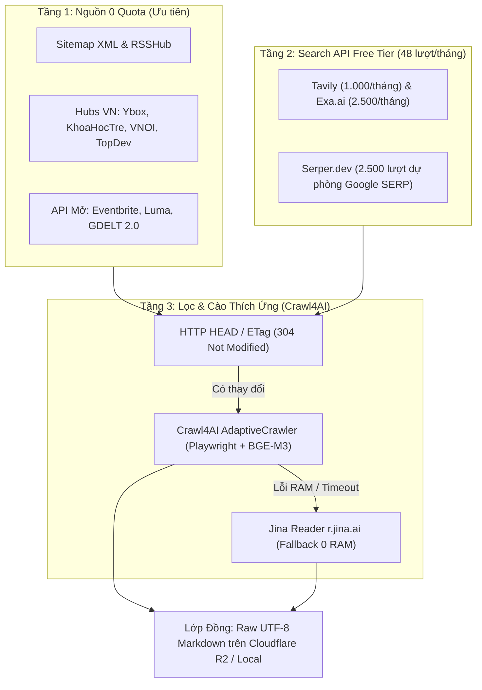

# Deliverable: Nghiên cứu search pattern và kỹ thuật cào tối ưu trên free tier (quy mô nhỏ)

- **Task ID**: `TASK-ING-01`
- **Related Cycle**: Cycle 06 (TLCN Phase 1)
- **Primary Owner**: Do Kien Hung (`@darktheDE`) & Nguyen Van Quang Duy (`@QuangDuyReal`)
- **Institution**: Khoa Công nghệ Thông tin, Trường Đại học Công nghệ Kỹ thuật TP.HCM (HCM-UTE)
- **Date Completed**: 2026-11-22
- **Deliverable Type**: Discovery & Ingestion Architecture Research
- **Status**: Complete

---

## 1. Tóm tắt điều hành và mục tiêu nghiên cứu

Trong giai đoạn Tiểu luận chuyên ngành (TLCN) theo chỉ thị `DIR-015`, danh sách 5–10 cuộc thi tiêu biểu trong [`src/acdp/1_crawl_to_bronze.py`](../../src/acdp/1_crawl_to_bronze.py) đang được nạp thủ công. Nghiên cứu này đánh giá khách quan các phương pháp khám phá nguồn cuộc thi (Discovery) và kỹ thuật cào dữ liệu trên gói miễn phí (Free Tier) tính đến mốc thời gian Tháng 9/2026 (`DIR-012`), nhằm chuẩn hóa luồng thu thập chất lượng cao với chi phí vận hành 0 VNĐ.

Kết quả đối chiếu thực tế cho thấy hai rủi ro lớn nếu dùng các giải pháp truyền thống. Thứ nhất, Google Custom Search JSON API (100 lượt/ngày) đã ngừng cấp mới và sẽ đóng cửa hoàn toàn vào ngày 01/01/2027. Thứ hai, các thư viện cào HTML không chính thức từ DuckDuckGo thường xuyên bị chặn bởi giới hạn tốc độ (`RatelimitException`) khi chạy truy vấn phức hợp `site:*.edu.vn`.

Giải pháp tối ưu cho ACDP là mô hình khám phá 3 tầng kết hợp:
1. Tầng 1 (0 quota, 0 VNĐ): Quét trực tiếp Sitemap XML (`<lastmod>`), RSSHub, cổng tổng hợp Việt Nam (`ybox.vn`, `khoahoctre.com.vn`, `vnoi.info`, `topdev.vn`) và API sự kiện mở (`Eventbrite`, `Luma`, `Devpost`, `GDELT Doc 2.0`).
2. Tầng 2 (Free Tier Search API tái tạo hàng tháng): Kết hợp **Tavily** (1.000 credits/tháng) và **Exa.ai** ($10/tháng $\approx 2.500$ lượt Lite) để chạy 12 mẫu truy vấn chuẩn/tuần ($\approx 48$ lượt/tháng, chỉ tiêu tốn $< 5\%$ hạn mức), dự phòng bằng **Serper.dev** (2.500 lượt Google SERP miễn phí khi đăng ký).
3. Tầng cào nội dung: Chuẩn hóa **Crawl4AI** (`AdaptiveCrawler` + `@cf/baai/bge-m3` + `gemini-3.5-flash`) cho các trang SPA JavaScript, kết hợp kiểm tra nhanh bằng `httpx` và dự phòng bằng **Jina Reader (`r.jina.ai`)** khi cần tiết kiệm RAM cục bộ.

---

## 2. Cơ sở lý thuyết và công trình khoa học liên quan

Kiến trúc khám phá và thu thập dữ liệu của ACDP kế thừa trực tiếp ba nền tảng nghiên cứu đã được bình duyệt:
1. Thu thập dữ liệu có định hướng (*Focused Crawling* — Chakrabarti et al., 1999): Thay vì cào dàn trải toàn bộ web, crawler sử dụng độ tương đồng ngữ nghĩa để ưu tiên các liên kết thuộc chủ đề cuộc thi học thuật, giảm thiểu nhiễu từ các trang tin tức thông thường.
2. Chính sách làm mới trang thích ứng (*Adaptive Page Refresh* — Cho & Garcia-Molina, 2003): Mô hình hóa tần suất thay đổi trang web theo phân phối Poisson. Kết hợp với HTTP Conditional Request (`ETag` và `If-Modified-Since`), hệ thống nhận mã `304 Not Modified` ($< 1\text{ KB}$) khi trang chưa cập nhật, tiết kiệm trên 85% băng thông và thời gian mở trình duyệt headless.
3. Khám phá tương tác dẫn hướng bằng truy vấn (*Query-Driven Thematic Collection* — West & Dragut, VLDB 2026): Sử dụng vòng lặp tái gieo hạt qua Search Engine API để tự động phát hiện các tên miền trường đại học mới phát động cuộc thi mà không cần biết trước URL.

---

## 3. Ma trận đối sánh các phương pháp khám phá nguồn trên free tier

Bảng dưới đây tổng hợp thông số kỹ thuật và hạn mức thực tế của 8 phương pháp khám phá nguồn cuộc thi (cập nhật Tháng 9/2026):

| Phương pháp / API | Hạn mức Free Tier | Cơ chế gia hạn | Thẻ tín dụng | Rate limit | Độ phủ `.edu.vn` VN | Trạng thái & Rủi ro |
| :--- | :--- | :--- | :--- | :--- | :--- | :--- |
| **Google Custom Search JSON** | 100 queries/ngày | Hàng ngày | Không | 10 QPS | Rất cao | Ngừng cấp mới, đóng cửa 01/01/2027 (Loại bỏ) |
| **Serper.dev** | 2.500 queries | Một lần | Không | 50 QPS | Rất cao (Google SERP) | Ổn định, tốt nhất cho giai đoạn thử nghiệm TLCN |
| **Tavily Search API** | 1.000 credits/tháng | Hàng tháng | Không | 100 RPM | Cao | Tối ưu cho LLM/RAG, trả về sẵn snippet sạch |
| **Exa.ai** | $10/tháng (~2.500 Lite) | Hàng tháng | Không | 10 QPS | Trung bình - Cao | Tìm kiếm ngữ nghĩa mạnh cho hackathon quốc tế/VN |
| **Brave Search API** | $5/tháng (~1.000 lượt) | Hàng tháng | Bắt buộc | 1 QPS | Trung bình | Yêu cầu thẻ xác minh và ghi nhận nguồn Brave |
| **DuckDuckGo Scraper** | Không giới hạn lý thuyết | N/A | Không | Thấp | Thấp | Không có API web chính thức, dễ bị chặn HTTP 202/429 |
| **SearXNG (Self-host)** | Không giới hạn | N/A | Không | Tùy engine | Cao | Miễn phí 100% mã nguồn mở, xuất JSON trực tiếp |
| **Sitemap / RSS / Hubs / GDELT** | Không giới hạn | N/A | Không | Cao | Rất cao (nguồn gốc) | Tốn 0 quota API, phát hiện nhanh qua `<lastmod>` và `ETag` |

---

## 4. Nguồn dữ liệu bổ sung cho cuộc thi công nghệ Việt Nam

Ngoài Search Engine truyền thống, khảo sát thực tế cho thấy dữ liệu cuộc thi công nghệ cho sinh viên Việt Nam phân bố tập trung trên 4 nhóm kênh miễn phí có cấu trúc tốt:

1. Cổng tổng hợp và tuyển dụng IT trong nước:
   - `ybox.vn/cuoc-thi`: Tập hợp phần lớn cuộc thi sinh viên toàn quốc (lập trình, AI, khởi nghiệp, nghiên cứu khoa học).
   - `khoahoctre.com.vn`: Kênh chính thức của Thành Đoàn TP.HCM cho các giải thưởng như Euréka, Tin học Trẻ.
   - `vnoi.info`: Đầu mối các kỳ thi thuật toán, OLP Tin học Sinh viên và ICPC Vietnam.
   - `topdev.vn` và `itviec.com`: Nơi các doanh nghiệp công nghệ đăng tải thông tin Hackathon tuyển dụng tài năng trẻ (Fresher/Intern).
2. Nền tảng sự kiện công nghệ quốc tế hoạt động mạnh tại Việt Nam:
   - **Luma (`lu.ma`)**: Nền tảng phổ biến nhất cho các AI Hackathon, Buildathon và meetup công nghệ tại TP.HCM và Hà Nội. Có thể đọc trạng thái JSON nhúng trên các trang danh mục công khai.
   - **Eventbrite Public API**: Cung cấp endpoint `/v3/events/search/` miễn phí cho phép lọc theo `location.address=Vietnam` và `category=102` (Science & Technology).
   - **Devpost (`devpost.com`)**: Lưu trữ các giải Hackathon khu vực (như LotusHacks), hỗ trợ lọc theo từ khóa `Vietnam` và RSS feed công khai.
3. Kho tin tức và dữ liệu mở toàn cầu:
   - **GDELT Doc 2.0 API**: Hoàn toàn miễn phí, không cần API key, cập nhật mỗi 15 phút. Truy vấn `query=hackathon%20vietnam&mode=artlist&format=json` giúp bắt ngay các cuộc thi do trường đại học hoặc tập đoàn (Viettel, FPT, NVIDIA) vừa phát động trên báo chí.
   - **RSSHub (Self-host trên Render/Docker)**: Chuyển đổi các trang thông báo của khoa CNTT các trường đại học (không có sẵn RSS) thành luồng RSS chuẩn để theo dõi tự động.

---

## 5. Bộ search pattern tối ưu và bài toán ngân sách truy vấn

Để đạt độ chính xác cao khi dùng Tavily, Exa hoặc Serper.dev, các câu truy vấn được chuẩn hóa thành 4 nhóm mẫu kèm toán tử loại trừ nhiễu học vụ:

| Nhóm mục tiêu | Mẫu truy vấn (Search Pattern) | Mục đích & Bộ lọc nhiễu |
| :--- | :--- | :--- |
| **A. Đại học & Học viện** | `site:edu.vn ("phát động cuộc thi" OR "thể lệ cuộc thi" OR "hackathon") (CNTT OR AI OR "dữ liệu") 2026 -filetype:pdf -"lịch thi" -"đề cương"` | Quét trang chủ khoa CNTT các trường, loại bỏ file PDF nặng và lịch thi học kỳ |
| **B. Sở KH&CN & Nhà nước** | `site:gov.vn ("cuộc thi" OR "hội thi" OR "giải thưởng") ("trí tuệ nhân tạo" OR "chuyển đổi số" OR "sáng tạo") 2026` | Phát hiện các cuộc thi cấp thành phố/quốc gia (AI Challenge, Sáng tạo trẻ) |
| **C. Doanh nghiệp & Hackathon** | `("hackathon" OR "datathon" OR "coding challenge") ("Vietnam" OR "TP.HCM" OR "Hà Nội") ("sinh viên" OR "students") 2026` | Bắt các giải do tập đoàn công nghệ tổ chức trên landing page riêng hoặc Luma/Devpost |
| **D. Săn thể lệ PDF** | `site:edu.vn ("thể lệ" OR "quy chế" OR "kế hoạch") "cuộc thi" 2026 filetype:pdf` | Chỉ kích hoạt khi đã có tên cuộc thi cụ thể để lấy tài liệu gốc cho RAG |

**Định lượng ngân sách truy vấn (Query Budget)**:
Với 12 mẫu truy vấn chuẩn chạy định kỳ 1 lần/tuần (4 tuần/tháng), tổng số lượt gọi Search API là `12 × 4 = 48 queries/tháng`. Mức tiêu thụ này chỉ chiếm **4,8% hạn mức miễn phí hàng tháng của Tavily** (1.000 credits) và **1,9% hạn mức của Exa.ai** (~2.500 lượt Lite), đảm bảo hệ thống vận hành bền vững ở mức 0 VNĐ qua cả hai giai đoạn TLCN và KLTN.

---

## 6. Đánh giá công cụ cào quy mô nhỏ và chuẩn hóa luồng xử lý

Sau khi có danh sách URL từ tầng Discovery, hệ thống cần chuyển đổi HTML/SPA thành Markdown sạch để đưa vào `Instructor` + `Pydantic v2` ở lớp Bạc. Bảng dưới đây so sánh 4 công cụ phổ biến trên máy cấu hình 16GB RAM:

| Tiêu chí | Crawl4AI | Jina Reader (`r.jina.ai`) | Firecrawl | Scrapling |
| :--- | :--- | :--- | :--- | :--- |
| **Giấy phép & Chi phí** | Apache 2.0 (Miễn phí 100%) | Cloud API (Miễn phí giới hạn rate) | AGPL / Cloud (500–1.000 credits thử) | BSD-3 (Miễn phí 100%) |
| **Render JS SPA** | Tốt (Playwright headless) | Tốt (Server-side) | Rất tốt (Playwright managed) | Tốt (DynamicFetcher / Camoufox) |
| **RAM cục bộ** | ~350–450 MB mỗi phiên | 0 MB (Cloud) | 0 MB (Cloud) | Rất nhẹ (~50–150 MB) |
| **Độ sạch Markdown** | Rất tốt (hỗ trợ lọc ngữ nghĩa) | Tốt | Rất tốt | Tốt |
| **Vai trò trong ACDP** | **Engine chủ lực tại chỗ** | **Dự phòng cloud 0 RAM** | Loại bỏ (vướng phí định kỳ) | **Tùy chọn cho trang chống bot mạnh** |

### Chuẩn hóa cấu hình cho quy mô TLCN (`src/acdp/1_crawl_to_bronze.py`)

Pipeline hiện tại đã áp dụng đúng các kỹ thuật tối ưu cho trang SPA hiện đại (`codetour.org`, `thucchien.ai`, `vietnamaichallenge.com`):
1. Bật `java_script_enabled=True` kết hợp `wait_until="networkidle"` và `delay_before_return_html=5.0` để đảm bảo framework React/Next.js tải xong dữ liệu thể lệ trước khi trích xuất.
2. Dùng `AdaptiveCrawler` với `EmbeddingStrategy` (`@cf/baai/bge-m3` qua Cloudflare Workers AI) và `gemini-3.5-flash` để mở rộng truy vấn ngữ nghĩa, tự động chấm điểm các link nội bộ (`/rules`, `/timeline`, `/prizes`) thay vì cào mù toàn bộ website.
3. Chốt chặn dữ liệu rỗng trong `upload_to_bronze()`: từ chối ghi object 0-byte lên Cloudflare R2 nếu trang đích chặn bot hoặc trả về nội dung trống.

---

## 7. Kiến trúc chuẩn hóa (TLCN vs KLTN) và hồ sơ phản biện

### Phân định ranh giới thực thi
1. Giai đoạn TLCN (`DIR-015`): Tập trung 5–10 cuộc thi tiêu biểu, chạy script discovery và `1_crawl_to_bronze.py` theo yêu cầu (on-demand) để kiểm chứng độ chính xác bóc tách dữ liệu.
2. Giai đoạn KLTN (`TASK-ING-02`): Tự động hóa hoàn toàn phễu Discovery 2 tầng trên qua **GitHub Actions** (miễn phí 2.000 phút/tháng), chạy định kỳ hàng tuần theo lịch mùa vụ (tăng tần suất vào Tháng 3–5 và Tháng 9–11).

### Luận cứ phản biện trước Hội đồng FIT-HCMUTE
- *Câu hỏi: Tại sao không dùng Google Custom Search API chính chủ hoặc cào trực tiếp Google bằng Playwright?*
  - *Trả lời*: Google Custom Search API sẽ đóng cửa hoàn toàn vào 01/01/2027, gây rủi ro gãy hệ thống. Việc cào trực tiếp trang tìm kiếm Google bằng Playwright vi phạm điều khoản và bị chặn CAPTCHA ngay lập tức. Kết hợp nguồn mở (`Ybox`, `GDELT`, `Luma`, `Sitemap`) với gói miễn phí tái tạo hàng tháng của `Tavily` và `Exa.ai` giúp hệ thống đạt độ ổn định cao với chi phí 0 VNĐ.

---

## 8. Tài liệu và mã nguồn liên quan

- Mã nguồn crawler lớp Đồng: [`src/acdp/1_crawl_to_bronze.py`](../../src/acdp/1_crawl_to_bronze.py)
- Đặc tả luồng dữ liệu: [`docs/specs/0002-data-ingestion-and-schema-spec.md`](../specs/0002-data-ingestion-and-schema-spec.md)
- Báo cáo trực quan HTML: [`TASK-ING-01-search-pattern-and-crawling-tradeoffs-visual-dossier.html`](./TASK-ING-01-search-pattern-and-crawling-tradeoffs-visual-dossier.html)
- Sổ cái quản lý task: [`docs/tasks/task-registry.md`](../tasks/task-registry.md)

---

## 9. Nhật ký truy vấn và nguồn tham khảo đối chiếu (`DIR-020`)

Để phục vụ kiểm chứng chéo toàn bộ số liệu và nhận định trong tài liệu, dưới đây là các câu truy vấn tìm kiếm đã thực thi và các nguồn tài liệu gốc:

### 9.1. Nhật ký câu truy vấn (`search_web`)
1. `"Serper.dev" vs "Tavily" vs "Exa" vs "Brave Search API" vs "DuckDuckGo" free tier pricing limits 2025 2026`
2. `"Crawl4AI" vs "Jina Reader" vs "Firecrawl" vs "Scrapling" markdown extraction benchmark free tier 2025 2026`
3. `Google Custom Search JSON API free tier 100 queries per day 2025 2026 alternatives`
4. `cổng thông tin cuộc thi sinh viên công nghệ thông tin Việt Nam ybox khoahoctre topdev itviec hackathon 2025 2026`
5. `"SearXNG" OR "Common Crawl" OR "GDELT" OR "Eventbrite" OR "Luma" OR "Devpost" Vietnam hackathon competition discovery API free`
6. `"Apify" OR "RSSHub" OR "Telegram" OR "Facebook" fanpage cuộc thi sinh viên IT Việt Nam automation free tier`
7. `"Schema.org" Event JSON-LD academic competition discovery web crawler`
8. `"DuckDB" "Parquet" "Medallion" architecture small data justification Data Engineering 2025 2026`

### 9.2. Nguồn tài liệu và API chính thức
- **Tavily Search API**: [https://tavily.com/](https://tavily.com/)
- **Exa AI Search**: [https://exa.ai/](https://exa.ai/)
- **Brave Search API**: [https://brave.com/search/api/](https://brave.com/search/api/)
- **Crawl4AI Documentation**: [https://docs.crawl4ai.com/](https://docs.crawl4ai.com/)
- **Scrapling Repository**: [https://github.com/D4Vinci/Scrapling](https://github.com/D4Vinci/Scrapling)
- **Schema.org Event Specification**: [https://schema.org/Event](https://schema.org/Event)
- **GDELT Project Doc 2.0 API**: [https://www.gdeltproject.org/](https://www.gdeltproject.org/)
- **YBOX Cuộc thi**: [https://ybox.vn/](https://ybox.vn/)
- **ACM TODS (Cho & Garcia-Molina, 2003)**: [https://doi.org/10.1145/945721.945723](https://doi.org/10.1145/945721.945723)
- **Focused Crawling (Chakrabarti et al., 1999)**: [https://doi.org/10.1016/S1389-1286(99)00052-3](https://doi.org/10.1016/S1389-1286(99)00052-3)

