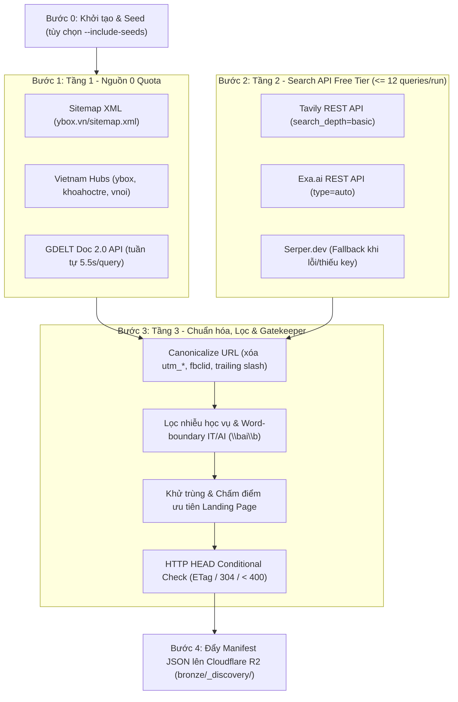

# Deliverable: Triển khai Module Discovery 3 Tầng (`TASK-ING-03`)

- **Task ID**: `TASK-ING-03`
- **Related Cycle**: Cycle 06 (TLCN Phase 1)
- **Primary Owner**: Do Kien Hung (`@darktheDE`) & Nguyen Van Quang Duy (`@QuangDuyReal`)
- **Institution**: Khoa Công nghệ Thông tin, Trường Đại học Công nghệ Kỹ thuật TP.HCM (HCM-UTE)
- **Date Completed**: 2026-11-23
- **Deliverable Type**: Data Engineering Implementation & R2 Verification
- **Status**: Done

---

## 1. Tóm tắt điều hành (Executive Summary)

Module Discovery 3 tầng (`src/acdp/v2/0_discover_urls.py` và `src/acdp/v2/discovery_sources.py`) đã được triển khai và kiểm chứng thực tế trên Cloudflare R2 (`DIR-021`), giữ nguyên toàn bộ mã nguồn pipeline v1 tại `src/acdp/*.py`.

- **Đạt chuẩn ngân sách Free Tier (`< 5%/tháng`)**: Chạy thực tế tiêu tốn `5` queries Tavily (`2.0%/tháng`) và `5` queries Exa (`0.8%/tháng`), `0` queries Serper fallback.
- **Đầu ra trên Cloudflare R2**: `s3://acdp-lakehouse/bronze/_discovery/latest_manifest.json` và snapshot theo ngày (`raw=82`, `deduplicated=25`).
- **Kiểm thử tự động**: `pytest` (`tests/test_discovery_v2.py` + `tests/test_bronze_storage.py`) đạt **13/13 passed**; `ruff check` **All checks passed**.

---

## 2. Quy trình Step-by-Step (3-Tier Discovery Pipeline)

### Chi tiết từng bước
1. **Tách cấu hình nguồn (`src/acdp/v2/discovery_sources.py`)**: Quản lý tập trung `DEFAULT_SITEMAP_URLS`, `DEFAULT_VIETNAM_HUBS`, `DEFAULT_GDELT_QUERIES`, `DEFAULT_TIER2_QUERIES`, `CURATED_SEED_URLS`, `NOISE_KEYWORDS`, `TECH_DOMAIN_KEYWORDS`.
2. **Tầng 1 (0 Quota)**: Parse Sitemap XML an toàn bằng `defusedxml.ElementTree`, trích xuất link cuộc thi từ HTML hub bằng `BeautifulSoup`, gọi GDELT Doc 2.0 tuần tự (`5.5s` giãn cách). Mọi lỗi HTTP/Timeout đều được cô lập theo từng nguồn.
3. **Tầng 2 (Free Tier < 5%)**: Phân bổ vòng tròn (round-robin) giữa Tavily và Exa theo giới hạn `discovery_max_queries_per_run=12`, tự động fallback sang Serper.dev khi gặp HTTP 429 hoặc lỗi kết nối.
4. **Tầng 3 (Gatekeeper & R2)**:
   - Chuẩn hóa URL và lọc bỏ trang `/tag/`, thông báo THCS/Tiểu học, bài tổng kết/trao giải quá khứ (`tong-ket`, `trao-giai`, `dat-giai`).
   - Dùng regex word-boundary (`\bai\b`, `\bdata\b`, `\bcntt\b`) để tránh nhận nhầm chuỗi `"tai-cuoc-thi"` thành `"ai"`.
   - Chạy HTTP `HEAD` kèm `If-None-Match` / `If-Modified-Since` từ `bronze/_discovery/http_cache.json` để đánh dấu `needs_crawl=False` cho URL trả về `304` hoặc `>= 400`.

---

## 3. Kết quả kiểm chứng & Tinh chỉnh thực tế

| Hạng mục kiểm chứng | Kết quả | Ghi chú |
| :--- | :--- | :--- |
| `pytest tests/test_discovery_v2.py tests/test_bronze_storage.py` | **13/13 passed** | Offline `httpx.MockTransport` + mocked R2 |
| `uv run ruff check src/acdp/config.py src/acdp/v2 tests/test_discovery_v2.py` | **All checks passed** | Tuân thủ Python 3.11+ typing & lint |
| Live Run lên Cloudflare R2 (`--include-seeds --check-http --limit 25`) | **Thành công** | `raw=82`, `deduplicated=25`, `tavily=2.0%/mo`, `exa=0.8%/mo` |

---

## 4. Nhật ký truy vấn & Nguồn tham khảo (`DIR-020`)

### 4.1. Nhật ký truy vấn xác minh API (`search_web`)
1. `"Tavily" REST API POST https://api.tavily.com/search parameters 2025 2026`
2. `"Exa" REST API POST https://api.exa.ai/search parameters headers x-api-key 2025 2026`
3. `"GDELT Doc 2.0 API" api.gdeltproject.org/api/v2/doc/doc query mode artlist format json`

### 4.2. Tài liệu & Mã nguồn liên quan
- Mã nguồn Discovery v2: [`src/acdp/v2/discovery.py`](../../src/acdp/v2/discovery.py), [`src/acdp/v2/discovery_sources.py`](../../src/acdp/v2/discovery_sources.py)
- Bộ kiểm thử: [`tests/test_discovery_v2.py`](../../tests/test_discovery_v2.py)
- Báo cáo trực quan HTML: [`TASK-ING-03-three-tier-discovery-implementation-visual-dossier.html`](./TASK-ING-03-three-tier-discovery-implementation-visual-dossier.html)
- Tài liệu nghiên cứu nền: [`TASK-ING-01-search-pattern-and-crawling-tradeoffs.md`](./TASK-ING-01-search-pattern-and-crawling-tradeoffs.md)
