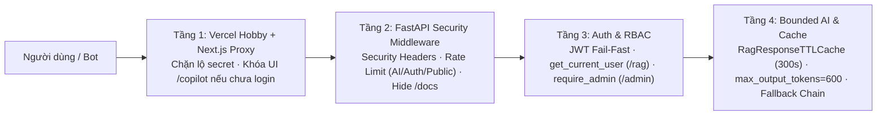

# Báo cáo Nghiên cứu Bảo mật Trước Triển khai & Checklist OWASP 2025/2026 (`TASK-SEC-00`)

| Thuộc tính | Giá trị |
| :--- | :--- |
| Document ID | `TASK-SEC-00` (Pre-Deployment Security Blueprint — Cycle 07/08) |
| Primary Owner | Đỗ Kiến Hưng (`@darktheDE`) & Nguyễn Văn Quang Duy (`@QuangDuyReal`) |
| Institution | Khoa Công nghệ Thông tin, Trường Đại học Công nghệ Kỹ thuật TP.HCM (HCM-UTE) |
| Date Created | 2026-11-24 |
| Deliverable Type | OWASP 2025/2026 Audit, LLM Quota Guardrails, RBAC & Pre-Deployment Gate Checklist |
| Status | Approved Blueprint (Chờ triển khai theo `TASK-SEC-01`, `TASK-SEC-02`, `TASK-SEC-03`) |

---

## 1. Bối cảnh & Mục tiêu Bảo mật Trước Triển khai

Khi chuyển nền tảng ACDP từ môi trường phát triển cục bộ lên Public Cloud Free-Tier (**Vercel Hobby** + **HF Spaces / Render** + **Supabase Free** + **Qdrant Cloud Free** + **Cloudflare R2** + **Gemini / Groq / OpenRouter**), rủi ro lớn nhất không chỉ nằm ở lỗi phần mềm mà còn ở **lộ bề mặt API, lạm dụng quota miễn phí (Denial of Wallet / Rate-Limit Exhaustion)** và **thiếu công cụ quản trị khẩn cấp (Admin Kill-Switch)**.

Báo cáo này tổng hợp kết quả rà soát mã nguồn `src/acdp/api/` đối chiếu với **OWASP Top 10:2025/2026** và **OWASP Top 10 for LLM Applications 2025**, làm cơ sở thiết kế kỹ thuật cho 3 task bảo mật bắt buộc trước khi mở public (`TASK-SEC-01`, `TASK-SEC-02`, `TASK-SEC-03`).

---

## 2. Kiểm toán Hiện trạng theo OWASP Top 10 (2025/2026) & OWASP LLM (2025)

| Hạng mục OWASP (2025/2026) | Hiện trạng trong mã nguồn ACDP | Mức độ rủi ro | Phương án khắc phục bắt buộc |
| :--- | :--- | :---: | :--- |
| **A01:2025 – Broken Access Control** *(Bao gồm SSRF & Horizontal/Vertical Privilege)* | • `/api/v1/rag/chat` và `/query` dùng `Depends(get_optional_user)` cho phép khách ẩn danh gọi LLM. • `User.role` đã có (`student`/`lecturer`/`admin`) nhưng chưa có `require_admin` và chưa có router `/api/v1/admin/*`. | **Nghiêm trọng** | • Khóa `/rag/chat` & `/query` sang `Depends(get_current_user)` (trả `401` nếu chưa đăng nhập). • Bổ sung `require_admin` và khóa UI `/copilot` với khách. • Gán quyền Admin qua `ADMIN_EMAILS` trong `.env`. |
| **A02:2025 – Security Misconfiguration** | • `/docs`, `/redoc`, `/openapi.json` luôn mở công khai trong `src/acdp/api/main.py`. • Chưa gắn Security Headers (`X-Frame-Options`, `nosniff`, `Referrer-Policy`). | **Cao** | • Tự động tắt `/docs`, `/redoc`, `/openapi.json` (`None`) khi `ENVIRONMENT=production`. • Bổ sung Security Headers Middleware & chuẩn hóa CORS whitelist. |
| **A03:2025 – Software Supply Chain Failures** | • Đã khóa phiên bản qua `uv.lock` và `package-lock.json`, tách optional deps khỏi `Dockerfile.api`. | **Thấp** | • Duy trì `uv sync --frozen --no-dev` và quét lỗ hổng dependency định kỳ trước khi release. |
| **A04:2025 – Cryptographic Failures** | • `AppConfig.jwt_secret_key` có giá trị mặc định dev; `secure` cookie phụ thuộc `ENVIRONMENT=production`. | **Cao** | • Bật **Fail-Fast Startup Check**: từ chối khởi động nếu `ENVIRONMENT=production` mà `JWT_SECRET_KEY` dùng chuỗi mặc định hoặc `< 32` ký tự. |
| **A05:2025 – Injection** | • Truy vấn DuckDB (`gold_queries.py`) dùng tham số hóa `?` + whitelist cột sort (`_ALLOWED_SORTS`); OLTP dùng SQLModel/SQLAlchemy ORM. | **Thấp** | • Tiếp tục cấm nội suy chuỗi SQL và giữ kiểm tra `len <= 2000` cho input RAG. |
| **A06:2025 – Insecure Design** & **LLM10:2025 – Unbounded Consumption** | • Chưa có Rate Limiting ở tầng FastAPI (`TASK-OPS-03` bị đẩy sang Cycle 10 KLTN). • Chưa ép trần `max_output_tokens` khi gọi Gemini / Groq / OpenRouter. | **Nghiêm trọng** | • Triển khai **Multi-Tier Rate Limiting** ngay tại TLCN (`TASK-SEC-01`): AI `5 req/phút` + `30 req/ngày/user` + Global `10 RPM`; Auth `10 req/phút/IP`; Public `60 req/phút/IP`. • Ép cứng `max_output_tokens=600`. |
| **A07:2025 – Authentication Failures** | • Đã có Argon2id + Refresh Token Rotation + Reuse Detection trong `auth.py`, nhưng `/auth/login` và `/auth/register` chưa bị giới hạn brute-force. | **Trung bình – Cao** | • Áp dụng Rate Limit chặt (`10 req/phút/IP`) cho `/auth/login` và `/auth/register`. |
| **A08:2025 – Software or Data Integrity Failures** | • `register` luôn gán cứng `role="student"`, an toàn trước mass assignment. | **Thấp** | • Giữ nguyên gán `role="student"`, chỉ nâng quyền `admin` qua `ADMIN_EMAILS` server-side hoặc Admin endpoint. |
| **A09:2025 – Security Logging & Alerting Failures** | • Chưa có nhật ký sự kiện bảo mật tập trung (401/403/429, khóa user, reset cache). | **Trung bình** | • Ghi log có cấu trúc các sự kiện `429 Rate Limit`, `401/403 Auth`, và hành động của Admin. |
| **A10:2025 – Mishandling of Exceptional Conditions** | • Chưa có Global Exception Handler che giấu chi tiết stack trace hoặc thông tin cấu hình khi xảy ra lỗi `500` bất thường. | **Trung bình** | • Bổ sung Global Exception Handler trả JSON chuẩn sạch sẽ khi `ENVIRONMENT=production`, ghi trace vào server log. |

---

## 3. Kiến trúc Phòng vệ 4 Lớp & Cách Test Khi Đã Ẩn `/docs`

### Giải pháp Test API trên Production khi đã ẩn `/docs`, `/redoc`, `/openapi.json`
Khi đặt `ENVIRONMENT=production`, các đường dẫn `/docs`, `/redoc` và `/openapi.json` công khai trả về **`404 Not Found`** để ngăn bot tự động dò sơ đồ API. Nhóm vẫn có **4 cách kiểm thử đầy đủ**:
1. **Local Development (`ENVIRONMENT=development`)**: `/docs` và `/openapi.json` vẫn bật mặc định tại `http://localhost:8000/docs`.
2. **Swagger Nội bộ Chỉ dành cho Admin (`/api/v1/admin/docs`)**: Mở 2 route riêng `/api/v1/admin/openapi.json` và `/api/v1/admin/docs` gắn `Depends(require_admin)`. Chỉ tài khoản Admin (Hưng/Duy) đăng nhập mới mở được giao diện Swagger hoặc nút *"API Sandbox"* trong `/admin`.
3. **Postman / Bruno / Insomnia với `openapi.json` tĩnh**: Xuất schema từ local bằng lệnh `uv run python -c "import json; from acdp.api.main import app; print(json.dumps(app.openapi(), indent=2))" > openapi.json`, sau đó import vào Bruno/Postman và đổi biến `base_url` sang domain Cloud.
4. **Automated Smoke Tests (`pytest`)**: Bộ kiểm thử gọi `app.openapi()` trực tiếp trong bộ nhớ Python và dùng `TestClient` / `AsyncClient` xác minh tự động sau mỗi lần thay đổi.

---

## 4. Checklist 8 Chốt Bắt buộc Trước Khi Deploy (`G1`–`G8`)

- [ ] **G1 — Secret Isolation**: Không có biến nhạy cảm nào (`SUPABASE_DATABASE_URL`, `AWS_*`, `GEMINI_API_KEY`, `GROQ_API_KEY`, `OPENROUTER_API_KEY`, `QDRANT_API_KEY`, `JWT_SECRET_KEY`) mang tiền tố `NEXT_PUBLIC_` hoặc tồn tại trong lịch sử Git.
- [ ] **G2 — Fail-Fast JWT & Cookie Hardening**: `ENVIRONMENT=production` bắt buộc `len(JWT_SECRET_KEY) >= 32` (khác giá trị dev mặc định) và ép `Secure=True, HttpOnly=True, SameSite=Lax` cho cookie refresh token.
- [ ] **G3 — Auth-Only RAG Gate**: `POST /api/v1/rag/chat` và `/query` trả về `401 Unauthorized` nếu thiếu Bearer JWT hợp lệ (`is_active=True`).
- [ ] **G4 — Multi-Tier Rate Limiting & Token Cap**: Vượt `5 req/phút/user` hoặc `30 req/ngày/user` trên `/rag/chat`, hoặc `10 req/phút/IP` trên `/auth/login` phải trả `429 Too Many Requests` + header `Retry-After`; LLM bị giới hạn `max_output_tokens <= 600`.
- [ ] **G5 — Hidden Public Docs**: Khi `ENVIRONMENT=production`, `GET /docs`, `GET /redoc`, `GET /openapi.json` trả `404 Not Found`; chỉ Admin truy cập được `/api/v1/admin/*`.
- [ ] **G6 — Admin RBAC & Kill-Switch**: Tài khoản trong `ADMIN_EMAILS` truy cập được `/admin` để xem telemetry rate-limit/cache, làm mới DuckDB/RAG cache, và khóa (`is_active=False`) tài khoản spam ngay lập tức.
- [ ] **G7 — Strict CORS & Security Headers**: Whitelist chính xác origin Vercel; gắn `X-Content-Type-Options: nosniff`, `X-Frame-Options: DENY`, `Referrer-Policy: strict-origin-when-cross-origin`, và che stack trace ở lỗi `500`.
- [ ] **G8 — Free-Tier Hard-Cap Guardrail**: Toàn bộ API key AI/Cloud dùng gói Free `$0` không thẻ trả sau (an toàn 0 đồng).

---

## 5. Lộ trình Task Bảo mật Đã Bổ sung vào `tasks-data.json`

| Task ID | Cycle | Tầng | Mục tiêu cốt lõi |
| :--- | :---: | :---: | :--- |
| **`TASK-SEC-01`** | Cycle 07 *(TLCN)* | Cloud & Infra | Hardening OWASP Top 10 (2025/2026): Auth-Only RAG, Rate Limiting 3 tầng, ẩn `/docs` Production, Fail-Fast JWT, Security Headers & Exception Masking. |
| **`TASK-SEC-02`** | Cycle 08 *(TLCN)* | Serving & Web | Phân quyền RBAC (`require_admin`), `ADMIN_EMAILS`, `/api/v1/admin/*` (khóa user, refresh cache, Admin Docs), trang `/admin` và khóa UI `/copilot`. |
| **`TASK-SEC-03`** | Cycle 08 *(TLCN)* | Cloud & Infra | Script CLI `acdp.v2.security_audit` kiểm tra tự động 8 chốt `G1..G8` trước khi bấm deploy lên Vercel & HF Spaces / Render. |
| **`TASK-OPS-03`** | Cycle 10 *(KLTN)* | Cloud & Infra | Mở rộng từ `TASK-SEC-01`: thêm Cloudflare Turnstile CAPTCHA và Distributed Redis/Upstash Rate Limiting cho 500–1.000 sinh viên. |

---

## 6. Nhật ký Truy vấn & Nguồn Tham khảo (`DIR-020`)

| STT | Câu lệnh truy vấn (`search_web`) | Mục đích kiểm chứng | Nguồn tham khảo |
| :---: | :--- | :--- | :--- |
| 1 | `"OWASP Top 10" 2025 2026 release candidate categories web application security` | Xác nhận 10 hạng mục OWASP 2025/2026 (`A03 Supply Chain`, `A10 Exceptional Conditions`, gộp SSRF vào `A01`) | [OWASP Top 10:2025](https://owasp.org/Top10/) |
| 2 | `"OWASP Top 10 for LLM Applications" 2025 "Unbounded Consumption" RAG API security FastAPI` | Kiểm chứng chuẩn `LLM10:2025 Unbounded Consumption` (Denial of Wallet), validation và `max_tokens` | [OWASP Top 10 for LLM](https://owasp.org/www-project-top-10-for-large-language-model-applications/) |
| 3 | `FastAPI disable or protect "/docs" "/redoc" "/openapi.json" production admin auth how to test API 2025 2026` | Kiểm chứng mẫu tắt `/docs` production, mở `/docs` bảo vệ bằng Admin Auth và workflow test | [FastAPI Security Docs](https://fastapi.tiangolo.com/tutorial/security/) |
| 4 | `FastAPI rate limiting per user IP AI endpoint token bucket slowapi or custom middleware Next.js 16 2025 2026` | Kiểm chứng thuật toán Token Bucket theo `user_id` (AI) và `IP` (Auth/Public) | [SlowAPI / Token Bucket Patterns](https://fastapi.tiangolo.com/) |
