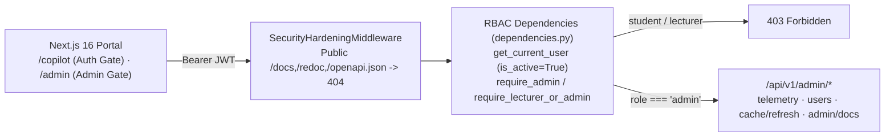

# Báo cáo Triển khai Phân quyền RBAC, Admin API & Trang Quản trị (`/admin`) (`TASK-SEC-02`)

| Thuộc tính | Giá trị |
| :--- | :--- |
| Document ID | `TASK-SEC-02` (Cycle 08 — Serving & Web) |
| Primary Owner | Đỗ Kiến Hưng (`@darktheDE`) & Nguyễn Văn Quang Duy (`@QuangDuyReal`) |
| Institution | Khoa Công nghệ Thông tin, Trường Đại học Công nghệ Kỹ thuật TP.HCM (HCM-UTE) |
| Date Created | 2026-11-24 |
| Deliverable Type | RBAC (`Admin`/`Lecturer`/`Student`), Admin Control Center API & UI, Hidden `/docs` |
| Status | Completed (`19/19 pytest PASSED`, `0 ruff errors`, `0 tsc errors`) |

---

## 1. Kiến trúc Phân quyền RBAC & Tắt `/docs` Công khai

Theo yêu cầu bảo mật **OWASP A01:2025 (Broken Access Control)**, **OWASP A02:2025 (Security Misconfiguration)** và chốt **Gate G5 / G6** trong [`TASK-SEC-00`](TASK-SEC-00-pre-deployment-security-and-owasp-report.md), hệ thống tách biệt hoàn toàn giao diện tài liệu công khai và các tác vụ quản trị:

1. **Vô hiệu hóa `/docs`, `/redoc`, `/openapi.json` công khai ở mọi môi trường**:
   - Đặt cứng `openapi_url=None`, `docs_url=None`, `redoc_url=None` khi khởi tạo `FastAPI` trong [`src/acdp/api/main.py`](../../src/acdp/api/main.py).
   - Chặn trực tiếp mọi request tới `/docs`, `/docs/`, `/docs/oauth2-redirect`, `/redoc`, `/redoc/`, `/openapi.json` tại `SecurityHardeningMiddleware` ([`src/acdp/api/middleware/security.py`](../../src/acdp/api/middleware/security.py)) để luôn trả về **`404 Not Found`** cùng bộ Security Headers.
2. **Tự động nâng quyền qua `ADMIN_EMAILS` & Dependencies RBAC**:
   - Thêm cấu hình `admin_emails` và hàm chuẩn hóa `AppConfig.get_admin_emails()` tại [`src/acdp/config.py`](../../src/acdp/config.py) (khai báo mẫu tại [`.env.example`](../../.env.example)).
   - Triển khai `_sync_admin_role_if_listed()`, `require_admin()` và `require_lecturer_or_admin()` tại [`src/acdp/api/dependencies.py`](../../src/acdp/api/dependencies.py).
   - Đồng bộ nâng vai trò `admin` khi email khớp `ADMIN_EMAILS` tại các luồng `register()`, `login()` và `refresh_tokens()` trong [`src/acdp/api/routers/auth.py`](../../src/acdp/api/routers/auth.py).

---

## 2. Đặc tả Router Quản trị (`/api/v1/admin/*`) & Kill-Switch

Toàn bộ các route trong [`src/acdp/api/routers/admin.py`](../../src/acdp/api/routers/admin.py) (sử dụng DTO tại [`src/acdp/api/schemas/admin.py`](../../src/acdp/api/schemas/admin.py)) đều gắn `Depends(require_admin)`:

| Method & Path | Chức năng | Quy tắc An toàn & Kiểm soát |
| :--- | :--- | :--- |
| `GET /api/v1/admin/telemetry` | Thống kê tài khoản OLTP (`AdminUsersSummaryDTO`), `get_rate_limit_stats()`, `get_gold_mart_cache_stats()`, `get_rag_cache_stats()` | Chặn `401` (ẩn danh) / `403` (non-admin) |
| `GET /api/v1/admin/users` | Liệt kê danh sách người dùng kèm lọc `q`, `role`, `is_active` | Sắp xếp `created_at DESC`, không trả `password_hash` |
| `PATCH /api/v1/admin/users/{user_id}` | Đổi `role` (`student`/`lecturer`/`admin`) hoặc khóa/mở khóa (`is_active`) | Chặn tự khóa/tự hạ quyền chính Admin (`400 Bad Request`); khi `is_active=False` lập tức thu hồi toàn bộ `UserSession` (`revoked_at=NOW()`) và ghi audit log |
| `POST /api/v1/admin/cache/refresh` | Làm mới DuckDB R2 Gold Parquet (`all`/`duckdb_r2`), xóa `RagResponseTTLCache` (`rag`) hoặc reset `MultiTierRateLimiter` (`rate_limit`) | Chạy `refresh_duckdb_r2_connection()` trong `asyncio.to_thread` |
| `GET /api/v1/admin/openapi.json` | Phục vụ schema OpenAPI 3.1 nội bộ (`include_in_schema=False`) | Chỉ Admin đã đăng nhập mới truy xuất được |
| `GET /api/v1/admin/docs` | Giao diện Swagger UI nội bộ trỏ về `/api/v1/admin/openapi.json` (`include_in_schema=False`) | CSP cho phép nạp `cdn.jsdelivr.net` riêng cho `/api/v1/admin/docs` |

---

## 3. Giao diện Next.js `/admin` & Cổng Khóa Đăng nhập `/copilot`

1. **Khóa đăng nhập trên `/copilot`** ([`apps/web/app/copilot/page.tsx`](../../apps/web/app/copilot/page.tsx) & [`apps/web/components/copilot/CopilotWorkspace.tsx`](../../apps/web/components/copilot/CopilotWorkspace.tsx)):
   - Khách chưa đăng nhập không thể gửi câu hỏi từ UI; màn hình hiển thị cổng yêu cầu xác thực tài khoản (nêu rõ định mức 5 lượt/phút, 30 lượt/ngày theo **OWASP LLM10:2025**) kèm nút điều hướng tới `/login`.
   - Hiển thị thông báo cụ thể khi nhận mã `429 Too Many Requests` hoặc `401 Unauthorized`.
2. **Trang Quản trị Hệ thống `/admin`** ([`apps/web/app/admin/page.tsx`](../../apps/web/app/admin/page.tsx)):
   - Tích hợp cổng kiểm tra RBAC 3 trạng thái: loading skeleton $\rightarrow$ chưa đăng nhập $\rightarrow$ `403 Forbidden` (nếu `user.role !== "admin"`) $\rightarrow$ Bảng điều khiển Admin.
   - Hiển thị 4 thẻ KPI (Tài khoản OLTP, Rate Limiter 429, DuckDB R2 Gold Cache, RAG Response Cache), thanh thao tác làm mới R2/RAG/Rate Limit, công cụ kiểm tra `/api/v1/admin/openapi.json`, bảng quản lý user + nút khóa/mở khóa, và nhật ký `recent_blocks`.
   - Cập nhật [`apps/web/components/layout/TopNav.tsx`](../../apps/web/components/layout/TopNav.tsx), [`apps/web/lib/api-client.ts`](../../apps/web/lib/api-client.ts) và [`apps/web/types/api.d.ts`](../../apps/web/types/api.d.ts) để hiển thị mục **Quản trị (`/admin`)** riêng cho Admin.

---

## 4. Kết quả Kiểm chứng Thực nghiệm

| Hạng mục Kiểm tra | Lệnh thực thi | Kết quả |
| :--- | :--- | :--- |
| **API Integration & Security Tests** (`test_security_owasp.py`, `test_rag_and_openapi.py`, `test_auth_and_bookmarks.py`, `test_health_and_analytics.py`) | `uv run pytest ... -q` | **19 passed** (`79.18s`) |
| **Python Static Lint** | `uv run ruff check src/acdp/config.py src/acdp/api/ tests/api/` | **All checks passed** (`0` lỗi) |
| **Frontend TypeScript Check** | `npm --prefix apps/web run typecheck` | **0 lỗi** (`tsc --noEmit`) |
| **Task & Doc Drift Audit** | `sync_tasks.py --sync` & `audit_doc_drift.py --strict` | **0 violation(s)** (`CLEAN`, 61 tasks) |

---

## 5. Nhật ký Truy vấn & Nguồn Tham khảo (`DIR-020`)

| STT | Câu lệnh truy vấn (`search_web`) | Mục đích kiểm chứng | Nguồn tham khảo |
| :---: | :--- | :--- | :--- |
| 1 | `FastAPI disable default docs custom protected swagger_ui_html RBAC Depends 2025 2026` | Xác nhận mẫu tắt `/docs`, `/redoc`, `/openapi.json` mặc định (`None`) và dựng Swagger UI bảo vệ bằng `Depends(require_admin)` với `include_in_schema=False` | [FastAPI Custom Docs & Security](https://fastapi.tiangolo.com/how-to/extending-openapi/) |
