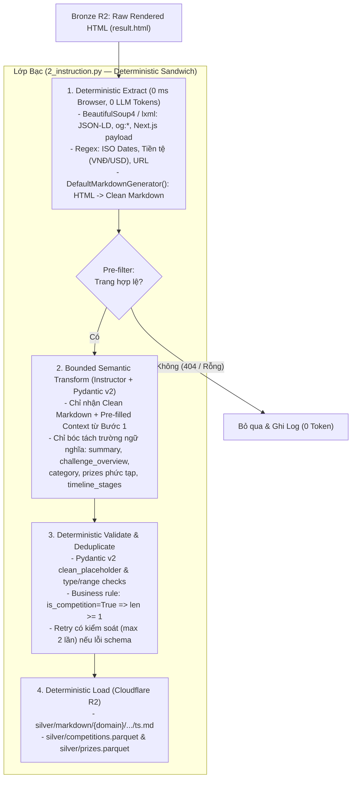

# Deliverable: Bảo vệ Tính chất Data Engineering & Tối ưu Tỷ lệ Sử dụng LLM ở Lớp Bạc

- **Task ID**: `TASK-SLV-01`
- **Related Cycle**: Cycle 06 (TLCN Phase 1)
- **Primary Owner**: Do Kien Hung (`@darktheDE`) & Nguyen Van Quang Duy (`@QuangDuyReal`)
- **Institution**: Khoa Công nghệ Thông tin, Trường Đại học Công nghệ Kỹ thuật TP.HCM (HCM-UTE)
- **Date Completed**: 2026-11-23
- **Deliverable Type**: Silver Layer Architecture Study & Hybrid Extraction Design
- **Status**: Complete

---

## 1. Tóm tắt điều hành (Executive Summary)

Sau khi [`TASK-BRZ-01`](./TASK-BRZ-01-bronze-raw-vs-markdown-justification.md) chuẩn hóa lớp Đồng (`s3://acdp-lakehouse/bronze/`) chỉ lưu **Raw Rendered HTML (`result.html`)** và chuyển toàn bộ khâu tiền xử lý sang lớp Bạc (`silver/`), câu hỏi trọng tâm đặt ra cho lớp Bạc ([`src/acdp/2_instruction.py`](../../src/acdp/2_instruction.py)) là:

> *Việc dùng `Instructor` + `LLM` liên tục để bóc tách toàn bộ JSON/Parquet từ văn bản cào về có làm mất đi bản chất **Data Engineering (DE)** hay không?*

**Kết luận kiến trúc**:
1. **Bản chất Data Engineering không nằm ở việc "cấm dùng LLM", mà ở tính tất định của đường ống (Pipeline Determinism), khả năng kiểm toán (Auditability) và tối ưu chi phí/độ trễ.**
2. **Không dùng Pure LLM, cũng không dùng Pure Rule-based**: Theo đồng thuận kiến trúc ETL 2025–2026, hệ thống chuẩn công nghiệp áp dụng mô hình **Deterministic Sandwich** — trong đó **Extract, Validate và Load** hoàn toàn tất định (100% Python/Regex/DOM/Pydantic), còn **LLM bị khoanh vùng (Bounded LLM)** chỉ xử lý bước **Transform ngữ nghĩa** cho các trường phi cấu trúc.
3. **Tận dụng di sản từ `TASK-BRZ-01`**: Nhờ lớp Đồng giữ nguyên Raw HTML, lớp Bạc có thể trích xuất tất định `application/ld+json` (`Schema.org/Event`), thẻ `<meta property="og:*">`, payload Next.js (`self.__next_f.push`), URL, ngày tháng chuẩn ISO và giá trị tiền tệ **với 0 token LLM** trước khi gọi `Instructor`.

---

## 2. Kiểm toán hiện trạng `2_instruction.py` & `schemas.py`

Kiểm toán [`src/acdp/2_instruction.py`](../../src/acdp/2_instruction.py) và [`src/acdp/schemas.py`](../../src/acdp/schemas.py) cho thấy 3 điểm nghẽn khi phụ thuộc LLM 100%:

1. **Lãng phí token cho siêu dữ liệu đã có cấu trúc trong HTML**: Các trường như `url`, `tagline` (`og:description`), `name` (`og:title`), `organizers` (JSON-LD `organizer`) vốn đã tồn tại tường minh trong `<head>` và `<script type="application/ld+json">` của Raw HTML nhưng vẫn bị đưa qua LLM để đoán lại từ Markdown.
2. **Rủi ro phi tất định (Non-determinism) & Chi phí suy luận**: Chạy `qwen2.5:7b` qua Ollama (context `8192` tokens) cho toàn bộ 25 trường của `Competition` và `PrizeTier` tốn nhiều giây/cuộc thi và dễ gặp lỗi placeholder (`"N/A"`, `"Not specified"`) mà `clean_placeholder()` trong `schemas.py` phải dọn dẹp hậu kỳ.
3. **Thiếu tầng tiền lọc tất định (Deterministic Pre-filter)**: Hiện tại `is_competition` do LLM quyết định sau khi đã nạp toàn bộ prompt. Nếu trang là lỗi 404, trang rỗng hoặc thiếu từ khóa học thuật tối thiểu, việc gọi LLM là hoàn toàn lãng phí.

---

## 3. Kiến trúc Hybrid "Deterministic Sandwich" cho Lớp Bạc

### Nguyên tắc vận hành 4 bước
1. **Extract (100% Tất định)**:
   - Tách siêu dữ liệu từ Raw HTML (`JSON-LD`, `og:*`, `canonical URL`).
   - Chạy `DefaultMarkdownGenerator().generate_markdown(raw_html)` trong RAM (`<5 ms`) để xuất `clean_markdown` lưu xuống `silver/markdown/` phục vụ RAG (`rag_service.py`).
   - Tiền lọc nhanh: loại bỏ trang `< 200` ký tự hoặc chứa mã lỗi HTTP 404/500.
2. **Transform (Bounded LLM)**:
   - **Không** bắt LLM đọc lại HTML thô hay đoán lại các trường đã có từ Bước 1.
   - Truyền `pre_filled_fields` vào ngữ cảnh để LLM chỉ tập trung điền các trường ngữ nghĩa còn thiếu.
3. **Validate (100% Tất định)**:
   - Coi đầu ra LLM là *untrusted input*. Bắt buộc đi qua `Pydantic v2` (`CompetitionExtractionResult`), kiểm tra định dạng ngày, giá trị số dương cho giải thưởng, và ràng buộc `is_competition=True` phải có ít nhất 1 phần tử.
4. **Load (100% Tất định)**:
   - Chuẩn hóa khóa chính (`domain + name`), khử trùng lặp và ghi thẳng Parquet lên Cloudflare R2 `silver/`.

---

## 4. Ma trận phân bổ trách nhiệm theo từng trường (Field-Level Matrix)

Ánh xạ trên schema `Competition` và `PrizeTier` trong [`src/acdp/schemas.py`](../../src/acdp/schemas.py):

| Nhóm trường | Tên trường (`schemas.py`) | Cơ chế ưu tiên (Primary) | Vai trò của LLM |
| :--- | :--- | :--- | :--- |
| **Định danh & Nguồn** | `url`, `og:image` | **Tất định** (`<link rel="canonical">`, `og:url`, `og:image`) | Không dùng (0 token) |
| **Tiêu đề & Khẩu hiệu** | `name`, `tagline` | **Tất định trước** (`og:title`, `JSON-LD name`, `<h1>`) | Chỉ chuẩn hóa/làm sạch nếu `<h1>` nhiễu |
| **Tổ chức & Tài trợ** | `organizers`, `partners_and_sponsors` | **Hybrid** (`JSON-LD organizer` nếu có) | Bóc tách danh sách từ Markdown nếu thiếu |
| **Thời gian & Tiền tệ** | `registration_start`, `registration_deadline`, `total_prize_pool` | **Hybrid** (Regex ngày `DD/MM/YYYY`, tiền `VNĐ/USD`) | Giải quyết ngữ cảnh năm ẩn (*Wrong-Year Problem*) & quy đổi |
| **Ngữ nghĩa thuần túy** | `summary`, `challenge_overview`, `category`, `target_audience`, `mode` | **Bounded LLM** (`Instructor` + Few-shot) | Bắt buộc dùng LLM để tóm tắt & phân loại |
| **Cấu trúc lồng nhau** | `prizes` (`PrizeTier`), `timeline_stages` (`TimelineStage`) | **Bounded LLM + Pydantic Validate** | LLM bóc tách từ bảng/danh sách; Pydantic ép kiểu `float` & `bool` |

---

## 5. Đánh giá Trade-offs: Pure Rule-based vs. Pure LLM vs. Hybrid

| Tiêu chí | Pure Rule-based (Regex/DOM) | Pure LLM (Hiện tại) | Hybrid (Deterministic Sandwich) |
| :--- | :--- | :--- | :--- |
| **Xử lý dữ liệu web đa dạng** | Kém (vỡ ngay khi web đổi layout DOM) | Tốt (linh hoạt theo ngữ nghĩa) | **Tốt** (DOM cho chuẩn chung + LLM cho phần biến thiên) |
| **Tính tất định & Kiểm toán** | Tuyệt đối (100% lặp lại được) | Thấp (dễ drift, hallucinate) | **Cao** (Extract/Validate/Load tất định; LLM bị khóa schema) |
| **Chi phí Token & Độ trễ** | Cực thấp (`< 5 ms`, 0 token) | Cao (nhiều giây/trang, tốn ~5k token/prompt) | **Tối ưu** (giảm ~30–60% token nhờ pre-fill & pre-filter) |
| **Rủi ro lỗi đặc thù** | *Wrong-Year Problem* (sai năm), *False Confidence* (lọt lỗi im lặng) | Hallucination, placeholder `"N/A"` | **Được kiểm soát** (LLM xử lý ngữ cảnh năm; Pydantic chặn placeholder) |

> [!NOTE]
> **Cảnh báo kỹ thuật về "Rule-First, LLM-Fallback" ngây thơ**: Các nghiên cứu 2025–2026 chỉ ra rằng nếu dùng Rule làm bộ gác cổng (*gatekeeper*) một cách thô sơ (ví dụ: thấy regex khớp được 1 chuỗi ngày là bỏ qua LLM), hệ thống dễ bị **False Confidence** (khớp nhầm ngày đăng bài thay vì hạn chót đăng ký) và làm giảm điểm F1. Do đó, ACDP chọn **Pre-fill Metadata + Bounded LLM** thay vì bỏ qua LLM hoàn toàn khi có 1 vài regex khớp.

---

## 6. Search Provenance & References (DIR-020)

Toàn bộ lập luận kiến trúc trong tài liệu này được đối chiếu và xác thực từ các nguồn công khai (truy vấn thực hiện ngày 23/11/2026):

1. **Query 1**: `"deterministic" vs "LLM" data extraction ETL pipeline hybrid approach 2025 2026`
   - *Architectural Consensus ("Deterministic Sandwich")*: [henrybernreuter.com](https://vertexaisearch.cloud.google.com/grounding-api-redirect/AUZIYQHDVy90zrl_fgIH_IBe2_VPVma6meYxuts6P2D1bGMFioWqCiWEIOudzqTr4PbCiY1-uvaq7sreASGzoD52gsFzJvHoWlBXwLK_7FRv6J3u8_qR_yaIWm2eFrQnIhbKRv3I9pdG2USjIs7QcRR2wahiHcBLAr_OpO8vYg==), [cloverdx.com](https://vertexaisearch.cloud.google.com/grounding-api-redirect/AUZIYQGSKc5ffJSEVaGFiaAWhpfL7X3NcLWep1ykNSoIhMqKvnZ6r8I1WIYZfIYnfpBdKkj2tYaAvei_kvw7XnJW0KXihs04irPk66FpwRWU7J1RYI45P91F9yDLw_jiSDLmqRwPzoAJzK2I3BuH74LSQxV0iwvxDCY1gdXkRHT3t4_3kjlqwigVg_DOC6yjJLeing==), [dev.to](https://vertexaisearch.cloud.google.com/grounding-api-redirect/AUZIYQGAYo-OaFg4R_jPIAzVmx8MMV3zz7l-vSZzh6ACDJ3AWrL9ztf03IcrIlh1YrYiG5jP-QegY6N4cPFmRyIz_L0gSmvtnNrcRBNY-kHaJJgxQe35zVFWhxnQpz25e-zFveFWzXXcw2irHPMaEF5JVz4VTR01WbnCHR_ZDD4UatG2oJjGwjpQwZkDEY5nzWRHgzg=)
2. **Query 2**: `"rule-based" "LLM fallback" structured data extraction cost latency accuracy 2025 2026`
   - *Cost, Latency & Accuracy Trade-offs (Wrong-Year Problem, False Confidence, Schema-Constrained Decoding)*: [preprints.org](https://vertexaisearch.cloud.google.com/grounding-api-redirect/AUZIYQFEk1-vFMrjQdKZALOUSYfEO83lQaAbuJTN50goHyA_6YXlO3uMq29PRAir5qRaQ8eMy0wP1pQgYYPxPqJvKXYPZJQb1h_4nroFHIoT2-aTSvCf8FGDyOibQPTwgK4hfqqTEy0F77xThxYQlrEps2QGBkFzY1Kvi9zpojgt4i8irsgcjyG2mZsYL1L7Z78AzA==), [arxiv.org](https://vertexaisearch.cloud.google.com/grounding-api-redirect/AUZIYQEpXGPuyVivX0Iiy_XAXRQHx_cqWiRYbAyM5njxijJQueX4gv5v_uWx6rR8ArHVJdytamCL5mVnF85Zn-7hFMkdthE0Yd604kPDJWJfmo6ntH4chR_-Qvc=), [towardsdatascience.com](https://vertexaisearch.cloud.google.com/grounding-api-redirect/AUZIYQEKqNsNfLnYtVJNby99vte5zm_gXENEt6M8PiPGFt1pfcDicu5gFT0aIfQJyMoTbbgg7CFL5nVY3skN4GpF0TejHurWTpP3pCKilfH9Io8YIrhdCOh0lP53tdcWIrFvwSqA9cO3bEF1_sSY8z5SsyPDMWy2k2hPbo6ntzzG1zslsYjCix6EE7C4JNF-6kBXJibidEWLSA==)
