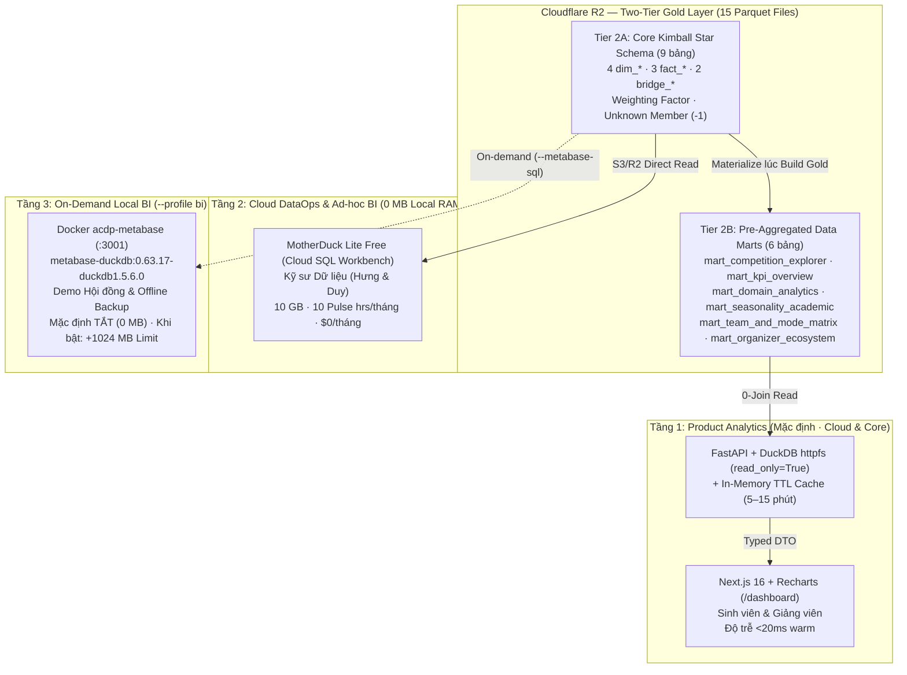

# T15: Phân định Ranh giới Web Dashboard vs Metabase & Tối ưu Prefect UI (2026)

> **Mã tài liệu**: `T15` | **Task ID**: `TASK-CLD-02` (Cycle 07 — Cloud & Infra) | **Ngày cập nhật**: `2026-11-23`  
> **Phạm vi**: Phase 1 (TLCN) $\rightarrow$ Phase 2 (KLTN) | **Nhóm tác giả**: Đỗ Kiến Hưng & Nguyễn Văn Quang Duy  
> **Tham chiếu**: [`docker-compose.yml`](../../docker-compose.yml), [`0006-docker-infrastructure-and-resource-spec.md`](../specs/0006-docker-infrastructure-and-resource-spec.md), [`TASK-CLD-03`](../deliverables/TASK-CLD-03-full-cloud-free-tier-architecture.md), [`TASK-GLD-01`](../deliverables/TASK-GLD-01-kimball-star-schema-audit-and-alternatives.md)

---

## Tóm tắt quyết định điều hành (Executive Verdict)

Hệ thống ACDP áp dụng **Kiến trúc 3 Tầng BI (3-Tier Analytics & BI Boundary)** trên nền **Two-Tier Gold Layer** (`15` tệp Parquet trên Cloudflare R2):

1. **Tầng 1 — Customer-Facing Product Analytics (`Next.js 16 + Recharts` tại `/dashboard`)**: Là giao diện phân tích **duy nhất** phục vụ **Sinh viên và Giảng viên** trên Cloud Production (Vercel Hobby) và Docker `core`. Đọc trực tiếp **6 bảng Pre-Aggregated Data Marts (`mart_*`)** qua FastAPI + DuckDB `httpfs` (`read_only=True`) + In-Memory TTL Cache (`< 20 ms` warm, `~183 ms` cold). Tích hợp chặt với UX sản phẩm: Dark/Light mode (`SPEC-0005`), click-to-filter sang `/competitions?domain=...`, dẫn hướng lập đội (`/teams`) và hỏi đáp RAG (`/copilot`).
2. **Tầng 2 — Cloud DataOps & Ad-hoc SQL Workbench (`MotherDuck Lite Free`)**: Thay thế hoàn toàn Metabase trên môi trường **100% Cloud Free-Tier (`TASK-CLD-03`)**. Lý do: (a) **Metabase Cloud không có gói miễn phí** (Starter từ `$100/tháng` cho 5 người dùng, Pro `$575/tháng`, và **không cho phép cài custom community plugin** `metabase_duckdb_driver`), (b) Self-host Metabase chạy trên **JVM / Clojure** tốn `650–850 MB` RAM thực tế (trần container `1024 MB`, khuyến nghị production `>= 2 GB`), gây lỗi `OOM 137` trên các PaaS Free Tier giới hạn `512 MB` RAM (Render Free, Koyeb Eco). Ngược lại, **MotherDuck Lite** (`$0/tháng`, `10 GB` managed storage, `10 CU-hours` Pulse compute/tháng, tối đa `3` users + `2` service accounts) đọc trực tiếp Parquet trên Cloudflare R2 qua `s3://` mà **không tính dung lượng R2 vào quota 10 GB của MotherDuck**, tốn `0 MB` RAM máy trạm, cung cấp sẵn Web SQL IDE cho Kỹ sư dữ liệu (Hưng & Duy).
3. **Tầng 3 — On-Demand Local Self-Service BI & Offline Defense Sandbox (`Metabase Docker --profile bi` ở cổng `:3001`)**: **Loại bỏ khỏi luồng chạy mặc định (`core`) và Cloud Production**, nhưng **giữ cấu hình cô lập trong `docker-compose.yml` dưới `profiles: ["bi"]`** (`0 MB` RAM khi tắt). Chỉ bật tạm thời (`docker compose --profile bi up -d` kèm `uv run python -m acdp.v2.gold_star_schema --metabase-sql`) trong 2 tình huống: (a) Minh họa trực quan trước Hội đồng khả năng **Self-Service BI** (Point-and-Click Query Builder, Foreign Key drill-through trên 9 bảng Core Kimball Star Schema và 4 virtual views `gold_*`), hoặc (b) Phương án dự phòng **Local Offline Demo** tại phòng bảo vệ khi mất kết nối Internet (Rủi ro `R6` trong `TASK-CLD-03`).

---

## 1. Khung Lý thuyết & Đối sánh Công nghệ BI trên DuckDB (2026 SOTA Matrix)

### 1.1. Bản chất khác biệt: Product Analytics vs Self-Service BI

Trong kiến trúc Data Engineering hiện đại, việc đặt câu hỏi *"Có nên bỏ Web Dashboard để nhúng Metabase, hay bỏ Metabase vì đã có Web Dashboard?"* xuất phát từ sự nhầm lẫn giữa hai phạm trù tách biệt:
- **Customer-Facing Product Analytics (`Next.js 16 + Recharts`)**: Phục vụ người dùng cuối (Sinh viên, Giảng viên). Yêu cầu phản hồi tức thì (`< 20 ms`), giao diện đồng bộ thương hiệu, kiểm soát chặt truy vấn (`0 JOIN` runtime nhờ đọc `mart_*`), và liên kết hành động trực tiếp với các luồng OLTP (lưu cuộc thi, tạo đội).
- **Internal Self-Service BI & DataOps Workbench (`MotherDuck Lite` / `Metabase`)**: Phục vụ Kỹ sư Dữ liệu (DE) và Hội đồng kiểm định. Yêu cầu viết SQL ad-hoc tự do, kiểm toán chất lượng dữ liệu trên toàn bộ Star Schema (`dim_*`, `fact_*`, `bridge_*`), và xuất CSV nhanh mà không cần sửa mã nguồn Frontend.

### 1.2. Tại sao không nhúng iframe Metabase lên Web Portal?

1. **Vỡ đồng bộ UX & Điều hướng nghiệp vụ**: Iframe Metabase có hệ thống CSS/font cố định, không đồng bộ biến màu Tailwind v4 Dark/Light mode (`SPEC-0005`), và không thể kích hoạt Next.js App Router để chuyển sinh viên từ biểu đồ ngành sang trang `/competitions?domain=...` hoặc mở luồng ghép đội (`/teams`).
2. **Rào cản Chi phí & Hạ tầng Cloud Free-Tier**: Nhúng Metabase công khai đòi hỏi một máy chủ JVM Metabase hoạt động 24/7 (`>= 1–2 GB` RAM). Phương án này phá vỡ ngân sách `$0/tháng` (vì Metabase Cloud Starter giá `$100/tháng`, không có Free Tier) hoặc làm cạn `10 giờ` Pulse/tháng của MotherDuck nếu mở trực tiếp cho sinh viên truy cập.
3. **Hiệu năng truy vấn & Bảo vệ Lakehouse**: Web `/dashboard` chỉ đọc 6 bảng `mart_*` đã tính sẵn trọng số cầu giải thưởng, kèm In-Memory TTL Cache ở tầng FastAPI. Ngược lại, công cụ BI cho phép người dùng kéo thả tự do dễ sinh câu lệnh quét lặp qua mạng (`httpfs`) tới các bảng `fact_*`/`dim_*`.

### 1.3. Đối sánh 6 Giải pháp BI / Analytics cho DuckDB (2026)

| Giải pháp | Triết lý & Kiến trúc | Tương thích DuckDB / R2 | Chi phí Cloud Free Tier (2026) | Phán quyết cho ACDP |
| :--- | :--- | :--- | :--- | :--- |
| **Next.js 16 + Recharts** *(Embedded Marts)* | Custom Product Analytics, đọc FastAPI + DuckDB `httpfs` | Native (Python `duckdb` + TTL Cache) | Vercel Hobby (`$0`) + HF Spaces (`$0`) | **Chọn cho Tầng 1** (Sinh viên & Giảng viên) |
| **MotherDuck Lite Web UI** | Serverless Cloud DuckDB + Web SQL IDE | Native (DuckDB Cloud + `s3://` R2) | `$0/tháng` (`10 GB`, `10h` Pulse, 3 users) | **Chọn cho Tầng 2** (Cloud DataOps & Ad-hoc SQL) |
| **Metabase Docker** *(`metabase-duckdb`)* | Self-Service BI (JVM/Clojure), Query Builder trực quan | Community plugin (`ghcr.io/motherduckdb/metabase-duckdb`) | Self-host (`$0` OSS, nhưng tốn `650–850 MB` RAM); Cloud từ `$100/tháng` | **Chọn cho Tầng 3** (Tắt mặc định; bật `--profile bi` on-demand local) |
| **Apache Superset** | Enterprise SQL Lab + >50 chart types | Qua `duckdb-engine` SQLAlchemy | Cần Postgres metadata + Redis + Celery workers | **Loại bỏ** (Quá nặng cho quy mô TLCN/KLTN) |
| **Evidence.dev** | BI-as-Code (Markdown + SQL $\rightarrow$ Static site) | Native DuckDB | Static deploy miễn phí | **Loại bỏ** (Trùng vai trò trình bày tĩnh với Next.js 16) |
| **Rill Data** | Metrics-first operational BI (YAML + SQL) | Native DuckDB | Local free; Cloud tính phí | **Loại bỏ** (Không tích hợp luồng OLTP ghép đội/bookmark) |

### 1.4. Ma trận Đối sánh Chuyên sâu 10 Tiêu chí (3 Tầng được chọn)

| Tiêu chí | Tầng 1: Web Dashboard (`Next.js 16 + Recharts`) | Tầng 2: Cloud BI (`MotherDuck Lite Free`) | Tầng 3: Local BI (`Metabase --profile bi`, `:3001`) |
| :--- | :--- | :--- | :--- |
| **Đối tượng chính** | Sinh viên, Giảng viên (End-user) | Kỹ sư dữ liệu (Hưng & Duy) | DE kiểm tra chéo & Hội đồng xem Self-Service BI |
| **Nguồn dữ liệu Gold** | 6 bảng `mart_*` (Pre-Aggregated, 0-Join) | 9 bảng Core Star Schema + 4 views `gold_*` | 9 bảng Core Star Schema + 4 views `gold_*` |
| **Truy vấn Ad-hoc SQL** | Không (Chỉ biểu đồ & filter định sẵn) | Toàn diện (Web SQL IDE, Auto-complete) | Toàn diện (SQL Editor + Point-and-Click Builder) |
| **Tùy biến UX & OLTP** | Toàn diện (Tailwind v4, link sang `/competitions`, `/teams`) | Cố định theo SQL IDE | Cố định theo giao diện BI, không gắn luồng OLTP |
| **RAM tiêu thụ Local** | `~53–220 MB` (`web`) + `~180–300 MB` (`api`) | **`0 MB`** (Chạy trên Cloud MotherDuck) | **`650–850 MB` thực tế** (trần `1024 MB` JVM) |
| **Cloud Free Tier** | Vercel Hobby + HF Spaces (`$0/tháng`) | MotherDuck Lite (`$0/tháng`, 10 GB, 10h) | Không có Cloud Free Tier (`Starter $100/tháng`) |
| **Plugin / Driver** | `duckdb` Python package chính thức | Tích hợp sẵn nhân DuckDB | Dùng community image `metabase-duckdb` |
| **Phân quyền & Bảo mật** | Public + JWT / Next.js Middleware | Tối đa 3 tài khoản DE nội bộ | Chỉ mở cổng nội bộ `localhost:3001` |
| **Độ trễ phản hồi** | `< 20 ms` (TTL Cache) / `182.9 ms` (Cold R2) | `~150–400 ms` (Serverless Pulse) | `~200–500 ms` (JDBC $\rightarrow$ DuckDB `httpfs`) |
| **Trạng thái mặc định** | **Luôn bật** (`core` + Cloud Prod) | **Luôn sẵn sàng trên Cloud** | **TẮT mặc định** (chỉ bật qua `--profile bi`) |

---

## 2. Phân quyền Nội dung & Ánh xạ Two-Tier Gold Layer (`TASK-GLD-01` & `TASK-GLD-02`)



### 2.1. Bảng Phân tách Quyền & Nội dung theo 3 Persona

| Đối tượng (Persona) | Kênh truy cập | Bảng Gold sử dụng | Câu hỏi nghiệp vụ & Chỉ số hiển thị |
| :--- | :--- | :--- | :--- |
| **Sinh viên** *(End-user)* | **Web `/dashboard`** (`Next.js + Recharts`) | `mart_kpi_overview`, `mart_domain_analytics`, `mart_seasonality_academic`, `mart_team_and_mode_matrix` | Cuộc thi đang mở, tổng quỹ giải thưởng, tỷ lệ miễn phí & học bổng, phân bổ ngành (click lọc sang `/competitions`), ma trận hình thức thi (`Online/Offline/Hybrid`) $\times$ quy mô đội để chuẩn bị lập đội (`/teams`). |
| **Giảng viên / Khoa** *(FIT HCM-UTE)* | **Web `/dashboard`** (*Góc nhìn Khoa & Hệ sinh thái*) | `mart_organizer_ecosystem`, `mart_seasonality_academic` | Đối chiếu mùa cao điểm cuộc thi với học kỳ HCM-UTE (`HK1`, `HK2`, `Hè`); thống kê BXH đơn vị tổ chức và nhà tài trợ (`organizer` vs `partner_sponsor`) để Khoa kết nối bồi dưỡng đội tuyển. |
| **Kỹ sư Dữ liệu & Hội đồng** *(DataOps / Audit)* | **MotherDuck Lite** *(Cloud)* hoặc **Metabase `--profile bi`** *(Local)* | 9 bảng Star Schema (`dim_*`, `fact_*`, `bridge_*`) + 4 virtual views (`gold_*`) | Kiểm định **Data Quality Scorecard** (tỷ lệ thiếu deadline, thiếu quy mô đội), kiểm chứng bảo toàn cầu tổng giải thưởng (`0.0 VND` drift), truy vết lineage `source_batch_file`, và demo Self-Service BI drill-through. |

### 2.2. Bộ Truy vấn SQL Kiểm định Chất lượng Dữ liệu (Data Quality Scorecard)

Kỹ sư dữ liệu sử dụng trực tiếp 3 truy vấn dưới đây trong **MotherDuck Lite** hoặc **Metabase SQL Editor** (sau khi nạp views từ `--metabase-sql`):

```sql
-- 1. Data Quality Scorecard: Kiểm tra tỷ lệ Unknown Member (-1) & NULL trên Fact/Bridge
SELECT
    COUNT(*) AS total_competitions,
    SUM(CASE WHEN reg_deadline_date_sk = -1 THEN 1 ELSE 0 END) AS missing_deadline_count,
    SUM(CASE WHEN team_size_max IS NULL THEN 1 ELSE 0 END) AS missing_team_size_count,
    SUM(CASE WHEN prize_tier_count = 0 THEN 1 ELSE 0 END) AS missing_prize_tiers_count
FROM fact_competitions;

-- 2. Kiểm định Bất biến Bảo toàn Tổng Giải thưởng (Bridge Weighting Factor Invariant)
WITH kpi_sum AS (
    SELECT SUM(total_prize_vnd) AS fact_total_vnd FROM fact_competitions
),
domain_sum AS (
    SELECT SUM(allocated_prize_vnd) AS bridge_total_vnd FROM mart_domain_analytics
)
SELECT
    fact_total_vnd,
    bridge_total_vnd,
    ABS(fact_total_vnd - bridge_total_vnd) AS drift_vnd
FROM kpi_sum, domain_sum;

-- 3. Kiểm toán Lineage & Freshness theo Batch nạp R2
SELECT
    source_batch_file,
    COUNT(*) AS record_count,
    MAX(loaded_at) AS latest_loaded_at
FROM fact_competitions
GROUP BY source_batch_file
ORDER BY latest_loaded_at DESC;
```

---

## 3. Định lượng Tài nguyên Container & Quy trình Kích hoạt `--profile bi`

### 3.1. Ngân sách RAM Docker Compose (`SPEC-0006` sau `TASK-CLD-01` & `TASK-CLD-02`)

| Tổ hợp Profile Docker | Các container hoạt động | Tổng trần RAM (`limits`) | Chênh lệch so với `core` | Mục đích sử dụng |
| :--- | :--- | :---: | :---: | :--- |
| **`core` (Mặc định Cloud-First)** | `postgres`, `api`, `web` | **`1408 MB` (`1.38 GB`)** | Baseline | Phát triển hàng ngày với Qdrant Cloud & Web Dashboard |
| **`core + local-backup`** | `postgres`, `qdrant`, `api`, `web` | `1920 MB` (`1.88 GB`) | `+512 MB` (`+36.4%`) | Dự phòng Qdrant Local khi Cloud mất kết nối |
| **`core + bi`** | `postgres`, `api`, `web`, `metabase` | `2432 MB` (`2.38 GB`) | `+1024 MB` (`+72.7%`) | Bật tạm Metabase JVM (`-Xmx768m -Xms256m`) kiểm định SQL / Demo |
| **Toàn phần (6 containers)** | `core` + `local-backup` + `bi` + `pipeline` | `3456 MB` (`3.38 GB`) | `+2048 MB` | Kiểm thử toàn bộ hạ tầng cục bộ |

### 3.2. Lưu ý Kỹ thuật & Playbook CLI (`--metabase-sql`)

- **Phân giải cổng**: `acdp-metabase` ánh xạ cổng `3001:3000` để không xung đột cổng `3000` của Next.js 16 (`EC-D5` trong `SPEC-0006`).
- **Quyền ghi extension & chế độ đọc**: Driver `ghcr.io/motherduckdb/metabase-duckdb:0.63.17-duckdb1.5.6.0` cần thư mục ghi để tải extension `httpfs` động khi khởi động (`home_directory` / `extension_directory`) và nên kết nối ở chế độ `access_mode=READ_ONLY` nếu trỏ tới tệp `.duckdb` cục bộ để tránh lỗi khóa file đơn tiến trình của DuckDB.
- **Quy trình bật/tắt nhanh**:

```powershell
# 1. Sinh mã SQL tạo Secret R2 và Views (15 bảng Parquet + 4 Virtual Views) cho MotherDuck / Metabase
uv run python -m acdp.v2.gold_star_schema --metabase-sql

# 2. (Tùy chọn khi cần Demo Local Self-Service BI) Khởi chạy Metabase ở cổng :3001
docker compose --profile bi up -d metabase

# 3. Tắt ngay sau khi kiểm định xong để giải phóng ~650–850 MB JVM RAM
docker compose --profile bi stop metabase
```

---

## 4. Tối ưu hóa Tầng Điều phối (`Prefect Server` `--profile pipeline`)

Trong `docker-compose.yml`, container `prefect-server` (`--profile pipeline`, trần `512 MB` RAM) chạy đồng thời API + UI + metadata DB, không cần thiết cho quy mô 5–20 cuộc thi ở TLCN. Ba phương án điều phối đã thống nhất với `TASK-CLD-03` và `TASK-ING-02`:

1. **Phương án A — Ephemeral Local Flow Execution *(Khuyến nghị cho TLCN Dev)***: Prefect 3 cho phép chạy `@flow` trực tiếp như script Python thuần với ephemeral SQLite tạm thời (`0 MB` RAM chạy nền khi không thực thi), giữ nguyên cơ chế retry và logging.
2. **Phương án B — GitHub Actions Serverless Workflow *(Khuyến nghị cho TLCN $\rightarrow$ KLTN Automation)***: Dùng GitHub Actions (`on: schedule` + `workflow_dispatch`) chạy trên `ubuntu-latest` (`7–16 GB RAM`, miễn phí không giới hạn phút cho public repo / `2.000 phút/tháng` cho private repo), đẩy dữ liệu lên Cloudflare R2 và Qdrant Cloud (`TASK-CLD-06`, `TASK-ING-02`).
3. **Phương án C — Prefect Cloud Hobby + `prefect.yaml` *(Tùy chọn Observability ở KLTN)***: Dùng **Prefect Cloud Hobby** (`$0/tháng`, tối đa `2 users`, `5 deployments`, `500 serverless minutes/tháng`, lưu lịch sử `7 ngày`) làm Control Plane thay cho `prefect-server` self-host; giữ `acdp-prefect` trong `--profile pipeline` làm dự phòng offline.

---

## 5. Ngân hàng Câu hỏi Phản biện Hội đồng (`Defense Q&A Bank`)

1. **"Trên Web Portal đã có trang `/dashboard` vẽ biểu đồ bằng Recharts rồi, vậy Metabase trong `docker-compose.yml` dùng để làm gì? Có bị thừa không?"**
   - *Trả lời*: Không thừa vì hai công cụ phục vụ hai tầng người dùng và hai tầng dữ liệu khác nhau. Web `/dashboard` phục vụ Sinh viên và Giảng viên, đọc 6 bảng `mart_*` đã tổng hợp sẵn để đạt độ trễ `< 20 ms` và liên kết trực tiếp sang luồng tìm kiếm/lập đội. Ngược lại, **MotherDuck Lite** (trên Cloud) và **Metabase `--profile bi`** (bật on-demand ở local, mặc định tắt `0 MB` RAM) phục vụ Kỹ sư Dữ liệu và Hội đồng chạy ad-hoc SQL kiểm định 9 bảng Kimball Star Schema (`dim_*`, `fact_*`, `bridge_*`) và Data Quality Scorecard.
2. **"Tại sao nhóm không nhúng thẳng (embed iframe) dashboard của Metabase lên trang Web cho nhanh mà phải tự viết API FastAPI và code biểu đồ Recharts bằng Next.js?"**
   - *Trả lời*: Nhúng Metabase iframe không đồng bộ được hệ thống giao diện Tailwind v4 (Dark/Light mode) và không thể tương tác hai chiều với luồng OLTP (như bấm vào cột ngành AI để lọc cuộc thi và tạo đội). Quan trọng hơn, Metabase Cloud không có gói miễn phí (từ `$100/tháng`), còn self-host container JVM tốn `650–850 MB` RAM nên không thể vận hành 24/7 trên PaaS Free Tier `512 MB` RAM.
3. **"Khi đưa hệ thống lên Cloud Free Tier (`0 USD/tháng`), Metabase nặng gần 1 GB RAM chạy bằng cách nào?"**
   - *Trả lời*: Trên môi trường Full Cloud Free-Tier (`TASK-CLD-03`), nhóm **không triển khai Metabase lên Cloud** mà chuyển toàn bộ vai trò SQL Workbench & kiểm toán dữ liệu sang **MotherDuck Lite Free** (`10 GB` lưu trữ, `10 giờ` Pulse/tháng, `$0/tháng`) đọc trực tiếp Parquet trên Cloudflare R2. Metabase Docker chỉ được giữ ở local trong `--profile bi` để phục vụ demo Self-Service BI hoặc dự phòng offline tại phòng bảo vệ.

---

## 6. Nhật ký Truy vấn & Nguồn Tham khảo Kiểm chứng (`DIR-020`)

### 6.1. Nhật ký các câu lệnh `search_web` đã thực thi (2026-11-23)

| STT | Câu lệnh truy vấn (`search_web`) | Mục đích kiểm chứng |
| :---: | :--- | :--- |
| 1 | `Metabase DuckDB driver MotherDuck vs custom web dashboard Next.js Recharts BI architecture 2025 2026` | Đối sánh kiến trúc Product Analytics (Next.js + Recharts) với Self-Service BI (Metabase + DuckDB); kiểm chứng hạn chế không cài được custom DuckDB plugin trên Metabase Cloud |
| 2 | `Metabase JVM memory footprint Docker container vs lightweight embedded analytics DuckDB 2025 2026` | Kiểm chứng mức tiêu thụ RAM thực tế của Metabase JVM (`~500–800 MB` idle, khuyến nghị `>= 2 GB` production) so với DuckDB in-process (`50–150 MB`) |
| 3 | `Metabase Cloud pricing 2025 2026 Starter Pro free tier JVM memory requirements Docker -Xmx` | Xác nhận Metabase Cloud không có Free Tier (Starter `$100/tháng` cho 5 user, Pro `$575/tháng`) và quy tắc cấu hình `-Xmx` bằng `70–80%` RAM container |
| 4 | `MotherDuck Lite free tier limits 2025 2026 10GB storage 10 Pulse compute hours S3 Cloudflare R2 Parquet` | Kiểm chứng hạn mức MotherDuck Lite Free (`$0/tháng`, `10 GB`, `10 CU-hours` Pulse/tháng, `3` users, `2` service accounts) và xác nhận Parquet trên R2/S3 không tính vào quota 10 GB của MotherDuck |
| 5 | `ghcr.io/motherduckdb/metabase-duckdb driver community plugin DuckDB httpfs read_parquet views 2025 2026` | Kiểm chứng cơ chế `httpfs`, `read_parquet`, tạo Views cho Query Builder, yêu cầu quyền ghi `extension_directory`, và cấu hình `access_mode=READ_ONLY` tránh file-locking |
| 6 | `Prefect 3 ephemeral server local flow execution vs Prefect Cloud Hobby free tier GitHub Actions 2025 2026` | Đối chiếu Prefect 3 ephemeral server cục bộ/GHA với Prefect Cloud Hobby (`$0/tháng`, `2` users, `5` deployments, `500` serverless minutes, lưu lịch sử `7 ngày`) |
| 7 | `MotherDuck Web UI vs Metabase vs Apache Superset vs Evidence.dev vs Rill Data DuckDB BI comparison 2025 2026` | Lập ma trận so sánh 6 công cụ BI/Analytics hiện đại trên hệ sinh thái DuckDB năm 2026 |

### 6.2. Liên kết tài liệu chính thức (Official Sources)

1. Metabase Pricing & Cloud Plans: [Metabase Pricing](https://www.metabase.com/pricing/)
2. Metabase Docker & JVM Memory Tuning: [Running Metabase on Docker](https://www.metabase.com/docs/latest/installation-and-operation/running-metabase-on-docker)
3. MotherDuck Pricing (Lite Free Tier): [MotherDuck Pricing](https://motherduck.com/pricing/)
4. MotherDuck Cloud Storage (S3 / R2 Parquet): [MotherDuck Amazon S3 & Object Storage Integration](https://motherduck.com/docs/integrations/cloud-storage/amazon-s3/)
5. MotherDuck Metabase Integration & Community Driver: [MotherDuck Metabase Docs](https://motherduck.com/docs/integrations/bi-tools/metabase/) và [GitHub `metabase_duckdb_driver`](https://github.com/motherduckdb/metabase_duckdb_driver)
6. DuckDB `httpfs` Extension: [DuckDB `httpfs` Overview](https://duckdb.org/docs/stable/extensions/httpfs/overview)
7. Prefect Pricing & Deployments: [Prefect Pricing](https://www.prefect.io/pricing) và [Prefect 3 Deployments](https://docs.prefect.io/v3/deploy/)
8. GitHub Actions Billing & Quotas: [GitHub Actions Billing](https://docs.github.com/en/billing/managing-billing-for-github-actions/about-billing-for-github-actions)
