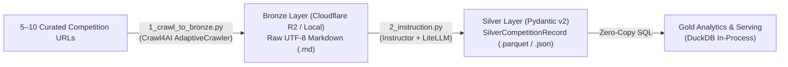

# SPEC-0002: Lean Data Ingestion, Bronze-to-Silver Extraction, and Schema Contracts

- **Status**: Approved & Active (Phase 1 TLCN - DIR-015)
- **Author(s)**: Nguyen Van Quang Duy (`@QuangDuyReal`), Do Kien Hung (`@darktheDE`)
- **Scientific Advisor**: M.Sc. Tran Quang Khai
- **Institution**: Faculty of Information Technology, Ho Chi Minh City University of Technology and Engineering (HCM-UTE)
- **Target Phase**: Phase 1: Special Topic Project (TLCN 15-Week MVP)

---

## 1. Objective & Scope Boundary (TLCN vs. KLTN)

This specification defines the end-to-end data ingestion and structured extraction pipeline for Phase 1 (Tiểu luận chuyên ngành - TLCN):
1. **TLCN Scope (Current Phase)**:
   - Targets a curated dataset of **5–10 representative academic competitions** (currently 7 competitions: *Code Tour, AI Challenge TP.HCM, Vietnam AI Challenge, DataDNA Onyx, IT Consultant Challenge, RMIT Hackathon, HackAITHON*).
   - Crawling is executed **on-demand** via CLI script to verify scraping feasibility and LLM schema extraction accuracy.
   - Uses a minimalist storage and compute stack: raw UTF-8 Markdown on **Local Files / Cloudflare R2** $\rightarrow$ structured extraction via **`instructor` + `litellm` + `Pydantic v2`** $\rightarrow$ direct analytical querying via **`DuckDB`**.
2. **KLTN Scope (Deferred to Phase 2 Graduation Thesis)**:
   - Automated periodic batch scheduling (Seasonality Scheduler, HTTP `ETag` polling) and realtime webhook ingestion.
   - Large-scale multi-channel crawling across hundreds of sources and fuzzy cross-channel deduplication.

---

## 2. End-to-End Lean Data Flow



---

## 3. Component 1: On-Demand Ingestion to Bronze (`src/acdp/1_crawl_to_bronze.py`)

### 3.1. Crawler Mechanism
- Uses `Crawl4AI` (`AsyncWebCrawler` and `AdaptiveCrawler`) with semantic query guidance:
  - Query prompt: `"upcoming competition including description, policy/regulation, prize, timeline/registry deadline, and challenge"`.
  - Extracts clean UTF-8 Markdown (`raw_markdown`) stripped of boilerplate HTML tags, scripts, and navigation clutter.

### 3.2. Bronze Storage Format (Cloudflare R2 & Local)
- Instead of compressing payloads into opaque `zstandard` binary blobs (unnecessary for 5–10 competitions totaling $< 1.5\text{ MB}$), raw Markdown is stored directly as human-readable UTF-8 text:
  - **Cloudflare R2 Object Key Pattern**:
    ```text
    s3://{BUCKET_NAME}/bronze/{domain_name}/year={YYYY}/month={MM}/day={DD}/{timestamp}
    ```
    with `ContentType="text/markdown; charset=utf-8"` and metadata `{"source": domain_name, "layer": "bronze"}`.
  - **Local Reproducible Fixtures**:
    Stored in `data/raw/markdown/{domain_name}.md` and `data/raw/html/{domain_name}.html` for offline testing.
  - **Tabular Bronze Contract (`BronzeRecord`)**:
    When persisted as a table via [`src/acdp/lakehouse/schema.py`](../../src/acdp/lakehouse/schema.py), payloads are stored in `raw_content: str` (UTF-8) alongside `content_hash: str` (SHA-256).

---

## 4. Component 2: Silver Layer Data Contract (`src/acdp/lakehouse/schema.py`)

The `SilverCompetitionRecord` Pydantic v2 model transforms unstructured competition Markdown into 8 quantitative and qualitative attribute groups:

| Dimension Group | Key Fields & Types | Validation & Normalization Rules |
| :--- | :--- | :--- |
| **1. Identity & Provenance** | `competition_id` (`str` UUID), `canonical_name` (`str`), `slug` (`str`), `primary_source` (`str`), `registration_link` (`str \| None`) | Mandatory canonical title and primary URL; auto-generated UUID v4. |
| **2. Organizer** | `organizer_name` (`str`), `organizer_type` (`str`), `co_organizers` (`list[str]`) | Classifies into `enterprise`, `university`, `government`, `student_association`, `international`. |
| **3. Temporal** | `edition_year` (`int`), `registration_deadline` (`str \| None`), `event_start_date`, `event_end_date`, `season_quarter` | Dates normalized to ISO 8601 (`YYYY-MM-DD`); quarters mapped to `Q1`–`Q4`. |
| **4. Domain & Skills** | `domain_categories` (`list[str]`), `technical_tags` (`list[str]`), `competition_level` (`str`) | Standardized tags (`AI/ML`, `Data Engineering`, `Algorithmic Coding`, `Web/Mobile`). |
| **5. Eligibility & Team** | `target_audience` (`str`), `min_team_size` (`int`), `max_team_size` (`int`), `is_individual_allowed` (`bool`), `registration_fee_vnd` (`int`) | Enforces `1 <= min_team_size <= max_team_size <= 20` and `registration_fee_vnd >= 0`. |
| **6. Financial & Prizes** | `total_prize_vnd` (`int`), `first_prize_vnd` (`int`), `prizes` (`list[PrizeItem]`) | Monetary values converted to integer `VND` (`ge=0`). |
| **7. Knowledge & Rules** | `summary_description` (`str`), `rules_document_url` (`str \| None`), `rules_text_content` (`str \| None`), `submission_format` (`str \| None`) | Preserves rulebook text for downstream RAG clause chunking. |
| **8. Auditing & Dedup** | `extraction_timestamp` (`datetime`), `confidence_score` (`float`), `dedup_fingerprint` (`str`) | Deterministic SHA-256 hash of `norm_title::edition_year::norm_org` via `generate_fingerprint()`. |

---

## 5. Component 3: Bronze-to-Silver LLM Extraction (`src/acdp/2_instruction.py`)

1. **Input**: Reads raw UTF-8 Markdown files from Cloudflare R2 (`bronze/...`) or local `data/raw/markdown/*.md`.
2. **Schema Enforcement**: Uses `instructor` patched over `litellm` (supporting Gemini API / OpenAI / local Ollama models) with `response_model=SilverCompetitionRecord`.
3. **Output Persistence**: Serializes validated `SilverCompetitionRecord` instances to Parquet / JSON (`silver/competitions.parquet`) on Local disk and Cloudflare R2, enabling immediate SQL querying via `DuckDB`.

---

## 6. Verification & Engineering TODO Tasks

- [x] 7 sample competitions crawled and stored in `data/raw/markdown/` and uploaded to Cloudflare R2 via `src/acdp/1_crawl_to_bronze.py`.
- [x] `SilverCompetitionRecord` Pydantic v2 contract implemented and verified in `tests/test_silver_schema.py`.
- [ ] **TODO-CODE-01 (Refactor Bronze Code)**: Remove legacy `zstandard` compression from `pyproject.toml`, `src/acdp/lakehouse/bronze.py`, `src/acdp/lakehouse/schema.py`, and `tests/test_bronze_storage.py` so `BronzeRecord` stores plain UTF-8 text (`raw_content: str`).
- [ ] **TODO-CODE-02 (Sync R2 Env Config)**: Add `BUCKET_NAME`, `SILVER_STORAGE_URI`, and `GOLD_STORAGE_URI` to `src/acdp/config.py` and `.env.example`.
- [ ] **TODO-CODE-03 (Implement Extraction Pipeline)**: Complete `src/acdp/2_instruction.py` to extract all 7 sample Markdown files into validated `SilverCompetitionRecord` Parquet records queryable by DuckDB.

