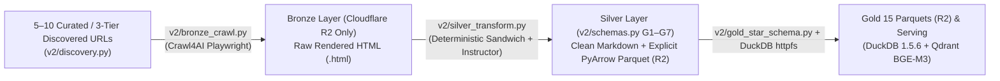

# SPEC-0002: Lean Data Ingestion, Bronze-to-Silver Extraction, and Schema Contracts

- **Status**: Approved & Active (Updated to v2 R2-Exclusive Pipeline per `DIR-021`, `DIR-022`, `RFC-0001`)
- **Author(s)**: Nguyen Van Quang Duy (`@QuangDuyReal`), Do Kien Hung (`@darktheDE`)
- **Scientific Advisor**: M.Sc. Tran Quang Khai
- **Institution**: Faculty of Information Technology, Ho Chi Minh City University of Technology and Engineering (HCM-UTE)
- **Target Phase**: Phase 1: Special Topic Project (TLCN 15-Week MVP)

---

## 1. Objective & Scope Boundary (TLCN vs. KLTN)

This specification defines the end-to-end data ingestion and structured extraction pipeline for Phase 1 (Tiểu luận chuyên ngành - TLCN):
1. **TLCN Scope (Current Phase)**:
   - Targets a curated dataset of **5–10 representative academic competitions** (currently 7 competitions: *Code Tour, AI Challenge TP.HCM, Vietnam AI Challenge, DataDNA Onyx, IT Consultant Challenge, RMIT Hackathon, HackAITHON*).
   - Crawling is executed **on-demand** via CLI (`src/acdp/v2/discovery.py` + `src/acdp/v2/bronze_crawl.py`) to verify scraping feasibility and Hybrid Deterministic-LLM extraction accuracy.
   - Uses a minimalist storage and compute stack (`DIR-021`): Raw Rendered HTML on **Cloudflare R2 (`bronze/*.html`)** $\rightarrow$ Clean Markdown + Hybrid Deterministic Sandwich (`src/acdp/v2/silver_transform.py`) + **`instructor` + `Pydantic v2`** (`src/acdp/v2/schemas.py`) exported to explicit PyArrow Parquet on R2 (`silver/*.parquet`) $\rightarrow$ direct SQL querying via **`DuckDB 1.5.6 httpfs`**.
2. **KLTN Scope (Deferred to Phase 2 Graduation Thesis)**:
   - Automated periodic batch scheduling (Seasonality Scheduler, HTTP `ETag` polling) and realtime webhook ingestion.
   - Large-scale multi-channel crawling across hundreds of sources and fuzzy cross-channel deduplication.

---

## 2. End-to-End Lean Data Flow



---

## 3. Component 1: On-Demand Ingestion to Bronze (`src/acdp/v2/bronze_crawl.py`)

### 3.1. Crawler Mechanism
- Uses `Crawl4AI` (`AsyncWebCrawler` and `AdaptiveCrawler`) with semantic query guidance:
  - Query prompt: `"upcoming competition including description, policy/regulation, prize, timeline/registry deadline, and challenge"`.
  - Preserves 100% **Raw Rendered HTML (`result.html`)** including `<head>`, `JSON-LD` (`Schema.org/Event`), `og:*` metadata, and Next.js state payloads, packaging multi-page crawls with `<!-- ACDP_PAGE_BOUNDARY url="..." -->` markers (`TASK-BRZ-01`, `TASK-BRZ-02`).

### 3.2. Bronze Storage Format (Cloudflare R2 Exclusive - `DIR-021`)
- Raw rendered HTML is persisted exclusively on Cloudflare R2 with zero local disk persistence (`bronze_storage_backend="cloudflare_r2"`):
  - **Cloudflare R2 Object Key Pattern**:
    ```text
    s3://{BUCKET_NAME}/bronze/{domain_name}/year={YYYY}/month={MM}/day={DD}/{timestamp}.html
    ```
    with `ContentType="text/html; charset=utf-8"`, `IfNoneMatch="*"` conditional write enforcement (`412 PreconditionFailed` overwrite guard), `ChecksumAlgorithm="SHA256"`, idempotent re-crawl skip when `content_hash` matches the latest snapshot, and 10 provenance metadata fields (`source`, `source_url`, `layer`, `format`, `page_count`, `content_hash`, `content_bytes`, `crawled_at`, `http_status`, `crawl_mode`) validated via `src/acdp/v2/bronze_validate.py` (`TASK-DQ-01`).
  - **Tabular Silver Contract (`Competition` v2)**:
    Standardized Pydantic v2 data contracts (`G1–G7`) are defined in [`src/acdp/v2/schemas.py`](../../src/acdp/v2/schemas.py), storing canonical normalized URLs, ISO 8601 `date` fields, `required_skills`, `PrizeTier` currency/quantity details, and SHA-256 `competition_key`.

---

## 4. Component 2: Silver Layer Data Contract (`src/acdp/v2/schemas.py`)

The `Competition` and `CompetitionExtractionResult` Pydantic v2 models transform unstructured competition Markdown into quantitative and qualitative attribute groups:

| Dimension Group | Key Fields & Types | Validation & Normalization Rules |
| :--- | :--- | :--- |
| **1. Identity & Provenance** | `competition_id` (`str` UUID), `canonical_name` (`str`), `slug` (`str`), `primary_source` (`str`), `registration_link` (`str \| None`) | Mandatory canonical title and primary URL; auto-generated UUID v4. |
| **2. Organizer** | `organizer_name` (`str`), `organizer_type` (`str`), `co_organizers` (`list[str]`) | Classifies into `enterprise`, `university`, `government`, `student_association`, `international`. |
| **3. Temporal** | `edition_year` (`int`), `registration_deadline` (`str \| None`), `event_start_date`, `event_end_date`, `season_quarter` | Dates normalized to ISO 8601 (`YYYY-MM-DD`); quarters mapped to `Q1`–`Q4`. |
| **4. Domain & Skills** | `domain_categories` (`list[str]`), `technical_tags` (`list[str]`), `competition_level` (`str`) | Standardized tags (`AI/ML`, `Data Engineering`, `Algorithmic Coding`, `Web/Mobile`). |
| **5. Eligibility & Team** | `target_audience` (`str`), `min_team_size` (`int`), `max_team_size` (`int`), `is_individual_allowed` (`bool`), `registration_fee_vnd` (`int`) | Enforces `1 <= min_team_size <= max_team_size <= 20` and `registration_fee_vnd >= 0`. |
| **6. Financial & Prizes** | `total_prize_vnd` (`int`), `first_prize_vnd` (`int`), `prizes` (`list[PrizeItem]`) | Monetary values converted to integer `VND` (`ge=0`). |
| **7. Knowledge & Rules** | `summary_description` (`str`), `rules_document_url` (`str \| None`), `rules_text_content` (`str \| None`), `submission_format` (`str \| None`) | Preserves rulebook text for downstream RAG clause chunking. |
| **8. Auditing & Dedup** | `extraction_timestamp` (`datetime`), `confidence_score` (`float`), `dedup_fingerprint` (`str`) | Deterministic SHA-256 hash of `norm_title::edition_year::norm_org` via `generate_fingerprint()`. |

---

## 5. Component 3: Bronze-to-Silver Hybrid Extraction (`src/acdp/v2/silver_transform.py`)

1. **Input**: Reads Raw Rendered HTML (`bronze/.../*.html`) from Cloudflare R2 and converts it in RAM via Crawl4AI `DefaultMarkdownGenerator()` (`0 ms` browser overhead), uploading Clean Markdown for accepted competitions to `silver/markdown/` (`TASK-SLV-03`).
2. **Hybrid Deterministic Sandwich & Scope Gate (`DIR-022`)**: Runs deterministic extractors (`JSON-LD`, `og:*`, canonical official URL resolution, `.pdf`/`.docx` optional links, regex hints) and filters strictly for IT/AI/Data/Security/Programming student competitions (`2025–2027`) with official websites before calling bounded `instructor` LLM (`response_model=CompetitionExtractionResult`).
3. **Output Persistence**: Writes Silver JSON (`silver/extractions/`), batch manifests (`silver/batches/`), and explicit PyArrow Parquet (`silver/competitions.parquet`, `silver/prizes.parquet`, `silver/timeline_stages.parquet` via `v2/gold_star_schema.py`) directly on Cloudflare R2 for DuckDB `httpfs` querying.
4. **Automated Data Contracts & WAP Quality Gate (`TASK-DQ-03`)**: Governed by the ODCS v3.2.0 contract [`docs/contracts/acdp-silver-competition.odcs.yaml`](../contracts/acdp-silver-competition.odcs.yaml) and enforced via [`src/acdp/v2/data_contracts.py`](../../src/acdp/v2/data_contracts.py) across 19 rules (`C01–C14` `CRITICAL` fail-fast circuit breaker + `W01–W05` `WARNING` soft SLAs) before writing Silver or Gold Parquet files.
5. **Entity Resolution, Natural Keys & Multi-Season Deduplication (`TASK-DQ-04`)**: Implemented in [`src/acdp/v2/entity_resolution.py`](../../src/acdp/v2/entity_resolution.py) and [`src/acdp/v2/schemas.py`](../../src/acdp/v2/schemas.py) using a 5-stage pipeline (RFC 3986 URL normalization + Vietnamese NFKD folding $\rightarrow$ Temporal Blocking by `season_year` $\rightarrow$ 3-zone Fellegi-Sunter matching Rules 0–4 $\rightarrow$ Season-consistent Union-Find $\rightarrow$ Authority-first Data Fusion). Composite natural keys follow `core_name|primary_org|season_year|official_domain`, while `competition_key` scopes evergreen domains by `#season={year}` before SHA-256 hashing so multi-source duplicates collapse onto the official site (`DIR-022`) and distinct seasons (`2025` vs `2026`) stay separated.

---

## 6. Verification & Engineering TODO Tasks

- [x] 7 sample competitions crawled and stored in `data/raw/markdown/` and uploaded to Cloudflare R2 via `src/acdp/1_crawl_to_bronze.py`.
- [x] Standardized `Competition` Pydantic v2 contract implemented in `src/acdp/schemas.py` and verified in `tests/test_silver_schema.py` (8/8 tests passed).
- [x] **TODO-CODE-01 (Refactor Bronze Code)**: Removed legacy `zstandard` compression and pruned deprecated `src/acdp/lakehouse/` folder in favor of clean `src/acdp/schemas.py` and raw UTF-8 text.
- [x] **TODO-CODE-02 (Sync R2 Env Config)**: Added `BUCKET_NAME`, `BRONZE_STORAGE_URI`, `SILVER_STORAGE_URI`, and `GOLD_STORAGE_URI` to `src/acdp/config.py` and `.env.example`, and unified `1_crawl_to_bronze.py` / `2_instruction.py`.
- [x] **TODO-CODE-03 (Implement Extraction Pipeline)**: Completed `src/acdp/2_instruction.py` `--save-parquet` output connector delegating to `export_silver_parquet` so Silver Parquet records are directly queryable by DuckDB.

