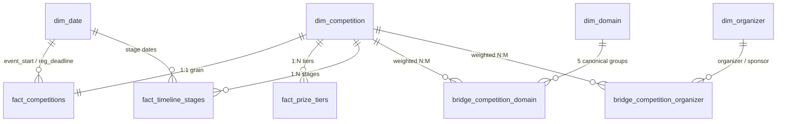

# SPEC-0003: Gold Layer Kimball Star Schema & Analytical Data Marts

> **Task ID**: `TASK-W102` | **Task Registry**: [`NT-024`](../tasks/task-registry.md)
> **Status**: Proposed (Web Sprint 01 Specification)
> **Dependencies**: [`SPEC-0002`](./0002-data-ingestion-and-schema-spec.md), [`T14`](./../rd-tasks/T14_web_and_gold_stack_evaluation.md)
> **Target Module (Sprint 02 Implementation)**: `src/acdp/4_analytics_gold.py` (refactor)

---

## 1. Objective & Scope

Tài liệu này đặc tả cấu trúc kho dữ liệu phân tích Lớp Vàng (Gold Layer) theo chuẩn **Kimball Star Schema** trên DuckDB `1.5.x` để phục vụ đồng thời cổng tra cứu FastAPI/Next.js và công cụ BI Metabase. Mục tiêu trọng tâm là khắc phục triệt để 5 khiếm khuyết hiện hữu trong `src/acdp/4_analytics_gold.py` trên tập dữ liệu Silver gồm 17 nguồn mục tiêu và 18 cuộc thi (`data/extractions/extractions_2026-11-15_1794720683.json`).

### 1.1. Chẩn đoán 5 Lỗi của `src/acdp/4_analytics_gold.py` Hiện tại

| STT | Thành phần lỗi | Mô tả hiện trạng | Hệ quả phân tích | Biện pháp khắc phục trong SPEC-0003 |
| :---: | :--- | :--- | :--- | :--- |
| **1** | `load_silver_competitions()` | Quét toàn bộ `*.json` trong `data/extractions/` (gồm cả 17 file đơn lẻ lẫn 1 file batch) | Trùng lặp bản ghi cuộc thi khi cộng gộp nguồn | Chọn ưu tiên snapshot batch mới nhất và khử trùng theo `canonical_url` (`SHA-256`) |
| **2** | `build_gold_views()` | Chỉ tạo 6 bảng/view phẳng (`gold_competitions`, `gold_prizes`, `gold_category_summary`, `gold_mode_distribution`, `gold_seasonality`, `gold_top_prizes`) | Không có Surrogate Key, không phân tách Fact/Dimension chuẩn Data Engineering | Xây dựng 4 bảng `dim_*`, 3 bảng `fact_*`, 2 bảng `bridge_*` và 6 `mart_*` |
| **3** | Mất trường dữ liệu Silver | Bỏ qua `timeline_stages` và `partners_and_sponsors` của Pydantic model `Competition` (`src/acdp/schemas.py`) | Không phân tích được lịch trình từng vòng thi và hệ sinh thái nhà tài trợ | Bổ sung `fact_timeline_stages` và cột `role_type` trong `bridge_competition_organizer` |
| **4** | `gold_category_summary` (Fan-out) | Gọi `unnest(category)` trực tiếp trước khi tính `SUM(total_prize_vnd)` | Một cuộc thi đa ngành bị cộng lặp tiền giải thưởng nhiều lần | Áp dụng bảng cầu `bridge_competition_domain` kèm `allocation_weight = 1.0 / n` |
| **5** | `gold_seasonality` | Chỉ lọc định dạng ngày ISO `____-__-__` | Các ngày kiểu Việt Nam `DD/MM/YYYY` bị đẩy vào nhóm `'Khác'` | Chuẩn hóa ngày sang `date_sk` trỏ tới `dim_date` hỗ trợ đa định dạng và học kỳ |

### 1.2. Phạm vi

Phạm vi áp dụng bao gồm toàn bộ bước đọc JSON Silver, biến đổi thành 9 bảng Star Schema (Dimension, Fact, Bridge), tạo 6 Analytical Data Marts (`mart_*`), duy trì 4 view tương thích ngược (`gold_*`), và xuất ra Parquet/DuckDB tại `data/lakehouse/`. Lớp phục vụ HTTP/FastAPI nằm ngoài phạm vi tài liệu này và được quy định tại [`SPEC-0004`](./0004-serving-api-and-oltp-spec.md).

---

## 2. Data Contracts & Schemas

### 2.1. Sơ đồ Star Schema & Bridge Tables



### 2.2. DuckDB DDL cho 4 Bảng Dimension

```sql
-- 1. Dimension Cuộc thi (Type-1 SCD cho TLCN, khóa tự nhiên là SHA-256 của canonical URL)
CREATE OR REPLACE TABLE dim_competition (
    competition_sk BIGINT PRIMARY KEY,
    competition_key VARCHAR(64) NOT NULL UNIQUE,
    name VARCHAR NOT NULL,
    tagline VARCHAR,
    canonical_url VARCHAR NOT NULL,
    summary VARCHAR,
    target_audience VARCHAR,
    team_size_min SMALLINT,
    team_size_max SMALLINT,
    team_profile VARCHAR NOT NULL,         -- 'Individual (1)' | 'Small Team (2-4)' | 'Large Team (5+)' | 'Unspecified'
    mode_raw VARCHAR,
    mode_canonical VARCHAR NOT NULL,       -- 'Online' | 'Offline' | 'Hybrid' | 'Unknown'
    location VARCHAR,
    participation_fee_raw VARCHAR,
    is_free BOOLEAN NOT NULL DEFAULT FALSE,
    total_prize_pool_raw VARCHAR,
    registration_status VARCHAR,
    submission_platform VARCHAR,
    raw_categories VARCHAR[],
    source_batch_file VARCHAR NOT NULL,
    loaded_at TIMESTAMP NOT NULL DEFAULT CURRENT_TIMESTAMP
);

-- 2. Dimension Thời gian & Học kỳ HCM-UTE (-1 đại diện cho Không xác định / Mở quanh năm)
CREATE OR REPLACE TABLE dim_date (
    date_sk INTEGER PRIMARY KEY,           -- YYYYMMDD hoặc -1
    full_date DATE,
    year SMALLINT,
    quarter TINYINT,
    month TINYINT,
    month_name_vi VARCHAR,
    day_of_month TINYINT,
    academic_year VARCHAR,                 -- VD: '2026-2027'
    academic_term VARCHAR NOT NULL         -- 'HK1' (T9-T12) | 'HK2' (T1-T5) | 'Hè' (T6-T8) | 'Không xác định'
);

-- 3. Dimension Lĩnh vực chuẩn hóa (5 nhóm ngành chuẩn)
CREATE OR REPLACE TABLE dim_domain (
    domain_sk INTEGER PRIMARY KEY,
    domain_slug VARCHAR NOT NULL UNIQUE,
    domain_group VARCHAR NOT NULL,
    display_order TINYINT NOT NULL
);

-- 4. Dimension Đơn vị tổ chức & Nhà tài trợ
CREATE OR REPLACE TABLE dim_organizer (
    organizer_sk INTEGER PRIMARY KEY,
    organizer_slug VARCHAR NOT NULL UNIQUE,
    organizer_name VARCHAR NOT NULL,
    organizer_tier VARCHAR NOT NULL        -- 'University' | 'Enterprise' | 'Community' | 'Unknown'
);
```

Bảng ánh xạ chuẩn 5 nhóm lĩnh vực trong `dim_domain` (cộng bản ghi dự phòng `-1`):

| `domain_sk` | `domain_slug` | `domain_group` | Nhóm từ khóa nguồn ánh xạ vào (`category`) |
| :---: | :--- | :--- | :--- |
| `1` | `ai-data-science` | `AI & Data Science` | `AI`, `Machine Learning`, `Data Science`, `NLP`, `LLM`, `Computer Vision`, `Robotics`, `Analytics` |
| `2` | `web3-blockchain-fintech` | `Web3, Blockchain & FinTech` | `Web3`, `Blockchain`, `DeFi`, `Crypto`, `FinTech`, `Smart Contract` |
| `3` | `software-web-mobile` | `Software, Web & Mobile` | `Software`, `Web`, `Mobile`, `Full-stack`, `Hackathon`, `Cloud`, `DevOps`, `Game` |
| `4` | `security-iot-embedded` | `Security, IoT & Embedded` | `Cybersecurity`, `CTF`, `Security`, `IoT`, `Embedded`, `Hardware` |
| `5` | `startup-design-interdisciplinary` | `Startup, Design & Interdisciplinary` | `Startup`, `Entrepreneurship`, `UI/UX`, `Design`, `Business`, `Case Study`, `Innovation` |
| `-1` | `unclassified` | `Chưa phân loại` | Danh sách `category` rỗng hoặc chưa khớp nhóm trên |

### 2.3. DuckDB DDL cho 3 Bảng Fact & 2 Bảng Bridge

```sql
-- 5. Fact Cuộc thi (Grain: 1 dòng cho 1 cuộc thi duy nhất sau khử trùng)
CREATE OR REPLACE TABLE fact_competitions (
    competition_sk BIGINT PRIMARY KEY REFERENCES dim_competition(competition_sk),
    reg_start_date_sk INTEGER NOT NULL REFERENCES dim_date(date_sk),
    reg_deadline_date_sk INTEGER NOT NULL REFERENCES dim_date(date_sk),
    event_start_date_sk INTEGER NOT NULL REFERENCES dim_date(date_sk),
    event_end_date_sk INTEGER NOT NULL REFERENCES dim_date(date_sk),
    total_prize_vnd BIGINT NOT NULL DEFAULT 0,
    prize_tier_count SMALLINT NOT NULL DEFAULT 0,
    stage_count SMALLINT NOT NULL DEFAULT 0,
    organizer_count SMALLINT NOT NULL DEFAULT 0,
    sponsor_count SMALLINT NOT NULL DEFAULT 0,
    domain_count SMALLINT NOT NULL DEFAULT 0,
    team_size_min SMALLINT,
    team_size_max SMALLINT,
    duration_days INTEGER,
    has_scholarship BOOLEAN NOT NULL DEFAULT FALSE
);

-- 6. Fact Cơ cấu Giải thưởng (Grain: 1 dòng cho 1 hạng giải thuộc 1 cuộc thi)
CREATE OR REPLACE TABLE fact_prize_tiers (
    prize_tier_sk BIGINT PRIMARY KEY,
    competition_sk BIGINT NOT NULL REFERENCES dim_competition(competition_sk),
    tier_rank SMALLINT NOT NULL,
    tier_name VARCHAR NOT NULL,
    reward_description VARCHAR NOT NULL,
    estimated_value_vnd BIGINT NOT NULL DEFAULT 0,
    is_scholarship BOOLEAN NOT NULL DEFAULT FALSE
);

-- 7. Fact Tiến độ Vòng thi (Grain: 1 dòng cho 1 giai đoạn timeline thuộc 1 cuộc thi)
CREATE OR REPLACE TABLE fact_timeline_stages (
    stage_sk BIGINT PRIMARY KEY,
    competition_sk BIGINT NOT NULL REFERENCES dim_competition(competition_sk),
    stage_order SMALLINT NOT NULL,
    stage_name VARCHAR NOT NULL,
    stage_start_date_sk INTEGER NOT NULL REFERENCES dim_date(date_sk),
    stage_end_date_sk INTEGER NOT NULL REFERENCES dim_date(date_sk),
    start_date_raw VARCHAR,
    end_date_raw VARCHAR,
    description VARCHAR
);

-- 8. Bridge Cuộc thi - Lĩnh vực (Chống phình tổng tiền khi gộp theo ngành)
CREATE OR REPLACE TABLE bridge_competition_domain (
    competition_sk BIGINT NOT NULL REFERENCES dim_competition(competition_sk),
    domain_sk INTEGER NOT NULL REFERENCES dim_domain(domain_sk),
    allocation_weight DOUBLE NOT NULL CHECK (allocation_weight > 0.0 AND allocation_weight <= 1.0),
    PRIMARY KEY (competition_sk, domain_sk)
);

-- 9. Bridge Cuộc thi - Đơn vị tổ chức / Tài trợ
CREATE OR REPLACE TABLE bridge_competition_organizer (
    competition_sk BIGINT NOT NULL REFERENCES dim_competition(competition_sk),
    organizer_sk INTEGER NOT NULL REFERENCES dim_organizer(organizer_sk),
    role_type VARCHAR NOT NULL CHECK (role_type IN ('organizer', 'partner_sponsor')),
    allocation_weight DOUBLE NOT NULL CHECK (allocation_weight > 0.0 AND allocation_weight <= 1.0),
    PRIMARY KEY (competition_sk, organizer_sk, role_type)
);
```

### 2.4. Đặc tả 6 Analytical Data Marts (`mart_*`) & 4 View Tương thích Ngược (`gold_*`)

| Tên Data Mart / View | Nguồn bảng lõi | Mục đích phục vụ API & BI | Công thức cốt lõi |
| :--- | :--- | :--- | :--- |
| `mart_kpi_overview` | `fact_competitions`, `dim_competition` | Thẻ KPI hàng đầu trên `/dashboard` | Đếm tổng cuộc thi, tổng `total_prize_vnd` không trùng, tỷ lệ miễn phí `%`, số cuộc thi có học bổng |
| `mart_domain_analytics` | `bridge_competition_domain`, `dim_domain`, `fact_competitions` | Biểu đồ ngang phân bổ cuộc thi & giải thưởng theo 5 ngành | `COUNT(DISTINCT competition_sk)` và `SUM(total_prize_vnd * allocation_weight)` |
| `mart_seasonality_academic` | `fact_competitions`, `dim_date` | Biểu đồ Composed theo Tháng / Học kỳ (`HK1`, `HK2`, `Hè`) | Nhóm theo `academic_year`, `academic_term`, `month` trên `COALESCE(NULLIF(event_start_date_sk, -1), reg_deadline_date_sk)` |
| `mart_organizer_ecosystem` | `bridge_competition_organizer`, `dim_organizer`, `fact_competitions` | Xếp hạng BTC & nhà tài trợ tích cực | Phân tách theo `role_type`, tính số cuộc thi và `SUM(total_prize_vnd * allocation_weight)` |
| `mart_team_and_mode_matrix` | `fact_competitions`, `dim_competition` | Biểu đồ Donut `mode_canonical` & ma trận `team_profile` | Nhóm theo `(mode_canonical, team_profile)` tính số lượng & tổng giải thưởng |
| `mart_competition_explorer` | `fact_competitions`, `dim_competition`, `dim_date` | Phục vụ `/competitions`, `/competitions/[key]` và lọc bookmark | Nối sẵn ngày chuẩn hóa, `domain_groups`, `organizer_names`, `total_prize_vnd`, `stage_count` |

Bốn view tương thích ngược cho kịch bản kiểm thử và Metabase hiện hữu được khai báo qua `CREATE OR REPLACE VIEW`:

```sql
CREATE OR REPLACE VIEW gold_category_summary AS
SELECT domain_group AS category, competition_count AS count, allocated_prize_vnd AS total_prize_vnd
FROM mart_domain_analytics;

CREATE OR REPLACE VIEW gold_mode_distribution AS
SELECT mode_canonical AS mode, SUM(competition_count) AS count
FROM mart_team_and_mode_matrix GROUP BY mode_canonical;

CREATE OR REPLACE VIEW gold_seasonality AS
SELECT CONCAT(year, '-', LPAD(CAST(month AS VARCHAR), 2, '0')) AS month_key,
       academic_term, SUM(competition_count) AS count
FROM mart_seasonality_academic WHERE date_known = TRUE GROUP BY year, month, academic_term;

CREATE OR REPLACE VIEW gold_top_prizes AS
SELECT competition_key, name, total_prize_vnd, mode_canonical AS mode
FROM mart_competition_explorer ORDER BY total_prize_vnd DESC;
```

---

## 3. Core Processing Logic & Algorithms

### 3.1. Nạp & Khử trùng Nguồn Silver (`load_silver_competitions`)

1. Tìm tệp batch hợp lệ mới nhất khớp mẫu `data/extractions/extractions_*.json`. Nếu không tồn tại tệp batch, mới đọc tập hợp các tệp đơn lẻ không thuộc mẫu `extractions_*.json`. Tuyệt đối không cộng gộp đồng thời tệp batch và tệp đơn lẻ.
2. Chuẩn hóa URL nguồn (`canonical_url`): bỏ mảnh `#fragment`, chuyển scheme về `https`, bỏ tham số theo dõi (`utm_*`, `fbclid`), bỏ dấu `/` cuối đường dẫn, đưa hostname về chữ thường.
3. Tính khóa tự nhiên `competition_key = sha256(canonical_url.encode("utf-8")).hexdigest()`. Nếu trùng `competition_key` giữa hai bản ghi, ưu tiên bản ghi thuộc lần quét có `extracted_at` mới hơn hoặc có danh sách `prizes` dài hơn.

### 3.2. Chuẩn hóa Tiền tệ (`parse_vnd_currency`)

1. Loại bỏ khoảng trắng thừa, chuẩn hóa chữ thường. Tách ngữ cảnh ngoại tệ (`usd`, `$`, `usdt`, `usdc`) so với tiền Việt (`vnd`, `vnđ`, `đ`, `triệu`, `tr`, `tỷ`, `ty`).
2. Nếu chuỗi là khoảng tiền (ví dụ `10.000 - 20.000 USD`), trích xuất giá trị trần (hoặc tổng giải công bố nếu ghi `tổng giải thưởng lên tới ...`) bằng biểu thức chính quy có xác định đơn vị đi kèm.
3. Quy đổi ngoại tệ sang VND theo hằng số cấu hình `USD_TO_VND_RATE = 25_400`.
4. Nếu `total_prize_pool` không phân giải được ra số dương nhưng danh sách `prizes` có giá trị `estimated_value_vnd > 0`, gán fallback bằng `SUM(estimated_value_vnd)` (chỉ cộng các tier chính nếu không có cờ trùng gộp). Ngược lại trả về `0`.

### 3.3. Chuẩn hóa Ngày tháng & Lịch Học kỳ (`resolve_date_sk`)

Thứ tự thử phân giải chuỗi ngày thô từ trường `registration_start`, `registration_deadline`, `event_start`, `event_end`, và `timeline_stages[].start_date|end_date`:

1. Khớp định dạng ISO `YYYY-MM-DD` (lấy 10 ký tự đầu nếu đi kèm `THH:MM:SS`).
2. Khớp định dạng Việt Nam `DD/MM/YYYY` hoặc `DD-MM-YYYY`.
3. Khớp định dạng tháng/năm `MM/YYYY` hoặc `YYYY-MM`: quy ước ngày mặc định là `01` của tháng đó để không mất thông tin mùa vụ.
4. Nếu chuỗi rỗng, chứa `"TBD"`, `"Rolling"`, `"Hàng tháng"`, `"Liên tục"` hoặc không hợp lệ: trả về `date_sk = -1` (ánh xạ bản ghi `'Không xác định'` trong `dim_date`).
5. Ánh xạ học kỳ HCM-UTE cho các ngày hợp lệ: Tháng 9–12 gán `'HK1'` (`academic_year = '{Y}-{Y+1}'`); Tháng 1–5 gán `'HK2'` (`academic_year = '{Y-1}-{Y}'`); Tháng 6–8 gán `'Hè'` (`academic_year = '{Y-1}-{Y}'`).

### 3.4. Thuật toán Phân bổ Trọng số Bridge (`allocation_weight`)

Với mỗi cuộc thi `c`:
1. Ánh xạ mọi nhãn trong `c.category` sang `domain_sk` thuộc 5 nhóm chuẩn (hoặc `-1` nếu rỗng). Khử trùng tập `domain_sk` của riêng cuộc thi `c` thành tập $D_c$ (loại trừ trường hợp một cuộc thi có cả `"AI"` lẫn `"Machine Learning"` bị tính 2 lần cho cùng nhóm `AI & Data Science`).
2. Gán `allocation_weight = 1.0 / len(D_c)` cho từng cặp `(c.competition_sk, d)` với $d \in D_c$. Tổng $\sum_{d \in D_c} \text{allocation\_weight} = 1.0$, bảo đảm tổng tiền giải thưởng theo từng nhóm ngành cộng lại luôn khớp tuyệt đối với tổng toàn hệ thống.

### 3.5. Ghi Dữ liệu Nguyên tử (Atomic DuckDB Swap & Parquet Export)

Để tránh lỗi khóa file khi container FastAPI đang mở kết nối `read_only=True` tới `data/lakehouse/acdp.duckdb`:
1. Pipeline Gold ghi toàn bộ 9 bảng Star Schema và 6 view vào file tạm `data/lakehouse/acdp.duckdb.tmp`.
2. Sau khi chạy đủ câu lệnh SQL kiểm chứng chất lượng bên trong file `.tmp`, xuất toàn bộ bảng/mart dưới dạng Parquet chuẩn (`data/lakehouse/gold/<name>.parquet`) phục vụ chế độ đọc Parquet không khóa.
3. Thực hiện thay thế tệp nguyên tử (`os.replace("acdp.duckdb.tmp", "acdp.duckdb")`), giúp dịch vụ API không bao giờ đọc phải trạng thái bảng xây dựng dở dang.

---

## 4. Error Handling & Edge Cases

| Tình huống biên | Nguyên nhân thường gặp | Quy tắc xử lý bắt buộc |
| :--- | :--- | :--- |
| **EC-G1: Tổng giải thưởng bằng tổng các `category` vượt tổng thật** | Do một cuộc thi thuộc 2–3 lĩnh vực | Kiểm tra ràng buộc `ABS(SUM(mart_domain_analytics.allocated_prize_vnd) - mart_kpi_overview.total_prize_pool_vnd) <= 1` (sai số làm tròn dấu phẩy động) |
| **EC-G2: Trường `timeline_stages` hoặc `prizes` là mảng rỗng `[]`** | Cuộc thi chỉ đăng thông báo sơ bộ | Không bỏ rơi cuộc thi khỏi `fact_competitions`; ghi `stage_count = 0` hoặc `prize_tier_count = 0` và không sinh bản ghi con |
| **EC-G3: Ngoại tệ USD/USDT hoặc chữ lẫn số (`"Up to $100,000 + credits"`)** | Hackathon quốc tế / Web3 (`web3hackfest.org`) | Parser tách số gắn với ký hiệu `$` hoặc `USD`, nhân `25,400`, không cộng gộp giá trị không định lượng như cloud credits nếu không ghi số tiền |
| **EC-G4: Ngày ghi bằng văn bản tự do (`"Tháng 11/2026"`, `"Đang mở"`, `None`)** | Dữ liệu crawl web thiếu trường chuẩn | Mẫu `"Tháng MM/YYYY"` đưa về ngày 01 của tháng; chuỗi phi thời gian gán `date_sk = -1` để không làm gãy khóa ngoại `fact_competitions -> dim_date` |
| **EC-G5: Miễn phí tham gia không thống nhất (`"Free"`, `"0 VND"`, `"Miễn phí"`, `None`)** | Khác biệt ngôn ngữ nguồn crawl | Hàm chuẩn hóa đánh dấu `is_free = TRUE` khi khớp từ khóa miễn phí hoặc giá trị số bằng `0`; ngược lại `FALSE` |

---

## 5. Verification & Acceptance Criteria

Sprint 02 chỉ được phép đánh dấu hoàn thành phần Gold Layer khi đáp ứng đồng thời các tiêu chí sau:

1. **Khớp số lượng bản ghi nguồn:** Đọc `data/extractions/extractions_2026-11-15_1794720683.json` cho đúng `19` dòng trong `dim_competition` và `fact_competitions` (0 bản ghi trùng lặp).
2. **Bảo toàn tổng giải thưởng qua Bridge Table:** Truy vấn kiểm thử `pytest` xác nhận `SUM(allocated_prize_vnd)` trong `mart_domain_analytics` bằng chính xác `total_prize_pool_vnd` trong `mart_kpi_overview` (chênh lệch <= 1 VND do làm tròn float).
3. **Tính toàn vẹn khóa ngoại:** Mọi dòng trong `fact_competitions`, `fact_prize_tiers`, `fact_timeline_stages`, `bridge_competition_domain`, `bridge_competition_organizer` đều tham chiếu hợp lệ đến `dim_*` (bao gồm `date_sk = -1` và `domain_sk = -1`).
4. **Xuất đủ Gold Parquet:** Toàn bộ 6 `mart_*.parquet` và các bảng `dim_*`/`fact_*`/`bridge_*` được xuất ra `data/lakehouse/gold/` (gitignored) và đọc thành công ở chế độ DuckDB `read_only=True` dưới `50 ms` cho mỗi truy vấn dashboard.
5. **Tương thích ngược BI:** Bốn view `gold_category_summary`, `gold_mode_distribution`, `gold_seasonality`, `gold_top_prizes` trả về dữ liệu hợp lệ khi Metabase kết nối trực tiếp.
