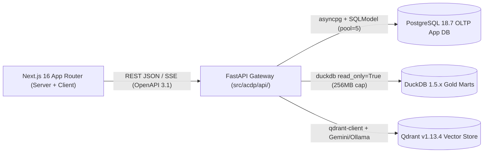

# SPEC-0004: FastAPI Serving Gateway, PostgreSQL 18 OLTP & OpenAPI Contract

> **Task ID**: `TASK-W103` | **Notion Mapping**: [`NT-025`](../tasks/notion-task-mapping.md)
> **Status**: Proposed (Web Sprint 01 Specification)
> **Dependencies**: [`SPEC-0003`](./0003-gold-dimensional-modeling-spec.md), [`T14`](./../rd-tasks/T14_web_and_gold_stack_evaluation.md)
> **Target Modules (Sprint 02 Implementation)**: `src/acdp/api/`, `apps/web/types/api.d.ts`

---

## 1. Objective & Scope

Tài liệu này đặc tả lớp dịch vụ ứng dụng (`src/acdp/api/`) đóng vai trò cổng hợp nhất (Unified Serving Gateway) cho nền tảng ACDP bằng **FastAPI (`fastapi[standard]`)** trên Python `3.13+`. Kiến trúc tuân thủ nguyên lý tách biệt hoàn toàn tải giao dịch (OLTP) và tải phân tích (OLAP): **PostgreSQL 18.7** lưu trữ tài khoản người dùng, phiên đăng nhập, danh sách cuộc thi đã lưu và lịch sử hội thoại RAG; **DuckDB 1.5.x** gắn ở chế độ `read_only=True` phục vụ truy vấn Star Schema và Data Marts; **Qdrant `v1.13.4`** phục vụ truy xuất ngữ nghĩa RAG.

Hợp đồng giao tiếp giữa Backend và Frontend tuân thủ quy trình **Spec-Driven Development**: toàn bộ Pydantic v2 DTO xuất chuẩn `OpenAPI 3.1` để sinh tự động định nghĩa TypeScript (`apps/web/types/api.d.ts`) thông qua `openapi-typescript`.

---

## 2. Data Contracts & Schemas

### 2.1. Kiến trúc Kết nối Đa Cơ sở Dữ liệu (Dual-DB Gateway)



### 2.2. PostgreSQL 18.7 OLTP Schema DDL

Hệ quản trị **PostgreSQL 18.7 (`postgres:18.7-alpine3.21`)** quản lý 5 bảng quan hệ sau trong schema mặc định `public`:

```sql
CREATE EXTENSION IF NOT EXISTS "pgcrypto";

-- 1. Tài khoản người dùng (Sinh viên, Giảng viên, Quản trị viên)
CREATE TABLE IF NOT EXISTS users (
    id UUID PRIMARY KEY DEFAULT gen_random_uuid(),
    email VARCHAR(255) NOT NULL UNIQUE,
    full_name VARCHAR(120) NOT NULL,
    role VARCHAR(20) NOT NULL DEFAULT 'student' CHECK (role IN ('student', 'lecturer', 'admin')),
    student_or_staff_id VARCHAR(32),
    password_hash VARCHAR(255) NOT NULL,
    is_active BOOLEAN NOT NULL DEFAULT TRUE,
    created_at TIMESTAMPTZ NOT NULL DEFAULT NOW(),
    updated_at TIMESTAMPTZ NOT NULL DEFAULT NOW()
);

-- 2. Phiên đăng nhập & Refresh Token Rotation
CREATE TABLE IF NOT EXISTS user_sessions (
    id UUID PRIMARY KEY DEFAULT gen_random_uuid(),
    user_id UUID NOT NULL REFERENCES users(id) ON DELETE CASCADE,
    refresh_token_hash VARCHAR(128) NOT NULL UNIQUE,
    user_agent VARCHAR(255),
    expires_at TIMESTAMPTZ NOT NULL,
    revoked_at TIMESTAMPTZ,
    created_at TIMESTAMPTZ NOT NULL DEFAULT NOW()
);
CREATE INDEX IF NOT EXISTS idx_user_sessions_user_id ON user_sessions(user_id);

-- 3. Cuộc thi thí sinh đánh dấu theo dõi (liên kết lỏng tới DuckDB qua SHA-256 competition_key)
CREATE TABLE IF NOT EXISTS saved_competitions (
    id UUID PRIMARY KEY DEFAULT gen_random_uuid(),
    user_id UUID NOT NULL REFERENCES users(id) ON DELETE CASCADE,
    competition_key VARCHAR(64) NOT NULL,
    competition_name_snapshot VARCHAR(255) NOT NULL,
    personal_note TEXT,
    notify_before_deadline BOOLEAN NOT NULL DEFAULT TRUE,
    created_at TIMESTAMPTZ NOT NULL DEFAULT NOW(),
    CONSTRAINT uq_user_saved_competition UNIQUE (user_id, competition_key)
);
CREATE INDEX IF NOT EXISTS idx_saved_competitions_user_id ON saved_competitions(user_id);

-- 4. Phiên hỏi đáp RAG Copilot
CREATE TABLE IF NOT EXISTS chat_sessions (
    id UUID PRIMARY KEY DEFAULT gen_random_uuid(),
    user_id UUID NOT NULL REFERENCES users(id) ON DELETE CASCADE,
    title VARCHAR(200) NOT NULL DEFAULT 'Phiên hỏi đáp mới',
    created_at TIMESTAMPTZ NOT NULL DEFAULT NOW(),
    updated_at TIMESTAMPTZ NOT NULL DEFAULT NOW()
);
CREATE INDEX IF NOT EXISTS idx_chat_sessions_user_updated ON chat_sessions(user_id, updated_at DESC);

-- 5. Tin nhắn chi tiết kèm trích dẫn nguồn bắt buộc (citations_json)
CREATE TABLE IF NOT EXISTS chat_messages (
    id UUID PRIMARY KEY DEFAULT gen_random_uuid(),
    session_id UUID NOT NULL REFERENCES chat_sessions(id) ON DELETE CASCADE,
    role VARCHAR(16) NOT NULL CHECK (role IN ('user', 'assistant')),
    content TEXT NOT NULL,
    citations_json JSONB NOT NULL DEFAULT '[]'::jsonb,
    latency_ms INTEGER,
    created_at TIMESTAMPTZ NOT NULL DEFAULT NOW()
);
CREATE INDEX IF NOT EXISTS idx_chat_messages_session_created ON chat_messages(session_id, created_at ASC);
```

**Quy tắc khóa liên kết chéo (`saved_competitions.competition_key`)**: Khóa ngoại không tạo trực tiếp sang DuckDB vì hai động cơ chạy tách rời. Trường `competition_key` lưu chuỗi SHA-256 dài 64 ký tự hex khớp với `dim_competition.competition_key`. Cột `competition_name_snapshot` bảo lưu tên cuộc thi tại thời điểm bấm lưu để giao diện vẫn hiển thị hợp lệ ngay cả khi nguồn ngoài đóng cửa hoặc thay đổi cấu trúc.

### 2.3. Danh mục Endpoints OpenAPI 3.1

Tiền tố chung cho toàn bộ tài nguyên nghiệp vụ là `/api/v1`:

| Nhóm | Method & Path | Nguồn dữ liệu | Yêu cầu Auth | Mục đích |
| :--- | :--- | :--- | :---: | :--- |
| **System** | `GET /api/v1/health` | PG + DuckDB + Qdrant | Công khai | Kiểm tra trạng thái sống và số lượng bản ghi Gold |
| **Analytics** | `GET /api/v1/analytics/overview` | `mart_kpi_overview`, `mart_domain_analytics`, `mart_team_and_mode_matrix`, `mart_organizer_ecosystem` | Công khai | Dữ liệu tổng hợp cho Dashboard Giảng viên / Khoa |
| **Analytics** | `GET /api/v1/analytics/seasonality` | `mart_seasonality_academic` | Công khai | Phân bổ cuộc thi theo tháng và học kỳ (`HK1`, `HK2`, `Hè`) |
| **Competitions** | `GET /api/v1/competitions` | `mart_competition_explorer` | Công khai | Danh sách phân trang, tìm kiếm từ khóa, lọc theo ngành/hình thức/miễn phí |
| **Competitions** | `GET /api/v1/competitions/{competition_key}` | `dim_competition`, `fact_competitions`, `fact_prize_tiers`, `fact_timeline_stages` | Công khai | Hồ sơ chi tiết cuộc thi kèm giải thưởng và timeline từng vòng |
| **Auth** | `POST /api/v1/auth/register` | `users` | Công khai | Đăng ký tài khoản sinh viên mới |
| **Auth** | `POST /api/v1/auth/login` | `users`, `user_sessions` | Công khai | Đăng nhập, cấp Access JWT và Refresh Token |
| **Auth** | `POST /api/v1/auth/refresh` | `user_sessions` | Cookie/Token | Cấp lại Access JWT và xoay vòng Refresh Token |
| **Auth** | `POST /api/v1/auth/logout` | `user_sessions` | Bearer JWT | Thu hồi phiên đăng nhập hiện tại |
| **Auth** | `GET /api/v1/auth/me` | `users` | Bearer JWT | Lấy hồ sơ người dùng đang đăng nhập |
| **Bookmarks** | `GET /api/v1/bookmarks` | `saved_competitions` + `mart_competition_explorer` | Bearer JWT | Danh sách cuộc thi đã lưu kèm trạng thái đồng bộ Gold |
| **Bookmarks** | `POST /api/v1/bookmarks` | `saved_competitions` + `dim_competition` | Bearer JWT | Lưu cuộc thi (kiểm tra tồn tại ở DuckDB trước khi ghi PG) |
| **Bookmarks** | `DELETE /api/v1/bookmarks/{competition_key}` | `saved_competitions` | Bearer JWT | Hủy lưu cuộc thi thuộc quyền sở hữu người dùng |
| **RAG Copilot** | `POST /api/v1/rag/chat` (alias: `POST /api/v1/rag/query`) | Qdrant + LLM + `chat_sessions` + `chat_messages` | Bearer JWT (tùy chọn Guest ở bản demo có giới hạn) | Đặt câu hỏi thể lệ, trả câu trả lời kèm danh sách trích dẫn URL |
| **RAG Copilot** | `GET /api/v1/rag/sessions` | `chat_sessions` | Bearer JWT | Liệt kê lịch sử các phiên hỏi đáp của người dùng |
| **RAG Copilot** | `GET /api/v1/rag/sessions/{session_id}/messages` | `chat_messages` | Bearer JWT | Tải toàn bộ tin nhắn và trích dẫn trong một phiên |
| **RAG Copilot** | `DELETE /api/v1/rag/sessions/{session_id}` | `chat_sessions` | Bearer JWT | Xóa một phiên hội thoại thuộc quyền sở hữu người dùng |

### 2.4. Hợp đồng Pydantic v2 DTO Cốt lõi

```python
from datetime import datetime
from typing import Literal
from uuid import UUID
from pydantic import BaseModel, Field

class HealthResponse(BaseModel):
    status: Literal["ok", "degraded"]
    postgres: Literal["up", "down"]
    duckdb: Literal["up", "down"]
    qdrant: Literal["up", "degraded", "down"]
    gold_competitions_count: int = 0

class KpiOverviewDTO(BaseModel):
    total_competitions: int
    open_competitions: int
    total_prize_pool_vnd: int
    free_participation_pct: float
    scholarship_competitions: int
    unique_domains: int
    unique_organizers: int

class DomainMetricDTO(BaseModel):
    domain_slug: str
    domain_group: str
    competition_count: int
    allocated_prize_vnd: int
    free_count: int

class SeasonalityMetricDTO(BaseModel):
    year: int | None
    month: int | None
    academic_year: str
    academic_term: Literal["HK1", "HK2", "Hè", "Không xác định"]
    competition_count: int
    total_prize_vnd: int

class ModeTeamMetricDTO(BaseModel):
    mode_canonical: Literal["Online", "Offline", "Hybrid", "Unknown"]
    team_profile: str
    competition_count: int
    total_prize_vnd: int

class OrganizerMetricDTO(BaseModel):
    organizer_slug: str
    organizer_name: str
    organizer_tier: str
    role_type: Literal["organizer", "partner_sponsor"]
    competition_count: int
    allocated_prize_vnd: int

class AnalyticsDashboardDTO(BaseModel):
    kpi: KpiOverviewDTO
    domains: list[DomainMetricDTO]
    seasonality: list[SeasonalityMetricDTO]
    mode_team_matrix: list[ModeTeamMetricDTO]
    top_organizers: list[OrganizerMetricDTO]

class CompetitionSummaryDTO(BaseModel):
    competition_key: str
    name: str
    tagline: str | None = None
    canonical_url: str
    mode_canonical: str
    is_free: bool
    total_prize_vnd: int
    registration_status: str | None = None
    registration_deadline_raw: str | None = None
    domain_groups: list[str]
    team_size_min: int | None = None
    team_size_max: int | None = None

class PrizeTierDTO(BaseModel):
    tier_rank: int
    tier_name: str
    reward_description: str
    estimated_value_vnd: int
    is_scholarship: bool

class TimelineStageDTO(BaseModel):
    stage_order: int
    stage_name: str
    start_date_raw: str | None = None
    end_date_raw: str | None = None
    description: str | None = None

class CompetitionDetailDTO(CompetitionSummaryDTO):
    summary: str | None = None
    target_audience: str | None = None
    location: str | None = None
    submission_platform: str | None = None
    challenge_overview: str | None = None
    organizers: list[str]
    partners_and_sponsors: list[str]
    prizes: list[PrizeTierDTO]
    timeline_stages: list[TimelineStageDTO]

class BookmarkCreateRequest(BaseModel):
    competition_key: str = Field(min_length=64, max_length=64)
    personal_note: str | None = Field(default=None, max_length=1000)
    notify_before_deadline: bool = True

class BookmarkDTO(BaseModel):
    id: UUID
    competition_key: str
    competition_name: str
    personal_note: str | None = None
    notify_before_deadline: bool
    is_archived: bool = False
    mode_canonical: str | None = None
    total_prize_vnd: int | None = None
    created_at: datetime

class RagChatRequest(BaseModel):
    session_id: UUID | None = None
    message: str = Field(min_length=2, max_length=2000)
    domain_filter: str | None = None

class RagCitationDTO(BaseModel):
    title: str
    url: str
    domain: str
    snippet: str

class RagChatResponse(BaseModel):
    session_id: UUID
    answer: str
    citations: list[RagCitationDTO]
    grounded: bool
    latency_ms: int
```

---

## 3. Core Processing Logic & Algorithms

### 3.1. Quản lý Kết nối DuckDB Read-Only & PostgreSQL Pool

1. **DuckDB Per-Request Context Manager (`get_duckdb_conn`)**: Mở kết nối bằng `duckdb.connect(str(settings.duckdb_database_path), read_only=True)` ngay khi xử lý request phân tích, thi hành cấu hình bảo vệ RAM `SET memory_limit='256MB'; SET threads=2;`, và đóng kết nối trong khối `finally`. Cách tiếp cận này tránh giữ file lock dài hạn khi người dùng chạy pipeline cập nhật `acdp.duckdb` ở tiến trình khác.
2. **PostgreSQL Async Pool (`get_db_session`)**: Sử dụng `create_async_engine` kết hợp driver `asyncpg` với cấu hình `pool_size=5`, `max_overflow=5`, `pool_recycle=1800`, `pool_pre_ping=True`. Tổng kết nối tối đa từ FastAPI luôn nằm gọn trong `max_connections=40` của container Postgres.

### 3.2. Xác thực & Phân quyền (Authentication & RBAC)

1. **Mã hóa mật khẩu**: Sử dụng Argon2id (qua `pwdlib[argon2]`), không lưu mật khẩu thuần văn bản hoặc dùng thuật toán băm cũ thiếu salt.
2. **Dual-Token Flow**: Endpoint `/auth/login` trả về Access JWT (thuật toán HS256, thời hạn 15 phút, chứa `sub = user.id`, `role`) và Refresh Token (chuỗi ngẫu nhiên 256-bit gửi qua `HttpOnly; SameSite=Lax; Path=/api/v1/auth` cookie). Giá trị SHA-256 của Refresh Token được ghi vào `user_sessions`.
3. **Token Rotation**: Khi gọi `/auth/refresh`, hệ thống vô hiệu hóa bản ghi `user_sessions` cũ (`revoked_at = NOW()`) và tạo bản ghi mới. Nếu phát hiện dùng lại token đã bị thu hồi, toàn bộ phiên còn hiệu lực của `user_id` đó lập tức bị hủy để chống đánh cắp phiên.

### 3.3. Tích hợp RAG Copilot & Chống Ảo giác (`DIR-004`)

1. Tầng API bao bọc hàm `generate_answer(message, session_id)` trong `src/acdp/3_chatbot_mvp.py` bằng `asyncio.to_thread(...)` để không làm nghẽn vòng lặp sự kiện asyncio trong lúc chờ model embedding (`qwen3-embedding:4b`) hoặc LLM (`gemini-3.5-flash-lite` / Ollama).
2. Mọi `Document` trả về từ Qdrant (`collection = acdp_competitions`, chỉ mục `metadata.domain`) được chuyển hóa thành `RagCitationDTO` chứa tiêu đề, URL nguồn gốc và đoạn trích ngắn.
3. Nếu danh sách tài liệu truy xuất rỗng hoặc điểm tương đồng dưới ngưỡng tin cậy, API trả về `grounded = False` cùng thông điệp từ chối suy diễn thể lệ cuộc thi (`DIR-004`).
4. Khi có `user_id` hợp lệ, tin nhắn người dùng và phản hồi kèm `citations_json` được ghi nguyên vẹn vào `chat_sessions` và `chat_messages` trong PostgreSQL.

### 3.4. Quy trình Sinh Hợp đồng Kiểu Tĩnh (Spec-Driven Codegen)

1. Lập trình viên chỉnh sửa Pydantic v2 DTO tại `src/acdp/api/schemas/`.
2. Chạy lệnh trích xuất schema hoặc khởi động FastAPI lấy tệp JSON tại `/openapi.json` (chuẩn OpenAPI `3.1.0`).
3. Sinh lại tệp TypeScript tại Frontend bằng lệnh `npx openapi-typescript http://localhost:8000/openapi.json -o apps/web/types/api.d.ts` (hoặc từ tệp `openapi.json` tĩnh trong CI).
4. Bước `tsc --noEmit` ở Frontend sẽ báo lỗi biên dịch ngay lập tức nếu tên trường API thay đổi mà giao diện chưa cập nhật theo.

---

## 4. Error Handling & Edge Cases

| Tình huống biên | Cơ chế phát hiện | Phản hồi HTTP & Xử lý |
| :--- | :--- | :--- |
| **EC-A1: Khóa file DuckDB hoặc đang swap `.tmp`** | Bắt ngoại lệ `duckdb.IOException` khi gọi `connect(..., read_only=True)` | Thử lại tối đa 3 lần với jitter `50 ms`; nếu vẫn bận, chuyển sang đọc trực tiếp tệp Parquet tại `data/lakehouse/gold/*.parquet` qua kết nối DuckDB `:memory:` |
| **EC-A2: Bookmark trỏ tới cuộc thi đã bị gỡ ở Gold mới** | `LEFT JOIN mart_competition_explorer` trả về `NULL` ở kết quả ghép | Vẫn trả `200 OK` tại `GET /bookmarks` kèm `is_archived=True` và giữ nguyên `competition_name_snapshot` đã lưu trong PostgreSQL |
| **EC-A3: Nhấn lưu trùng một cuộc thi 2 lần liên tiếp** | Ràng buộc `uq_user_saved_competition` trong PostgreSQL | Endpoint `POST /bookmarks` kiểm tra hoặc dùng `ON CONFLICT (user_id, competition_key) DO UPDATE` để đảm bảo tính idempotent |
| **EC-A4: Qdrant ngừng hoạt động hoặc LLM vượt thời gian chờ** | `UnexpectedResponse` / `ConnectError` / `TimeoutError` (`> 25s`) | Các endpoint Analytics và Competition Explorer vẫn hoạt động bình thường `200 OK`; `/health` chuyển trạng thái thành `degraded`; `/rag/chat` trả `503 Service Unavailable` kèm thông điệp hướng dẫn thử lại |
| **EC-A5: Truy vấn tìm kiếm chứa ký tự SQL injection** | Kiểm tra dữ liệu đầu vào bằng Pydantic + Tham số hóa SQL | Tuyệt đối dùng prepared placeholders (`?` ở DuckDB, `$1` ở asyncpg), không bao giờ nội suy f-string vào điều kiện `WHERE`, `ORDER BY` ánh xạ qua whitelist cột hợp lệ |

---

## 5. Verification & Acceptance Criteria

1. **Xác thực hợp đồng OpenAPI 3.1:** Xuất thành công `openapi.json` từ `app.openapi()` mà không lỗi kiểu Pydantic; chạy `npx openapi-typescript` tạo `apps/web/types/api.d.ts` không cảnh báo.
2. **Kiểm thử tích hợp Pytest (`tests/api/`):** Toàn bộ endpoint `/health`, `/analytics/*`, `/competitions*`, `/auth/*`, `/bookmarks*` đạt trạng thái `PASSED` bằng `httpx.AsyncClient`.
3. **Kiểm thử bảo mật & sở hữu tài nguyên:** Tài khoản sinh viên A gọi `DELETE /bookmarks/{key}` hoặc `GET /rag/sessions/{id}/messages` của sinh viên B phải nhận về HTTP `403` hoặc `404` (không rò rỉ dữ liệu chéo tài khoản).
4. **Kiểm thử hiệu năng DuckDB read-only:** Truy vấn `GET /api/v1/analytics/overview` hoàn thành dưới `100 ms` trong giới hạn `memory_limit='256MB'`.
5. **Kiểm tra nguồn sự thật RAG:** Mọi phản hồi `grounded=True` từ `/api/v1/rag/chat` bắt buộc chứa tối thiểu 1 phần tử trong mảng `citations` có trường `url` hợp lệ.
