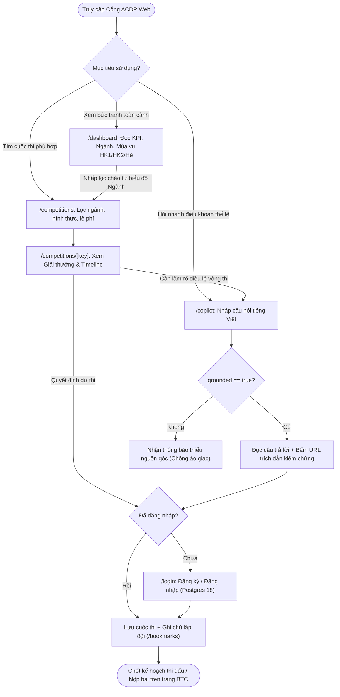
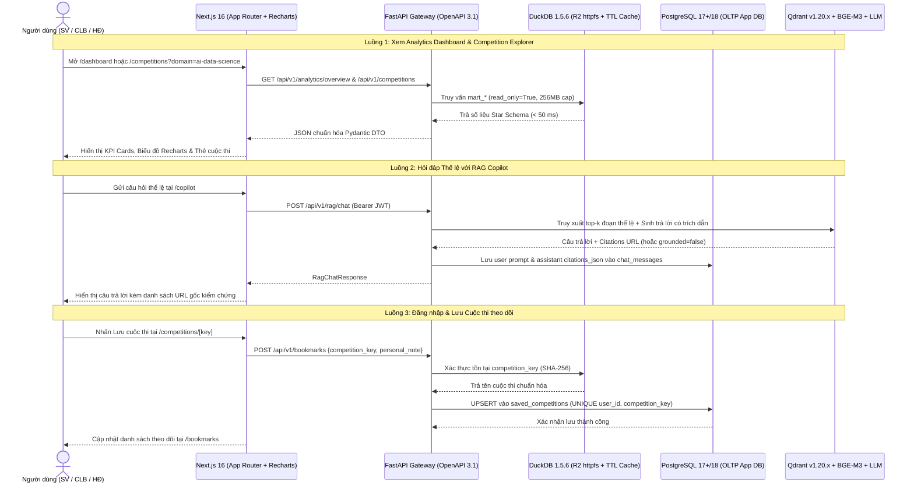

# SPEC: Đặc Tả Tổng Thể Sản Phẩm, Giá Trị Nghiệp Vụ & Luồng Người Dùng (Master Product Spec)

> **Tài liệu gốc**: Master Product & User Flow Specification (`SPEC.md`)
> **Nhóm tác giả**: Đỗ Kiến Hưng (`@darktheDE`) & Nguyễn Văn Quang Duy (`@QuangDuyReal`)
> **Giảng viên hướng dẫn**: ThS. Trần Quang Khải
> **Đơn vị**: Khoa Công nghệ Thông tin, Trường Đại học Công nghệ Kỹ thuật TP.HCM (HCM-UTE)
> **Giai đoạn áp dụng**: Phase 1 (Tiểu luận Chuyên ngành Kỹ thuật Dữ liệu, 15 tuần MVP) & nền tảng mở rộng KLTN

---

## 1. Bài toán Nghiệp vụ & Lý do Xây dựng Web ACDP

### 1.1. Ba nút thắt thực tế của người học và đơn vị quản lý phong trào

1. **Phân mảnh và thiếu đồng nhất thông tin cuộc thi.** Thông báo hackathon, cuộc thi AI/Data Science, Web3 hay khởi nghiệp sinh viên nằm rải rác trên website Ban tổ chức, cổng tin sinh viên và các trang tổng hợp quốc tế. Mỗi nguồn trình bày hạn chót đăng ký (`DD/MM/YYYY` so với `YYYY-MM-DD`), đơn vị giải thưởng (`USD`, `triệu VNĐ`, `học bổng`), và danh sách vòng thi theo một cấu trúc khác nhau, khiến sinh viên khó so sánh trực diện.
2. **Chi phí đọc hiểu và rủi ro hiểu nhầm thể lệ.** Thể lệ chính thức thường trải dài trên nhiều trang web hoặc tài liệu mô tả phức tạp. Thí sinh mất nhiều thời gian để trích lọc những điều kiện sống còn như số lượng thành viên tối thiểu/tối đa, đối tượng hợp lệ, nền tảng nộp bài hay quyền sở hữu trí tuệ.
3. **Điểm mù dữ liệu cho công tác lập kế hoạch học thuật.** Cả sinh viên lẫn Ban chủ nhiệm CLB học thuật, Cố vấn hoặc Khoa CNTT đều thiếu bức tranh định lượng để trả lời các câu hỏi mang tính quy luật: tháng nào trong năm học (`HK1`, `HK2`, `Hè`) tập trung nhiều cuộc thi nhất, lĩnh vực nào đang thu hút nhiều nguồn tài trợ doanh nghiệp nhất, và đa số sân chơi đòi hỏi thi cá nhân hay lập đội `2–4` người.

### 1.2. Vai trò của Website trong Đồ án Chuyên ngành Kỹ thuật Dữ liệu

Đối với chuyên ngành **Kỹ thuật Dữ liệu (Data Engineering)**, trang web ACDP đóng vai trò **Lớp Phục vụ & Tiêu thụ Dữ liệu (Serving & Consumption Layer)** hoàn chỉnh cho toàn bộ kiến trúc Lakehouse Medallion:

```text
Raw Rendered HTML on Cloudflare R2 (Bronze: v2/bronze_crawl.py)
  -> Hybrid Deterministic Sandwich + Instructor (Silver: v2/silver_transform.py, v2/schemas.py)
  -> Kimball Star Schema + Data Marts (Gold: 15 Parquets on R2 via DuckDB 1.5.6 httpfs) + Vector Index (Qdrant v1.20.x)
  -> Serving Gateway (FastAPI OpenAPI 3.1 + TTL Cache + PostgreSQL 17+/18 OLTP)
  -> Giao diện Ra quyết định (Next.js 16 + Recharts)
```

Xây dựng ứng dụng Web mang lại 3 giá trị kiểm chứng bắt buộc mà các script Python thuần hoặc notebook phân tích tĩnh không thể thay thế:

1. **Chứng minh tính hữu dụng của Gold Star Schema (`SPEC-0003`).** Các bảng `dim_*`, `fact_*`, `bridge_*` và `mart_*` trên DuckDB được khai thác trực tiếp qua API đọc chỉ (`read_only=True`) dưới `100 ms`, khẳng định mô hình chiều dữ liệu phục vụ tốt cả công cụ BI (`Metabase`) lẫn ứng dụng web sản phẩm thực tế.
2. **Tách bạch thực nghiệm giữa OLAP, OLTP và Vector Search (`SPEC-0004`).** Hệ thống minh họa rõ nguyên lý kỹ thuật dữ liệu hiện đại: không dồn dữ liệu phân tích vào CSDL giao dịch và không dùng kho phân tích OLAP để xử lý đăng nhập, bookmark hay lưu lịch sử hội thoại đồng thời.
3. **Đưa trí tuệ dữ liệu đến tay người dùng cuối không chuyên.** Sinh viên không cần viết câu lệnh SQL hay chạy Python CLI vẫn có thể lọc cơ hội, xem biểu đồ mùa vụ theo học kỳ HCM-UTE và hỏi đáp thể lệ có trích dẫn nguồn kiểm chứng.

---

## 2. Chân dung Người dùng & Ma trận Giá trị Nhận được

Theo phạm vi đã rà soát tại [`NT-013`](../deliverables/NT-013-business-technical-feasibility-review.md), giai đoạn TLCN tập trung vào các luồng giá trị cốt lõi cho 3 nhóm đối tượng mà không phát sinh phân hệ quản trị phức tạp hay dữ liệu cá nhân nhạy cảm:

| Nhóm người dùng | Role hệ thống | Câu hỏi / Nhu cầu thực tế | Phân hệ sử dụng | Giá trị cụ thể nhận được |
| :--- | :--- | :--- | :--- | :--- |
| **Sinh viên / Thí sinh HCM-UTE** | `student` | Cuộc thi nào phù hợp kỹ năng AI/Web/Security? Thi cá nhân hay lập nhóm mấy người? Còn bao nhiêu ngày hết hạn? | `/competitions`, `/competitions/[key]`, `/copilot`, `/bookmarks` | Tiết kiệm thời gian sàng lọc, nắm rõ timeline từng chặng, hỏi nhanh thể lệ kèm link gốc, lưu danh sách theo dõi cá nhân |
| **Ban chủ nhiệm CLB / Cố vấn / Quản trị Khoa** | `lecturer` / `admin` (hoặc truy cập Dashboard công khai) | Mùa cao điểm thi cử rơi vào học kỳ nào? Ngành nào có quỹ tài trợ cao? Doanh nghiệp nào hay đồng hành? | `/dashboard` | Nắm xu hướng theo 5 nhóm ngành chuẩn và chu kỳ `HK1`/`HK2`/`Hè` để lên lịch tập huấn đội tuyển, điều phối CLB tránh trùng kỳ thi học kỳ |
| **Hội đồng Chuyên môn KTDL** | Khách đánh giá & Phản biện | Dữ liệu phi cấu trúc đã biến đổi thành mô hình chiều chuẩn chưa? Chatbot có bịa thể lệ không? Kiến trúc Web gắn với Lakehouse ra sao? | Toàn bộ 4 phân hệ + OpenAPI `/docs` + Metabase (`bi` profile) | Kiểm chứng tận mắt số liệu nhất quán giữa DuckDB Gold Marts và biểu đồ Web, xác thực trích dẫn URL trong câu trả lời RAG |

---

## 3. Chi tiết Giá trị Nghiệp vụ theo từng Phân hệ & Biểu đồ

### 3.1. Phân hệ 1: Academic Competition Explorer (`/competitions` & `/competitions/[key]`)

1. **Người dùng thao tác gì?** Tìm kiếm theo tên/từ khóa, lọc kết hợp theo 5 nhóm lĩnh vực chuẩn (`AI & Data Science`, `Web3, Blockchain & FinTech`, `Software, Web & Mobile`, `Security, IoT & Embedded`, `Startup, Design & Interdisciplinary`), hình thức tổ chức (`Online`, `Offline`, `Hybrid`), trạng thái miễn phí (`Miễn phí`), sau đó mở hồ sơ chi tiết của một cuộc thi.
2. **Dữ liệu đứng sau là gì?** View [`mart_competition_explorer`](file:///d:/Code/final-thesis/acdp-platform/docs/specs/0003-gold-dimensional-modeling-spec.md) cung cấp danh sách đã khử trùng 18 cuộc thi từ 17 nguồn mục tiêu; trang chi tiết ghép thêm `fact_prize_tiers` (từng hạng giải thưởng kèm giá trị quy đổi VNĐ) và `fact_timeline_stages` (các mốc sơ loại, nộp sản phẩm, chung kết).
3. **Người dùng nhận được gì?** Một bản hồ sơ cô đọng thay thế việc đọc nhiều trang web rời rạc: biết ngay tổng giải thưởng (hoặc học bổng), lệ phí, yêu cầu số thành viên đội, nền tảng nộp bài, đơn vị tổ chức/tài trợ và nút bấm mở ngay trang đăng ký chính thức của Ban tổ chức.

### 3.2. Phân hệ 2: Faculty & Student Analytics Dashboard (`/dashboard`)

Trang `/dashboard` không dùng để trang trí bằng số liệu minh họa mà phục vụ trực tiếp việc định lượng thị trường sân chơi học thuật từ Lớp Vàng (`SPEC-0003`):

| Widget / Biểu đồ trên `/dashboard` | Data Mart nguồn (`SPEC-0003`) | Câu hỏi nghiệp vụ được giải đáp | Hành động / Quyết định người dùng có thể đưa ra |
| :--- | :--- | :--- | :--- |
| **4 Thẻ KPI Tổng quan** | `mart_kpi_overview` | Hiện có bao nhiêu cuộc thi, bao nhiêu sân chơi đang mở, tổng quỹ giải thưởng thực tế (không cộng trùng) và tỷ lệ miễn phí tham gia? | Đánh giá nhanh quy mô cơ hội hiện hữu và tỷ lệ sân chơi sinh viên tham gia không mất phí (`is_free`) |
| **Biểu đồ Phân bổ Ngành & Quỹ Giải thưởng (BarChart)** | `mart_domain_analytics` | Nhóm ngành nào có nhiều sân chơi và tổng ngân sách tài trợ cao nhất? (Dùng `allocation_weight` tránh phình tiền ở cuộc thi đa ngành) | Sinh viên định hướng chọn mảng công nghệ phù hợp; Khoa nhận diện lĩnh vực đang thiếu sân chơi hoặc thu hút mạnh vốn doanh nghiệp |
| **Biểu đồ Mùa vụ theo Học kỳ HCM-UTE (ComposedChart)** | `mart_seasonality_academic` | Các cuộc thi mở đăng ký và khởi tranh dày đặc nhất vào tháng nào trong `HK1` (T9–T12), `HK2` (T1–T5) hay `Hè` (T6–T8)? | Sinh viên chủ động chọn cuộc thi rơi vào giai đoạn nhẹ lịch thi; CLB học thuật mở lớp ôn luyện trước mùa cao điểm `1–2` tháng |
| **Ma trận Hình thức & Quy mô Đội (Donut + Stacked Bar)** | `mart_team_and_mode_matrix` | Tỷ lệ thi `Online`, `Offline`, `Hybrid` ra sao? Đa số cuộc thi yêu cầu cá nhân hay đội `2–4` người, `5+` người? | Thí sinh biết cần tìm bao nhiêu đồng đội trước khi nộp đơn và ước lượng chi phí di chuyển nếu thi `Offline` |
| **Bảng Hệ sinh thái BTC & Nhà tài trợ** | `mart_organizer_ecosystem` | Tổ chức nào đứng ra tổ chức (`organizer`) và doanh nghiệp/quỹ nào tài trợ (`partner_sponsor`) nhiều cuộc thi nhất? | Sinh viên nhận diện các doanh nghiệp đồng hành thường xuyên để tìm kiếm cơ hội thực tập; CLB có danh sách đối tác tiềm năng để mời hợp tác |

### 3.3. Phân hệ 3: RAG Regulation Copilot (`/copilot`)

1. **Người dùng đang chat với ai?** Người dùng trao đổi với **Trợ lý Hỏi đáp Thể lệ ACDP**, một đường ống Dual-Layer Retrieval-Augmented Generation (RAG) hoạt động dựa trên kho chỉ mục vector `Qdrant Cloud` (backup Docker `v1.20.2`, collection `acdp_competitions_bge_m3`, embedding `@cf/baai/bge-m3` 1,024 chiều nạp qua `src/acdp/v2/rag_ingest.py`) kết hợp LLM (`gemini-3.5-flash-lite` + fallback `Groq` / `OpenRouter :free` trong `src/acdp/api/services/rag_service.py`) và lưu trữ lịch sử đa phiên tại PostgreSQL OLTP (`chat_sessions`, `chat_messages`).
2. **Người dùng nhận được gì?** Thí sinh nhập câu hỏi tự nhiên bằng tiếng Việt (ví dụ: *"Cuộc thi này có cho sinh viên năm hai ghép nhóm liên trường không, hạn nộp vòng sơ loại là ngày nào?"*). Hệ thống trả về câu trả lời trực diện kèm khung **Trích dẫn Nguồn (Citations)** gồm tiêu đề tài liệu, tên miền, đoạn trích gốc và đường dẫn URL nguồn để thí sinh tự bấm kiểm chứng.
3. **Cơ chế chống bịa đặt (`DIR-004`):** Nếu câu hỏi vượt ra ngoài tập dữ liệu thể lệ hiện có trong Qdrant (`grounded = false`), Copilot từ chối suy đoán và hiển thị cảnh báo chưa tìm thấy điều khoản xác thực trong nguồn thu thập, bảo vệ thí sinh khỏi rủi ro nộp sai quy chế.

### 3.4. Phân hệ 4: Quản lý Tài khoản & Theo dõi Cá nhân (`/login`, `/bookmarks`)

1. **Người dùng thao tác gì?** Đăng ký/đăng nhập bằng tài khoản cá nhân (JWT Access Token + Refresh Token Rotation lưu trong PostgreSQL 18 `users` và `user_sessions`), bấm lưu các cuộc thi mục tiêu và viết ghi chú lập đội (`personal_note`).
2. **Người dùng nhận được gì?** Một bảng theo dõi riêng tư lưu bền vững trên CSDL giao dịch `PostgreSQL 18.7`. Nhờ khóa liên kết SHA-256 `competition_key` kết hợp cột `competition_name_snapshot`, danh sách đã lưu vẫn bảo toàn thông tin tên cuộc thi kể cả khi nguồn ngoài đóng trang ở các đợt cập nhật Lakehouse sau.

---

## 4. Sơ đồ Luồng Người dùng Đầu-Cuối (End-to-End User Flow Diagrams)

### 4.1. Biểu đồ Luồng Nghiệp vụ Người dùng (User Flow Diagram)



### 4.2. Sơ đồ Tương tác Hệ thống Theo Luồng Chức năng (End-to-End Sequence)



---

## 5. Bản đồ Điều hướng Hệ thống Đặc tả (`SPEC-0001` – `SPEC-0006`)

Mọi quyết định kỹ thuật cụ thể phục vụ các luồng nghiệp vụ nêu trên được phân rã thành 6 bản đặc tả độc lập nhưng liên kết chặt chẽ theo chuẩn Spec-Driven Development:

| Mã Spec | Tài liệu chi tiết | Tầng phụ trách | Liên kết trực tiếp với User Flow |
| :--- | :--- | :--- | :--- |
| **`SPEC-0001`** | [`0001-system-foundation-spec.md`](./0001-system-foundation-spec.md) | Quy chuẩn Python, `uv`, `ruff`, cấu hình `.env` | Nền tảng vận hành thống nhất cho toàn bộ backend |
| **`SPEC-0002`** | [`0002-data-ingestion-and-schema-spec.md`](./0002-data-ingestion-and-schema-spec.md) | Thu thập `Crawl4AI` & bóc tách Silver (`Pydantic v2`) | Cung cấp dữ liệu sạch đầu vào cho mọi cuộc thi hiển thị trên Web |
| **`SPEC-0003`** | [`0003-gold-dimensional-modeling-spec.md`](./0003-gold-dimensional-modeling-spec.md) | DuckDB Kimball Star Schema (`4 dim`, `3 fact`, `2 bridge`, `6 mart`) | Cấp số liệu chính xác cho `/dashboard` và `/competitions` |
| **`SPEC-0004`** | [`0004-serving-api-and-oltp-spec.md`](./0004-serving-api-and-oltp-spec.md) | FastAPI Gateway, PostgreSQL 18 (5 bảng OLTP), OpenAPI 3.1 | Thực thi Auth, Bookmark, lưu phiên RAG và sinh `apps/web/types/api.d.ts` |
| **`SPEC-0005`** | [`0005-frontend-design-system-and-ux-spec.md`](./0005-frontend-design-system-and-ux-spec.md) | Next.js 16 App Router, SVG Logo, Tailwind v4 WCAG 2.2 AA, Recharts | Hiện thực hóa 4 phân hệ UI/UX trực quan cho người dùng cuối |
| **`SPEC-0006`** | [`0006-docker-infrastructure-and-resource-spec.md`](./0006-docker-infrastructure-and-resource-spec.md) | Docker multi-stage, pinning tag, `core` profile `<= 2.0 GB` RAM | Đảm bảo toàn bộ Web + API + DB + Vector chạy ổn định trên laptop 16GB RAM |
