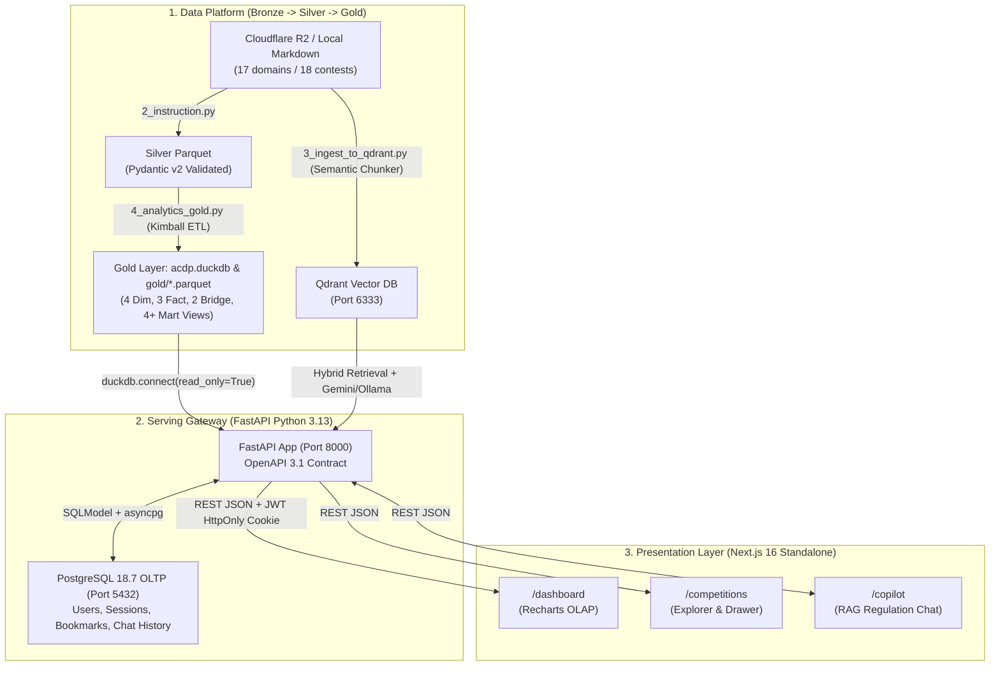
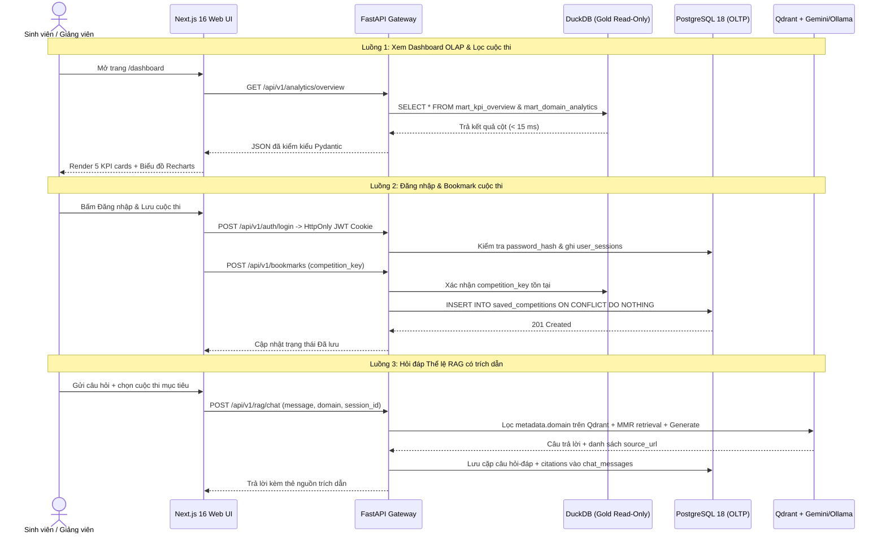
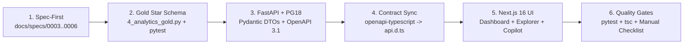

# Kế hoạch Sprint 01 (Web & Gold Layer): Nghiên cứu, Kiến trúc & Quy trình Kiểm thử

| Thuộc tính kế hoạch | Chi tiết |
| :--- | :--- |
| Mã Sprint | Web-Sprint-01 (Giai đoạn Khởi tạo Nghiên cứu & Kiến trúc) |
| Đơn vị thực hiện | Khoa Công nghệ Thông tin, Trường Đại học Công nghệ Kỹ thuật TP.HCM (HCM-UTE) |
| Chuyên ngành | Kỹ thuật Dữ liệu (Data Engineering) |
| Phạm vi dữ liệu nền | 17 domains / 18 cuộc thi thực tế tại [`data/extractions/`](../../data/extractions/extractions_2026-11-15_1794720683.json) |
| Mốc thời gian tham chiếu | Tháng 11/2026 (Chuẩn LTS & Best Practices 2026–2027) |
| Nguyên tắc vận hành | Tập trung 100% vào nghiên cứu đối sánh, chuẩn hóa lược đồ dữ liệu, thiết kế đặc tả (Spec-Driven Development) và khóa hạ tầng trước khi viết mã ứng dụng Web. |

---

## 1. Mục tiêu Sprint 01 & Bảng phân rã nhiệm vụ (`TASK-W101` – `TASK-W106`)

Mục tiêu của Sprint 01 là xây dựng đầy đủ luận cứ kỹ thuật, bản thiết kế chi tiết cho cả hai lớp dữ liệu (Gold OLAP + PostgreSQL OLTP), bộ quy chuẩn giao diện và quy trình kiểm thử để bạn nắm vững từng bước vận hành hệ thống dù AI là người hỗ trợ triển khai mã nguồn.

| Mã Task | Notion ID | Nội dung trọng tâm | Tài liệu / Đầu ra bắt buộc | Skills kích hoạt | Định nghĩa hoàn thành (DoD) |
| :---: | :---: | :--- | :--- | :--- | :--- |
| **TASK-W101** | `NT-023` | Nghiên cứu đối sánh & bảo vệ lựa chọn Tech Stack (2026–2027 LTS) | `docs/rd-tasks/T14_web_and_gold_stack_evaluation.md` | `academic-researcher`, `anti-slop-scientific-writer` | Hoàn thành 5 ma trận so sánh công nghệ kèm số liệu RAM, độ trễ và lý do loại bỏ phương án thay thế. |
| **TASK-W102** | `NT-024` | Thiết kế chuẩn hóa Kimball Star Schema Lớp Vàng & OLAP Marts | `docs/specs/0003-gold-dimensional-modeling-spec.md` | `experiment-evaluator` | Đặc tả xong `4 dim_*`, `3 fact_*`, `2 bridge_*`, `4–6 mart_*` và thuật toán xử lý 5 lỗi hiện tại của `4_analytics_gold.py`. |
| **TASK-W103** | `NT-025` | Đặc tả Backend FastAPI, PostgreSQL 18 (OLTP) & Spec-Driven (OpenAPI 3.1) | `docs/specs/0004-serving-api-and-oltp-spec.md` | `anti-slop-scientific-writer` | Chốt schema PostgreSQL 18 (`users`, `saved_competitions`, `chat_*`), danh sách REST endpoints và luồng sinh TypeScript types tự động. |
| **TASK-W104** | `NT-026` | Thiết kế Logo SVG, Hệ thống màu WCAG 2.2 AA & Wireframe UI/UX | `docs/specs/0005-frontend-design-system-and-ux-spec.md` | `frontend-designer`, `modern-web-guidance`, `a11y-debugging` | Hoàn thành đặc tả Logo SVG 3 biến thể, token màu Tailwind v4 `@theme`, bảng màu Recharts và bố cục 3 phân hệ Web. |
| **TASK-W105** | `NT-027` | Thiết kế Hạ tầng Docker, Ghim phiên bản & Ngân sách RAM/Disk (16GB RAM) | `docs/specs/0006-docker-infrastructure-and-resource-spec.md` | `anti-slop-scientific-writer` | Khóa toàn bộ tag container (bỏ `:latest`), chia Docker Compose profiles và tính toán mức trần RAM dưới `2.3 GB` cho nhóm `core`. |
| **TASK-W106** | `NT-028` | Quy trình Kiểm thử 4 tầng, 8 Edge Cases & Sổ tay Manual Test / CLI | Mục 6 & Mục 7 trong tài liệu này | `experiment-evaluator` | Có checklist kiểm thử tự động (`pytest`, `tsc`, `validate_ui_component.py`) và hướng dẫn chạy tay từng bước cho lập trình viên. |

---

## 2. Nghiên cứu & Đối sánh Tech Stack (`TASK-W101`: Benchmark 2026–2027)

Phần này cung cấp luận cứ khách quan phục vụ phản biện trước Hội đồng về lý do lựa chọn **Next.js 16 + Recharts + FastAPI + PostgreSQL 18 + DuckDB** thay vì các công cụ khác.

### 2.1. Đối sánh Frontend Framework

| Tiêu chí | Next.js 16.4.x (Active LTS - Đã chọn) | Vite + React 19 SPA | Streamlit / Gradio | Evidence.dev |
| :--- | :--- | :--- | :--- | :--- |
| **Mô hình xử lý** | Hybrid SSR + App Router + Standalone Server | Client-side SPA thuần | Python script chạy lại từ đầu | Static Site Generation (Markdown + SQL) |
| **RAM lúc phát triển** | 300–600 MB (Node.js server) | 100–200 MB | 150–300 MB (Python process) | 200–350 MB |
| **Hỗ trợ SEO & Link công khai** | Tốt (Server rendering cho trang chi tiết cuộc thi) | Kém (render phía client) | Kém | Trung bình (chủ yếu báo cáo tĩnh) |
| **Tích hợp Portal + Dashboard + RAG Chat** | Đáp ứng đầy đủ cả 3 phân hệ trên 1 giao diện thống nhất | Đáp ứng đầy đủ, cần cấu hình thêm router | Giao diện gò bó, khó tùy biến thẻ và drawer chi tiết | Không phù hợp xây dựng khung chat RAG và đăng nhập người dùng |
| **Quyết định** | **Chọn** (dùng `output: "standalone"` tối ưu Docker) | Dự phòng nếu muốn bỏ hẳn Node server | Chỉ dùng test nội bộ như `3_ingest_to_qdrant.py` | Loại vì thiếu tính năng ứng dụng tương tác |

### 2.2. Đối sánh Thư viện Biểu đồ (Charting Library)

| Thư viện | Cơ chế vẽ & Kiến trúc | Điểm mạnh với ACDP | Hạn chế & Điều kiện kiểm soát |
| :--- | :--- | :--- | :--- |
| **Recharts v2.15+ / v3** (Đã chọn) | SVG khai báo bằng JSX React (`<BarChart>`, `<Tooltip>`) | Tích hợp trực tiếp Tailwind CSS và hệ sinh thái `shadcn/ui Charts`; dễ tùy biến Tooltip hiển thị học kỳ, VNĐ, học bổng. | Bắt buộc đặt trong component `'use client'` và dùng bản hỗ trợ React 19; chậm nếu vẽ trên 5.000 điểm (không ảnh hưởng quy mô 10–100 cuộc thi). |
| **Chart.js** (`react-chartjs-2`) | HTML5 Canvas | Nhẹ và nhanh khi vẽ chuỗi thời gian lớn. | Cấu hình bằng object JS lồng nhau, khó tùy biến Tooltip phức tạp bằng JSX. |
| **Apache ECharts** | Canvas / SVG | Vẽ tốt Heatmap và Gantt lớn. | Kích thước bundle nặng, cấu hình rườm rà cho các biểu đồ cột và donut tiêu chuẩn. |

### 2.3. Đối sánh Backend Serving API

| Tiêu chí | FastAPI (`fastapi[standard]` - Đã chọn) | Litestar | Django Ninja | Flask |
| :--- | :--- | :--- | :--- | :--- |
| **Tương thích Python 3.13 & Pydantic v2** | Tích hợp gốc; dùng lại trực tiếp model từ [`schemas.py`](../../src/acdp/schemas.py) | Hỗ trợ tốt nhưng cộng đồng nhỏ hơn | Phụ thuộc Django ORM nặng nề | Phải cài thêm nhiều extension thủ công |
| **Sinh đặc tả OpenAPI** | Tự động xuất **OpenAPI 3.1** (JSON Schema Draft 2020-12) | Tự động xuất OpenAPI 3.1 | Xuất OpenAPI 3.0/3.1 | Không có mặc định |
| **Bất đồng bộ (`asyncio`)** | Chuẩn ASGI (`Uvicorn`), xử lý tốt gọi đồng thời DuckDB, PostgreSQL và Qdrant/LLM | Chuẩn ASGI | Hỗ trợ ASGI chưa đồng nhất bằng FastAPI | WSGI đồng bộ mặc định |

### 2.4. Đối sánh Backend App DB (OLTP) và Gold Analytics Engine (OLAP)

| Tầng dữ liệu | Công nghệ chọn | Công nghệ đối sánh | Lý do kiến trúc (Bắt buộc tách biệt) |
| :--- | :--- | :--- | :--- |
| **App Backend DB (OLTP)** | **PostgreSQL 18.7** (`postgres:18-alpine3.21`) | SQLite, MySQL 8.4 LTS, MongoDB | Lưu dữ liệu giao dịch ghi nhiều theo từng dòng (`users`, `user_sessions`, `saved_competitions`, `chat_messages`). Chọn PostgreSQL 18 thay SQLite để hỗ trợ ghi đồng thời chuẩn ACID khi nhiều sinh viên đăng nhập, đồng thời khớp với cấu hình `POSTGRES_*` trong [`config.py`](../../src/acdp/config.py#L28-L33). |
| **Gold Analytics DB (OLAP)** | **DuckDB 1.5.x** (`read_only=True`) | ClickHouse, PostgreSQL `GROUP BY` | Lưu Star Schema hướng cột (`dim_*`, `fact_*`, `mart_*`), đọc trực tiếp Parquet zero-copy với độ trễ dưới 15 ms, không tốn RAM chạy thêm cụm ClickHouse. Tuyệt đối không dùng DuckDB để lưu tài khoản đăng nhập vì cơ chế Single-Writer Lock dễ gây lỗi khóa tệp. |

---

## 3. Quy trình Nghiên cứu & Thiết kế Frontend (`TASK-W104`)

### 3.1. Bộ Skills cần đọc và kích hoạt trước khi viết mã UI

Trước khi tạo thư mục `apps/web/`, AI và thành viên phụ trách giao diện cần kích hoạt theo thứ tự 4 kỹ năng sau:
1. Đọc [`.agents/skills/frontend-designer/SKILL.md`](../../.agents/skills/frontend-designer/SKILL.md) và [`references/design_tokens.md`](../../.agents/skills/frontend-designer/references/design_tokens.md) để nắm quy chuẩn component Next.js 16, ranh giới `'use client'` và sử dụng script kiểm định `validate_ui_component.py`.
2. Kích hoạt kỹ năng `modern-web-guidance` để kiểm tra chuẩn HTML/CSS mới nhất (popover/dialog gốc trình duyệt, bảng đáp ứng đa màn hình, tối ưu Web Vitals LCP/CLS).
3. Kích hoạt kỹ năng `a11y-debugging` để kiểm tra tuân thủ **WCAG 2.2 Level AA**: tỷ lệ tương phản chữ thường tối thiểu `4.5:1`, chữ lớn và khung biểu tượng tối thiểu `3:1`, vùng bấm tối thiểu `24x24 CSS px` (SC 2.5.8), và vòng focus `focus-visible:ring-4` rõ nét khi điều hướng bằng bàn phím.
4. Tham khảo [`.agents/skills/visual-dossier-reporter/SKILL.md`](../../.agents/skills/visual-dossier-reporter/SKILL.md) khi cần dựng nhanh bản thử nghiệm HTML tĩnh để duyệt bố cục trước khi đưa vào React.

### 3.2. Thiết kế Logo & Nhận diện thương hiệu ACDP

Logo của nền tảng được thiết kế dưới dạng **Inline SVG thuần** (`viewBox="0 0 32 32"`) đặt tại `apps/web/components/brand/Logo.tsx` để hiển thị sắc nét trên mọi độ phân giải và đổi màu tự động giữa Light/Dark Mode.

1. **Ý niệm hình khối**: Biểu tượng ghép từ 3 nét hình học tối giản gồm đường đỉnh nón học thuật (Academic), khối bậc thang 3 tầng đại diện cho kiến trúc Medallion Bronze–Silver–Gold (Data Engineering), và mũi tên la bàn hướng lên trên biểu thị khám phá cơ hội thi đấu (Discovery).
2. **Quy chuẩn biến thể**: Xuất 3 biến thể từ cùng một component: `LogoMark` (khối biểu tượng `32x32` dùng cho favicon và thanh bên thu gọn), `LogoFull` (biểu tượng + chữ `ACDP` dùng font serif *Plus Jakarta Sans* + nhãn phụ `HCM-UTE`), và `LogoMonochrome` (1 màu trắng/đen phục vụ in ấn và trang đăng nhập nền tối).

### 3.3. Hệ thống màu sắc (Tailwind CSS v4 `@theme` & WCAG 2.2 AA)

Tailwind CSS v4 sử dụng cấu hình CSS-first bằng khối `@theme` trong `app/globals.css`, không dùng `tailwind.config.js`. Toàn bộ màu sắc kế thừa từ [`design_tokens.md`](../../.agents/skills/frontend-designer/references/design_tokens.md) và bổ sung bảng màu riêng cho biểu đồ Recharts:

| Nhóm Token | Tên biến CSS | Giá trị Light Mode | Giá trị Dark Mode | Mục đích sử dụng & Chuẩn WCAG 2.2 |
| :--- | :--- | :--- | :--- | :--- |
| **Nền chính** | `--color-bg-canvas` | `#FAF8F5` | `#0F172A` | Nền trang tổng thể (giảm chói mắt khi đọc thể lệ dài). |
| **Bề mặt thẻ** | `--color-bg-surface` | `#FFFFFF` | `#1E293B` | Thẻ cuộc thi, khung biểu đồ, thanh lọc bên trái. |
| **Viền phân cách** | `--color-border-subtle` | `#E2E8F0` | `#334155` | Viền card, đường chia bảng (`>= 3:1` contrast). |
| **Chữ chính** | `--color-text-primary` | `#0F172A` | `#F8FAFC` | Tiêu đề, nội dung thể lệ (đạt tỷ lệ tương phản `> 12:1`). |
| **Chữ phụ** | `--color-text-muted` | `#475569` | `#94A3B8` | Ngày cào, nhãn phụ (điều chỉnh từ `#64748B` lên `#475569` trên nền `#FAF8F5` để bảo đảm chuẩn `>= 4.5:1`). |
| **Thương hiệu** | `--color-brand-navy` | `#1E3A8A` | `#60A5FA` | Nút hành động chính, thanh điều hướng đang chọn, huy hiệu Khoa CNTT. |
| **Cảnh báo hạn nộp** | `--color-accent-coral` | `#C2410C` | `#FB923C` | Đếm ngược hạn đăng ký (`Còn < 7 ngày`), nút CTA đăng ký thi. |
| **Trạng thái Mở** | `--color-status-open` | `#15803D` | `#4ADE80` | Trạng thái `open`, luôn đi kèm chữ `"Đang mở"` hoặc icon (không dùng màu đơn độc theo WCAG 1.4.1). |
| **Biểu đồ Recharts** | `--chart-1` .. `--chart-5` | `#1E3A8A`, `#0D9488`, `#C2410C`, `#6D28D9`, `#B45309` | Điều chỉnh độ sáng tăng 15% | 5 màu tách biệt rõ sắc độ, phân biệt được ngay cả với người mù màu đỏ-lục. |

### 3.4. Thiết kế UI/UX & Bố cục 3 phân hệ Web

Giao diện tổ chức theo mô hình thanh điều hướng trên cùng (Top Header gồm Logo, 3 tab chính, nút chuyển Light/Dark Mode và nút Đăng nhập sinh viên):

1. Phân hệ 1 (Gold Analytics Dashboard `/dashboard`). Hàng 1 đặt 5 thẻ KPI đọc từ `mart_kpi_overview` dùng font số `font-mono tabular-nums`; Hàng 2 đặt biểu đồ cột ngang kép (số cuộc thi và tổng quỹ giải thưởng có trọng số theo `domain_group`) cạnh bảng xếp hạng giải thưởng lớn nhất có gắn huy hiệu học bổng; Hàng 3 đặt biểu đồ mùa vụ theo tháng và học kỳ đại học (`HK1`, `HK2`, `Hè`) cạnh biểu đồ donut phân bố đơn vị tổ chức (`enterprise`, `university`, `government`); Hàng 4 đặt ma trận hình thức thi $\times$ quy mô đội và danh sách mốc lịch trình vòng thi đang diễn ra.
2. Phân hệ 2 (Student Competition Explorer `/competitions`). Thanh lọc bên trái (Desktop `w-72`, Mobile chuyển thành nút mở Drawer) lọc theo Nhóm lĩnh vực, Trạng thái, Hình thức, Lệ phí miễn phí và Quy mô đội; vùng phải hiển thị lưới 3 cột thẻ cuộc thi kèm nút Bookmark (lưu vào PostgreSQL 18) và ngăn trượt chi tiết bên phải (Slide-over Drawer) chứa toàn bộ hạng giải `fact_prize_tiers` và lộ trình vòng thi `fact_timeline_stages`.
3. Phân hệ 3 (RAG Regulation Copilot `/copilot`). Cửa sổ hỏi đáp cho phép chọn phạm vi `"Tất cả cuộc thi"` hoặc khóa theo 1 `source_domain` cụ thể, kèm danh sách thẻ trích dẫn nguồn (`source_url`, `crawl_date`) và lịch sử phiên chat lưu trên PostgreSQL 18.

---

## 4. Tài liệu hóa Backend & Spec-Driven Development (`TASK-W102` & `TASK-W103`)

### 4.1. Quy trình Spec-Driven Development (SDD) 5 bước

Thay vì viết API và UI rời rạc rồi sửa tay khi lệch kiểu dữ liệu, nhóm áp dụng quy trình Spec-Driven Development lấy **OpenAPI 3.1** làm hợp đồng duy nhất:

1. Soạn đặc tả kỹ thuật (`docs/specs/`). Hoàn thiện `0003-gold-dimensional-modeling-spec.md` (Star Schema DuckDB) và `0004-serving-api-and-oltp-spec.md` (FastAPI + PostgreSQL 18) dựa trên mẫu [`0000-spec-template.md`](../specs/0000-spec-template.md).
2. Định nghĩa Pydantic v2 Contracts. Viết toàn bộ Request/Response DTOs trong `src/acdp/api/schemas.py` kế thừa chuẩn kiểm kiểu từ [`src/acdp/schemas.py`](../../src/acdp/schemas.py).
3. Xuất OpenAPI và sinh kiểu TypeScript tự động. Xuất tệp `openapi.json` từ FastAPI và chạy `npx openapi-typescript` để sinh tự động `apps/web/types/api.d.ts`. Mọi thay đổi ở Backend sẽ lập tức báo lỗi biên dịch TypeScript trên Frontend nếu chưa đồng bộ.
4. Cài đặt Engine truy vấn và nghiệp vụ. FastAPI kết nối DuckDB qua dependency `read_only=True` (kèm `SET memory_limit='256MB'`, `SET threads=2`) cho các route `/analytics/*`, `/competitions/*`; kết nối PostgreSQL 18 qua `SQLModel` + `asyncpg` cho `/auth/*`, `/bookmarks/*`, `/chat-history/*`; và bọc `generate_answer()` cho `/rag/chat`.
5. Kiểm định hợp đồng (Contract Testing). Chạy `pytest` đối chiếu JSON trả về từ từng endpoint với OpenAPI 3.1 schema trước khi nối vào Next.js 16.

### 4.2. Sơ đồ 1: Kiến trúc Tổng thể Hệ thống (System Architecture)



### 4.3. Sơ đồ 2: Thiết kế Cơ sở Dữ liệu Kép (Gold OLAP Star Schema & PostgreSQL 18 OLTP)

Sơ đồ dưới đây minh họa cách tách biệt ranh giới dữ liệu giữa **Kho phân tích DuckDB** và **CSDL giao dịch PostgreSQL 18**, liên kết lỏng qua khóa logic `competition_key`:

```mermaid
erDiagram
    DIM_COMPETITION ||--|| FACT_COMPETITIONS : "competition_key"
    DIM_DATE ||--o{ FACT_COMPETITIONS : "reg_deadline_date_key"
    DIM_DATE ||--o{ FACT_COMPETITIONS : "event_start_date_key"
    DIM_COMPETITION ||--o{ FACT_PRIZE_TIERS : "competition_key"
    DIM_COMPETITION ||--o{ FACT_TIMELINE_STAGES : "competition_key"
    DIM_COMPETITION ||--o{ BRIDGE_COMPETITION_DOMAIN : "competition_key"
    DIM_DOMAIN ||--o{ BRIDGE_COMPETITION_DOMAIN : "domain_key"
    DIM_COMPETITION ||--o{ BRIDGE_COMPETITION_ORGANIZER : "competition_key"
    DIM_ORGANIZER ||--o{ BRIDGE_COMPETITION_ORGANIZER : "organizer_key"

    USERS ||--o{ USER_SESSIONS : "user_id"
    USERS ||--o{ SAVED_COMPETITIONS : "user_id"
    USERS ||--o{ CHAT_SESSIONS : "user_id"
    CHAT_SESSIONS ||--o{ CHAT_MESSAGES : "session_id"
    DIM_COMPETITION ||..o{ SAVED_COMPETITIONS : "logical link: competition_key"

    DIM_COMPETITION {
        varchar competition_key PK "SHA256 surrogate key"
        varchar slug "URL slug"
        varchar canonical_name "Ten cuoc thi"
        varchar source_domain "Domain nguon"
        varchar mode "online | offline | hybrid"
        varchar registration_status "open | upcoming | closed"
        varchar city_region "TP.HCM | Ha Noi | Toan quoc"
    }

    FACT_COMPETITIONS {
        varchar competition_key PK, FK
        int reg_deadline_date_key FK "YYYYMMDD or -1"
        int event_start_date_key FK "YYYYMMDD or -1"
        double total_prize_vnd "Tong giai thuong VND"
        double max_single_prize_vnd "Giai cao nhat VND"
        int prize_tier_count "So hang giai"
        int timeline_stage_count "So vong thi"
        int team_size_min
        int team_size_max
        boolean is_individual_allowed
        boolean is_free_entry
    }

    DIM_DATE {
        int date_key PK "YYYYMMDD (-1 Unknown)"
        date full_date
        int year
        varchar quarter_label "Q1..Q4"
        varchar month_year "YYYY-MM"
        varchar academic_semester "HK1 | HK2 | He"
    }

    DIM_DOMAIN {
        int domain_key PK
        varchar domain_name
        varchar domain_group "5 nhom chuan"
    }

    BRIDGE_COMPETITION_DOMAIN {
        varchar competition_key FK
        int domain_key FK
        double allocation_weight "1.0 / category_count"
    }

    DIM_ORGANIZER {
        int organizer_key PK
        varchar organizer_name
        varchar organizer_type "university | enterprise | government"
    }

    BRIDGE_COMPETITION_ORGANIZER {
        varchar competition_key FK
        int organizer_key FK
        varchar role_type "organizer | sponsor_partner"
    }

    FACT_PRIZE_TIERS {
        int prize_tier_key PK
        varchar competition_key FK
        int tier_rank_order
        varchar tier_name
        double estimated_value_vnd
        boolean is_scholarship
    }

    FACT_TIMELINE_STAGES {
        int stage_key PK
        varchar competition_key FK
        int stage_order
        varchar stage_name
        int start_date_key FK
        int end_date_key FK
    }

    USERS {
        uuid user_id PK
        varchar email UK
        varchar student_id "MSSV HCM-UTE"
        varchar full_name
        varchar password_hash "Argon2id / bcrypt"
        varchar role "student | faculty_admin"
    }

    USER_SESSIONS {
        uuid session_id PK
        uuid user_id FK
        varchar refresh_token_hash
        timestamp expires_at
    }

    SAVED_COMPETITIONS {
        uuid bookmark_id PK
        uuid user_id FK
        varchar competition_key "UK(user_id, competition_key)"
        timestamp created_at
    }

    CHAT_SESSIONS {
        uuid session_id PK
        uuid user_id FK
        varchar scoped_domain "Nullable domain filter"
        timestamp created_at
    }

    CHAT_MESSAGES {
        uuid message_id PK
        uuid session_id FK
        varchar role "user | assistant"
        text content
        jsonb citations "source_url + crawl_date"
    }
```



### 4.4. Sơ đồ 3: Luồng Tương tác Từng bước (Request Lifecycle Sequence)



### 4.5. Sơ đồ 4: Chu trình Triển khai & Kiểm thử Spec-Driven (Execution Pipeline)



---

## 5. Hạ tầng Docker, Khóa phiên bản & Tối ưu RAM/Disk (`TASK-W105`)

### 5.1. Chính sách khóa phiên bản (Version Pinning — Loại bỏ tag `:latest`)

Trong [`docker-compose.yml`](../../docker-compose.yml), `metabase` và `qdrant` hiện dùng tag `:latest` gây rủi ro sai lệch môi trường khi dựng lại máy. Sprint 01 yêu cầu khóa toàn bộ phiên bản cơ sở và chạy theo **Docker Compose Profiles** để chỉ nạp dịch vụ cần thiết lên RAM.

| Dịch vụ | Image / Base Image khóa phiên bản | Profile | Giới hạn RAM (`limits`) | Giới hạn CPU | Tham số tối ưu tài nguyên |
| :--- | :--- | :---: | :---: | :---: | :--- |
| **postgres** | `postgres:18.7-alpine3.21` | `core` | `512M` (reserve `128M`) | `0.5` | `-c shared_buffers=128MB -c work_mem=4MB -c max_connections=40` |
| **qdrant** | `qdrant/qdrant:v1.13.4` | `core` | `512M` (reserve `128M`) | `0.5` | Mount volume `./qdrant_data:/qdrant/storage` |
| **fastapi** | `python:3.13-slim-bookworm` + `ghcr.io/astral-sh/uv:0.6` | `core` | `512M` (reserve `128M`) | `1.0` | `UV_COMPILE_BYTECODE=1`, `--workers 2`, mount `./data/lakehouse:/app/data/lakehouse:ro`, DuckDB `memory_limit='256MB'` + `threads=2` |
| **nextjs** | `node:22.14-alpine3.21` (Multi-stage Standalone) | `core` | `512M` (reserve `128M`) | `1.0` | `output: "standalone"` giảm image từ `>1.2 GB` xuống `~140 MB`; non-root user `nextjs` |
| **metabase** | `ghcr.io/motherduckdb/metabase-duckdb:v0.52.10` | `bi` | `768M` (reserve `256M`) | `1.0` | Chạy riêng khi kiểm tra BI nội bộ (`JAVA_OPTS=-XX:+UseG1GC -Xms256m -Xmx512m`) |
| **prefect-server** | `prefecthq/prefect:3.2-python3.11` | `pipeline` | `512M` (reserve `128M`) | `0.5` | Chỉ bật khi chạy điều phối pipeline ETL |

### 5.2. Tổng ngân sách tài nguyên trên máy trạm 16GB RAM

Khi phát triển và trình diễn Web (`docker compose --profile core up -d`), tổng trần RAM của 4 container lõi chỉ chiếm tối đa **2.0 GB** (thực tế thường trực khoảng `0.9–1.3 GB`), bảo đảm máy Windows 16GB RAM còn dư trên 12 GB cho hệ điều hành, trình duyệt và IDE.

Các quy chuẩn tiết kiệm dung lượng ổ đĩa (ROM/Disk):
1. Tạo tệp `.dockerignore` ở thư mục gốc và `apps/web/` để loại bỏ `.venv/`, `node_modules/`, `.git/`, `data/raw/`, `.scratchpad/`, `.pytest_cache/` khỏi build context.
2. Áp dụng **Multi-stage Build** cho cả FastAPI (`builder` cài `uv` -> `runner` chỉ copy `.venv` và mã nguồn) và Next.js (`deps` -> `builder` -> `runner` chỉ copy `.next/standalone`, `.next/static` và `public`).
3. Không đóng gói tệp `.duckdb` hoặc `.parquet` vào trong Docker image; gắn kết dưới dạng volume chỉ đọc (`:ro`) để tái build pipeline không cần build lại image Backend.

---

## 6. Quy trình Kiểm thử Từng Task & 8 Edge Cases Bắt buộc (`TASK-W106`)

### 6.1. Chiến lược kiểm thử tự động 4 tầng (Agent thực thi sau mỗi bước)

Mỗi khi triển khai xong một module trong Sprint 02 trở đi, quá trình nghiệm thu phải vượt qua 4 tầng kiểm thử sau:
1. Tầng 1 (Kiểm thử Kho dữ liệu Lớp Vàng `tests/test_gold_star_schema.py`). Xác nhận tổng số bản ghi trong `dim_competition` và `fact_competitions` khớp đúng 18 cuộc thi (0 trùng lặp), xác nhận tổng `SUM(allocation_weight)` cho mỗi cuộc thi trong `bridge_competition_domain` bằng `1.0 ± 0.001`, xác nhận không tồn tại khóa ngoại mồ côi giữa `fact_*` và `dim_*`, và kiểm tra hàm chuẩn hóa ngày tháng đa định dạng.
2. Tầng 2 (Kiểm thử Hợp đồng Backend API & OLTP `tests/test_api_endpoints.py`). Dùng `pytest` + `httpx.AsyncClient` kiểm tra các mã trạng thái (`200`, `201`, `401`, `404`, `422`), kiểm tra phản hồi JSON khớp lược đồ OpenAPI 3.1 bằng `openapi-spec-validator`, và dùng cơ chế `dependency_overrides` hoặc DB test tách biệt cho PostgreSQL 18.
3. Tầng 3 (Kiểm thử Tĩnh Frontend & A11y). Chạy `npx tsc --noEmit` kiểm tra kiểu TypeScript sinh từ OpenAPI, chạy `python .agents/skills/frontend-designer/scripts/validate_ui_component.py --file <component>`, và chạy `npm run build` để bảo đảm build standalone thành công không lỗi Server/Client boundary.
4. Tầng 4 (Kiểm thử Luồng Tích hợp E2E Smoke Test). Khởi chạy cả Backend + Frontend, kiểm tra đường dẫn `/api/v1/analytics/overview`, `/api/v1/competitions`, đăng nhập/bookmark và gọi thử `/api/v1/rag/chat`.

### 6.2. Danh sách 8 Edge Cases Bắt buộc xử lý

| STT | Tình huống biên (Edge Case) | Nguy cơ nếu bỏ qua | Cơ chế xử lý bắt buộc |
| :---: | :--- | :--- | :--- |
| 1 | Thư mục `data/extractions/` chứa cả 17 file domain đơn lẻ và 1 file batch `extractions_*.json` | Nạp lặp 2 lần toàn bộ dữ liệu vào Gold Layer | Chỉ đọc tệp batch mới nhất hoặc khử trùng theo `(source_domain, competition_name)` mới nhất theo `crawl_timestamp`. |
| 2 | Giải thưởng ghi bằng USD (`$10,000`, `USD 12,000`) hoặc chuỗi mơ hồ (`Hơn 2 tỷ VNĐ`) | Biểu đồ xếp hạng giải thưởng hiển thị `0đ` hoặc sai thứ tự | Bổ sung bộ quy đổi tỷ giá cố định tham chiếu (ví dụ `1 USD = 25,000 VNĐ`) vào parser tiền tệ của Lớp Vàng. |
| 3 | Một cuộc thi gắn nhiều nhãn `category` (ví dụ 4 lĩnh vực) | Cộng trùng giải thưởng khi `GROUP BY domain_name` làm tổng quỹ lớn hơn thực tế | Nhân giá trị giải thưởng với `allocation_weight = 1.0 / N` từ bảng `bridge_competition_domain`. |
| 4 | Ngày tháng lẫn lộn `YYYY-MM-DD`, `DD/MM/YYYY`, hoặc `null` / `TBD` | Mùa vụ bị đẩy vào nhóm `'Khác'`, lỗi parse ngày khi nối bảng | Chuẩn hóa parser thử lần lượt các định dạng ISO và VN; giá trị thiếu ánh xạ về `date_key = -1` (`Chưa công bố`) trong `dim_date`. |
| 5 | Chạy pipeline ghi `acdp.duckdb` trong khi FastAPI đang mở kết nối | Xung đột khóa tệp (`IO Error: Cannot open file`) | FastAPI luôn mở DuckDB ở chế độ `read_only=True` hoặc đọc trực tiếp từ `data/lakehouse/gold/*.parquet`. |
| 6 | Recharts báo lỗi `window is not defined` hoặc `ResizeObserver` khi SSR | Lỗi sập trang hoặc mismatch hydration trên Next.js 16 | Tách biểu đồ thành Client Component (`'use client'`), bọc khung container có chiều cao cố định (ví dụ `h-80 w-full`). |
| 7 | Qdrant không phản hồi hoặc Gemini API hết quota khi sinh câu trả lời RAG | Giao diện chat bị treo vô hạn hoặc hiện lỗi trắng trang | Bọc timeout 25 giây trên FastAPI, trả về HTTP `503` có cấu trúc kèm liên kết trang chính thức của cuộc thi để sinh viên tự tra cứu. |
| 8 | Sinh viên bấm nút Lưu (Bookmark) liên tiếp 2 lần do mạng chậm | Sinh bản ghi trùng hoặc báo lỗi HTTP `500` do vi phạm khóa | Đặt ràng buộc `UNIQUE(user_id, competition_key)` trong PostgreSQL 18 và dùng `INSERT ... ON CONFLICT DO NOTHING`. |

---

## 7. Hướng dẫn Manual Test & Sổ tay Lệnh CLI cho Developer

Phần này dành riêng cho bạn tự kiểm tra, vận hành và giải thích từng phần của hệ thống bằng tay sau khi các module được triển khai ở những sprint tiếp theo.

### 7.1. Quy trình Manual Test từng bước (Step-by-Step Verification)

| Bước | Thành phần kiểm tra | Thao tác thực hiện bằng tay | Kết quả đạt chuẩn cần thấy |
| :---: | :--- | :--- | :--- |
| **1** | **Tầng Vàng (DuckDB)** | Chạy lệnh build Gold và kiểm tra số dòng các bảng `dim_*`, `fact_*`, `mart_*`. | `dim_competition` có đúng 18 dòng; `SUM(total_prize_vnd)` trong `mart_domain_analytics` khớp với `mart_kpi_overview`. |
| **2** | **Hạ tầng Docker (`core`)** | Khởi động PostgreSQL 18 + Qdrant, kiểm tra trạng thái `healthy` và mức RAM thực tế. | Tất cả container ở trạng thái `healthy`; tổng RAM tiêu thụ dưới `1.5 GB`. |
| **3** | **Backend Swagger UI** | Mở trình duyệt tại `http://localhost:8000/docs`, thử gọi `GET /api/v1/analytics/overview` và `GET /api/v1/competitions`. | Trả về `200 OK`, dữ liệu JSON đúng 18 cuộc thi, thời gian phản hồi dưới `50 ms` trên tab Network. |
| **4** | **Luồng Auth & Bookmark** | Trên Swagger hoặc UI, đăng ký/đăng nhập 1 tài khoản sinh viên, lưu 1 cuộc thi rồi tải lại trang (`F5`). | Cookie phiên đăng nhập được giữ nguyên sau `F5`; trạng thái `Đã lưu` không biến mất (dữ liệu nằm trong bảng `saved_competitions` của PostgreSQL 18). |
| **5** | **Dashboard & Explorer UI** | Mở `http://localhost:3000/dashboard` và `/competitions`; bật DevTools (`F12`) kiểm tra tab Console và Network ở kích thước `1280px` và `375px`. | Không có lỗi đỏ Console/Hydration; 5 KPI cards và các biểu đồ Recharts hiển thị đúng số liệu từ DuckDB; bấm lọc cập nhật đúng danh sách. |
| **6** | **RAG Copilot UI** | Mở `/copilot`, chọn 1 cuộc thi cụ thể (ví dụ Zalo AI Challenge) và hỏi *"Tổng giải thưởng và hạn nộp bài?"*. | Trả về đúng con số từ Markdown gốc kèm thẻ link nguồn `https://challenge.zalo.ai` và ngày cào. |

### 7.2. Sổ tay các câu lệnh CLI bạn sẽ tự chạy

Nhóm lệnh kiểm tra dữ liệu và vận hành Pipeline Data Engineering:
```powershell
# 1. Chạy lại tầng Gold Star Schema từ Silver/JSON extractions và in báo cáo kiểm tra
uv run python src/acdp/4_analytics_gold.py --build --verify

# 2. Chạy bộ kiểm thử tự động toàn repo (Bronze, Silver, Gold Star Schema, Backend API)
uv run pytest -v

# 3. Kiểm tra nhanh cấu trúc bảng và số dòng trực tiếp trong DuckDB bằng Python 1 dòng
uv run python -c "import duckdb; con=duckdb.connect('data/lakehouse/acdp.duckdb', read_only=True); print(con.sql('SHOW TABLES').fetchall())"
```

Nhóm lệnh vận hành Hạ tầng Docker (tối ưu RAM 16GB):
```powershell
# 4. Bật nhóm dịch vụ cốt lõi cho Web (PostgreSQL 18 + Qdrant; hoặc kèm FastAPI + Next.js)
docker compose --profile core up -d

# 5. Kiểm tra mức sử dụng RAM/CPU thực tế của từng container
docker stats --no-stream

# 6. Chỉ bật Metabase khi cần tự viết SQL kiểm tra chéo trên DuckDB (tắt ngay sau khi xong)
docker compose --profile bi up -d metabase
```

Nhóm lệnh chạy và kiểm tra Backend API + Frontend Next.js 16 ở chế độ phát triển:
```powershell
# 7. Khởi chạy Backend FastAPI (từ thư mục gốc repo)
uv run uvicorn acdp.api.main:app --reload --port 8000

# 8. Đồng bộ kiểu TypeScript tự động từ OpenAPI 3.1 của FastAPI sang Next.js 16
cd apps/web
npx openapi-typescript http://localhost:8000/openapi.json -o types/api.d.ts

# 9. Kiểm tra lỗi kiểu TypeScript, lint và chạy build bản Standalone của Next.js 16
npx tsc --noEmit
npm run build
npm run dev
```

Nhóm lệnh kiểm tra chất lượng tài liệu và trạng thái Git (chỉ đọc):
```powershell
# 10. Kiểm tra văn phong khoa học (Anti-Slop) cho các file tài liệu mới viết
uv run python .agents/skills/anti-slop-scientific-writer/scripts/detect_ai_slop.py docs/tasks/sprint-web-01-research-plan.md --strict

# 11. Xem danh sách file đã thay đổi trước khi tự tay commit
git status -s
```
